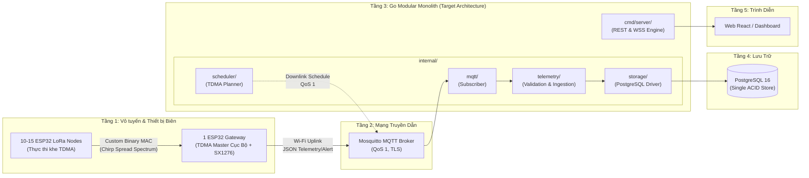
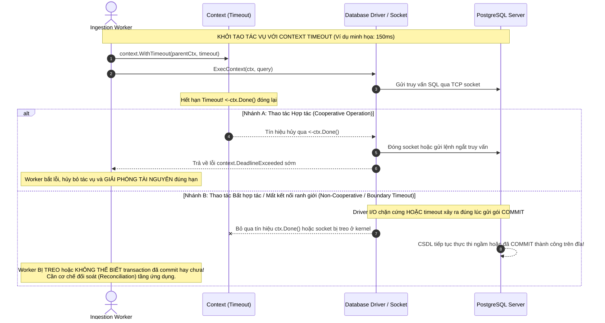
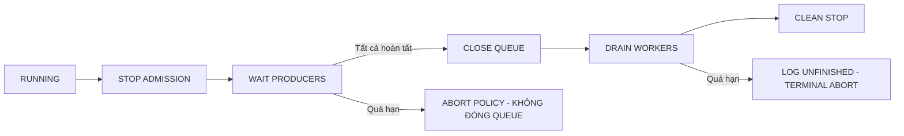
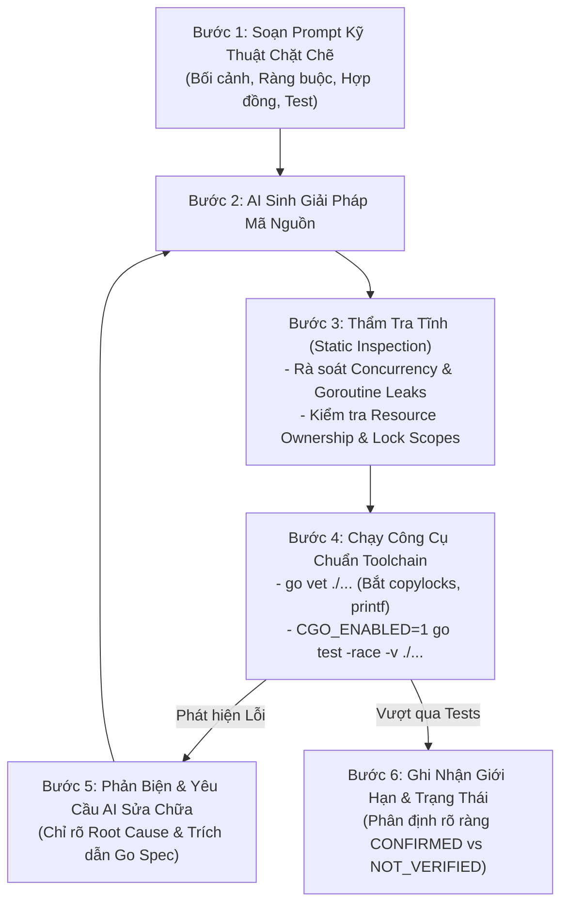
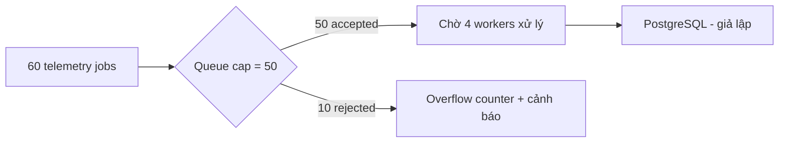
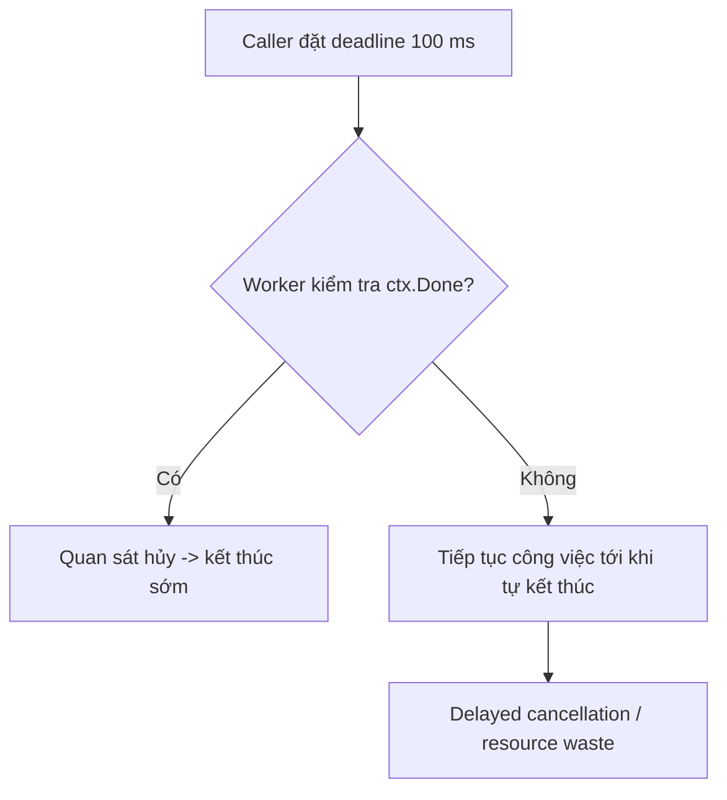

# BM01 — GO BACKEND FUNDAMENTALS & CONCURRENT INGESTION PIPELINE

**Giáo trình nền tảng Go Backend và xử lý đồng thời trong hệ thống IoT**  
**Bối cảnh áp dụng:** LoRa P2P Hybrid TDMA — ESP32/SX1276, MQTT, Go Modular Monolith, PostgreSQL  
**Thời lượng tham khảo:** 8 giờ (khái niệm và kiến trúc, phân tích tình huống, đánh giá thiết kế)

## Mục tiêu học tập

Sau module, người học có thể:

1. **WHAT —** Giải thích các cơ chế Go quan trọng: goroutine, channel, mutex, context, worker pool và graceful shutdown.
2. **WHY —** Nêu được bài toán mà từng cơ chế giải quyết trong Backend IoT.
3. **HOW —** Mô tả luồng xử lý và vòng đời tài nguyên; đọc được các đoạn code ngắn minh họa.
4. **WHEN & LIMITATIONS —** Lựa chọn cơ chế phù hợp, nhận diện data race, deadlock, goroutine leak, quá tải và mất dữ liệu.
5. **APPLICATION —** Phân tích pipeline Gateway → MQTT → Go Backend → PostgreSQL và ranh giới TDMA tại Gateway.
6. **AI REVIEW —** Phát hiện lỗi kỹ thuật trong phương án do AI Coding Agent đề xuất, xác định cần kiểm tra điều gì trước khi triển khai.

**Cách học:** Ưu tiên sơ đồ, phân tích tình huống, dự đoán hành vi và giải thích nguyên nhân. Không yêu cầu gõ lại mã nguồn dài hoặc xây dựng Backend hoàn chỉnh. Các ví dụ về thời gian, dung lượng queue và số workers là mô hình học tập, không phải thông số production đã được đo kiểm.

## Mục lục

- [1. Thuật ngữ nền tảng](#1-thuật-ngữ-nền-tảng)
- [2. Kiến thức cốt lõi](#2-kiến-thức-cốt-lõi)
- [3. Cảnh báo kỹ thuật thường gặp](#3-cảnh-báo-kỹ-thuật-thường-gặp)
- [4. Workshop phân tích cơ chế](#4-workshop-phân-tích-cơ-chế)
- [5. Tự đánh giá kiến thức](#5-tự-đánh-giá-kiến-thức)
- [6. Checklist năng lực](#6-checklist-năng-lực)
- [7. Nguồn học và ranh giới áp dụng](#7-nguồn-học-và-ranh-giới-áp-dụng)

---

# 1. Thuật ngữ nền tảng

| Thuật ngữ / Viết tắt gốc (EN) | English Full Name | Thuật ngữ Tiếng Việt chuẩn hóa | Giải thích bản chất kỹ thuật (VN, rõ nghĩa) |
| :--- | :--- | :--- | :--- |
| **Goroutine** | — | Luồng cực nhẹ Go | Luồng thực thi độc lập do Go Runtime quản lý trong không gian người dùng (User-space), tiêu tốn bộ nhớ khởi tạo rất nhỏ (~2 KB Stack) và tự co giãn. *Khác OS Thread: OS Thread do nhân hệ điều hành điều phối với Stack mặc định lớn hơn đáng kể (kích thước cụ thể phụ thuộc hệ điều hành, kiến trúc và cấu hình hệ thống); chi phí chuyển ngữ cảnh của Goroutine thường thấp hơn do phần lớn được Go Scheduler điều phối trong không gian người dùng, dù vẫn có thể phát sinh system call khi tương tác với tài nguyên hệ thống.* |
| **OS Thread** | Operating System Thread | Luồng hệ điều hành | Đơn vị thực thi cấp kernel của hệ điều hành. Go Runtime ánh xạ $M$ goroutine lên $N$ luồng hệ điều hành thông qua bộ lập lịch M:N Scheduler tích hợp sẵn. |
| **Channel** | — | Kênh truyền thông điệp Go | Đường ống truyền dẫn dữ liệu an toàn kiểu tĩnh (Type-safe) có tính đồng bộ giữa các goroutine, hiện thực hóa triết lý: *"Đừng giao tiếp bằng cách chia sẻ bộ nhớ; hãy chia sẻ bộ nhớ bằng cách giao tiếp"*. |
| **Unbuffered Channel** | — | Kênh không bộ đệm | Kênh có dung lượng bằng 0 (`make(chan T)`). Thao tác gửi (`ch <- x`) sẽ bị chặn (Block) hoàn toàn cho đến khi có một goroutine khác thực hiện thao tác nhận (`<-ch`), tạo điểm bắt tay đồng bộ trực tiếp (Rendezvous point). |
| **Buffered Channel** | — | Kênh có bộ đệm | Kênh có hàng đợi vòng lưu trữ trong bộ nhớ (`make(chan T, capacity)`). Thao tác gửi chỉ bị chặn khi bộ đệm đã đầy; thao tác nhận chỉ bị chặn khi bộ đệm trống rỗng. *Lưu ý Go Spec: Khi kênh có đệm đã đóng, thao tác nhận vẫn tiếp tục lấy ra tuần tự các phần tử còn lại trong đệm với cờ `ok == true` trước khi trả về zero value.* |
| **select Statement** | — | Cấu trúc điều phối đa kênh | Khối lệnh cho phép goroutine chờ đợi đồng thời trên nhiều thao tác gửi/nhận kênh. Nhánh nào sẵn sàng trước sẽ chạy; nếu nhiều nhánh cùng sẵn sàng, Go chọn giả ngẫu nhiên đồng đều (Uniform Pseudo-random). *Lưu ý: select KHÔNG có cơ chế ưu tiên cứng (No deterministic priority).* |
| **Default Case** | — | Nhánh mặc định không chờ | Nhánh `default` trong cấu trúc `select`: Chạy ngay lập tức nếu không có nhánh kênh nào sẵn sàng, giúp thực hiện thao tác thăm dò không khóa luồng (Non-blocking probe/enqueue). |
| **Context** | `context.Context` | Ngữ cảnh thực thi nghiệp vụ | Giao diện chuẩn mang tín hiệu hủy mang tính **hợp tác tự nguyện (Cooperative)**, mốc thời hạn (Deadline), và giá trị phân định phiên làm việc xuyên qua các ranh giới hàm, goroutine và cuộc gọi mạng. |
| **Cancellation** | — | Tín hiệu hủy thực thi mang tính hợp tác | Tín hiệu thông báo dừng công việc qua việc đóng kênh nội bộ (`<-ctx.Done()`). *Bản chất: Cancellation trong Go là hợp tác tự nguyện (Cooperative), KHÔNG THỂ cưỡng bức ngắt luồng (No Preemption/Kill); nếu goroutine con chạy vòng lặp CPU thuần hoặc gọi hàm I/O chặn cứng không lắng nghe `ctx.Done()`, nó sẽ tiếp tục chạy ngầm.* |
| **Deadline** | — | Mốc thời gian giới hạn phát tín hiệu hủy | Thời điểm tuyệt đối trong tương lai (`time.Time`) mà tại đó Context tự động phát tín hiệu hủy qua việc đóng kênh `<-ctx.Done()` (thiết lập qua `context.WithDeadline`). *Lưu ý kỹ thuật: Đến deadline, Context chỉ phát tín hiệu hợp tác, không tự bảo đảm tác vụ con tự dừng nếu tác vụ đó không chủ động kiểm tra `ctx.Done()`.* |
| **Timeout** | — | Khoảng thời gian chờ tối đa | Độ dài thời gian tương đối (`time.Duration`) tính từ hiện tại cho phép tác vụ chạy; quá hạn này Context tự động hủy (`context.WithTimeout`). *Phân biệt: Timeout là thời lượng (ví dụ minh họa: 150 ms); Deadline là mốc thời điểm (ví dụ: 17:00:05.150).* |
| **Data Race** | — | Xung đột truy cập vùng nhớ đồng thời | Trạng thái lỗi kỹ thuật khi có ít nhất hai goroutine cùng truy cập một ô nhớ đồng thời, trong đó có ít nhất một thao tác ghi (Write), và không có cơ chế đồng bộ hóa (Mutex, Channel) kiểm soát. Dẫn đến sai lệch dữ liệu ngầm hoặc sập ứng dụng. |
| **Race Condition** | — | Lỗi chạy đua logic nghiệp vụ | Lỗi thiết kế luồng khiến tính đúng đắn của kết quả phụ thuộc vào thứ tự thực thi ngẫu nhiên giữa các tiến trình/luồng, ngay cả khi mã nguồn hoàn toàn không vi phạm Data Race ở cấp độ bộ nhớ. *Phân biệt: Data Race là lỗi xung đột ô nhớ vật lý; Race Condition là lỗi sai logic trình tự nghiệp vụ cấp cao.* |
| **Data Race Detector** | ThreadSanitizer (TSan) | Bộ phát hiện đua dữ liệu động | Công cụ phân tích động tích hợp trong Go toolchain (cờ `-race`), sử dụng ThreadSanitizer. *Giới hạn quan trọng: Race Detector chỉ phát hiện xung đột trên các nhánh mã THỰC TẾ CHẠY QUA trong lượt test; việc pass `-race` không phải chứng minh toán học về sự vắng mặt của mọi race condition.* |
| **Mutex** | `sync.Mutex` | Khóa loại trừ tương hỗ | Cơ chế khóa cơ sở đảm bảo tại một thời điểm chỉ có duy nhất một goroutine được phép bước vào và thực thi mã trong vùng nguy hiểm (Critical Section) bảo vệ trạng thái chia sẻ. |
| **RWMutex** | `sync.RWMutex` | Khóa đọc/ghi phân tách | Cơ chế khóa phân tách đọc và ghi: Cho phép nhiều goroutine cùng giữ khóa Đọc (`RLock`) đồng thời, nhưng chỉ một goroutine giữ khóa Ghi (`Lock`) độc quyền. *Lưu ý kỹ thuật: RWMutex có thêm chi phí quản lý reader count và cache-line contention, không tự động tối ưu hơn Mutex cho mọi kịch bản đọc nhiều; cần đo kiểm khi có tranh chấp cao.* |
| **Critical Section** | — | Vùng mã nguy hiểm cần bảo vệ | Khối lệnh thao tác trực tiếp trên biến hoặc cấu trúc dữ liệu chia sẻ có khả năng biến đổi trạng thái đồng thời, cần được khóa loại trừ để tránh Data Race. |
| **WaitGroup** | `sync.WaitGroup` | Bộ đếm đồng bộ chờ nhóm luồng | Bộ đếm an toàn luồng dùng để điều phối luồng chính chờ đợi một tập hợp các goroutine hoàn thành qua 3 hàm: `Add(delta)`, `Done()`, và `Wait()`. *Quy tắc Go Spec: Lệnh `Add` với delta dương từ mức 0 bắt buộc phải xảy ra (happens-before) trước lệnh `Wait()`. Phải truyền bằng con trỏ (`*sync.WaitGroup`), không truyền theo giá trị.* |
| **Deadlock** | — | Bế tắc tài nguyên vĩnh viễn | Trạng thái các goroutine bị khóa vĩnh viễn do phụ thuộc vòng tròn lẫn nhau hoặc chờ thao tác trên kênh không bao giờ sẵn sàng. Go Runtime có thể phát hiện và làm sập tiến trình nếu toàn bộ goroutine trong hệ thống đều bị chặn. |
| **Livelock** | — | Tắc nghẽn tích cực / Bế tắc linh động | Trạng thái các goroutine liên tục thay đổi trạng thái và nhường nhịn nhau để giải quyết xung đột nhưng không bên nào thực sự tiến triển được công việc, có thể gây lãng phí đáng kể tài nguyên CPU. *Phân biệt: Deadlock là đứng im ngủ đông; Livelock là liên tục hoạt động vô ích.* |
| **Worker Pool** | — | Nhóm luồng xử lý giới hạn | Mô hình kiến trúc đồng thời duy trì một số lượng cố định $N$ goroutine thợ (Workers) để nhận việc từ một hàng đợi chung, ngăn chặn nguy cơ bùng nổ số lượng goroutine làm cạn kiệt tài nguyên máy chủ. |
| **Bounded Queue** | — | Hàng đợi có giới hạn dung lượng | Hàng đợi trong bộ nhớ (thường dùng buffered channel dung lượng $M$) quy định số lượng tác vụ tối đa được phép xếp hàng, tạo chốt chặn bảo vệ RAM trước các đợt bùng nổ dữ liệu (Burst traffic). |
| **Backpressure** | Flow Control | Cơ chế áp lực ngược điều tiết tải | Kỹ thuật truyền tín hiệu từ bên nhận bị quá tải ngược về phía nguồn phát, yêu cầu làm chậm tốc độ gửi hoặc từ chối bớt bản tin để hệ thống không bị tràn bộ nhớ hoặc tê liệt. |
| **Drop Policy** | — | Chính sách loại bỏ bản tin tràn hàng đợi | Chiến lược xử lý khi hàng đợi bộ nhớ bị đầy: *Drop Newest* (bỏ bản tin mới đến), *Drop Oldest* (xóa bản tin cũ nhất ở đầu hàng đợi để nạp bản tin mới). *Cảnh báo kỹ thuật: Đây là giải pháp chấp nhận mất dữ liệu (Lossy), chỉ phù hợp làm ví dụ giảng dạy về giới hạn bộ nhớ; KHÔNG PHẢI thiết kế an toàn cho tầng MQTT sản xuất đã gửi ACK.* |
| **Resource Ownership** | — | Nguyên lý sở hữu vòng đời tài nguyên | Quy tắc thiết kế: Goroutine khởi tạo tài nguyên hoặc ghi dữ liệu (Producer) là bên duy nhất có quyền đóng tài nguyên (`close(ch)`). Bên nhận (Consumer) không bao giờ được đóng kênh để tránh lỗi gửi vào kênh đã đóng (`panic: send on closed channel`). |
| **Graceful Shutdown** | — | Quy trình dừng ứng dụng an toàn | Trình tự tắt tiến trình có phối hợp: Khóa cổng nạp mới nguyên tử (Stop Admission), chờ Producer dứt điểm (Quiescence), đóng hàng đợi an toàn một lần (`close`), xả cạn hàng đợi (Drain), và dừng Worker trong thời hạn tối đa kèm kế toán chính xác số dở dang (in-flight + queued). |
| **Goroutine Leak** | — | Rò rỉ luồng Goroutine bỏ hoang | Hiện tượng goroutine bị treo vĩnh viễn (do chờ đọc/ghi trên kênh không ai tương tác hoặc thiếu hủy Context), khiến bộ nhớ Stack và các đối tượng liên quan không bao giờ được Garbage Collector thu hồi. *Phân biệt với Delayed Cancellation: Tác vụ bỏ qua Context nhưng tự kết thúc khi hết vòng lặp chỉ gây lãng phí tài nguyên tạm thời (Resource Waste), không phải rò rỉ vĩnh viễn.* |
| **Modular Monolith** | — | Đơn khối mô-đun hóa | Kiến trúc phần mềm đóng gói toàn bộ hệ thống vào một tiến trình nhị phân thực thi duy nhất nhưng phân tách nghiêm ngặt ranh giới các miền nghiệp vụ thành các package nội bộ độc lập. |
| **Table-Driven Tests** | — | Kiểm thử định hướng bảng | Phong cách viết unit test chuẩn mực trong Go: Gom các kịch bản kiểm thử vào một danh sách cấu trúc (Slice of Structs) gồm dữ liệu đầu vào và kết quả kỳ vọng, sau đó lặp qua bảng bằng `t.Run()` để kiểm chứng độc lập. |
| **NodeID** | — | Định danh định tuyến Node mạng LoRa | Theo MQTT telemetry schema dự thảo (`telemetry.schema.json`), NodeID hợp lệ nằm trong khoảng **1–254**. Giá trị 0 và 255 nằm ngoài miền giá trị của trường này. Ý nghĩa các giá trị reserved/broadcast, nếu có, phải đối chiếu với Radio MAC Contract. *Phân biệt với SlotID: Việc MVP triển khai 10–15 thiết bị vật lý không đồng nghĩa NodeID bị giới hạn từ 1–15.* |
| **SlotID** | — | Định danh khe thời gian TDMA | Vị trí khe thời gian cố định trong một Superframe TDMA. Theo hợp đồng schema dự án (`telemetry.schema.json`), `data.slot_id` là số nguyên trong dải **1–15**. |

---

# 2. Kiến thức cốt lõi

### 2.1 — Go Trong Kiến Trúc Backend IoT & Modular Monolith

#### Bản chất (WHAT)
Go (Golang) là ngôn ngữ lập trình biên dịch tĩnh, định kiểu mạnh do Google thiết kế. Trong hệ thống IoT, Go đóng vai trò là tầng **Application Backend & Ingestion Engine**, chịu trách nhiệm tiếp nhận dữ liệu cảm biến, xác thực nghiệp vụ, lưu trữ vào cơ sở dữ liệu và phục vụ giao diện người dùng. Kiến trúc được lựa chọn cho Backend của dự án là **Modular Monolith** — một tiến trình thực thi duy nhất (`binary`) nhưng được phân chia ranh giới miền nghiệp vụ chặt chẽ qua hệ thống package.

#### Vấn đề giải quyết (WHY)
Nếu sử dụng các ngôn ngữ hướng kịch bản (Python/NodeJS) hoặc kiến trúc Microservices phân tán ngay từ giai đoạn đầu:
- Hệ thống 10–15 Node LoRa với chu kỳ 10–15 giây chỉ sinh ra tải $\sim 1 - 2\text{ bản tin/giây}$. Việc dựng nhiều microservices, service mesh, hay phân mảnh CSDL (Redis, InfluxDB) gây phức tạp hóa vận hành, tiêu tốn tài nguyên và tăng độ trễ mạng vô ích.
- Go giải quyết bài toán này nhờ mô hình biên dịch native không cần máy ảo nặng, cơ chế quản lý bộ nhớ hiệu quả và khả năng xử lý đồng thời I/O không chặn thông qua Goroutine.

> [!NOTE]
> **Ranh giới hiện trạng kho mã nguồn (Scaffold Baseline):**  
> Tài liệu nguồn `backend-go/README.md` mô tả Backend ở trạng thái **Scaffold only**, các dịch vụ nghiệp vụ chưa triển khai hoạt động. Toàn bộ cấu trúc package bên trong `internal/{domain, mqtt, scheduler, telemetry, alert, api, storage}` được mô tả trong giáo trình là **kiến trúc mục tiêu (Architecture Target)** của dự án, chưa phải các thành phần đã có benchmark hiệu năng thực tế.

#### Nguyên lý hoạt động & Luồng dữ liệu hệ thống (HOW)



- **Phân tách trách nhiệm kiến trúc sống còn (ADR-0001):**
  - **ESP32 Gateway:** Là TDMA Master cục bộ, thực thi phần cứng thời gian thực (GPTimer, SPI tới SX1276 với độ chính xác micro-giây), chuyển tiếp khung nhị phân LoRa thành bản tin MQTT JSON.
  - **Go Backend:** Đóng vai trò **hoạch định tập trung (Centralized Planner)**. Backend tính toán bảng lịch TDMA tương lai (Schedule Planner) dựa trên toàn bộ mạng lưới, xuất bản lịch xuống Gateway; Backend **không can thiệp điều khiển bật/tắt radio theo từng mili-giây qua mạng**.
- **Cấu trúc thư mục Modular Monolith theo quy tắc Go Toolchain:**
  - `backend-go/cmd/server/main.go`: Điểm nhập cảnh duy nhất (`main()`), khởi tạo dependencies và kích hoạt tiến trình.
  - `backend-go/internal/`: Vùng mã nguồn được Go compiler bảo vệ nghiêm ngặt theo chuẩn `https://pkg.go.dev/cmd/go#hdr-Internal_Directories`. Chỉ có mã nguồn bên trong thư mục cha (`backend-go/`) mới được import các package bên trong `internal/`. Bất kỳ module bên ngoài nào import đều bị compiler từ chối ngay lập tức.
    - `internal/domain/`: Thực thể nghiệp vụ thuần túy (Node, Gateway, Schedule, Telemetry DTO), độc lập hoàn toàn với CSDL và MQTT.
    - `internal/mqtt/`: Quản lý kết nối MQTT Broker, đăng ký topic uplink và phát downlink.
    - `internal/telemetry/`: Bóc tách JSON, xác thực trường dữ liệu và chuyển giao cho pipeline lưu trữ.
    - `internal/scheduler/`: Thuật toán phân bổ khe thời gian TDMA theo phiên bản.
    - `internal/storage/`: Tương tác với PostgreSQL qua câu lệnh SQL chuẩn ACID.

#### Khi nào sử dụng & Khi nào xử lý tuần tự (WHEN)
- **Xử lý tuần tự (Sequential):** Phù hợp cho logic giải mã gói tin đơn lẻ, xác thực tính hợp lệ của DTO (Validation), tính toán thuật toán lịch TDMA, hoặc các tác vụ không phát sinh I/O chờ đợi. Đừng lạm dụng concurrency cho những tác vụ CPU-bound tính bằng micro-giây.
- **Xử lý đồng thời (Concurrent):** Cần thiết khi tiếp nhận luồng bản tin từ nhiều nguồn I/O độc lập: nhận bản tin MQTT, xử lý lưu CSDL đồng thời, phục vụ các kết nối WebSocket trực tuyến và xử lý các tín hiệu ngắt từ hệ điều hành.

#### Giới hạn kỹ thuật (LIMITATIONS)
- Go Modular Monolith không phải là hệ điều hành thời gian thực (RTOS). Go có Garbage Collector (GC), do đó độ trễ thực thi có thể biến thiên từ vài trăm micro-giây đến vài mili-giây (GC pause). Đó là lý do Go **chỉ làm việc ở tầng ứng dụng/hoạch định**, nhường việc thực thi chính xác vô tuyến thời gian thực cho ESP32 chạy FreeRTOS.
- Cấu trúc package trong Go cấm hoàn toàn **Import Cycle (phụ thuộc vòng)**: Package A import B thì B không được phép import A. Thiết kế kiến trúc phải tuân thủ luồng phụ thuộc một chiều (Dependency Inversion / Clean Architecture).

#### Ứng dụng trong dự án LoRa P2P Hybrid TDMA
Trong MVP, Backend Go nhận bản tin JSON từ topic MQTT `iot/v1/gw/{gateway_id}/uplink/telemetry`, bóc tách dữ liệu điện áp, cảm biến, chuyển thành thực thể Domain và lưu trữ bền vững vào bảng `telemetry_records` của PostgreSQL.

#### Kiểm chứng với AI (AI VERIFICATION)
Khi yêu cầu AI Coding Agent cấu trúc một Go Backend Service, lập trình viên cần thẩm tra:
1. AI có tạo cấu trúc thư mục rác (như `src/`, `controllers/`, `models/` kiểu NodeJS) hay tuân thủ chuẩn `cmd/` và `internal/` của Go?
2. AI có vi phạm import cycle giữa các package không?
3. Các struct trong `domain/` có bị phụ thuộc ngược vào thư viện bên ngoài (như GORM, PGX hay MQTT Paho) hay giữ được tính độc lập thuần khiết?

---

### 2.2 — Concurrency Fundamentals: Goroutine, Channel, Mutex & Atomic

#### Bản chất (WHAT)
Go cung cấp mô hình đồng thời tích hợp sẵn ở cấp độ ngôn ngữ dựa trên nền tảng **CSP (Communicating Sequential Processes)** kết hợp với các công cụ đồng bộ hóa bộ nhớ truyền thống. Bốn trụ cột đồng thời cơ sở gồm:
- **Goroutine:** Đơn vị thực thi cực nhẹ do Go Runtime quản lý.
- **Channel:** Đường ống truyền thông điệp an toàn kiểu tĩnh giữa các goroutine.
- **sync.Mutex / sync.RWMutex:** Khóa loại trừ tương hỗ bảo vệ vùng bộ nhớ chia sẻ.
- **sync/atomic:** Các phép toán nguyên tử cấp phần cứng trên từ nhớ đơn lẻ.

#### Vấn đề giải quyết (WHY)
Nếu không có các cơ chế này:
- Việc tạo thread hệ điều hành truyền thống (OS Thread) cho mỗi kết nối sẽ nhanh chóng làm cạn kiệt bộ nhớ.
- Nếu nhiều goroutine cùng đọc và ghi một biến hoặc `map` mà không đồng bộ, hiện tượng **Data Race** sẽ xảy ra, làm sai lệch dữ liệu ngầm hoặc gây sập tiến trình.

#### Nguyên lý hoạt động & Bảng So Sánh Kỹ Thuật (HOW)

##### 1. Bộ lập lịch Go M:N Scheduler
Go Runtime ánh xạ $M$ goroutines lên $N$ OS threads chạy trên $P$ bộ xử lý logic (`GOMAXPROCS`). Khi một goroutine bị chặn bởi I/O mạng hoặc kênh channel, Go Scheduler tự động tráo đổi luồng OS sang chạy goroutine khác ngay tại không gian người dùng. Tuy nhiên, lập trình viên cần lưu ý rằng không phải mọi chuyển ngữ cảnh đều thuần túy không có system call (ví dụ khi goroutine tương tác với runtime scheduler hoặc bị ngắt bởi thread sysmon).

##### 2. Bảng Trạng Thái Toàn Diện Của Channel (Bắt Buộc Ghi Nhớ)
Theo Go Programming Language Specification (`https://go.dev/ref/spec#Channel_types`):

| Trạng thái Kênh | Thao tác Đọc (`val, ok := <-ch`) | Thao tác Ghi (`ch <- x`) | Thao tác Đóng (`close(ch)`) |
| :--- | :--- | :--- | :--- |
| **Kênh mở bình thường (Open)** | Chặn nếu rỗng; nhận dữ liệu (`ok == true`) nếu có | Chặn nếu đầy; ghi dữ liệu nếu còn chỗ | Đóng kênh thành công, phát tín hiệu cho bên nhận |
| **Kênh đã đóng, CÒN DỮ LIỆU ĐỆM** | **Tiếp tục trả tuần tự dữ liệu còn trong đệm (`ok == true`)** | **Sập ứng dụng tức thì (`panic: send on closed channel`)** | **Sập ứng dụng tức thì (`panic: close of closed channel`)** |
| **Kênh đã đóng, ĐÃ HẾT DỮ LIỆU** | **Trả về ngay Zero Value (`ok == false`)** | **Sập ứng dụng tức thì (`panic: send on closed channel`)** | **Sập ứng dụng tức thì (`panic: close of closed channel`)** |
| **Kênh chưa khởi tạo (`nil`)** | **Treo luồng vĩnh viễn (Block forever)** | **Treo luồng vĩnh viễn (Block forever)** | **Sập ứng dụng tức thì (`panic: close of nil channel`)** |

##### 3. Bảng So Sánh Chiến Lược Đồng Bộ Hóa: Channel vs Mutex vs Atomic

| Tiêu chí | Channel (`chan T`) | Mutex (`sync.Mutex / RWMutex`) | Atomic (`sync/atomic`) |
| :--- | :--- | :--- | :--- |
| **Triết lý thiết kế** | Truyền quyền sở hữu dữ liệu (Data Ownership Transfer) | Bảo vệ vùng nhớ chia sẻ (Shared State Protection) | Thao tác cấp lệnh phần cứng (Hardware Primitives) |
| **Phù hợp nhất cho** | Luồng công việc (Pipelines), phân phối việc cho Worker, điều phối sự kiện | Bảo vệ cấu trúc dữ liệu phức hợp trong RAM (`struct`, `map`, `slice`) | Bộ đếm đơn giản (`Int64`), cờ nhị phân bật/tắt (`Bool`), con trỏ đơn |
| **Chi phí / Độ trễ** | Trung bình (cần cấp phát hàng đợi, khóa nội bộ kênh) | Thấp khi ít tranh chấp; `RWMutex` có thêm chi phí quản lý reader | Rất thấp cho biến đơn; nhưng không phải lúc nào cũng nhanh hơn khi tranh chấp cache-line cao |
| **Xử lý cấu trúc phức hợp (`map`)** | Cần một worker duy nhất sở hữu map và đọc qua chan | **Rất tốt** (`Mutex` hoặc `RWMutex` đo kiểm theo tải) | **KHÔNG THỂ DÙNG** (Atomic chỉ thao tác từ nhớ đơn lẻ) |
| **Nguy cơ lỗi thường gặp** | Rò rỉ goroutine, gửi vào kênh đóng gây panic | Quên Unlock, Deadlock, sao chép Mutex theo giá trị | Lỗi logic nghiệp vụ phức tạp (Race Condition) do thiếu khóa toàn vẹn |

##### 4. `select` và giới hạn của cơ chế ưu tiên

Khi nhiều nhánh giao tiếp qua channel cùng sẵn sàng, `select` không bảo đảm ưu tiên tuyệt đối cho một nhánh. Chẳng hạn, hệ thống có hai luồng **Alert** và **Telemetry**; cách kiểm tra Alert trước rồi mới chờ cả hai luồng chỉ tạo *best-effort priority*. Alert xuất hiện đúng lúc chuyển giữa hai lần kiểm tra vẫn có thể được xử lý sau Telemetry.

**Ứng dụng:** Nếu yêu cầu khẩn cấp có thời hạn cứng, cần đánh giá thêm cơ chế ưu tiên ở tầng kiến trúc và tại Gateway/firmware; không xem Go `select` là bộ lập lịch thời gian thực.

#### Khi nào sử dụng (WHEN)
- Dùng **Channel** khi cần truyền luồng công việc từ Producer sang Consumer, điều phối tín hiệu hoàn thành (`done chan struct{}`), hoặc xây dựng Worker Pool.
- Dùng **Mutex / RWMutex** khi cần duy trì và cập nhật trạng thái nội bộ trong RAM (như danh sách node đang trực tuyến lưu trong `map`). Lưu ý chọn giữa `Mutex` và `RWMutex` dựa trên đo kiểm thực tế, không mặc định `RWMutex` luôn nhanh hơn.
- Dùng **Atomic** khi chỉ cần tăng giảm các biến đếm số liệu đo lường độc lập (`processedCount.Add(1)`).

#### Giới hạn kỹ thuật (LIMITATIONS)
- **Data Race vs Race Condition:** Công cụ `-race` chỉ phát hiện **Data Race** (xung đột đọc/ghi cùng ô nhớ vật lý). Nó không phát hiện được **Race Condition** (sai sót thứ tự logic nghiệp vụ). Một chương trình có thể hoàn toàn sạch Data Race nhưng vẫn trả kết quả sai logic.
- Khóa `sync.Mutex` **không hỗ trợ Reentrant (khóa đệ quy)**: Một goroutine đang giữ Mutex mà cố tình gọi `Lock()` lại trên chính Mutex đó sẽ bị Deadlock vĩnh viễn.

#### Ứng dụng trong dự án LoRa P2P Hybrid TDMA
Bộ đệm trạng thái Node trong RAM (`map[uint8]*NodeStatus`) được bảo vệ bằng `sync.RWMutex`: Cho phép các request REST API đọc đồng thời qua `RLock()`, và dùng `Lock()` độc quyền khi có bản tin telemetry mới cập nhật trạng thái Node.

#### Kiểm chứng với AI (AI VERIFICATION)
Khi AI sinh mã liên quan đến Concurrency:
1. Yêu cầu AI giải trình: Dữ liệu chia sẻ được bảo vệ bằng cơ chế nào?
2. Kiểm tra xem AI có dùng `sync/atomic` để bảo vệ một `map` hay không (atomic không bảo vệ được map).
3. Kiểm tra xem các struct chứa `sync.Mutex` có bị truyền theo giá trị (Value Receiver) làm nhân bản khóa hay không bằng công cụ `go vet`.

---

### 2.3 — Context & Resource Lifecycle Management

#### Bản chất (WHAT)
`context.Context` là chuẩn mực của Go để truyền biên thời hạn (Deadlines), tín hiệu hủy (Cancellation signals) và dữ liệu mang tính phạm vi yêu cầu (Request-scoped values) xuyên qua các ranh giới hàm, goroutines và cuộc gọi mạng.

#### Vấn đề giải quyết (WHY)
Nếu không có Context:
- Khi một yêu cầu HTTP bị client ngắt kết nối (Client disconnect) hoặc mạng Wi-Fi bị đứt, Backend vẫn tiếp tục thực hiện các truy vấn cơ sở dữ liệu nặng nề, gây lãng phí tài nguyên CPU và RAM.
- Goroutine con bị bỏ rơi (Orphaned goroutines) sẽ tiếp tục chạy ngầm trong bộ nhớ, dẫn đến hiện tượng lãng phí tài nguyên (Resource Waste) hoặc rò rỉ luồng vĩnh viễn (Goroutine Leak).

#### Nguyên lý hoạt động & Sơ đồ Vòng đời (HOW)

##### 1. Bản chất hợp tác tự nguyện (Cooperative Cancellation)
Đây là nguyên tắc thiết kế quan trọng nhất: **Context trong Go KHÔNG BAO GIỜ cưỡng bức dừng luồng (No Thread Preemption/Kill)**.
- Khi gọi hàm `cancel()`, Go Runtime chỉ đơn giản là đóng một kênh nội bộ: `<-ctx.Done()`.
- Goroutine con **bắt buộc phải chủ động kiểm tra** kênh này qua `select { case <-ctx.Done(): return }`. Nếu hàm con đang chạy một vòng lặp tính toán CPU nặng hoặc gọi một thư viện C/I/O chặn cứng mà không kiểm tra `ctx.Done()`, nó sẽ tiếp tục chạy bất chấp context đã hết hạn!

##### 2. Sequence Diagram: Hai Nhánh Xử Lý Khi Context Timeout Thao Tác CSDL
Sơ đồ sau minh họa rõ hai kịch bản: Khi Database Driver hợp tác hủy và khi Database Driver bất hợp tác hoặc timeout xảy ra tại ranh giới commit:



> [!IMPORTANT]
> **Lưu ý kỹ thuật quan trọng về Timeout & Ranh giới Transaction:**
> 1. Thông số timeout (như 150 ms) trong giáo trình chỉ là **thông số ví dụ minh họa sư phạm**, không phải SLA hay cấu hình production đã được phê duyệt.
> 2. Context timeout tại tầng client **KHÔNG ĐỒNG NGHĨA với việc transaction chưa commit trên Database Server**. Nếu timeout xảy ra ngay tại ranh giới mạng khi PostgreSQL đang xử lý lệnh `COMMIT`, transaction có thể đã thành công trên đĩa dù client nhận lỗi `context.DeadlineExceeded`. Hệ thống thực tế bắt buộc phải có cơ chế đối soát (Reconciliation) và Idempotency key.

##### 3. Phân Biệt Delayed Cancellation vs Permanent Goroutine Leak vs Resource Waste
- **Delayed Cancellation:** Tác vụ bỏ qua Context timeout trong khi đang chạy, nhưng cuối cùng vẫn tự hoàn thành và thoát khi vòng lặp/hàm kết thúc.
- **Permanent Goroutine Leak:** Goroutine bị chặn vô hạn (ví dụ trên unbuffered channel không ai đọc hoặc khóa mutex vĩnh viễn) và không bao giờ có đường thoát, khiến bộ nhớ Stack bị rò rỉ vĩnh viễn.
- **Resource Waste:** Trong thời gian delayed cancellation, tác vụ tiếp tục tiêu tốn CPU và RAM dù kết quả trả về không còn được caller sử dụng.

#### Khi nào sử dụng (WHEN)
- Luôn truyền `ctx context.Context` làm tham số đầu tiên cho mọi hàm thực hiện I/O: gọi CSDL, gọi mạng, đọc ghi file, hoặc các hàm xử lý công việc tốn thời gian.
- Dùng `context.WithTimeout` hoặc `context.WithDeadline` cho mọi truy vấn bên ngoài để bảo vệ hệ thống khỏi sự cố treo kết nối vô hạn.

#### Giới hạn kỹ thuật (LIMITATIONS)
- Không dùng `context.Value` để truyền các tham số nghiệp vụ bắt buộc. `context.Value` chỉ dành cho dữ liệu phạm vi vòng đời yêu cầu như TraceID, RequestID hoặc Authentication Token.
- Hủy Context không đồng nghĩa với việc giải phóng bộ nhớ ngay lập tức; các goroutine phải hoàn tất việc thoát hàm để Garbage Collector thu hồi Stack.

#### Ứng dụng trong dự án LoRa P2P Hybrid TDMA
Trong pipeline tiếp nhận bản tin của dự án, mỗi gói tin telemetry được gán một Context timeout minh họa. Nếu kết nối PostgreSQL driver hợp tác quan sát context, tác vụ ghi sẽ tự động hủy bỏ sớm, giải phóng worker để tiếp tục nhận bản tin tiếp theo từ Gateway.

#### Kiểm chứng với AI (AI VERIFICATION)
Khi AI sinh mã sử dụng Context:
1. Kiểm tra xem AI có gọi `defer cancel()` ngay sau khi khởi tạo context hay không (quên gọi sẽ gây rò rỉ bộ định thời runtime timer).
2. Kiểm tra xem hàm con có thực sự kiểm tra `<-ctx.Done()` hay chỉ nhận tham số context "cho có" mà bên trong lại gọi I/O chặn cứng?
3. Hỏi AI: "Nếu database query bị treo vĩnh viễn ở tầng socket kernel, đoạn mã này có giải phóng goroutine đúng hạn không?" — AI chuẩn mực phải chỉ ra giới hạn của cooperative cancellation và sự cần thiết của socket-level read/write deadlines.

---

### 2.4 — Worker Pool, Bounded Queue & Backpressure Strategies

#### Bản chất (WHAT)
Worker Pool là mô hình kiến trúc đồng thời giới hạn số lượng goroutine thực thi ở một mức xác định $N$ (Workers), kết hợp với một hàng đợi có giới hạn dung lượng $M$ (Bounded Work Queue). Backpressure (Áp lực ngược) là cơ chế điều tiết luồng dữ liệu khi tốc độ đến của bản tin vượt quá khả năng xử lý của nhóm Worker.

#### Vấn đề giải quyết (WHY)
Nếu không có Bounded Worker Pool:
- Khi mạng phục hồi sau sự cố, Gateway ESP32 có thể xả hàng loạt bản tin ngoại tuyến tích lũy. Nếu Backend tạo goroutine không giới hạn (`go handle(msg)` cho từng bản tin), hàng nghìn goroutine sẽ đồng loạt tranh chấp CPU, làm cạn kiệt RAM và kích hoạt cơ chế Linux OOM Killer làm sập tiến trình Backend.
- Ngược lại, nếu hàng đợi trong RAM không có giới hạn (Unbounded Queue), hàng đợi sẽ phình to vô hạn cho đến khi cạn kiệt bộ nhớ.

#### Nguyên lý hoạt động, Sự Đánh Đổi & Chính Sách Khi Hàng Đợi Đầy (HOW)

##### 1. Sự đánh đổi kỹ thuật (Trade-offs): Throughput vs Latency vs Memory

```text
[Incoming Rate: λ] ---> [ Bounded Queue: Cap M ] ---> [ N Workers ] ---> [ Storage / DB ]
```
- **Số lượng Workers ($N$):** Không có công thức phổ quát nào (như $N \approx 2 \times \text{CPU cores}$) bảo đảm tối ưu cho mọi hệ thống. Số worker thực tế phải được lựa chọn dựa trên tốc độ đến ($\lambda$), thời gian xử lý ($\mu$), kích thước pool kết nối cơ sở dữ liệu, giới hạn RAM, và yêu cầu độ trễ.
- **Dung lượng Queue ($M$):** Hàng đợi lớn hơn chỉ giúp hấp thụ các đợt bùng nổ tải ngắn hạn (Bursts) trong giới hạn dung lượng. **Queue không giải quyết được tình trạng quá tải kéo dài** khi tốc độ bản tin đến $\lambda$ (jobs/s) liên tục vượt **tổng năng lực xử lý ổn định của toàn bộ worker pool** $\mu_{\mathrm{pool}}$ (jobs/s), tức $\lambda > \mu_{\mathrm{pool}}$. Nếu $\mu$ là thông lượng của một worker, năng lực lý tưởng có thể xấp xỉ $N\mu$ nhưng thực tế còn bị giới hạn bởi PostgreSQL connection pool, I/O, contention và các tầng downstream. Hàng đợi càng lớn thì độ trễ chờ đợi (Queueing Latency) càng cao và rủi ro mất dữ liệu khi mất điện càng lớn.

| Yếu tố Kiến trúc | Cấu hình Thấp / Nhỏ | Cấu hình Cao / Lớn | Hướng Tối Ưu Hóa Kỹ Thuật |
| :--- | :--- | :--- | :--- |
| **Số Worker ($N$)** | Tiết kiệm RAM, giảm tranh chấp DB connection | Tăng thông lượng song song, nhưng tăng context switch và tranh chấp lock DB | Cân bằng theo pool kết nối PostgreSQL và năng lực CPU qua đo kiểm thực nghiệm |
| **Dung lượng Queue ($M$)** | Phản ứng nhanh, backpressure kích hoạt sớm, RAM an toàn | Hấp thụ burst tốt hơn, nhưng tăng độ trễ và mất nhiều dữ liệu nếu crash RAM | Cấu hình dựa trên dung lượng burst lớn nhất có thể chấp nhận được |

> [!NOTE]
> Cấu hình $N=4$ workers và queue capacity $M=50$ trong BM01 là **các tham số ví dụ phục vụ bài học**, không phải cấu hình sản xuất đã phê duyệt. Cấu hình sản xuất bắt buộc phải được xác định qua benchmark và đo kiểm thực tế trên hệ thống. Superframe 10 giây trong tài liệu là profile nghiên cứu P-10S-15, không phải thông số timing đã được đo kiểm.

##### 2. Các Lựa Chọn Thiết Kế Khi Hàng Đợi Bị Đầy (Queue Full Options)

| Chính sách xử lý | Cơ chế thực hiện | Hệ quả đối với Hệ thống | Khi nào nên dùng? |
| :--- | :--- | :--- | :--- |
| **Reject / Fail-fast** | Trả về lỗi bận ngay (`503 Service Unavailable` hoặc NACK) | Nguồn phát biết ngay hệ thống đang nghẽn để thử lại sau | Phù hợp với API đồng bộ (REST/gRPC) |
| **Block / Wait** | Chặn luồng gửi (`ch <- job`) đến khi có chỗ trống | Tự nhiên tạo áp lực ngược (Backpressure) làm chậm nguồn phát | Phù hợp khi luồng nạp và luồng xử lý cùng một tiến trình |
| **Drop Newest (Lossy)** | Bỏ qua bản tin mới đến, ghi nhận `overflowCount++` | Giữ lại dữ liệu cũ, chấp nhận mất mát dữ liệu mới | Dùng trong bài giảng học tập hoặc dữ liệu cảm biến streaming không quan trọng |
| **Drop Oldest (Lossy)** | Đọc bỏ bản tin cũ nhất ở đầu hàng đợi, nạp bản tin mới vào | Ưu tiên dữ liệu thời gian thực mới nhất, bỏ dữ liệu cũ | Phù hợp với hiển thị trực tiếp (Live Dashboard) |

##### 3. Phân Biệt Sống Còn: Lossy In-Memory Queue vs Durable Ingestion Pipeline
- **Hàng đợi bộ nhớ trong BM01:** Là **mô hình sư phạm về giới hạn tài nguyên RAM**. Thao tác drop bản tin khi queue đầy (`select { default: drop }`) là thiết kế chấp nhận mất mát dữ liệu (Lossy).
- **Ranh giới với MQTT bền vững (Durable Production):**
  > [!CRITICAL]
  > **RANH GIỚI GIỮA XÁC NHẬN MQTT HOP VÀ TÍNH BỀN VỮNG CƠ SỞ DỮ LIỆU:**  
  > Giao thức MQTT QoS 1 `PUBACK` chỉ là xác nhận tầng mạng rằng broker đã bàn giao bản tin tới client trên hop kết nối hiện tại; **`PUBACK` hoàn toàn không bảo đảm PostgreSQL đã COMMIT**.  
  > Khi Backend Go gửi `PUBACK` cho Mosquitto Broker ngay khi vừa nhận bản tin vào RAM, broker coi như hop truyền dẫn đó đã hoàn thành và sẽ **không phát lại bản tin trên cùng hop này nữa**. Nếu sau đó Go Backend drop bản tin vì hàng đợi đầy hoặc tiến trình bị crash trước khi ghi CSDL, bản tin đó sẽ bị mất trên luồng tiếp nhận MQTT hiện tại (và không thể khôi phục nếu không có cơ chế lưu trữ ngoại tuyến / replay độc lập từ phía Gateway hoặc tầng ứng dụng).  
  > Việc hoãn xác nhận MQTT ACK thủ công sau khi PostgreSQL commit thành công hiện đang là trạng thái **`NOT_VERIFIED`** trong BM01 và được bàn giao cho Module BM03 khảo sát trên thư viện client cụ thể.

#### Khi nào sử dụng (WHEN)
- Áp dụng Bounded Worker Pool ở mọi điểm tiếp nhận dữ liệu không đồng bộ trong Backend: luồng xử lý telemetry từ MQTT, luồng gửi thông báo cảnh báo khẩn cấp, các tác vụ xử lý nền.

#### Giới hạn kỹ thuật (LIMITATIONS)
- Bounded Worker Pool trong Go **chỉ bảo vệ tài nguyên tính toán cục bộ của tiến trình**. Nó hoàn toàn không cung cấp tính năng bền vững dữ liệu (Durability). Dữ liệu nằm trong channel sẽ mất sạch nếu tiến trình bị tắt đột ngột (SIGKILL, mất điện).

#### Ứng dụng trong dự án LoRa P2P Hybrid TDMA
Hệ thống sử dụng nhóm workers lắng nghe một buffered channel để tiếp nhận các gói tin telemetry từ Gateway ESP32, hấp thụ tải dao động trước khi ghi vào PostgreSQL.

#### Kiểm chứng với AI (AI VERIFICATION)
Khi yêu cầu AI xây dựng Worker Pool:
1. Kiểm tra giới hạn số job được chờ và xử lý đồng thời: buffered channel có `cap(ch)` hữu hạn, còn `cap(ch) == 0` là **unbuffered channel**, không phải unbounded queue. Nếu AI tạo custom queue hoặc sinh goroutine theo từng job, cơ chế giới hạn tổng tải nằm ở đâu?
2. Kiểm tra xem AI xử lý trường hợp hàng đợi đầy như thế nào: Chặn luồng, drop lặng lẽ hay có trả về mã lỗi và đo lường số đếm tràn?
3. Hỏi AI: "Nếu tiến trình bị crash khi còn 30 bản tin trong queue, dữ liệu có được đảm bảo không?" — AI đạt chuẩn phải trả lời rõ ràng là dữ liệu trong RAM sẽ mất và cần cơ chế bền vững ở tầng broker/DB.

---

### 2.5 — Graceful Shutdown & Failure Recovery Architecture

#### Bản chất (WHAT)
Graceful Shutdown (Dừng ứng dụng an toàn) là quy trình điều phối có kiểm soát nhằm tắt tiến trình Backend khi nhận tín hiệu từ hệ điều hành (`SIGINT`, `SIGTERM`), đảm bảo không làm gián đoạn các yêu cầu đang thực thi dở dang, đóng tài nguyên trật tự và giảm thiểu tối đa nguy cơ mất mát dữ liệu.

#### Vấn đề giải quyết (WHY)
Nếu không có Graceful Shutdown và tiến trình bị dừng đột ngột:
- Các giao dịch cơ sở dữ liệu đang ghi dở dang bị ngắt quãng, có thể để lại dữ liệu rác hoặc khóa bảng.
- Các bản tin cảm biến đang nằm trong bộ nhớ hàng đợi bị vứt bỏ lập tức.
- Nếu đóng kênh không đúng thứ tự, các producer đang gửi dữ liệu sẽ gặp lỗi nghiêm trọng **`panic: send on closed channel`** làm crash ứng dụng trước khi kịp ghi nhận log.

#### Trạng Thái Vòng Đời & Quy Trình 5 Bước Phối Hợp Tường Minh (HOW)

##### 1. Chuỗi trạng thái của Graceful Shutdown



Đây là trình tự an toàn ở cấp **mô hình thiết kế**: dừng tiếp nhận mới, chờ producer hiện hành, đóng queue chỉ khi không còn bên gửi, để workers xả cạn, sau đó giải phóng tài nguyên. Timeout không tự giết goroutine đang bị chặn.

##### 2. Các Giả Định Vòng Đời & Giới Hạn Sống Còn Của Graceful Shutdown

1. **Giả định thứ tự khởi tạo (Worker Registration Lifecycle):**
   Toàn bộ nhóm workers phải được khởi tạo và đăng ký vào `workerWG.Add(...)` **trước khi** hệ thống bắt đầu nạp tin và trước khi quy trình shutdown được kích hoạt. Không khởi tạo worker mới trong lúc đang shutdown.
2. **Nguyên tắc Happens-Before của `sync.WaitGroup`:**
   Lệnh `producerWG.Add(1)` khi counter bằng 0 bắt buộc phải xảy ra (happens-before) trước cuộc gọi `producerWG.Wait()`. Việc kiểm tra cờ admission và gọi `Add(1)` phải được đồng bộ nguyên tử.
3. **Bản chất của Timeout trong Shutdown:**
   Timeout chỉ là một chính sách giới hạn thời gian chờ đợi (Waiting Policy). **Hết hạn timeout KHÔNG THỂ cưỡng bức ngắt luồng goroutine đang bị nghẽn I/O**.
4. **Xử lý khi Producer Quiescence bị Timeout (Aborted Shutdown):**
   Nếu bước chờ producer bị quá hạn (do producer bị treo mạng), **TUYỆT ĐỐI KHÔNG ĐƯỢC GỌI `close(queue)`**! Nếu đóng queue lúc này, producer khi thoát nghẽn sẽ gửi vào queue đã đóng và gây sập ứng dụng với fatal panic `send on closed channel`. Hệ thống phải giữ queue mở và kích hoạt chính sách Terminal Abort.
5. **Kế toán số dở dang chỉ là Ảnh Chụp Thời Điểm (Point-in-Time Snapshot):**
   Số lượng dở dang $\text{UnfinishedCount} = \text{Accepted} - \text{Processed} = \text{InFlight} + \text{Queued}$ ghi nhận tại thời điểm timeout chỉ là một **ảnh chụp thời điểm (snapshot)**. Nếu worker tiếp tục chạy ngầm trong background sau timeout, giá trị thực tế có thể thay đổi.
6. **Graceful Shutdown không bảo đảm tính bền vững (Durability) của RAM:**
   Nếu tiến trình bị hệ điều hành tiêu diệt bằng `SIGKILL` (`kill -9`) hoặc máy chủ mất nguồn điện đột ngột, toàn bộ dữ liệu đang nằm trong RAM sẽ biến mất. Graceful Shutdown chỉ là nỗ lực phần mềm nhằm xả dữ liệu trước khi thoát có kiểm soát.

#### Khi nào sử dụng (WHEN)
- Bắt buộc phải hiện thực Graceful Shutdown ở mọi dịch vụ Backend production có tiếp nhận I/O, lắng nghe các tín hiệu hệ điều hành `os.Interrupt`, `syscall.SIGTERM`.

#### Giới hạn kỹ thuật (LIMITATIONS)
- Không có cam kết thời gian shutdown cố định nếu chưa có kết quả đo kiểm thực tế với các tải I/O cơ sở dữ liệu cụ thể.

#### Ứng dụng trong dự án LoRa P2P Hybrid TDMA
Khi quản trị viên cập nhật Backend Go qua container (`docker stop`), tiến trình nhận tín hiệu `SIGTERM`, thực thi quy trình điều phối dừng: Ngừng nhận bản tin mới từ MQTT, xả cạn các gói telemetry đang nằm trong queue vào PostgreSQL, và ngắt kết nối an toàn.

#### Kiểm chứng với AI (AI VERIFICATION)
Khi AI sinh mã Graceful Shutdown:
1. Kiểm tra thứ tự: AI có gọi `close(queue)` TRƯỚC KHI dừng Producer không? (Lỗi `panic: send on closed channel`).
2. Kiểm tra cạm bẫy deadlock: Mã có giữ khóa `RLock` hay `Mutex` xuyên qua thao tác gửi channel có thể block hay không?
3. Kiểm tra tính Idempotent: Nếu hàm `Shutdown()` bị gọi lặp lại hoặc đồng thời, mã có xử lý an toàn không?

---

### 2.6 — AI-Assisted Backend Engineering & Verification Discipline

#### Bản chất (WHAT)
Kỹ thuật phát triển phần mềm với sự hỗ trợ của AI (AI-Assisted Software Engineering) trong Go là phương pháp luận coi AI Coding Agent (Cursor, Claude Code, Copilot) là **Junior Implementer (người thực thi cấp dưới)** và kỹ sư con người là **Senior Architect & Technical Reviewer (kiến trúc sư trưởng và người thẩm định chất lượng)**.

#### Vấn đề giải quyết (WHY)
Nếu tin tưởng mù quáng vào mã do AI sinh ra:
- AI thường xuyên tạo ra mã nguồn "trông có vẻ chạy được" (Syntactically correct) nhưng vi phạm các nguyên tắc đồng thời nghiêm trọng: rò rỉ goroutine, data race trên map, giữ mutex qua thao tác blocking send, dùng value receiver sao chép mutex, hoặc drop âm thầm bản tin quan trọng.
- Kỹ sư không hiểu bản chất sẽ trở thành "thợ copy-paste", hoàn toàn bất lực khi hệ thống gặp sự cố treo luồng hoặc sập OOM trên production.

#### Quy Trình 6 Bước Giao Nhiệm Vụ & Phản Biện Mã AI (HOW)



1. **Bước 1 — Soạn thảo Prompt kỹ thuật chuẩn:**
   - Cung cấp rõ ràng: Phiên bản Go (`go 1.23`), kiểu dữ liệu hợp đồng (`telemetry.schema.json`), ràng buộc tài nguyên.
   - Yêu cầu AI: Liệt kê rõ các giả định kỹ thuật (Assumptions), các kịch bản thất bại (Failure cases), và viết kèm bài kiểm thử đơn vị Table-Driven.
2. **Bước 2 — Phân tích giải pháp do AI sinh ra:**
   - Đọc hiểu luồng dữ liệu thay vì vội vàng chạy thử.
3. **Bước 3 — Thẩm tra tĩnh các cạm bẫy đồng thời:**
   - Kênh có đệm hay không đệm? Có nguy cơ treo gửi không?
   - Có thao tác gửi channel bị chặn nào nằm BÊN TRONG phạm vi giữ Mutex/RWMutex không?
   - Context có được hủy bằng `defer cancel()` không?
   - Mutex có bị sao chép theo giá trị không?
4. **Bước 4 — Chạy công cụ kiểm chứng của Go Toolchain:**
   - Chạy `go vet ./...`: Bắt lỗi sao chép khóa (`copylocks`), lỗi biến vòng lặp, lỗi định dạng chuỗi.
   - Chạy `CGO_ENABLED=1 go test -race -count=1 ./...`: Bắt xung đột truy cập ô nhớ đồng thời.
5. **Bước 5 — Phản biện và yêu cầu sửa chữa:**
   - Không chấp nhận câu trả lời chung chung; buộc AI trích dẫn cơ sở đặc tả kỹ thuật (Go Spec / Official Blog).
6. **Bước 6 — Đánh dấu phân loại trạng thái minh bạch:**
   - Phân biệt trạng thái đã được xác minh, kết quả do AI/worker tự báo và nội dung `NOT_VERIFIED`; không tự nhận kết quả kiểm thử chưa thực hiện.

#### Khi nào sử dụng (WHEN)
- Áp dụng xuyên suốt toàn bộ quá trình phát triển dự án: từ việc tạo khung mã (Scaffolding), viết hàm thuật toán, tạo các ca kiểm thử biên (Edge cases), đến việc chẩn đoán log lỗi.

#### Giới hạn kỹ thuật (LIMITATIONS)
- AI không thể thay thế việc đo kiểm thực tế trên môi trường phần cứng thật (Hardware-in-the-Loop - HIL).
- Kết quả kiểm thử cục bộ đều PASS không chứng minh hệ thống không có lỗi ở quy mô tích hợp phân tán.

#### Ứng dụng trong dự án LoRa P2P Hybrid TDMA
Học viên sử dụng AI Coding Agent để sinh mã kiểm thử hồi quy độc lập cho bộ điều phối Graceful Shutdown, sau đó chủ động viết thêm các ca kiểm thử đối kháng (Adversarial Tests) để kích hoạt tình huống tranh chấp giữa `Enqueue` và `Shutdown`, ép AI phải thừa nhận và khắc phục các race window vi phạm hợp đồng `sync.WaitGroup`.

---

---

# 3. Cảnh báo kỹ thuật thường gặp

Các lỗi dưới đây đặc biệt quan trọng khi review mã Go do AI sinh ra. Mục tiêu là nhận diện **nguyên nhân – hậu quả – giới hạn cách khắc phục**, không phải ghi nhớ cú pháp.

| Vấn đề | Cơ chế gây lỗi | Hệ quả | Nguyên tắc xử lý |
|---|---|---|---|
| **Goroutine leak do unbuffered channel** | Caller hết timeout và không còn nhận; worker tiếp tục gửi vào channel không có receiver. | Worker kẹt vĩnh viễn ở thao tác gửi. | Dùng channel kết quả có đệm 1 cho trường hợp một kết quả; đồng thời bảo đảm tác vụ nền có thể hủy hợp tác. |
| **Deadlock giữa lock và channel send** | Producer giữ `RLock()` khi gửi vào queue đã đầy; shutdown cần `Lock()` để dừng nhận. | Producer chờ queue, shutdown chờ khóa, cả hai không tiến triển. | Đồng bộ bước đăng ký producer dưới lock ngắn; nhả lock trước thao tác gửi có thể block; gửi có xét `ctx.Done()`. |
| **Data race trên `map`** | Nhiều goroutine ghi/đọc `map` đồng thời không đồng bộ. | Dữ liệu không nhất quán hoặc fatal runtime error. | Dùng `Mutex`/`RWMutex`, hoặc giao một goroutine sở hữu map và nhận sự kiện qua channel. |
| **`cancel()` không được gọi đúng lúc** | `defer cancel()` tích lũy bên trong vòng lặp dài; timer/context sống lâu hơn công việc. | Tiêu tốn tài nguyên không cần thiết. | Tạo scope xử lý từng message, gọi `cancel()` khi tác vụ kết thúc. |
| **Queue đầy nhưng drop sau MQTT ACK** | Bản tin đã được xác nhận ở hop MQTT nhưng bị bỏ trong RAM trước DB commit. | Có thể mất dữ liệu telemetry vĩnh viễn nếu không có replay độc lập. | Thiết kế backpressure/durability, chỉ ra ranh giới ACK và DB commit, không âm thầm bỏ bản tin. |
| **Sao chép `sync.Mutex` theo giá trị** | Value receiver sao chép struct chứa lock và trạng thái. | Tăng bộ đếm trên bản sao; kết quả sai mà `-race` có thể không phát hiện. | Dùng pointer receiver, kiểm tra `go vet`/`copylocks`. |

### Ba ví dụ ngắn cần đọc hiểu

**1. Goroutine có thể bị kẹt sau timeout:**

```go
ch := make(chan Result) // Unbuffered
// Worker: ch <- result
// Caller đã thoát vì ctx timeout -> không còn receiver.
```

Một channel có đệm dung lượng 1 có thể tránh *blocked send* đối với một kết quả; **không thể cưỡng bức dừng** một `heavyOperation` không hợp tác với Context.

**2. Ghi `map` từ nhiều goroutine không đồng bộ:**

```go
statusMap := map[uint8]string{}
// Nhiều goroutine cùng thực hiện: statusMap[id] = status
```

`sync/atomic` không tự bảo vệ toàn bộ cấu trúc map. Cần đồng bộ quyền truy cập hoặc chuyển kết quả tới goroutine sở hữu map.

**3. Mutex với value receiver:**

```go
type Metric struct { mu sync.Mutex; total int }
func (m Metric) Add() { m.mu.Lock(); defer m.mu.Unlock(); m.total++ }
```

Ở ví dụ này, `m` là bản sao; thay bằng receiver `*Metric`. `go vet` có thể phát hiện `copylocks`; `go test -race` không bảo đảm phát hiện mọi lỗi logic.

### Ba ranh giới cần nhớ

- **Data Race ≠ Race Condition:** `-race` phát hiện truy cập bộ nhớ thiếu đồng bộ trên các đường chạy được kích hoạt; không chứng minh logic nghiệp vụ đúng.
- **Context timeout ≠ transaction rollback:** Khi timeout đúng lúc DB đang `COMMIT`, client có thể không biết transaction đã thành công hay chưa; cần đối soát và idempotency ở tầng ứng dụng.
- **MQTT PUBACK ≠ PostgreSQL COMMIT:** MQTT đảm nhận xác nhận giao nhận theo hop/protocol; tính bền vững của pipeline phải được thiết kế riêng. Khả năng điều khiển thời điểm PUBACK cần kiểm chứng theo thư viện client thực tế.

---

# 4. Workshop phân tích cơ chế

Mỗi workshop thực hiện theo quy trình: **Dự đoán → Quan sát sơ đồ/đầu ra giả lập → Giải thích → Xác định giới hạn → Đưa ra quyết định kỹ thuật**. Không cần dựng Go workspace hay thực thi unit tests.

## 4.1 Workshop 1 — Bounded Worker Pool và quá tải

**Mô hình:** Một `buffered channel` có `capacity = 50`, chưa khởi chạy workers. Producer thử đưa liên tiếp 60 telemetry messages vào queue theo chính sách *non-blocking enqueue*; khi queue đầy thì từ chối message mới.



**Hãy trả lời:**

1. Bao nhiêu message được chấp nhận và bị từ chối khi chưa có worker đang lấy việc? Vì sao?
2. Khi bật bốn workers, việc tăng queue capacity có khắc phục được quá tải kéo dài không?
3. Nếu đây là telemetry MQTT QoS 1 đã được xác nhận ở hop subscriber, có nên drop 10 bản tin không? Phân biệt **mô hình lossy phục vụ học tập** với **durable ingestion**.
4. Theo hợp đồng telemetry dự thảo của dự án, `node_id = 20` có thể hợp lệ trong khi `slot_id = 16` không hợp lệ. Vì sao giới hạn NodeID (1–254) không phải số lượng slot (1–15)?

**Gợi ý quan sát:** `len(queue)` và `cap(queue)`, thông lượng tới/ra, overflow count, số job đang xử lý và độ trễ chờ. Các số 4/50/60 chỉ phục vụ minh họa, không phải cấu hình production đã đo kiểm.

## 4.2 Workshop 2 — Context, timeout và vòng đời goroutine

**Mô hình:** Caller đặt timeout 100 ms cho một tác vụ mất 200 ms nếu chạy liên tục. So sánh hai trường hợp:



**Hãy trả lời:**

1. Vì sao hết hạn Context không tự động giết goroutine?
2. Khi nào ta gọi đó là *delayed cancellation* thay vì *permanent goroutine leak*?
3. Nếu worker kẹt vô hạn tại `ch <- result` trên unbuffered channel sau khi caller timeout, tình trạng thay đổi thế nào?
4. Vì sao timeout ở ranh giới PostgreSQL `COMMIT` không chứng minh transaction đã rollback?

**Cần kết luận:** Quyền sở hữu goroutine, điểm kiểm tra cancellation và phương án xử lý kết quả không chắc chắn khi mất kết nối.

## 4.3 Workshop 3 — Graceful Shutdown khi Producer còn hoạt động

**Mô hình:** Có nhiều producer đang gọi `Enqueue()` và nhiều workers đang xử lý. Hệ điều hành gửi `SIGTERM` đúng lúc queue gần đầy.

| Thời điểm | Sự kiện | Câu hỏi cần xét |
|---|---|---|
| T0 | Producer đăng ký gửi | Ai ghi nhận producer đang hoạt động? |
| T1 | Bắt đầu shutdown | Có chặn admission mới theo cách nguyên tử không? |
| T2 | Producer đang chờ queue có chỗ | Có giữ Mutex/RWMutex qua thao tác gửi không? |
| T3 | Chờ producer dừng | Nếu timeout trước khi dừng hết, có được đóng queue không? |
| T4 | Không còn producer | Ai được quyền `close(queue)` và bảo đảm chỉ đóng một lần? |
| T5 | Worker xả queue | Đếm unfinished jobs gồm những thành phần nào? |

**Hãy trả lời:**

1. Vì sao gọi `close(queue)` ngay ở T1 có nguy cơ `panic: send on closed channel`?
2. Vì sao giữ `RLock` qua thao tác gửi channel có thể gây deadlock?
3. Nếu còn 1 job đang xử lý và 4 jobs đang đợi, **snapshot** unfinished count là bao nhiêu? Vì sao không phải kết quả bất biến theo thời gian?
4. Graceful shutdown có bảo đảm không mất dữ liệu khi `SIGKILL` hoặc mất điện không?

**Kết luận cần đạt:** Dừng nhận → chờ producer → đóng queue an toàn → xả việc → đóng tài nguyên; không nhầm thời hạn chờ với khả năng cưỡng bức hủy.

---

# 5. Tự đánh giá kiến thức

Các đoạn Go bên dưới dùng để **đọc hiểu, dự đoán hành vi và chỉ ra lỗi**; không bắt buộc tự gõ lại.

## 5.1 Trắc nghiệm tình huống (5 câu)

#### Câu 1: Rò rỉ luồng Goroutine do kênh không đệm trong hàm Timeout
Một kỹ sư sử dụng đoạn mã sau để giới hạn thời gian thực thi một tác vụ phân tích gói tin:
```go
func AnalyzePacket(ctx context.Context, raw []byte) (*Report, error) {
    ch := make(chan *Report)
    go func() {
        report := parseAndValidate(raw) // Tốn 300ms
        ch <- report
    }()
    select {
    case <-ctx.Done():
        return nil, ctx.Err()
    case res := <-ch:
        return res, nil
    }
}
```
Biết rằng `ctx` được thiết lập timeout 100 ms. Điều gì chắc chắn xảy ra sau khi hàm `AnalyzePacket` trả về lỗi timeout?
- **A.** Goroutine con tự động bị Go Runtime hủy bỏ ngay khi `ctx.Done()` được kích hoạt.
- **B.** Goroutine con tiếp tục chạy ngầm đến 300 ms, sau đó bị treo vĩnh viễn ở lệnh `ch <- report` vì không còn ai đọc kênh, gây rò rỉ goroutine.
- **C.** Lệnh `ch <- report` sẽ kích hoạt lỗi `panic: send on closed channel` làm sập toàn bộ ứng dụng.
- **D.** Garbage Collector sẽ phát hiện kênh `ch` không còn tham chiếu và tự động giải phóng goroutine con.

#### Câu 2: Hành vi của Channel khi đóng và duyệt bằng vòng lặp
Cho một buffered channel `jobs := make(chan int, 3)`. Luồng chính nạp vào 2 phần tử `jobs <- 10`, `jobs <- 20`, sau đó gọi `close(jobs)`. Một goroutine thợ đọc dữ liệu bằng cấu trúc:
```go
for val := range jobs {
    fmt.Printf("%d ", val)
}
```
Hành vi xuất màn hình và kết thúc vòng lặp diễn ra như thế nào?
- **A.** In ra `10 20`, sau đó vòng lặp tự động kết thúc sạch sẽ và an toàn.
- **B.** In ra `0 0 0...` liên tục vô hạn vì kênh đã đóng luôn trả về zero value.
- **C.** Lập tức kích hoạt `panic: read on closed channel` ngay ở lần lặp đầu tiên.
- **D.** Vòng lặp bị chặn (block) vĩnh viễn sau khi in `10 20` vì không còn dữ liệu mới để đọc.

#### Câu 3: Bản chất hợp tác của Context và lệnh ngắt luồng
Một lập trình viên viết một hàm giải mã thuật toán nén nặng tiêu tốn 10 giây CPU:
```go
func Decompress(ctx context.Context, data []byte) []byte {
    // Vòng lặp tính toán CPU thuần túy, không có select hay kiểm tra ctx
    for i := 0; i < 100000000; i++ {
        compute(data)
    }
    return data
}
```
Nếu luồng gọi truyền vào một `ctx` có timeout 500 ms, điều gì sẽ xảy ra?
- **A.** Sau 500 ms, Go Runtime sẽ ngắt ngang (preempt/kill) goroutine đang chạy hàm `Decompress` để thu hồi CPU.
- **B.** Hàm `Decompress` tiếp tục chạy đủ 10 giây cho đến khi xong vòng lặp, hoàn toàn phớt lờ việc Context đã hết hạn timeout; đây là hiện tượng Delayed Cancellation và lãng phí tài nguyên CPU.
- **C.** Tiến trình Go sẽ bị sập với lỗi `fatal error: context deadline exceeded`.
- **D.** Go compiler sẽ báo lỗi cú pháp vì hàm có nhận `ctx` nhưng không dùng trong thân hàm.

#### Câu 4: Cạm bẫy sao chép `sync.Mutex` theo giá trị trong Struct Receiver
Cho đoạn mã khai báo phương thức thống kê gói tin cảm biến:
```go
type SensorMetric struct {
    mu    sync.Mutex
    total int
}

func (m SensorMetric) Add(v int) {
    m.mu.Lock()
    defer m.mu.Unlock()
    m.total += v
}
```
Khởi chạy 10 goroutines cùng gọi `metric.Add(1)` trên một biến `metric` ban đầu có `total = 0`. Khẳng định nào sau đây là **chính xác nhất** về mặt kỹ thuật?
- **A.** Lệnh `go test -race` chắc chắn 100% sẽ bắt được Data Race trên biến `total`.
- **B.** Struct `SensorMetric` bị truyền theo giá trị (Value Receiver), dẫn đến việc sao chép khóa `sync.Mutex` độc lập trên mỗi lời gọi; thao tác tăng `total` chỉ diễn ra trên bản sao cục bộ gây lỗi mất dữ liệu (Lost Update), biến gốc `metric.total` vẫn bằng 0; công cụ `go vet` sẽ cảnh báo lỗi `copylocks`.
- **C.** Chương trình sẽ bị bế tắc vĩnh viễn (Deadlock) ở goroutine thứ 2 vì khóa Mutex bị khóa kép.
- **D.** Đoạn mã trên hoàn toàn an toàn và idiomatic trong Go, giá trị cuối cùng của `total` luôn bằng 10.

#### Câu 5: Ranh giới giữa hàng đợi bộ nhớ nội bộ và tính bền vững MQTT
Một kiến trúc sư đề xuất thiết kế: *"Khi bản tin MQTT Telemetry gửi đến Backend Go, client MQTT sẽ gửi ngay xác nhận PUBACK về cho broker để giải phóng đường truyền mạng, sau đó đẩy bản tin vào buffered channel dung lượng 50. Nếu hàng đợi đầy, áp dụng chính sách Drop bản tin để bảo vệ RAM."*  
Đánh giá nào sau đây phản ánh đúng rủi ro kiến trúc của đề xuất trên?
- **A.** Đề xuất xuất sắc, giúp tăng thông lượng tiếp nhận và tối ưu hóa bộ nhớ đệm của Mosquitto Broker.
- **B.** Đề xuất có rủi ro nghiêm trọng: MQTT PUBACK chỉ xác nhận việc bàn giao trên hop mạng tới Backend và không bảo đảm PostgreSQL đã COMMIT; khi client đã gửi PUBACK, Broker sẽ không phát lại bản tin trên hop này nữa. Nếu sau đó bản tin bị drop trong RAM hoặc tiến trình crash trước khi ghi DB, dữ liệu sẽ bị thất thoát trên luồng MQTT hiện tại và không thể khôi phục nếu thiếu cơ chế replay độc lập từ phía Gateway/nguồn phát.
- **C.** Đề xuất hoàn toàn không ảnh hưởng vì Mosquitto Broker sẽ tự động phát hiện bản tin bị drop trong RAM để gửi lại.
- **D.** Go channel tự động lưu trữ dữ liệu xuống đĩa cứng khi bị đầy nên không thể mất dữ liệu.

---

## 5.2 Bài tập phân tích giải pháp AI (3 bài)

#### Bài Tập 1: Chẩn đoán lỗi đồng thời trong đoạn mã AI sinh ra
Một AI Coding Agent sinh ra đoạn mã sau để thu thập trạng thái hoạt động của các Node LoRa:
```go
func CollectNodeStatus(nodeIDs []uint8) map[uint8]string {
    statusMap := make(map[uint8]string)
    var wg sync.WaitGroup

    for _, id := range nodeIDs {
        wg.Add(1)
        go func(nodeID uint8) {
            defer wg.Done()
            status := pingNode(nodeID) // Giả lập gọi I/O mạng
            statusMap[nodeID] = status  // Ghi trực tiếp vào map
        }(id)
    }

    wg.Wait()
    return statusMap
}
```
**Yêu cầu:**
1. Hãy chỉ ra lỗi đồng thời nghiêm trọng nhất trong đoạn mã trên và hậu quả khi chạy thực tế theo mô hình bộ nhớ Go ([Go Memory Model](https://go.dev/ref/mem)).
2. Tại sao cờ `-race` của Go lại bắt được lỗi này?
3. Trình bày bằng lời hoặc pseudocode cách sử dụng `sync.Mutex` hoặc Channel để thu thập kết quả an toàn; không bắt buộc viết Go code hoàn chỉnh.

#### Bài Tập 2: Phản biện thiết kế Bounded Queue Dispatcher của AI
Khi được yêu cầu xây dựng bộ tiếp nhận telemetry chống tràn bộ nhớ, AI đề xuất đoạn mã:
```go
func EnqueueTelemetry(ch chan TelemetryDTO, data TelemetryDTO) {
    select {
    case ch <- data:
    default:
        // Hàng đợi đầy thì âm thầm bỏ qua để tránh nghẽn
    }
}
```
**Yêu cầu:** Hãy nêu ít nhất 3 điểm yếu chí tử về mặt kỹ thuật và khả năng vận hành (Observability & Reliability) của đoạn mã trên, đồng thời đề xuất cách thiết kế lại có đo lường và trả về mã trạng thái tường minh.

#### Bài Tập 3: Thiết kế quy trình Graceful Shutdown Coordinator
Một kỹ sư viết mã Shutdown như sau:
```go
func (c *Coordinator) Shutdown() {
    close(c.queue) // Đóng hàng đợi ngay lập tức
    c.workerWG.Wait() // Chờ workers xả hết
}
```
**Yêu cầu:**
1. Phân tích kịch bản dẫn đến sập ứng dụng (Crash panic) nếu vẫn còn producer đang nạp dữ liệu vào `c.queue`.
2. Trình bày quy trình các bước chuẩn mực để khắc phục triệt để lỗi trên và giải thích tại sao không được giữ khóa qua thao tác gửi channel có thể block.

---

## 5.3 Đáp án và giải thích

### Đáp án trắc nghiệm

| Câu | Đáp án Đúng | Căn cứ Kỹ thuật & Giải thích Chi tiết |
| :---: | :---: | :--- |
| **Q1** | **B** | **Rò rỉ Goroutine trên kênh không đệm:** Kênh `ch := make(chan *Report)` có dung lượng 0. Khi timeout, luồng chính thoát khỏi `select`. Goroutine con sau 300 ms thực hiện `ch <- report` sẽ bị treo vĩnh viễn vì không còn receiver. Garbage collector không thể thu hồi goroutine đang bị block. *(Khắc phục bằng buffered channel dung lượng 1).* |
| **Q2** | **A** | **Hành vi đọc xả cạn kênh đã đóng theo Go Spec:** Kênh có đệm khi đã đóng vẫn cho phép đọc tuần tự toàn bộ dữ liệu còn lại trong đệm với cờ `ok == true`. Sau khi lấy hết `10` và `20`, lần đọc tiếp theo thấy kênh rỗng và đã đóng sẽ trả về `ok == false`, khiến vòng lặp `for ... range` kết thúc tự nhiên, an toàn. |
| **Q3** | **B** | **Bản chất hợp tác tự nguyện của Context:** Context trong Go **hoàn toàn không có cơ chế cưỡng bức ngắt luồng (No Thread Preemption/Kill)**. Nếu hàm con không chủ động kiểm tra `ctx.Done()`, nó sẽ tiếp tục chạy ngầm cho đến khi hoàn tất vòng lặp, tiêu tốn CPU (Delayed Cancellation / Resource Waste). |
| **Q4** | **B** | **Sao chép Mutex theo giá trị (Lost Update & copylocks):** Khai báo Value Receiver `(m SensorMetric)` tạo bản sao nông của struct và Mutex. Khóa và tăng giá trị chỉ diễn ra trên bản sao, struct gốc không đổi (Lost Update). Cờ `-race` có thể không báo lỗi vì các goroutine ghi trên các bản sao độc lập, nhưng công cụ `go vet` sẽ bắt ngay lỗi `copylocks`. |
| **Q5** | **B** | **Ranh giới Transport ACK vs Database Commit:** MQTT PUBACK chỉ xác nhận hop truyền dẫn tới client, không bảo đảm PostgreSQL đã COMMIT và Broker sẽ không phát lại trên hop này sau khi nhận PUBACK; nếu drop bản tin trong RAM, dữ liệu sẽ thất thoát trên luồng tiếp nhận hiện tại nếu thiếu cơ chế replay độc lập. |

### Gợi ý trả lời ba bài tập phân tích

**Bài 1 — Truy cập map đồng thời:** Nhiều goroutine ghi vào `statusMap` mà không đồng bộ. `WaitGroup` chỉ đợi hoàn tất, không bảo vệ dữ liệu chia sẻ. Có thể dùng một `Mutex` bảo vệ mọi thao tác ghi map; hoặc cho workers gửi `{nodeID, status}` qua channel và để một goroutine duy nhất ghi map. `-race` có thể chỉ ra data race nếu tình huống tranh chấp được kích hoạt trong lần chạy; không thay thế thiết kế đúng.

**Bài 2 — Dispatcher drop lặng lẽ:** Ba vấn đề chính là (i) thiếu số liệu/log overflow, (ii) caller không biết message bị từ chối, và (iii) mất dữ liệu không được phân loại theo mức độ quan trọng. Cần định nghĩa `EnqueueStatus`, giới hạn và chính sách khi đầy, số liệu quan sát được, cùng chiến lược bảo toàn/replay nếu pipeline MQTT đã nhận ACK.

**Bài 3 — Shutdown quá sớm:** Đóng queue khi producer còn gửi sẽ dẫn tới `send on closed channel`. Trình tự đúng ở mức thiết kế: stop admission (nguyên tử) → chờ producers thoát/hủy → close queue một lần → cho workers drain → xác nhận dừng hoặc ghi lại unfinished snapshot. Không giữ khóa qua thao tác channel send có thể block; nếu producer chưa quiesce khi timeout thì không được tự ý close queue.

---

# 6. Checklist năng lực

Đánh dấu khi có thể **tự giải thích bằng lời, sơ đồ hoặc đánh giá phương án**, không yêu cầu hoàn thành bộ unit tests.

- [ ] Giải thích vì sao Backend sử dụng Go Modular Monolith và Gateway mới là nơi thực thi TDMA thời gian thực.
- [ ] Phân biệt goroutine và OS thread, hiểu vai trò của M:N scheduler.
- [ ] Dự đoán hành vi đọc, ghi, `close` đối với buffered/unbuffered/nil channel.
- [ ] Chọn đúng Channel, Mutex/RWMutex hoặc Atomic theo loại dữ liệu và luồng công việc.
- [ ] Phân biệt Data Race và Race Condition; giải thích giới hạn của `go test -race` và `go vet`.
- [ ] Giải thích Context cancellation là hợp tác và nhận diện goroutine leak.
- [ ] Phân tích mô hình Worker Pool, bounded queue, backpressure và đánh đổi throughput/latency/RAM.
- [ ] Phân biệt dữ liệu trong RAM với durable storage; biết tại sao MQTT ACK không chứng minh DB commit.
- [ ] Trình bày thứ tự shutdown an toàn và hậu quả của việc đóng queue trước khi dừng producer.
- [ ] Phân tích được ba workshop và phản biện các đề xuất AI ở phần bài tập.

**Điều kiện tự đánh giá:** Nếu một mục chưa giải thích được vì sao hoặc không nêu được tình huống thất bại, hãy quay lại phần tương ứng trong Mục 2–4.

---

# 7. Nguồn học và ranh giới áp dụng

## 7.1 Nguồn kỹ thuật

- [A Tour of Go](https://go.dev/tour/) — kiến thức cơ bản, method/interface và concurrency.
- [Go Language Specification](https://go.dev/ref/spec) — quy tắc channel và `select`.
- [Go Memory Model](https://go.dev/ref/mem) — quan hệ đồng bộ và dữ liệu chia sẻ.
- [Go Context](https://pkg.go.dev/context) và [Go Concurrency Patterns: Context](https://go.dev/blog/context) — deadlines và cancellation.
- [Go Race Detector](https://go.dev/doc/articles/race_detector) — khả năng và giới hạn của phép kiểm tra động.
- [Go `sync`](https://pkg.go.dev/sync), [`sync/atomic`](https://pkg.go.dev/sync/atomic) — mutex, waitgroup, atomic.
- [Go 1.22 Release Notes](https://go.dev/doc/go1.22) — phạm vi biến vòng lặp theo phiên bản module.

Nguồn dự án để đối chiếu khi học: `esp32_sx1762.md`, `backend-go/README.md`, `backend-go/go.mod`, `contracts/mqtt/schemas/telemetry.schema.json`, `contracts/OPEN_DECISIONS.md`. Thông tin về hợp đồng đang ở trạng thái dự thảo phải tiếp tục được kiểm tra trước khi triển khai.

## 7.2 Điều gì chưa được chứng minh bằng giáo trình?

- Sơ đồ pipeline mô tả **kiến trúc mục tiêu**, không khẳng định mọi thành phần Backend đã được triển khai.
- Cấu hình worker pool, queue capacity và timeout trong bài học chỉ là ví dụ; thông số production cần đo kiểm thực tế.
- Khả năng hoãn MQTT PUBACK theo trạng thái commit PostgreSQL phụ thuộc client library và thiết kế triển khai; **chưa được xác minh từ tài liệu học này**.
- Dừng ứng dụng an toàn không thay thế cơ chế lưu trữ bền vững; race detector PASS không bảo đảm hết lỗi logic; kết quả HIL/RF/SLA không thuộc phạm vi BM01.

## 7.3 Liên kết với các module tiếp theo

BM01 cung cấp nền tảng concurrency và quản lý vòng đời tài nguyên. **BM02** mở rộng sang PostgreSQL/transaction; **BM03** làm rõ MQTT/QoS và durable ingestion; **BM04** tập trung REST/HTTPS/OpenAPI; **BM05** phân tích WebSocket realtime; **BM06** tích hợp hệ thống và các điều kiện đánh giá kỹ thuật.
