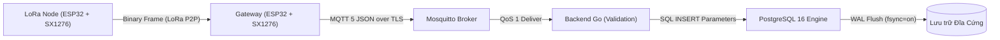
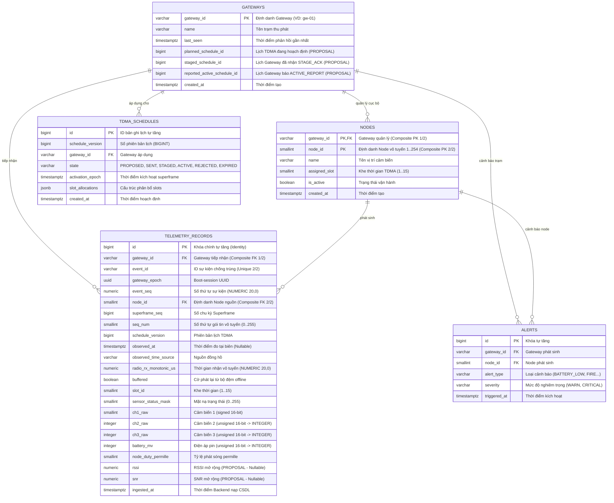
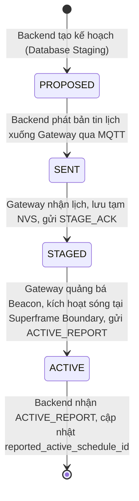
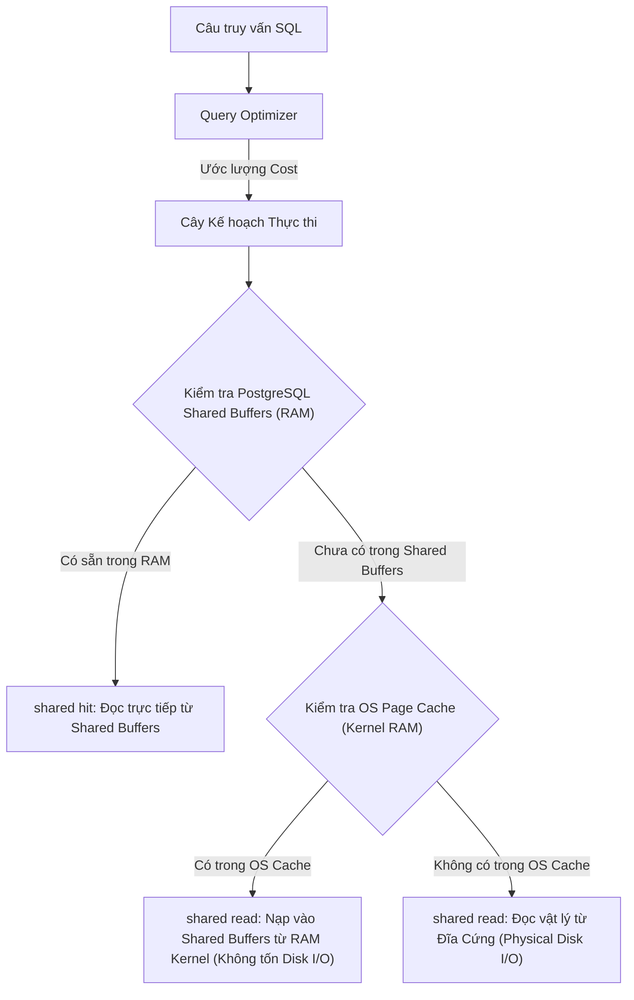
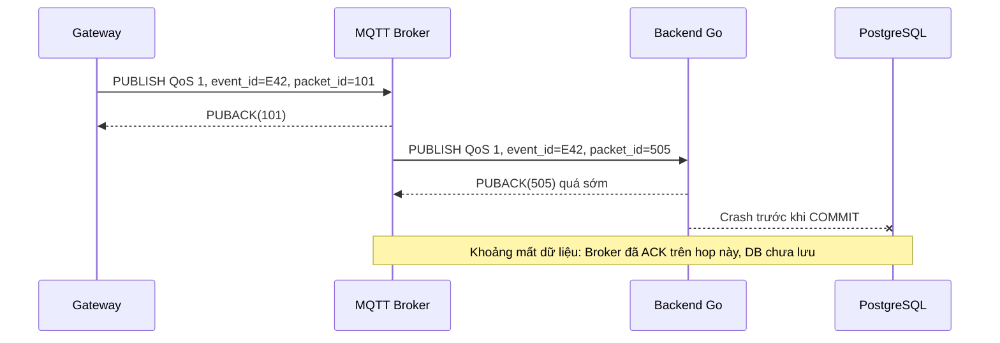

# BM02 — PostgreSQL Database & Go Integration

*Giáo trình nền tảng Backend cho hệ thống LoRa P2P Hybrid TDMA*

**Mục tiêu học tập:** Hiểu PostgreSQL dùng để làm gì, các cơ chế lưu trữ và giao dịch hoạt động ra sao, giới hạn kỹ thuật ở đâu, và cách đánh giá một thiết kế Backend Go do AI đề xuất. Không yêu cầu tự viết database driver, tạo toàn bộ schema hoặc xây dựng ứng dụng Go từ đầu.

**Bối cảnh hệ thống:** ESP32 + SX1276 truyền **Custom Binary MAC over LoRa P2P** đến Gateway; Gateway chuyển tiếp dữ liệu qua **MQTT/TLS**; Backend Go **Modular Monolith** xử lý nghiệp vụ và lưu trong **PostgreSQL**. Backend hoạch định lịch TDMA, còn Gateway thực thi thời gian thực. Ví dụ trong tài liệu phân biệt rõ giải pháp đang được đề xuất với chức năng đã triển khai.

**Môi trường minh họa:** PostgreSQL 16 và Go 1.23 theo tài liệu dự án nguồn; `pgx/v5` là thư viện đề xuất học tập, không được xem như dependency đã triển khai. Các con số thời gian, throughput, kết quả `EXPLAIN`, cấu hình pool và RF chỉ là ví dụ nếu không nêu bằng chứng đo kiểm.

## Lộ trình học tập

1. **Thuật ngữ:** Xác định đúng khái niệm và phân biệt các thuật ngữ dễ nhầm.
2. **Nguyên lý:** Hiểu quan hệ, SQL, giao dịch, MVCC, index, connection pool và migration.
3. **Giới hạn:** Nhận biết các tình huống có thể làm mất dữ liệu, nghẽn hệ thống hoặc sai trạng thái.
4. **Workshop:** Phân tích sáu tình huống thực tế, không bắt buộc viết code.
5. **Đánh giá:** Năm câu hỏi tình huống, ba bài tập phản biện thiết kế và đáp án.
6. **Tự kiểm tra:** Đánh dấu năng lực sau khi có thể tự giải thích và áp dụng.

## 1. Thuật ngữ trọng tâm (Module Glossary)

| Thuật ngữ (EN) | English Full Name | Thuật ngữ tiếng Việt | Giải thích kỹ thuật |
|---|---|---|---|

| **RDBMS** | Relational Database Management System | Hệ quản trị cơ sở dữ liệu quan hệ | Hệ quản trị lưu dữ liệu dưới dạng các bảng quan hệ; cung cấp SQL, ràng buộc toàn vẹn và giao dịch. |

| **Schema** | Database Schema | Lược đồ cơ sở dữ liệu | Cấu trúc logic định nghĩa bảng, kiểu dữ liệu, ràng buộc, index và các đối tượng cơ sở dữ liệu. |

| **Relation** | Relation (Table) | Quan hệ (Bảng dữ liệu) | Bảng quan hệ gồm các hàng và cột có cấu trúc và kiểu dữ liệu xác định. |

| **Row (Tuple)** | Table Row / Tuple | Bản ghi dữ liệu (Dòng) | Một bản ghi chứa các giá trị thuộc tính của một đối tượng hoặc sự kiện. |

| **Column (Attribute)** | Table Column / Field | Cột thuộc tính | Trường dữ liệu có tên và kiểu xác định trong một bảng. |

| **Primary Key (PK)** | Primary Key Constraint | Ràng buộc khóa chính | Định danh duy nhất, không NULL cho mỗi hàng; PostgreSQL tự tạo unique B-tree index cho khóa chính. |

| **Foreign Key (FK)** | Foreign Key Constraint | Ràng buộc khóa ngoại | Ràng buộc tham chiếu giữa bảng con và khóa được phép tham chiếu ở bảng cha; PostgreSQL không tự tạo index trên cột FK. |

| **Unique Constraint** | Unique Integrity Constraint | Ràng buộc duy nhất | Ngăn tổ hợp giá trị bị trùng; mặc định vẫn cho nhiều NULL, trừ khi dùng `NULLS NOT DISTINCT` hoặc cấm NULL. |

| **Check Constraint** | Check Integrity Constraint | Ràng buộc kiểm tra điều kiện logic | Kiểm tra điều kiện cho từng hàng; điều kiện cho kết quả `TRUE` hoặc `UNKNOWN` đều được chấp nhận. Dùng thêm `NOT NULL` để cấm NULL. |

| **Index** | Database Index | Chỉ mục cơ sở dữ liệu | Cấu trúc tìm kiếm bổ trợ để tăng tốc đọc, đánh đổi dung lượng đĩa và chi phí cập nhật khi ghi. |

| **B-Tree** | Balanced Tree Index | Chỉ mục cây cân bằng | Kiểu index mặc định, phù hợp so sánh bằng, phạm vi giá trị và một số truy vấn có sắp xếp. |

| **Composite Index** | Multicolumn Composite Index | Chỉ mục tổ hợp đa cột | Index nhiều cột; thứ tự cột ảnh hưởng hiệu quả lọc và sắp xếp. Không mặc định bỏ cột đầu sẽ vô dụng hoàn toàn. |

| **Seq Scan** | Sequential Table Scan | Quét tuần tự toàn bảng | Quét dữ liệu của bảng theo thứ tự lưu trữ; đôi khi được optimizer chọn vì rẻ hơn dùng index. |

| **Index Scan** | Index Table Scan | Quét qua chỉ mục | Tìm qua index rồi có thể truy cập heap để đọc nội dung hàng. |

| **Index Only Scan** | Index Only Table Scan | Quét chỉ đọc trên chỉ mục | Có thể lấy dữ liệu từ index; đôi khi vẫn phải kiểm tra heap để xác định tính hiển thị theo MVCC. |

| **EXPLAIN** | Query Execution Plan Inspector | Công cụ giải phẫu kế hoạch truy vấn | Hiển thị kế hoạch và chi phí ước lượng của optimizer; thông thường không chạy câu lệnh. |

| **EXPLAIN ANALYZE** | Execution Plan with Real Profiling | Giải phẫu kế hoạch kèm đo lường thời gian thực tế | Chạy thật truy vấn và đo thời gian/hàng xử lý; kết hợp `BUFFERS` khi cần xem truy cập bộ đệm. |

| **Transaction** | Database Transaction | Giao dịch cơ sở dữ liệu | Một nhóm thao tác SQL được quản lý như một đơn vị công việc với các thuộc tính ACID. |

| **ACID** | Atomicity, Consistency, Isolation, Durability | Bốn thuộc tính toàn vẹn giao dịch | Atomicity, Consistency, Isolation, Durability — bốn thuộc tính nền tảng của transaction. |

| **Atomicity** | Transaction Atomicity | Tính nguyên tử | Các thay đổi trong transaction hoặc được commit cùng nhau hoặc bị rollback theo ngữ nghĩa nguyên tử. |

| **Consistency** | Database Consistency | Tính nhất quán | Các ràng buộc toàn vẹn đã khai báo vẫn được duy trì khi transaction hoàn tất hợp lệ. |

| **Isolation** | Transaction Isolation | Tính cô lập | Quy tắc kiểm soát việc các transaction đồng thời nhìn thấy và ảnh hưởng dữ liệu của nhau. |

| **Durability** | Data Durability | Tính bền vững | Khả năng giữ các transaction đã commit trước sự cố, phụ thuộc WAL và cấu hình ghi đồng bộ; không thay thế backup. |

| **WAL** | Write-Ahead Logging | Nhật ký ghi trước | Write-Ahead Log: ghi nhật ký thay đổi trước khi cập nhật các trang dữ liệu chính, phục vụ khôi phục sau crash. |

| **MVCC** | Multi-Version Concurrency Control | Kiểm soát đồng thời đa phiên bản | Multi-Version Concurrency Control: quản lý nhiều phiên bản hàng để đọc/ghi đồng thời; cần vacuum để dọn phiên bản cũ. |

| **Read Committed** | Read Committed Isolation Level | Mức cô lập Đọc bản ghi đã chốt | Mức cô lập mặc định trong PostgreSQL: snapshot mới theo từng câu lệnh, tránh dirty read. |

| **Repeatable Read** | Repeatable Read Isolation Level | Mức cô lập Đọc lặp lại nhất quán | Giữ snapshot nhất quán cho transaction; có thể báo `40001` nếu xung đột cập nhật. |

| **Deadlock** | Database Deadlock | Hiện tượng khóa chết | Các transaction chờ khóa của nhau theo vòng; PostgreSQL phát hiện và hủy một transaction, thường với `40P01`. |

| **Commit** | Transaction Commit | Lệnh chốt giao dịch | Kết thúc transaction thành công; bảo đảm phụ thuộc chính sách WAL/durability của hệ thống. |

| **Rollback** | Transaction Rollback | Lệnh hủy bỏ giao dịch | Hủy thay đổi chưa commit; ứng dụng phải quản lý lỗi và vòng đời transaction. |

| **Connection Pool** | Database Connection Pool | Vùng đệm kết nối cơ sở dữ liệu | Tập kết nối DB được tái sử dụng để giảm chi phí tạo kết nối và giới hạn truy cập đồng thời. |

| **pgxpool** | pgx Connection Pool Package | Thư viện quản lý kết nối pgx trong Go | Bộ quản lý pool của thư viện Go `jackc/pgx/v5`; cần đóng rows và trả kết nối đúng vòng đời. |

| **Parameterized Query** | Parameterized SQL Query | Truy vấn tham số hóa | Truy vấn truyền giá trị riêng khỏi cú pháp SQL (`$1`, `$2`); không dùng placeholder tùy ý cho tên bảng/cột. |

| **SQL Injection (SQLi)** | SQL Injection Vulnerability | Lỗ hổng chèn mã SQL | Nguy cơ dữ liệu đầu vào bị ghép thành câu lệnh SQL; bảo vệ bằng tham số hóa, allowlist định danh và quyền tối thiểu. |

| **UPSERT** | Update or Insert (ON CONFLICT) | Thao tác chèn hoặc cập nhật kết hợp | `INSERT ... ON CONFLICT`; `DO NOTHING` bỏ qua conflict trên unique arbiter được chọn, không chứng minh payload trùng khớp. |

| **Idempotency** | Application Ingestion Idempotency | Tính chất bất biến khi nạp lại dữ liệu | Tiếp nhận lặp cùng một event không tạo nhiều kết quả nghiệp vụ trái phép; cần khóa định danh ổn định và chính sách so sánh payload. |

| **Migration** | Database Schema Migration | Tiến hóa lược đồ cơ sở dữ liệu có phiên bản | Thay đổi schema có quản lý phiên bản; `DOWN` không bảo đảm phục hồi dữ liệu đã bị xóa. |

| **Data Retention** | Data Retention Policy | Chính sách lưu giữ dữ liệu | Chính sách lưu giữ, xóa hoặc lưu trữ dài hạn dữ liệu theo thời gian và nhu cầu sử dụng. |

## 2. Kiến thức cốt lõi (Core Technical Knowledge)

Đọc mỗi chủ đề theo trình tự **khái niệm → mục đích → cơ chế → giới hạn → áp dụng → đánh giá thiết kế**. Các SQL snippets là ví dụ minh họa; schema SQL và chính sách ingestion cụ thể còn cần được chuẩn hóa trong hợp đồng triển khai.

### 2.1 Mô hình Dữ liệu Quan hệ & Ranh giới Thẩm định Schema

#### Khái niệm (WHAT)
Mô hình dữ liệu quan hệ (Relational Model) là phương pháp cấu trúc hóa dữ liệu thành các bảng hai chiều (Relations) gồm các hàng (Rows/Tuples) và cột (Columns/Attributes). Đi kèm là hệ thống kiểu dữ liệu có định dạng cố định và các quy tắc toàn vẹn khai báo (Declarative Constraints).

#### Mục đích sử dụng (WHY)
- Ngăn chặn các dữ liệu sai kiểu hoặc vi phạm quy tắc cấu trúc từ đường truyền vô tuyến LoRa P2P lọt vào hệ thống lưu trữ lõi.
- Đảm bảo tính nhất quán định danh thiết bị mạng (Gateway, Node cảm biến) và phiên bản lịch TDMA.
- **Khi nào nên dùng:** Dữ liệu có cấu trúc xác định, đòi hỏi tính toàn vẹn tham chiếu chặt chẽ, truy vấn liên kết phức tạp (`JOIN`), và tính bền vững giao dịch (ACID).
- **Khi nào không nên dùng:** Dữ liệu phi cấu trúc hoàn toàn, log văn bản thô tốc độ hàng triệu sự kiện/giây không cần đọc lại theo cấu trúc, hoặc payload tài liệu thay đổi schema liên tục không dự đoán trước.

#### Cơ chế vận hành (HOW)
Luồng dữ liệu tổng thể từ cảm biến vô tuyến đến cơ sở dữ liệu:


*Lưu ý kiến trúc cốt lõi:*
1. Node cảm biến **không** gửi trực tiếp bản tin MQTT JSON qua sóng LoRa; Node truyền tải khung nhị phân gọn nhẹ (Custom Binary MAC).
2. Gateway ESP32/SX1276 đóng vai trò cầu nối biên (Protocol Bridge), chuyển đổi giữa khung nhị phân vô tuyến và bản tin MQTT JSON.
3. Dự án sử dụng transceiver **Semtech SX1276** (theo kiến trúc dự án được mô tả trong tài liệu nguồn), không sử dụng SX1262. Tần số hoạt động vô tuyến và kênh truyền hiện ở trạng thái `TBD / NOT_VERIFIED` (chờ đo kiểm và phê duyệt theo quy chuẩn Cục Tần số Vô tuyến điện tại Việt Nam; không tự ý chọn 433 MHz, 868 MHz hay 920–923 MHz làm cấu hình approved).

#### Giới hạn kỹ thuật (LIMITATIONS)
- **Khác biệt dải giá trị Signed vs Unsigned:** PostgreSQL **không hỗ trợ kiểu số nguyên không dấu (Unsigned Integers)**. Toàn bộ các kiểu số nguyên đều là số có dấu (Signed):
  + `SMALLINT` (2 bytes signed): dải giới hạn từ $-32,768$ đến $+32,767$.
  + `INTEGER` (4 bytes signed): dải giới hạn từ $-2,147,483,648$ đến $+2,147,483,647$.
  + `BIGINT` (8 bytes signed): dải giới hạn tối đa $\approx 9.22 \times 10^{18}$ (19 chữ số).
- **Ranh giới thẩm định (Validation Boundary):** Việc ánh xạ kiểu CSDL chỉ giúp tránh lỗi tràn số (Type-range compatibility). CSDL **không thể thay thế việc thẩm định toàn diện JSON Schema ở tầng ứng dụng** (CSDL không tự kiểm tra được regex phức tạp, các enum thời gian, hay cấm trường lạ của `additionalProperties: false`). Ngược lại, CSDL cũng không ngăn chặn được "toàn bộ dữ liệu rác" mà chỉ thực thi các ràng buộc logic khai báo đã được định nghĩa rõ ràng.

#### Những sai lầm thường gặp
- **Lỗi tràn số `22003 integer out of range`:** Sử dụng `SMALLINT` để lưu trường điện áp `battery_mv` ($0..65535$). Trong các bài kiểm thử biên với giá trị nhân tạo lớn (ví dụ $33,000\text{ mV} = 33.0\text{V}$, vượt ngưỡng $32,767$), PostgreSQL sẽ lập tức báo lỗi sập câu lệnh chèn!
- **Lỗi tràn `BIGINT` với chuỗi số 20 chữ số:** Hợp đồng telemetry quy định `event_seq` và `radio_rx_monotonic_us` là chuỗi số thập phân tối đa 20 chữ số (`^(0|[1-9][0-9]{0,19})$`). Giá trị lớn nhất của 20 chữ số vượt quá trần $9.22 \times 10^{18}$ của `BIGINT`. Ép vào `BIGINT` sẽ gây lỗi tràn số. Bắt buộc phải dùng `NUMERIC(20, 0)` hoặc `TEXT`.

#### Ứng dụng trong hệ thống LoRa P2P
Bảng đối chiếu kiểu dữ liệu giữa Hợp đồng MQTT Telemetry (bản dự thảo) và Lược đồ CSDL Đề xuất (đề xuất thiết kế):

| Trường Telemetry | Kiểu trong JSON Schema | Dải giá trị quy định | Kiểu CSDL PostgreSQL 16 | Lý do kỹ thuật bắt buộc |
| :--- | :--- | :--- | :--- | :--- |
| `battery_mv` | `integer` | $0..65535$ | **`INTEGER`** (4 bytes) | `SMALLINT` bị tràn ở $32,767$. Bắt buộc dùng `INTEGER`. |
| `ch2_raw`, `ch3_raw`| `integer` | $0..65535$ | **`INTEGER`** (4 bytes) | Unsigned 16-bit ADC vượt quá dải signed của `SMALLINT`. |
| `ch1_raw` | `integer` | $-32768..32767$| **`SMALLINT`** (2 bytes) | Khớp hoàn hảo với signed 16-bit integer của PostgreSQL. |
| `slot_id` | `integer` | $1..15$ | **`SMALLINT`** (2 bytes) | Tiết kiệm bộ nhớ đĩa; kết hợp `CHECK (slot_id BETWEEN 1 AND 15)`. |
| `node_id` | `integer` | $1..254$ | **`SMALLINT`** (2 bytes) | Định danh cục bộ trên kênh RF của Gateway. |
| `superframe_seq` | `integer` | $0..4294967295$ | **`BIGINT`** (8 bytes) | Unsigned 32-bit vượt qua trần `INTEGER` ($2.14\times 10^9$). |
| `schedule_version` | `integer` | $0..4294967295$ | **`BIGINT`** (8 bytes) | Tránh lỗi tràn số khi phiên bản lịch TDMA tăng cao. |
| `event_seq` | `string` | Regex 20 chữ số | **`NUMERIC(20, 0)`** | Chuỗi 20 chữ số vượt quá trần 19 chữ số của `BIGINT`. |
| `radio_rx_monotonic_us`| `string` | Regex 20 chữ số | **`NUMERIC(20, 0)`** | Tương tự, lưu trữ số microsecond tăng đơn điệu 20 chữ số. |
| `gateway_epoch` | `string` | UUID RFC 4122 | **`UUID`** (16 bytes) | Định danh phiên khởi động Gateway, tối ưu dung lượng và so sánh. |
| `observed_at` | `string` / `null` | RFC 3339 | **`TIMESTAMPTZ NULL`** | Cho phép `NULL` khi Gateway chưa đồng bộ được thời gian thực. |
| `buffered` | `boolean` | `true` / `false`| **`BOOLEAN`** (1 byte) | Cờ phát lại từ bộ đệm flash của Gateway (Transport metadata). |

#### Cách đánh giá thiết kế AI
- **Đánh giá mã AI:** Khi yêu cầu AI sinh DDL từ JSON Schema, kiểm tra xem AI có dùng `SMALLINT` cho `battery_mv` hay dùng `BIGINT` cho `event_seq` không. Nếu có, phát hiện lỗi ngay.
- **Thực nghiệm biên:** Chèn thử giá trị kiểm thử nhân tạo `battery_mv = 65000` để kiểm chứng cột chấp nhận an toàn không phát sinh lỗi tràn số.

---

### 2.2 Khóa, Ràng buộc Toàn vẹn & Chiến lược Đánh Chỉ mục Khóa Ngoại

#### Khái niệm (WHAT)
- **Primary Key (PK):** Cột định danh duy nhất cho mỗi bản ghi; ngầm định `NOT NULL` và tự động tạo chỉ mục B-tree duy nhất.
- **Foreign Key (FK):** Cột liên kết trỏ tới PK hoặc Unique của bảng cha nhằm duy trì tính toàn vẹn tham chiếu.
- **Check Constraint:** Biểu thức logic Boolean kiểm tra tính hợp lệ của dữ liệu trên từng dòng.

#### Mục đích sử dụng (WHY)
- Ngăn chặn việc ghi nhận dữ liệu từ các Node hoặc Gateway chưa từng được khai báo trong danh mục mạng.
- Ngăn chặn việc xóa bất cẩn Gateway khi còn dữ liệu telemetry liên quan (`ON DELETE RESTRICT`).
- Giới hạn các thông số vật lý của mạng TDMA (ví dụ khe thời gian chỉ trong dải 1 đến 15).

#### Cơ chế vận hành (HOW)
Mô hình quan hệ thực thể đề xuất (đề xuất thiết kế) cho dự án LoRa P2P:


#### Giới hạn kỹ thuật (LIMITATIONS)
- **Phạm vi định danh Node (Node Identity Scope):** Trong mạng LoRa, `node_id` là địa chỉ ngắn (1..254). Trạm `gw-01` có Node 1, và trạm `gw-02` cũng có thể có Node 1! Nếu chỉ dùng `node_id` làm PK, CSDL sẽ bị đụng độ định danh ngay khi mở rộng sang Gateway thứ hai. Do đó, **Composite Primary Key `(gateway_id, node_id)` là thiết kế khuyến nghị (đề xuất thiết kế)**, không tự gán nhãn Approved khi chưa qua review liên nhóm.
- **FK không tự động có Index:** PostgreSQL **KHÔNG** tự động tạo chỉ mục trên cột khóa ngoại. Nếu không có chỉ mục, khi xóa dòng ở bảng cha, Postgres sẽ quét toàn bộ bảng con và giữ khóa chia sẻ.
- **Cạm bẫy giá trị `UNKNOWN` của Check Constraint:** Check Constraint chấp nhận bản ghi nếu biểu thức trả về `TRUE` hoặc `UNKNOWN`. Biểu thức `battery_mv BETWEEN 0 AND 65535` khi gặp `NULL` sẽ trả về `UNKNOWN`, và Postgres vẫn cho chèn! Muốn cấm rỗng, bắt buộc phải có `NOT NULL`.

#### Những sai lầm thường gặp
- **Tạo chỉ mục trùng lặp vô ích (Duplicate Index Anti-Pattern):** Bảng `telemetry_records` đã có ràng buộc `UNIQUE (gateway_id, event_id)`. Ràng buộc này đã tự sinh một Unique B-Tree Index. Nếu tạo thêm lệnh `CREATE INDEX idx_gw_event ON telemetry_records (gateway_id, event_id)`, chỉ mục này là dư thừa, làm chậm tốc độ ghi do phải cập nhật hai cây chỉ mục đồng thời và lãng phí bộ nhớ RAM cache.
- **Thiếu `NOT NULL` trên cột có `CHECK`:** Cột nhận giá trị rác `NULL` mà không bị từ chối do cơ chế 3-valued logic.

#### Ứng dụng trong hệ thống LoRa P2P
- Bảng `nodes` dùng khóa chính tổ hợp: `PRIMARY KEY (gateway_id, node_id)`.
- Bảng `telemetry_records` dùng khóa ngoại tổ hợp: `FOREIGN KEY (gateway_id, node_id) REFERENCES nodes(gateway_id, node_id) ON DELETE RESTRICT`.
- Tận dụng chỉ mục tổ hợp `idx_telemetry_gw_node_ingested ON (gateway_id, node_id, ...)` để bao phủ luôn kiểm tra FK mà không cần tạo index lẻ.

#### Cách đánh giá thiết kế AI
- **Đọc cấu trúc bảng:** Chạy lệnh `\d telemetry_records` trong psql để kiểm tra danh mục Indexes; nếu thấy 2 index có cùng định nghĩa khóa, thứ tự cột, biểu thức/predicate và điều kiện áp dụng thì cần xem xét có tạo index trùng lặp hay không. Cùng tiền tố không đủ để kết luận dư thừa.

---

### 2.3 Ngôn ngữ Truy vấn SQL: Phép kết, Gom nhóm & Bản chất Thực thi DISTINCT ON

#### Khái niệm (WHAT)
- **Phép kết (Joins):** Phép toán quan hệ kết hợp dữ liệu từ 2 hay nhiều bảng dựa trên điều kiện tương quan.
- **`DISTINCT ON`:** Cú pháp chuyên biệt của PostgreSQL để lấy dòng đầu tiên của mỗi nhóm theo trật tự sắp xếp xác định.
- **`LATERAL Subquery`:** Truy vấn con cho phép tham chiếu đến các cột của bảng đứng trước nó trong mệnh đề `FROM`.

#### Mục đích sử dụng (WHY)
- Hiển thị danh sách toàn bộ thiết bị trạm kèm bản tin đo lường mới nhất lên Dashboard giám sát.
- Thống kê tỷ lệ hoạt động và thông số pin của mạng cảm biến.

#### Cơ chế vận hành (HOW)
So sánh luồng xử lý giữa `DISTINCT ON`, `CROSS JOIN LATERAL` và `LEFT JOIN LATERAL`:

```mermaid
flowchart TD
    subgraph DISTINCT_ON["Phương án 1: DISTINCT ON (gateway_id, node_id)"]
        D1["Đọc dữ liệu bảng telemetry_records"] --> D2["Sắp xếp khi kế hoạch cần (Sort)"]
        D2 --> D3["Nút Unique lọc dòng đầu tiên mỗi nhóm"]
    end

    subgraph CROSS_LATERAL["Phương án 2: CROSS JOIN LATERAL"]
        C1["Lặp qua bảng nodes"] --> C2["LATERAL Subquery với Limit 1 trên từng node"]
        C2 --> C3["Chỉ trả về các Node ĐÃ CÓ telemetry"]
    end

    subgraph LEFT_LATERAL["Phương án 3: LEFT JOIN LATERAL (Khuyến nghị Dashboard)"]
        L1["Lặp qua bảng nodes"] --> L2["LATERAL Subquery với Limit 1 ON true"]
        L2 --> L3["Trả về TOÀN BỘ 15 Nodes (kể cả Node chưa có dữ liệu)"]
    end
```


#### Giới hạn kỹ thuật (LIMITATIONS)
- **Phân biệt `CROSS JOIN LATERAL` và `LEFT JOIN LATERAL`:**
  + `CROSS JOIN LATERAL` hoạt động tương tự INNER JOIN: nếu một Node **chưa từng gửi bản tin telemetry nào**, truy vấn con trả về 0 dòng, và Node đó sẽ bị **loại bỏ hoàn toàn khỏi kết quả**!
  + Nếu sử dụng cách truy vấn `LATERAL` để Dashboard hiển thị đầy đủ danh sách Node (kể cả Node chưa có dữ liệu), cần dùng **`LEFT JOIN LATERAL ... ON true`** thay cho `CROSS JOIN LATERAL`. Đây không phải cách SQL duy nhất; có thể dùng những biến thể `LEFT JOIN`/window function khác nếu đáp ứng cùng ngữ nghĩa.
- **`DISTINCT ON` không tự động nhảy cóc (No Automatic Skip Scan) trên PG16:** PostgreSQL 16 bắt buộc dữ liệu đầu vào phải có thứ tự sắp xếp. Nếu bảng có kích thước nhỏ, Optimizer thường chọn quét toàn bảng rồi sắp xếp lại (`Seq Scan + Sort + Unique`). Ngay cả khi có index, PG16 vẫn duyệt tuần tự qua các bản ghi chỉ mục thay vì nhảy cóc bỏ qua nhóm.
- **Đính chính về PostgreSQL 18 Skip Scan:** Tính năng B-Tree Skip Scan trong PostgreSQL 18 áp dụng cho truy vấn lọc vị từ (`WHERE ingested_at >= ...` khi thiếu cột tiền tố), **KHÔNG** đồng nghĩa với việc tự động biến `DISTINCT ON` thành Loose Index Scan.

#### Những sai lầm thường gặp
- **Dùng `CROSS JOIN LATERAL` làm mất Node chưa có dữ liệu trên Dashboard:** Kỹ sư viết `CROSS JOIN LATERAL`, khi hệ thống có 15 Node nhưng Node 15 mới khởi động chưa gửi tin, Dashboard chỉ hiển thị 14 dòng khiến nhân viên vận hành tưởng rằng Node 15 chưa được cấu hình.
- **Thiếu Tie-breaker ổn định:** Viết `SELECT DISTINCT ON (node_id) * ORDER BY node_id, ingested_at DESC`. Nếu có 2 bản tin cùng mốc thời gian `ingested_at`, PostgreSQL không cam kết bản tin nào được giữ lại. Bắt buộc phải bổ sung tie-breaker ổn định: `ORDER BY node_id, ingested_at DESC, id DESC`.

#### Ứng dụng trong hệ thống LoRa P2P
Ví dụ truy vấn Dashboard giữ lại cả Node chưa có dữ liệu:
```sql
SELECT
    n.gateway_id,
    n.node_id,
    n.name,
    latest.battery_mv,
    latest.sensor_status_mask,
    latest.ingested_at
FROM nodes AS n
LEFT JOIN LATERAL (
    SELECT r.battery_mv, r.sensor_status_mask, r.ingested_at
    FROM telemetry_records AS r
    WHERE r.gateway_id = n.gateway_id
      AND r.node_id = n.node_id
    ORDER BY r.ingested_at DESC, r.id DESC
    LIMIT 1
) AS latest ON true;
```

#### Cách đánh giá thiết kế AI
- **Đọc `EXPLAIN (ANALYZE, BUFFERS)`:**
  + Lưu ý phương pháp luận: Kế hoạch thực thi phụ thuộc vào cardinality (số lượng giá trị phân biệt), selectivity (độ chọn lọc), thống kê lưu trữ `pg_statistic`, cấu trúc chỉ mục, tỷ lệ dữ liệu nằm trong RAM cache, và tải hệ thống. Không khẳng định `LATERAL` luôn luôn nhanh nhất trong mọi trường hợp.
  + Nếu thấy `Buffers: shared hit` nhỏ và kế hoạch dùng `Index Scan`, đó là tín hiệu để phân tích thêm `actual rows`, `loops`, tổng I/O, latency và workload; không tự kết luận truy vấn tối ưu.

---

### 2.4 Giao dịch (Transactions), ACID, MVCC & Ranh giới Độ bền vững

#### Khái niệm (WHAT)
- **Transaction:** Đơn vị công việc logic gồm nhiều câu lệnh SQL thực thi theo nguyên tắc "hoặc thành công toàn bộ, hoặc không có gì thay đổi" (ACID).
- **MVCC (Multi-Version Concurrency Control):** Cơ chế kiểm soát đồng thời đa phiên bản của PostgreSQL: "Người đọc không chặn người ghi, người ghi không chặn người đọc".
- **WAL (Write-Ahead Logging):** Nhật ký ghi trước thay đổi xuống đĩa tuần tự trước khi cập nhật dữ liệu bảng chính.

#### Mục đích sử dụng (WHY)
- Đảm bảo tính nguyên tử khi Backend cập nhật đồng thời nhiều bảng (vừa chèn lịch TDMA mới vào `tdma_schedules`, vừa cập nhật con trỏ `planned_schedule_id` trên bảng `gateways`).
- Đảm bảo dữ liệu không bị hỏng hóc hoặc ở trạng thái dở dang khi máy chủ gặp sự cố sập nguồn.

#### Cơ chế vận hành (HOW)
Ví dụ vòng đời lịch TDMA phân tán giữa Backend và Gateway (dựa trên contract MQTT dự thảo):


#### Giới hạn kỹ thuật (LIMITATIONS)
- **Ranh giới Database COMMIT vs Kích hoạt Sóng Vô tuyến:** Khi câu lệnh cập nhật lịch chốt giao dịch (`COMMIT`) thành công trong PostgreSQL, sự kiện này **CHỈ LÀ STAGING KẾ HOẠCH**, tuyệt đối **CHƯA PHẢI LÀ KÍCH HOẠT SÓNG THỰC TẾ**! Gateway có thể đang mất mạng hoặc từ chối lịch. Lịch chỉ là `ACTIVE` khi nhận được `ACTIVE_REPORT`.
- **Ranh giới Bền vững (Durability Boundary):** Cấu hình `synchronous_commit = on` và `fsync = on` đảm bảo WAL đã được xả an toàn xuống đĩa cứng trước khi báo commit. Tuy nhiên, nó **không phải cam kết lossless tuyệt đối** trước thảm họa hỏng hóc phần cứng đĩa cứng vật lý, hỏng bộ điều khiển lưu trữ không có pin đệm (BBU), hoặc thảm họa máy chủ.

#### Những sai lầm thường gặp
- **Xác nhận MQTT PUBACK trước khi COMMIT CSDL:** Nhận tin MQTT, gửi ngay ACK cho broker, rồi mới gọi `tx.Commit()`. Nếu tiến trình Backend bị OOM Killer tiêu diệt trước khi Commit, gói tin bị mất vĩnh viễn khỏi hàng đợi của Broker mà CSDL không hề có dữ liệu!
- **Giữ Transaction quá lâu:** Mở transaction rồi gọi API mạng hoặc tính toán nặng bên trong transaction. Việc này giữ chặt khóa dòng, phong tỏa tiến trình `AUTOVACUUM` và làm phình to bảng (Table Bloat).

#### Ứng dụng trong hệ thống LoRa P2P
- Quy trình chuẩn: Chuẩn bị toàn bộ dữ liệu $\rightarrow$ Mở Transaction $\rightarrow$ Ghi SQL $\rightarrow$ `Commit()` tức thì $\rightarrow$ Mới gửi bản tin điều khiển qua MQTT.
- Trong Go, luôn bọc `defer tx.Rollback()` với một context độc lập ngắn hạn phòng khi context chính bị timeout.

#### Cách đánh giá thiết kế AI
- **Đánh giá mã AI:** Kiểm tra xem AI có gọi `broker.Publish()` hoặc `http.Post()` bên trong khối giao dịch CSDL hay không. Nếu có, yêu cầu tách I/O mạng ra ngoài giao dịch ngay lập tức.

---

### 2.5 Chỉ mục (Indexes), Cấu trúc B-Tree & Giải phẫu Kế hoạch Thực thi EXPLAIN

#### Khái niệm (WHAT)
- **B-Tree Index:** Cấu trúc dữ liệu cây cân bằng đa nhánh tự sắp xếp, lưu trữ các giá trị khóa cùng địa chỉ vật lý con trỏ `TID` trỏ đến vị trí dòng trên Heap.
- **EXPLAIN (ANALYZE, BUFFERS):** Lệnh chẩn đoán hiển thị chi phí ước lượng (`Cost`), thời gian thực thi thực tế (`actual time`) và số khối bộ đệm RAM/đĩa được truy xuất (`shared hit/read`).

#### Mục đích sử dụng (WHY)
- Tăng tốc độ tìm kiếm bản ghi từ quét toàn bộ hàng triệu dòng (`Seq Scan`) xuống còn vài thao tác duyệt cây ($O(\log N)$).
- Cung cấp bằng chứng thực nghiệm định lượng để đánh giá hiệu năng câu truy vấn thay vì phỏng đoán cảm tính.

#### Cơ chế vận hành (HOW)
Cấu trúc cây B-Tree và phân biệt bản chất `shared hit` vs `shared read`:


*Lưu ý kỹ thuật cốt lõi về Bộ đệm:*
- `shared hit`: Là **tổng số lần yêu cầu truy cập khối đệm (buffer hit count)** được tìm thấy sẵn trong bộ nhớ đệm RAM `shared_buffers` của PostgreSQL. **Lưu ý sư phạm đặc biệt:** `shared hit` **KHÔNG nhất thiết là số lượng khối đĩa vật lý phân biệt (distinct physical blocks)**! Một khối dữ liệu có thể được truy cập lặp đi lặp lại nhiều lần trong quá trình quét hoặc nối dòng, làm tăng chỉ số `shared hit`. Do đó, tuyệt đối không được suy diễn rằng bảng chỉ chiếm đúng 23 block vật lý đơn thuần từ con số `shared hit=23`.
- `shared read`: Là **tổng số lần khối dữ liệu được yêu cầu nạp từ nhân hệ điều hành (OS Kernel)** vào `shared_buffers`. **Lưu ý quan trọng:** `shared read` **KHÔNG đồng nghĩa với việc đọc đĩa vật lý (physical disk I/O)**! Nếu khối dữ liệu đó đã nằm sẵn trong bộ đệm trang của hệ điều hành (OS Page Cache trong RAM), kernel sẽ trả về ngay lập tức với tốc độ RAM mà không phải đọc từ thiết bị lưu trữ vật lý (SSD/HDD).

#### Giới hạn kỹ thuật (LIMITATIONS)
- **Quy tắc Tiền tố Bên trái (Leftmost Prefix):** Chỉ mục tổ hợp `(gateway_id, node_id, ingested_at DESC)` phát huy tối đa khi câu lệnh có điều kiện lọc trên cột đầu tiên (`gateway_id`). Nếu câu lệnh bỏ qua `gateway_id` mà chỉ lọc theo `ingested_at`, Optimizer thường phải chuyển sang `Seq Scan` hoặc quét toàn bộ các nút lá của chỉ mục nếu chi phí rẻ hơn.
- **Chi phí của Chỉ mục:** Mỗi chỉ mục bổ sung làm tăng thêm dung lượng đĩa và làm chậm các thao tác `INSERT`/`UPDATE` do phải cập nhật cây B-Tree đồng thời. Không đưa ra các con số phần trăm tùy tiện (như giảm cố định 30%) mà phải đánh giá trade-off theo tải thực tế.

#### Những sai lầm thường gặp
- **Đọc `EXPLAIN` mà tưởng là lệnh đã chạy thật:** `EXPLAIN` đơn thuần chỉ là bài toán ước lượng chi phí của Optimizer dựa trên thống kê `pg_statistic`, **không chạy lệnh thật**. Phải dùng `EXPLAIN (ANALYZE, BUFFERS)` mới có số đo thời gian và khối đệm thực tế.
- **Đồng nhất `shared read` với đọc đĩa vật lý:** Nhầm lẫn rằng mọi `shared read` đều gây nghẽn đĩa cứng, bỏ qua vai trò của OS Page Cache.

#### Ứng dụng trong hệ thống LoRa P2P
- Thiết kế chỉ mục tổ hợp phục vụ truy vấn telemetry:
  ```sql
  CREATE INDEX idx_telemetry_gw_node_ingested ON telemetry_records (gateway_id, node_id, ingested_at DESC, id DESC);
  ```
- Tạo thêm chỉ mục thời gian đơn lẻ cho tác vụ dọn dẹp dữ liệu cũ (Retention):
  ```sql
  CREATE INDEX idx_telemetry_ingested_at ON telemetry_records (ingested_at DESC);
  ```

#### Cách đánh giá thiết kế AI
- **Cách phân tích EXPLAIN:**
  + Phân biệt `Cost` (chi phí logic không thứ nguyên), `Actual Time` (thời gian chạy thực tế tính bằng ms), và `Buffers` (số khối đệm 8KB).
  + Đánh giá hiệu quả dựa trên tổng số khối bộ đệm truy xuất (`shared hit + shared read`) và loại toán tử quét.

---

### 2.6 Tích hợp Backend Go: pgx/v5, Connection Pool & Idempotent Ingestion State Machine

#### Khái niệm (WHAT)
- **`jackc/pgx/v5`:** Thư viện client Go chuyên biệt giao tiếp trực tiếp với PostgreSQL qua giao thức nhị phân (Binary Wire Protocol) (thư viện tham khảo; tài liệu nguồn không ghi nhận dependency này đã được pin vào repo).
- **`pgxpool.Pool`:** Vùng đệm quản lý tập hợp các kết nối mạng TCP được mở sẵn và tái sử dụng an toàn đa luồng.
- **Idempotent Ingestion State Machine:** Cỗ máy trạng thái tiếp nhận dữ liệu bảo đảm việc nhận cùng một bản tin nhiều lần do mạng QoS 1 phát lại không làm sai lệch trạng thái CSDL.

#### Mục đích sử dụng (WHY)
- Loại bỏ chi phí mở kết nối TCP và bắt tay TLS đắt đỏ cho mỗi gói tin telemetry.
- Bảo vệ CSDL trước các cuộc tấn công SQL Injection và phát hiện các sự kiện trùng khóa nhưng sai lệch nội dung (Divergent Payload Anomaly).

#### Cơ chế vận hành (HOW)
**Ví dụ cấu hình connection pool (giá trị minh họa, không phải benchmark):**
```go
// Giá trị cấu hình định hướng sư phạm cho môi trường nghiên cứu (chưa qua đo kiểm tải thực tế)
poolConfig, err := pgxpool.ParseConfig(databaseURL)
if err == nil {
    poolConfig.MaxConns = 25                       // Số kết nối tối đa mở đồng thời (CLM-26)
    poolConfig.MinConns = 5                        // Số kết nối duy trì tối thiểu (CLM-26)
    poolConfig.MaxConnIdleTime = 15 * time.Minute  // Thu hồi kết nối rảnh rỗi
    poolConfig.HealthCheckPeriod = 1 * time.Minute // Chu kỳ kiểm tra kết nối sống
}
```

Luồng xử lý cỗ máy trạng thái tiếp nhận dữ liệu chống trùng lặp:
```mermaid
flowchart TD
    Start["Gói tin Telemetry từ MQTT"] --> Val{"Thẩm định Schema tầng Go<br>(ValidateTelemetryEvent)"}
    Val -->|Lỗi Format/Range/UUID| Reject["Từ chối & Drop gói tin rác"]
    Val -->|Hợp lệ| Insert["Thực thi INSERT ... ON CONFLICT (gw, event_id) DO NOTHING"]
    Insert --> CheckRows{"RowsAffected == 1 ?"}
    CheckRows -->|Đúng (1 dòng)| Success["IngestNewEvent: Bản tin mới chèn thành công"]
    CheckRows -->|Sai (0 dòng)| SelectStored["Truy vấn SELECT đọc lại bản ghi cũ trong CSDL"]
    SelectStored --> Compare{"Đối chiếu Canonical Payload<br>(So sánh 100% thuộc tính vật lý)"}
    Compare -->|Trùng khớp 100%| AcceptedDup["IngestAcceptedDuplicate:<br>Bản tin phát lại hợp lệ (QoS 1)"]
    Compare -->|Sai lệch Mask/Version...| Anomaly["IngestDivergentAnomaly:<br>Phát hiện bất thường dữ liệu!"]
    Anomaly --> AuditLog["Ghi Durable Audit Record vào telemetry_anomalies"]
```

#### Giới hạn kỹ thuật (LIMITATIONS)
- **Phạm vi và Cơ chế của `ON CONFLICT (conflict_target) DO NOTHING`:**
  + Trong cú pháp đang học `ON CONFLICT (gateway_id, event_id) DO NOTHING`, **Conflict Target được chỉ định rõ** để chọn unique arbiter tương ứng. Tuy nhiên, PostgreSQL 16 **cho phép `DO NOTHING` bỏ qua conflict target**; khi đó nó có thể xử lý xung đột trên mọi unique constraint/index phù hợp. Không áp dụng quy tắc này cho `DO UPDATE`, vì `DO UPDATE` yêu cầu conflict target.
  + Khi và chỉ khi xảy ra xung đột vi phạm tính duy nhất trên **chính Conflict Target đã chỉ định** đó, PostgreSQL mới bỏ qua việc chèn và trả về `RowsAffected == 0` cùng `err == nil`.
  + **Không triệt tiêu mọi lỗi 23505:** Nếu bảng có các ràng buộc UNIQUE khác (ví dụ: Primary Key trên cột khác hoặc một Unique Index thứ hai) và câu lệnh INSERT vi phạm ràng buộc đó, PostgreSQL **vẫn ném ra lỗi `SQLSTATE 23505 (unique_violation)`** như bình thường!
  + `RowsAffected == 0` chỉ chứng minh có xung đột trên arbiter chỉ định. Nó **hoàn toàn không chứng minh** tải trọng bản tin mới trùng khớp với dữ liệu đã lưu.
  + Việc so sánh toàn bộ các trường tải trọng bất biến chính quy (Canonical Payload) và phân biệt với siêu dữ liệu giao vận (`buffered`, `ingested_at`) là một **đề xuất chính sách ứng dụng (đề xuất chính sách ứng dụng)** cần được thẩm định liên nhóm.
- **Ranh giới Siêu dữ liệu Giao vận:** Bản tin phát lại mang cờ `buffered = true`, trong khi bản tin gốc gửi lần đầu mang `buffered = false`. Một cỗ máy trạng thái chuẩn mực phải coi `buffered` là **transport metadata được phép thay đổi hợp lệ** (đề xuất chính sách ứng dụng), trong khi các thuộc tính cảm biến và phiên bản lịch là **bất biến chính quy (Canonical Immutable Payload)**.
- **Giới hạn của `go test -race`:** Công cụ kiểm tra race detector của Go chỉ phát hiện các xung đột dữ liệu đa luồng (Data Races) trên **các nhánh code thực tế được chạy trong bài test**. Nó không chứng minh toàn bộ hệ thống hoàn toàn sạch race trong mọi điều kiện tải thực tế!

#### Những sai lầm thường gặp
- **Rò rỉ kết nối (Connection Leak):** Quên gọi `rows.Close()` sau khi truy vấn `pool.Query()`. Kết nối không được trả lại pool; sau một thời gian, toàn bộ kết nối cạn kiệt, Backend bị treo cứng hoàn toàn (Resource Starvation).
- **Cạm bẫy UPDATE 0 dòng:** Lệnh `UPDATE gateways SET planned_schedule_id = ... WHERE gateway_id = 'gw-khong-ton-tai'` trả về `err == nil`. Nếu không kiểm tra `cmdTag.RowsAffected() == 0`, ứng dụng sẽ ngỡ là thành công và commit lịch mồ côi!

#### Ứng dụng trong hệ thống LoRa P2P
- Lập trình hàm `IngestTelemetryEvent`:
  + Kiểm tra `RowsAffected == 1` $\rightarrow$ Trả về `IngestNewEvent`.
  + Kiểm tra `RowsAffected == 0` $\rightarrow$ Đọc lại bản ghi, so sánh 100% thuộc tính bất biến chính quy.
  + Nếu phát hiện sai lệch $\rightarrow$ Chèn bản ghi kiểm toán bền vững vào bảng `telemetry_anomalies` (đề xuất thiết kế).
- Lập trình hàm bọc thử lại `ExecuteWithRetry`: Tối đa 3 lần thử, exponential backoff + jitter, không ngủ sau lượt cuối, và tôn trọng `ctx.Done()`.

#### Cách đánh giá thiết kế AI
- **Đánh giá mã AI:** Kiểm tra xem đoạn code xử lý `ON CONFLICT DO NOTHING` của AI có đọc lại bản ghi và so sánh dữ liệu hay không, hay chỉ đơn giản trả về `nil`.

---

### 2.7 Tiến hóa Lược đồ An toàn (Database Migrations) & Giới hạn Thực tế

#### Khái niệm (WHAT)
Database Migration là phương pháp quản lý lịch sử thay đổi cấu trúc CSDL dưới dạng mã nguồn phiên bản (Schema as Code) thông qua các cặp tệp `{version}_{name}.up.sql` và `{version}_{name}.down.sql`.

#### Mục đích sử dụng (WHY)
- Đảm bảo môi trường phát triển cục bộ, staging và production có cấu trúc CSDL hoàn toàn đồng nhất.
- Hỗ trợ triển khai tự động qua CI/CD và khả năng khôi phục (Rollback) khi triển khai gặp sự cố.

#### Cơ chế vận hành (HOW)
Công cụ migration (như `golang-migrate`, `PROPOSAL`) duy trì bảng hệ thống `schema_migrations` lưu phiên bản hiện tại và trạng thái khóa (`dirty`). Khi chạy lệnh `UP`, công cụ áp dụng tuần tự các script chưa chạy và cập nhật phiên bản.

#### Giới hạn kỹ thuật (LIMITATIONS)
- **Nguyên tắc "Reversible where practicable":** Tệp `DOWN` chỉ hoàn tác được các lệnh DDL như `DROP TABLE`, `DROP COLUMN`. Nó **không thể khôi phục dữ liệu đã bị xóa** nếu không có bản sao lưu (backup) trước đó.
- **Tối ưu hóa `ALTER TABLE ADD COLUMN DEFAULT` từ PostgreSQL 11+:**
  + *Trường hợp Non-volatile DEFAULT:* Từ PostgreSQL 11 trở đi, lệnh thêm cột có giá trị mặc định hằng số không biến động (ví dụ: `ALTER TABLE telemetry_records ADD COLUMN is_valid BOOLEAN NOT NULL DEFAULT true;`) là một **thao tác chỉ cập nhật metadata (Metadata-only update)**! CSDL chỉ lưu giá trị mặc định vào catalog hệ thống `pg_attribute` mà **KHÔNG hề viết lại toàn bộ bảng trên đĩa (No Table Rewrite)**. Lệnh hoàn tất gần như tức thì.
  + *Trường hợp Volatile DEFAULT:* Nếu biểu thức mặc định là biến động (ví dụ dùng `clock_timestamp()`, `random()`), PostgreSQL bắt buộc phải quét và viết lại từng dòng trên đĩa, gây khóa bảng lâu dài.
  + *Khóa độc quyền (AccessExclusiveLock):* Cả hai trường hợp đều yêu cầu khóa `AccessExclusiveLock`. Dù thời gian giữ khóa của metadata update rất ngắn, nếu có câu truy vấn dài đang chạy trước đó, lệnh DDL có thể phải xếp hàng chờ, đồng thời các câu truy vấn xung đột khóa đến sau cũng có thể bị chặn (Lock Queue Starvation). Kỹ sư cần thiết lập `lock_timeout` trước khi chạy DDL.

#### Những sai lầm thường gặp
- **Chạy Migration DDL không có `lock_timeout`:** Lệnh DDL đứng chờ một câu truy vấn báo cáo đang chạy 10 phút, làm toàn bộ các kết nối API tiếp theo bị phong tỏa, gây sập dịch vụ toàn hệ thống.

#### Ứng dụng trong hệ thống LoRa P2P
- Đề xuất sử dụng `golang-migrate/migrate` v4 với các file `.sql` thuần túy lưu tại `backend-go/migrations/` (đề xuất thiết kế).
- Quản lý 5 bảng cốt lõi: `gateways`, `nodes`, `tdma_schedules`, `telemetry_records`, `telemetry_anomalies` (đề xuất thiết kế) cùng bảng `alerts` (bản dự thảo).

#### Cách đánh giá thiết kế AI
- **Kiểm thử chu trình Up/Down:** Áp dụng tệp `001_init.up.sql`, kiểm tra các bảng đã xuất hiện đầy đủ; áp dụng tệp `001_init.down.sql`, kiểm tra toàn bộ bảng đã được dọn sạch mà không phát sinh lỗi ràng buộc khóa ngoại.

---

## 3. Tám cảnh báo kỹ thuật cần nhớ

| Nguy cơ | Nguyên nhân và hậu quả | Nguyên tắc xử lý |
|---|---|---|
| **1. `PUBACK` trước DB commit** | Broker coi một hop MQTT đã hoàn tất, nhưng bản tin còn ở RAM Backend; crash có thể làm mất dữ liệu. | Phân định ACK giao vận với durable commit; nghiên cứu khả năng kiểm soát ACK của MQTT client và cơ chế replay, idempotency. |
| **2. Connection leak** | `pgxpool` hết kết nối vì bỏ quên `rows.Close()` hoặc `conn.Release()`. | Quản lý vòng đời con trỏ/kết nối; đo pool saturation, đặt timeout. |
| **3. Transaction quá dài** | Giữ lock và kết nối DB khi chờ HTTP/MQTT hay tính toán ngoài DB. | Chuẩn bị dữ liệu trước; transaction ngắn; gửi MQTT sau commit theo mô hình phù hợp. |
| **4. Index FK máy móc** | Tạo index lặp lại làm tăng chi phí ghi và dung lượng. | Kiểm tra workload và tiền tố index tổ hợp đang có; FK không tự sinh index ở bảng con. |
| **5. SQL Injection** | Nối tên bảng, cột, `ORDER BY` hoặc giá trị người dùng thành chuỗi SQL. | Dùng parameterized values, allowlist các định danh động và tài khoản DB ít quyền. |
| **6. Duplicate nhưng sai payload** | `ON CONFLICT DO NOTHING` trả `RowsAffected=0` nhưng không kiểm tra nội dung cũ. | Có chính sách so sánh canonical payload; ghi nhận anomaly khi cùng identity nhưng dữ liệu khác nhau. |
| **7. DB `COMMIT` ≠ lịch TDMA `ACTIVE`** | Kế hoạch đã lưu tại server nhưng Gateway chưa xác nhận kích hoạt trên sóng. | Theo dõi trạng thái `PROPOSED → SENT → STAGED → ACTIVE`; chỉ diễn giải trạng thái theo ACK/event đã quy định. |
| **8. Nhầm phạm vi `node_id`** | Các Gateway khác nhau có thể dùng chung một `node_id`, gây trộn dữ liệu. | Ví dụ thiết kế dùng định danh `(gateway_id, node_id)` xuyên suốt DB và truy vấn. |

**Ba ranh giới quan trọng nhất:** `MQTT PUBACK ≠ PostgreSQL COMMIT`; `PostgreSQL COMMIT ≠ thực thi TDMA ngoài hiện trường`; `unique event ID ≠ nội dung sự kiện chắc chắn giống nhau`.

## 4. Ba workshop phân tích hệ thống

Không bắt buộc gõ code. Với mỗi tình huống, hãy **dự đoán kết quả**, **giải thích cơ chế**, **chỉ ra giới hạn** và **đề xuất cách kiểm chứng**. Các đoạn SQL, Go và plan sau đây là dữ liệu bài tập, không phải kết quả chạy production.

### Workshop 1 — Bền vững dữ liệu và chống trùng (Case A–B)

#### Case A. MQTT QoS 1: `PUBACK` trước hay sau `COMMIT`?

Gateway phát telemetry qua MQTT 5 QoS 1; Broker chuyển bản tin cho Backend Go. AI đề xuất quy trình:

```text
Backend nhận PUBLISH
    → gửi PUBACK cho Broker
    → tạo goroutine ghi PostgreSQL
    → container crash trước COMMIT
```



**Phân tích:** `packet_id` chỉ dùng cho giao dịch MQTT trên từng mối quan hệ Client–Broker, không phải ID end-to-end; `event_id` mới là identity ứng dụng trong ví dụ. Đưa `PUBACK` sau commit giúp giảm rủi ro mất bản tin ở Backend nhưng đòi hỏi hỗ trợ ACK đúng mức từ MQTT client (chưa kiểm chứng cho implementation hiện tại). Nếu commit xong nhưng ACK thất bại, broker có thể phát lại, vì vậy phải có idempotency ở DB. QoS 1 không bảo đảm tuyệt đối rằng không mất dữ liệu khi broker hết hạn session, queue đầy, persistence chưa bền vững hay hỏng đĩa.

**Câu hỏi:** (1) Hai hop MQTT khác nhau ở đâu? (2) Vì sao commit trước ACK có thể sinh duplicate? (3) Có thể thiết kế một hệ thống *không mất dữ liệu 100%* chỉ bằng QoS 1 và một hàng đợi RAM không?

#### Case B. Cùng `event_id`, hai nội dung sensor khác nhau

```text
E1: gateway=gw-01, event_id=EVT-100, sensor_status_mask=0, battery_mv=3300
E2: gateway=gw-01, event_id=EVT-100, sensor_status_mask=1, battery_mv=2800
```

AI sử dụng:

```sql
INSERT INTO telemetry_records (gateway_id, event_id, sensor_status_mask, battery_mv)
VALUES ($1, $2, $3, $4)
ON CONFLICT (gateway_id, event_id) DO NOTHING;
```

**Phân tích:** Khi E2 gặp unique conflict `(gateway_id, event_id)`, `RowsAffected` có thể bằng 0, `err=nil`, còn bản ghi cũ vẫn giữ `sensor_status_mask=0`. Đây không phải xác nhận E2 là một duplicate hợp lệ. Theo phương án thiết kế đang nghiên cứu, Backend cần đọc bản ghi cũ, so sánh các trường bất biến của sự kiện và báo **Divergent Payload Anomaly** khi chúng khác nhau. `buffered` và `ingested_at` có thể được xem là metadata giao vận, nhưng chính sách phân loại trường nào được phép đổi còn cần phê duyệt.

**Câu hỏi:** (1) Vì sao `DO NOTHING` không đủ làm idempotency nghiệp vụ? (2) Hệ quả nếu tín hiệu khẩn cấp bị bỏ qua? (3) Trường nào cần so sánh để kết luận một bản tin phát lại hợp lệ?

### Workshop 2 — Kiểu dữ liệu, toàn vẹn và trạng thái phân tán (Case C–D)

#### Case C. Sai kiểu dữ liệu và `CHECK` không cấm NULL

```sql
CREATE TABLE sample_telemetry (
    battery_mv SMALLINT NOT NULL,
    slot_id SMALLINT,
    event_seq BIGINT NOT NULL,
    CHECK (battery_mv BETWEEN 0 AND 65535),
    CHECK (slot_id BETWEEN 1 AND 15)
);
```

**Phân tích:** PostgreSQL `SMALLINT` là signed 16-bit, tối đa 32767; giá trị biên *nhân tạo* `battery_mv=33000` gây `22003` dù điều kiện CHECK cho phép đến 65535. `slot_id=NULL` vẫn được CHECK chấp nhận vì SQL dùng ba giá trị logic (`TRUE`, `FALSE`, `UNKNOWN`), còn `UNKNOWN` không làm CHECK thất bại. `event_seq` có thể lên tới 20 chữ số theo contract dự thảo; `BIGINT` signed 64-bit không chứa hết miền giá trị, nên cần kiểu tương thích như `NUMERIC(20,0)` hoặc `TEXT` theo nhu cầu truy vấn.

**Câu hỏi:** (1) Sửa các kiểu dữ liệu thế nào? (2) Kết hợp `CHECK` và `NOT NULL` ra sao? (3) Vì sao hợp đồng JSON Schema và SQL DDL phải được kiểm tra độc lập?

#### Case D. Lưu lịch TDMA trong DB có phải Gateway đã kích hoạt?

Một AI Coding Agent đề xuất:

```text
BEGIN;
INSERT schedule(state='ACTIVE');
UPDATE gateway.active_schedule_id;
COMMIT;
MQTT publish schedule xuống Gateway;
```

**Phân tích:** `COMMIT` chỉ chứng minh Backend đã lưu kế hoạch; Gateway có thể mất Wi-Fi, từ chối lịch hoặc chưa kích hoạt đến ranh giới superframe. Luồng đề xuất theo MQTT contract draft là **`PROPOSED → SENT → STAGED → ACTIVE`**; `STAGE_ACK` báo Gateway đã nhận/lưu lịch, còn `ACTIVE_REPORT` cho biết Gateway báo đã áp dụng lịch. Khi xử lý báo cáo vẫn phải kiểm tra `gateway_id`, `schedule_version` và mốc hiệu lực; không suy luận tất cả Nodes đã đồng bộ hoàn hảo chỉ từ một ACK của Gateway.

Ví dụ topic lịch xuống Gateway: `iot/v1/gw/{gateway_id}/downlink/schedule` (contract dự thảo), **QoS 1**, **retain=false**, sử dụng MQTT 5 **Message Expiry Interval** hợp lý và kiểm tra hạn ở Gateway. Cần đối chiếu trạng thái contract thực tế trước khi lập trình.

**Câu hỏi:** (1) Tại sao đánh dấu ACTIVE trước MQTT publish là sai? (2) `STAGE_ACK` khác `ACTIVE_REPORT` ở đâu? (3) Nếu Backend crash ngay sau commit và trước publish, trạng thái nào là hợp lý và cơ chế phục hồi là gì?

### Workshop 3 — Tối ưu truy vấn và quản lý kết nối (Case E–F)

#### Case E. Đọc `EXPLAIN (ANALYZE, BUFFERS)` đúng cách

*Plan sau là số liệu giả định để luyện đọc, không phải kết quả đo trong dự án.*

```text
A: Unique → Sort → Seq Scan (telemetry_records)
   rows=1000; Execution Time = 2.221 ms; shared hit=23

B: Nested Loop → Index Scan (latest per node)
   rows=5; Execution Time = 0.132 ms; shared hit=16
```

**Phân tích:** Plan A có thể phù hợp khi dữ liệu ít hoặc optimizer ước lượng quét + sắp xếp rẻ hơn đọc index. `shared hit` là số lần phục vụ truy cập block trong PostgreSQL shared buffers, không phải số block vật lý phân biệt. `shared read` có thể được trả từ OS page cache mà không đọc đĩa vật lý. Không kết luận `LATERAL` luôn nhanh hơn theo tỉ số của ví dụ giả định. Với Dashboard cần hiển thị **cả Node chưa có telemetry**, có thể dùng `LEFT JOIN LATERAL ... ON true` cùng index `(gateway_id, node_id, ingested_at DESC, id DESC)`; `CROSS JOIN LATERAL` có thể loại Node chưa có kết quả truy vấn con.

**Câu hỏi:** (1) `Cost` và `Actual Time` khác nhau thế nào? (2) Có thể suy ra bao nhiêu lần đọc SSD từ `shared read` không? (3) Tại sao phải có `ORDER BY ... id DESC` khi timestamps trùng?

#### Case F. Connection pool cạn và transaction deadlock

AI dùng `pool.Acquire(ctx)` nhưng quên `conn.Release()`. Nếu `MaxConns=5` và năm lần Acquire đầu tiên đều bị giữ, lần thứ sáu phải chờ pool rảnh hoặc đến timeout. Đồng thời hai transaction lần lượt khóa Node 1→2 và Node 2→1, tạo vòng chờ khóa; PostgreSQL có thể hủy một transaction với `40P01`.

**Phân tích:** Không trả kết nối gây **resource starvation**; trong Go nên bảo đảm vòng đời `Release()` và `rows.Close()`. Với deadlock, giảm nguy cơ bằng thứ tự khóa thống nhất, transaction ngắn, và retry *có giới hạn* đối với các lỗi thích hợp (`40P01`, `40001`) bằng backoff, jitter, quan sát `ctx.Done()` và chỉ retry toàn transaction an toàn.

**Câu hỏi:** (1) Vì sao request thứ sáu bị nghẽn? (2) Vì sao thêm nhiều goroutine không chữa được thiếu kết nối? (3) Khi nào retry có thể tạo tác dụng phụ trùng lặp?

## 5. Đánh giá năng lực (Assessment)

### 5.1 Trắc nghiệm tình huống

Trả lời trước khi xem đáp án ở §5.3. Các lựa chọn phải được giải thích dựa trên cơ chế PostgreSQL/MQTT, không chỉ học thuộc chữ cái.

#### Câu 1: Đánh giá Ranh giới Giao vận MQTT vs Bền vững CSDL
Một Gateway gửi bản tin Telemetry với QoS 1. Backend Go nhận được gói tin qua thư viện MQTT client. Lựa chọn thiết kế nào dưới đây giúp **giảm thiểu tối đa nguy cơ mất dữ liệu** khi container Backend bị crash đột ngột?
- **A.** Gọi xác nhận `Ack()` ngay khi nhận tin, sau đó đẩy vào hàng đợi RAM để ghi CSDL bất đồng bộ.
- **B.** Ghi dữ liệu vào PostgreSQL bằng giao dịch với `synchronous_commit = on`; chỉ sau khi lệnh Commit thành công mới gửi xác nhận `Ack()` cho Broker MQTT (chấp nhận kịch bản Broker gửi lại bản tin trùng lặp nếu crash xảy ra giữa Commit và Ack).
- **C.** Cấu hình CSDL với `synchronous_commit = off` để tăng tốc độ ghi rồi gửi `Ack()` ngay lập tức.
- **D.** Gửi `Ack()` ngay lập tức và dựa vào cờ retain của MQTT Broker để khôi phục dữ liệu.

#### Câu 2: Bản chất Mệnh đề `ON CONFLICT DO NOTHING` và Lỗi 23505
Khi thực thi câu lệnh `INSERT INTO telemetry_records (...) ON CONFLICT (gateway_id, event_id) DO NOTHING`:
- **A.** Nếu xảy ra trùng khóa, CSDL sẽ trả về lỗi `SQLSTATE 23505` để ứng dụng bắt lỗi trong khối `catch`.
- **B.** Mệnh đề `DO NOTHING` chỉ triệt tiêu lỗi `SQLSTATE 23505` phát sinh trên đúng conflict target đã chỉ định (ở đây là `(gateway_id, event_id)`), trả về `err == nil` và `RowsAffected == 0` (các vi phạm unique constraint khác trên bảng nếu có vẫn báo lỗi 23505). Để phát hiện bản tin sai lệch dữ liệu (Divergent Payload), ứng dụng bắt buộc phải đọc lại bản ghi cũ và đối chiếu toàn diện Canonical Immutable Payload.
- **C.** CSDL tự động ghi đè bản ghi cũ bằng dữ liệu mới nhất mà không báo lỗi.
- **D.** PostgreSQL tự động ném ra ngoại lệ và hủy kết nối pool.

#### Câu 3: Tối ưu hóa Truy vấn Lấy Bản tin Mới nhất trên Dashboard
Để hiển thị trạng thái mới nhất của **toàn bộ 15 Nodes cảm biến** trên Dashboard (bao gồm cả các Node mới lắp đặt chưa từng gửi dữ liệu), giải pháp truy vấn nào dưới đây là chuẩn xác nhất trên PostgreSQL 16?
- **A.** Dùng `SELECT DISTINCT ON (node_id) ... ORDER BY node_id, ingested_at DESC` vì PG16 tự động loose scan.
- **B.** Dùng `SELECT * FROM nodes n CROSS JOIN LATERAL (SELECT * FROM telemetry_records r WHERE r.node_id = n.node_id ORDER BY r.ingested_at DESC LIMIT 1) latest`.
- **C.** Dùng `SELECT * FROM nodes n LEFT JOIN LATERAL (SELECT * FROM telemetry_records r WHERE r.gateway_id = n.gateway_id AND r.node_id = n.node_id ORDER BY r.ingested_at DESC, r.id DESC LIMIT 1) latest ON true` kết hợp chỉ mục tổ hợp.
- **D.** Tắt toàn bộ chỉ mục để PostgreSQL thực hiện quét tuần tự toàn bảng.

#### Câu 4: Cạm bẫy Cập nhật Không Khớp Dòng (0 Rows Affected) trong Go
Khi thực thi `cmdTag, err := tx.Exec(ctx, "UPDATE gateways SET planned_schedule_id = $1 WHERE gateway_id = $2", id, "gw-999")` với một Gateway không tồn tại:
- **A.** `tx.Exec` trả về lỗi `pgx.ErrNoRows`.
- **B.** `tx.Exec` trả về `err == nil` và `cmdTag.RowsAffected() == 0`. Lập trình viên bắt buộc phải kiểm tra `RowsAffected() == 0` để chủ động trả về lỗi và kích hoạt Rollback.
- **C.** PostgreSQL tự động ngắt kết nối và rollback giao dịch.
- **D.** Bảng `gateways` tự động chèn một dòng mới với `gateway_id = 'gw-999'`.

#### Câu 5: Thiết kế Cơ chế Retry Khóa chết (Deadlock 40P01) Đạt Chuẩn
Khi giao dịch bị PostgreSQL hủy với mã lỗi `40P01` (`deadlock_detected`), thiết kế thử lại nào dưới đây là chuẩn xác nhất?
- **A.** Thử lại vô hạn lần với thời gian chờ cố định 1 giây.
- **B.** Bọc trong khối `for` giới hạn tối đa 3 lần thử, áp dụng Exponential Backoff kèm Jitter ngẫu nhiên, không ngủ sau lần thử cuối cùng và lắng nghe `ctx.Done()`.
- **C.** Bỏ qua lỗi và coi như giao dịch đã thành công.
- **D.** Chuyển cấp độ cô lập sang `Read Uncommitted`.

### 5.2 Ba bài phân tích kiến trúc

**Bài 1 — Review một schema IoT multi-Gateway.** AI đề xuất `nodes(node_id SMALLINT PRIMARY KEY)`, `telemetry(event_id UNIQUE, battery_mv SMALLINT, created_at TIMESTAMP)`. Chỉ ra tối thiểu bốn điểm rủi ro về phạm vi định danh, kiểu dữ liệu, uniqueness và thời gian. Đề xuất schema về mặt cấu trúc, không cần triển khai DDL đầy đủ.

**Bài 2 — Review một hàm ingestion chống trùng.** AI chỉ chạy `INSERT ... ON CONFLICT (gateway_id,event_id) DO NOTHING` rồi trả thành công. Hãy phân biệt ba nhánh `NewEvent`, `AcceptedDuplicate` và `DivergentAnomaly`; giải thích cách đối chiếu payload và rủi ro nếu bản tin cảnh báo bị bỏ qua.

**Bài 3 — Truy vấn Dashboard chậm khi telemetry tăng.** Plan xuất hiện `Sort Method: external merge Disk`. Giải thích mối quan hệ với `work_mem`, đề xuất truy vấn lấy bản tin mới nhất của từng Node nhưng vẫn giữ Node chưa có dữ liệu, và nêu các tiêu chí phải đo để so sánh với truy vấn hiện tại.

### 5.3 Đáp án và gợi ý đánh giá

| Câu | Đáp án | Lý do cốt lõi |
|---|---|---|
| 1 | **B** | Commit bền vững trước khi ACK giảm cửa sổ mất dữ liệu ở Backend; phải xử lý duplicate sau crash giữa commit và ACK. Khả năng manual ACK phụ thuộc thư viện thực tế. |
| 2 | **B** | `ON CONFLICT (gateway_id,event_id) DO NOTHING` bỏ qua conflict trên arbiter được nêu, không xác minh payload giống nhau; unique conflict khác vẫn có thể trả `23505`. |
| 3 | **C** | `LEFT JOIN LATERAL` có thể giữ cả Node không có telemetry; truy vấn ràng buộc cả Gateway, Node và có tie-breaker. Không suy ra đây luôn là kế hoạch nhanh nhất. |
| 4 | **B** | `UPDATE` không khớp dòng có thể thành công về SQL với `RowsAffected=0`; ứng dụng phải tự kiểm tra kỳ vọng. |
| 5 | **B** | Retry deadlock với số lần hữu hạn, backoff + jitter, tôn trọng context; ba lần thử chỉ là ví dụ chính sách. |

**Gợi ý Bài 1:** Khóa chính Node đơn lẻ dễ va chạm giữa các Gateway → cân nhắc `(gateway_id,node_id)`; `battery_mv SMALLINT` không phủ miền 0..65535 → `INTEGER`; `event_id UNIQUE` toàn cục có thể sai nếu identity chỉ duy nhất trong Gateway → `UNIQUE(gateway_id,event_id)`; `TIMESTAMP` thiếu ngữ nghĩa múi giờ rõ → `TIMESTAMPTZ`. Các lựa chọn là **thiết kế đề xuất**, không phải migration đã approved.

**Gợi ý Bài 2:** Với event mới, ghi thành công; với event trùng identity, đọc nội dung đã lưu và so sánh canonical immutable payload; nếu sai lệch, tạo anomaly và phát cảnh báo vận hành. Phải quyết định trường nào được phép đổi qua replay như `buffered`, không mặc định mọi metadata bất biến.

**Gợi ý Bài 3:** `external merge Disk` phản ánh sort vượt ngưỡng bộ nhớ có thể sử dụng, phải dùng temp storage; cách viết `LEFT JOIN LATERAL (...) ON true` với chỉ mục hợp lý là một phương án cần benchmark. So sánh `actual time`, `rows`, `loops`, bộ đệm, temporary I/O, cardinality, độ chọn lọc và nguồn dữ liệu. Không dùng plan tổng hợp giả định làm SLA.

## 6. Checklist tự đánh giá sau khi học

*Chỉ đánh dấu khi tự giải thích được và làm đúng tình huống tương ứng; chưa có đánh giá học viên nào được thực hiện trong tài liệu.*

- [ ] **Cơ sở dữ liệu quan hệ:** Giải thích bảng, khóa, ràng buộc và lý do chọn PostgreSQL cho MVP.
- [ ] **Kiểu dữ liệu:** Phân biệt signed/unsigned và chọn kiểu lưu `battery_mv`, `event_seq` không tràn.
- [ ] **Định danh:** Giải thích tại sao `node_id` có thể trùng giữa các Gateway và cách dùng composite key.
- [ ] **Truy vấn:** Phân biệt `CROSS JOIN LATERAL`, `LEFT JOIN LATERAL`, `DISTINCT ON`; đọc truy vấn lấy bản tin mới nhất.
- [ ] **ACID và MVCC:** Giải thích transaction, WAL, snapshot, isolation và giới hạn durability.
- [ ] **Chỉ mục và plan:** Đọc `EXPLAIN (ANALYZE, BUFFERS)`, không nhầm cost với thời gian thực hay `shared read` với disk I/O.
- [ ] **Kết nối Go:** Giải thích tại sao cần pool, context, `Release`/`Close` và transaction ngắn.
- [ ] **Idempotency:** Phân biệt duplicate giống hệt với trùng ID nhưng payload sai lệch.
- [ ] **Tính toàn vẹn hệ thống phân tán:** Phân biệt MQTT ACK, DB commit và Gateway ACTIVE report.
- [ ] **Migrations:** Nhận diện nguy cơ khóa bảng, mất dữ liệu khi rollback và vai trò của `lock_timeout`.
- [ ] **Phản biện AI:** Chỉ ra được lỗi của thiết kế SQL/Go và đề xuất cách xác minh, không suy luận từ test chưa chạy.

## Tài liệu tra cứu

- [PostgreSQL 16 Documentation](https://www.postgresql.org/docs/16/) — Data Types, Constraints, SQL, Transactions, Indexes, Query Planning, WAL và Migrations.
- [PostgreSQL 16 — Using EXPLAIN](https://www.postgresql.org/docs/16/using-explain.html) — Cách đọc execution plan và giới hạn suy luận hiệu năng.
- [pgx/v5 & pgxpool API](https://pkg.go.dev/github.com/jackc/pgx/v5/pgxpool) — Kết nối và pool trong Go.
- [MQTT Version 5.0 — OASIS Standard](https://docs.oasis-open.org/mqtt/mqtt/v5.0/mqtt-v5.0.html) — Phạm vi QoS và Packet Identifier.
- [Dự án LoRa P2P Hybrid TDMA](https://github.com/khanhpn308/LoRa-P2P-Hybrid-TDMA-MVP) — Đối chiếu `contracts/mqtt/`, `docs/adr/` và `backend-go/` trước khi triển khai thực tế.

**Ranh giới áp dụng:** ER diagram, bảng `telemetry_anomalies`, cấu hình `pgxpool`, policy xử lý `buffered`, retention và hành vi ACK sau PostgreSQL commit là **ví dụ/đề xuất thiết kế**, không phải bằng chứng đã triển khai hoặc đo kiểm. Mục tiêu BM02 là hiểu và phản biện những quyết định này; các integration tests và RF/HIL thuộc giai đoạn xác minh hệ thống riêng.
