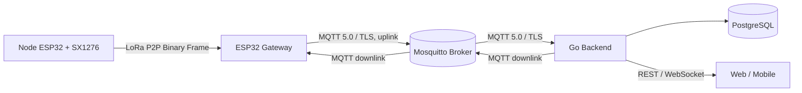
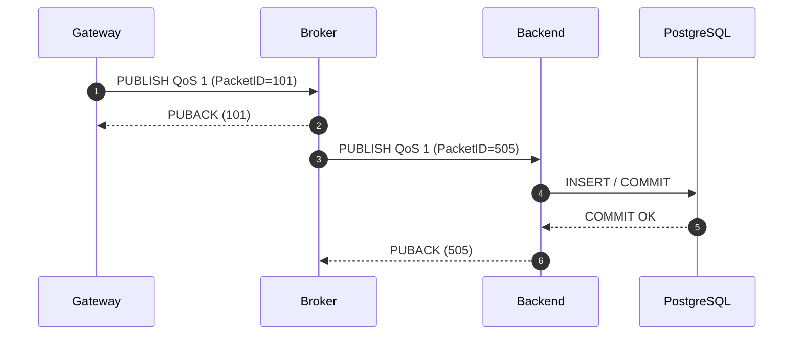
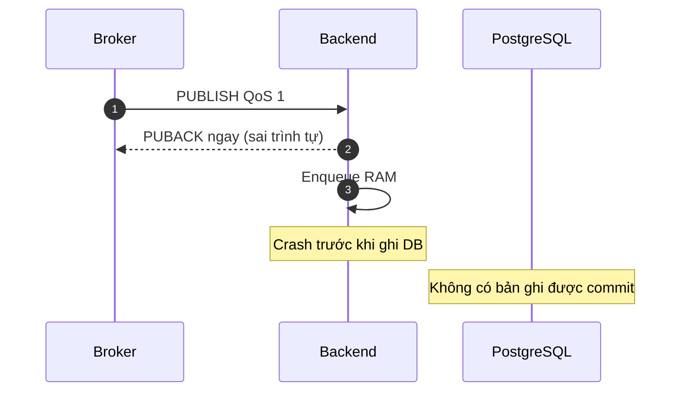
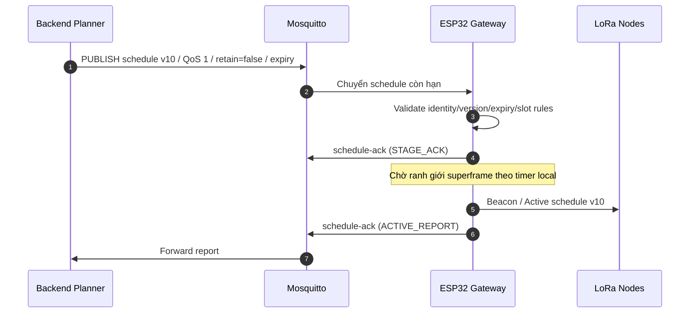

# BM03 — MQTT 5.0 over TLS & Messaging Reliability

**Giáo trình nền tảng Backend Engineering — LoRa P2P Hybrid TDMA**

**Mục tiêu học tập:** Hiểu MQTT 5.0 là gì, tại sao cần trong hệ thống IoT, các cơ chế truyền tin, giới hạn bảo mật/độ tin cậy và cách đánh giá thiết kế do AI Coding Agent đề xuất. **Không yêu cầu tự viết MQTT Broker hoặc Go Subscriber từ đầu.**

**Kiến thức cần có:** BM01 (Go concurrency và quản lý vòng đời), BM02 (PostgreSQL, transactions, idempotency), TCP/IP và kiến thức TLS cơ bản.

**Ranh giới dự án:** Node ESP32 + SX1276 truyền **Custom Binary MAC qua LoRa P2P** tới Gateway. Gateway chuyển tiếp dữ liệu bằng **MQTT 5.0 over TLS** tới Mosquitto; Backend Go lưu PostgreSQL và phục vụ Web/Mobile qua REST/WebSocket. MQTT là đường truyền nội bộ **Gateway ↔ Backend**, không phải LoRaWAN MAC và không điều khiển từng microsecond của TDMA qua Internet.

> **Cách học:** Với mỗi chủ đề, tự trả lời **WHAT → WHY → HOW → LIMITATIONS → APPLICATION**. Dùng ví dụ, sơ đồ, bảng và bài tập để phân tích; mã lệnh (nếu có) chỉ nhằm minh họa, không phải yêu cầu gõ lại.

---

## 1. Bảng thuật ngữ trọng tâm (Module Glossary)

Bảng gồm 40 thuật ngữ cốt lõi. Giữ nguyên tên packet, properties, keyword và API bằng tiếng Anh để có thể tra cứu tài liệu gốc.

| Thuật ngữ / Viết tắt gốc (EN) | English Full Name | Thuật ngữ Tiếng Việt chuẩn hóa | Giải thích bản chất kỹ thuật (VN, rõ nghĩa) |
| :--- | :--- | :--- | :--- |
| **MQTT 5.0** | Message Queuing Telemetry Transport v5.0 | Giao thức truyền thông điệp đo lường từ xa phiên bản 5.0 | Chuẩn giao thức Pub/Sub thế hệ mới của OASIS; bổ sung cơ chế kiểm soát phiên linh hoạt, thuộc tính gói tin (Properties), mã nguyên nhân lỗi (Reason Codes) và cơ chế tự hủy bản tin (Message Expiry). |
| **Broker** | MQTT Message Broker | Máy chủ trung gian điều phối bản tin | Tiến trình trung tâm tiếp nhận bản tin xuất bản từ Publisher, so khớp bộ lọc chủ đề và chuyển tiếp gói tin tới đúng các Subscriber đang kết nối hoặc lưu vào hàng đợi phiên nếu đáp ứng điều kiện phiên. |
| **Publisher** | MQTT Publisher Client | Bên phát bản tin | Thiết bị hoặc dịch vụ (như ESP32 Gateway hoặc Backend Go) gửi bản tin dữ liệu kèm Topic xác định lên Broker mà không cần biết danh tính của bên nhận. |
| **Subscriber** | MQTT Subscriber Client | Bên đăng ký nhận bản tin | Thiết bị hoặc dịch vụ đăng ký một hoặc nhiều Topic Filter trên Broker để nhận các bản tin có Topic khớp với bộ lọc khi có dữ liệu mới phát sinh. |
| **Topic** | MQTT Topic Name | Tên chủ đề xuất bản | Chuỗi ký tự UTF-8 phân cấp bằng dấu gạch chéo (`/`), dùng trong gói `PUBLISH` để định danh luồng dữ liệu (tuyệt đối không được chứa ký tự đại diện `+` hoặc `#`). |
| **Topic Filter** | MQTT Topic Filter | Bộ lọc chủ đề đăng ký | Chuỗi ký tự dùng trong lệnh `SUBSCRIBE`, có thể chứa các ký tự đại diện (`+`, `#`) để lắng nghe đồng thời nhiều chủ đề. *Khác với Topic Name: Topic Name là địa chỉ cụ thể của gói phát; Topic Filter là mẫu so khớp để đăng ký.* |
| **Single-level Wildcard (`+`)** | Single-level Topic Wildcard | Ký tự đại diện một cấp | Ký tự `+` trong Topic Filter, đại diện cho duy nhất một cấp phân cấp nằm giữa hai dấu gạch chéo (ví dụ: `iot/v1/gw/+/uplink/telemetry`). |
| **Multi-level Wildcard (`#`)** | Multi-level Topic Wildcard | Ký tự đại diện đa cấp | Ký tự `#` đặt ở cuối Topic Filter, đại diện cho toàn bộ các cấp phân cấp con phía sau (ví dụ: `iot/v1/gw/gw01/#`). |
| **QoS 1** | Quality of Service Level 1 (At least once) | Cấp chất lượng dịch vụ: Ít nhất một lần | Cơ chế giao vận bảo đảm bản tin được chuyển giao đến bên nhận ít nhất một lần trên từng hop mạng thông qua cơ chế phản hồi `PUBACK` và gửi lại khi mất gói. Không ngăn chặn được bản tin trùng lặp ở tầng ứng dụng và không cam kết 100% không mất dữ liệu nếu Broker sập nguồn hoặc tràn hàng đợi. |
| **Packet Identifier** | Packet Identifier (Packet ID) | Mã định danh gói tin | Trường số nguyên 2-byte (`1`–`65535`) trong Variable Header của các gói tin QoS > 0, dùng để đối chiếu xác nhận giữa bên gửi và bên nhận trong một phiên kết nối cụ thể. |
| **CONNECT** | MQTT Connection Request Packet | Gói yêu cầu thiết lập kết nối | Gói tin điều khiển đầu tiên từ Client gửi tới Broker để mở phiên làm việc MQTT (chứa ClientID, Clean Start, Keep Alive, Properties, LWT, User/Password). |
| **CONNACK** | MQTT Connection Acknowledgement Packet | Gói chấp thuận kết nối | Gói phản hồi từ Broker; trong Variable Header chứa cờ `Session Present` (báo hiệu khôi phục phiên cũ hay không), mã `Reason Code` (0x00 = Success, $\ge 0x80$ = Lỗi; khi lỗi Session Present bắt buộc bằng 0) và Properties. |
| **PUBLISH** | MQTT Publish Message Packet | Gói xuất bản bản tin | Gói tin mang dữ liệu thực tế (Payload), kèm Topic Name, Packet ID (nếu QoS > 0), cờ `DUP`, `QoS`, `RETAIN` và các thuộc tính MQTT 5.0 (như `Message Expiry Interval`). |
| **PUBACK** | MQTT Publish Acknowledgement Packet | Gói xác nhận xuất bản | Gói phản hồi trong luồng QoS 1, xác nhận bên nhận đã tiếp nhận quyền sở hữu gói tin ở hop mạng đó. Có 3 dạng theo OASIS §3.4.2.1: Remaining Length=2 (Packet ID); Remaining Length=3 (Packet ID + Reason Code, Property Length bị **lược bỏ khỏi đường truyền**); Remaining Length $\ge 4$ (Packet ID + Reason Code + Property Length + Properties; khi Length=4, Property Length có thể bằng 0). |
| **Clean Start** | MQTT 5.0 Clean Start Flag | Cờ khởi động phiên sạch | Cờ 1-bit trong gói `CONNECT` của MQTT 5.0: Đặt là 1 yêu cầu Broker hủy bỏ toàn bộ trạng thái phiên cũ trước đó và bắt đầu một phiên hoàn toàn mới; đặt là 0 yêu cầu duy trì/khôi phục phiên cũ nếu còn hiệu lực. *Lưu ý: Clean Start chỉ quyết định cách xử lý phiên khi BẮT ĐẦU kết nối, KHÔNG quyết định phiên có bị xóa hay không khi disconnect.* |
| **Session Expiry Interval** | MQTT 5.0 Session Expiry Interval | Khoảng thời gian duy trì phiên ngoại tuyến | Thuộc tính 4-byte trong gói `CONNECT`/`DISCONNECT` quy định số giây Broker tiếp tục lưu giữ trạng thái phiên (Subscriptions, hàng đợi tin nhắn) sau khi Client bị ngắt kết nối. Giá trị `0` đồng nghĩa phiên kết thúc ngay khi socket đóng. Một phiên tạo với `Clean Start = 1` vẫn được duy trì sau disconnect nếu `Session Expiry Interval > 0`. |
| **Message Expiry Interval** | MQTT 5.0 Message Expiry Interval | Thời hạn tồn tại của bản tin | Thuộc tính 4-byte trong gói `PUBLISH` quy định số giây bản tin còn giá trị. Broker tự động hủy bản tin nếu chưa kịp chuyển giao cho Subscriber trong khoảng thời gian này. Là tính năng tùy chọn của MQTT 5.0, nhưng **bắt buộc theo hợp đồng dự án** cho `downlink/schedule` và `downlink/command`. Không thay thế trường `expires_at` ở tầng ứng dụng. |
| **Reason Code** | MQTT 5.0 Reason Code | Mã nguyên nhân trạng thái | Trường mã 1-byte có trong các gói phản hồi (`CONNACK`, `PUBACK`, `SUBACK`, `DISCONNECT`) thông báo chính xác lý do thành công hoặc mã lỗi kỹ thuật chuẩn hóa theo đặc tả OASIS. |
| **Reason String** | MQTT 5.0 Reason String | Chuỗi giải thích nguyên nhân lỗi | Thuộc tính chuỗi ký tự UTF-8 tùy chọn đi kèm Reason Code giúp con người và hệ thống ghi log chẩn đoán sự cố mạng mà không cần đoán mã hex. |
| **User Property** | MQTT 5.0 User Property | Thuộc tính người dùng tùy biến | Cặp khóa-giá trị chuỗi UTF-8 trong MQTT 5.0 Header cho phép đính kèm metadata ứng dụng (như routing tag, trace ID) mà không cần can thiệp giải mã vùng Payload. |
| **Topic Alias** | MQTT 5.0 Topic Alias | Bí danh số của chủ đề | Số nguyên 2-byte đại diện tạm thời cho một chuỗi Topic dài, giúp giảm kích thước gói tin gửi qua mạng sau lần gửi đầu tiên, tối ưu hóa băng thông truyền thông. |
| **Receive Maximum** | MQTT 5.0 Receive Maximum | Giới hạn gói tin đang vận chuyển tiếp nhận | Thuộc tính kiểm soát luồng (Flow Control) trong gói `CONNECT`/`CONNACK`, quy định số lượng tối đa các bản tin QoS 1/2 chưa được xác nhận mà bên gửi được phép phát đồng thời. |
| **Retained Message** | MQTT Retained Message (RETAIN Flag) | Bản tin lưu giữ trạng thái cuối | Bản tin được Broker lưu lại trên Topic; khi có Subscriber mới đăng ký khớp Topic, Broker sẽ gửi ngay bản tin này xuống (với cờ RETAIN=1). Đối với subscriber đang kết nối sẵn, cờ RETAIN được giữ hay xóa phụ thuộc vào tùy chọn `Retain As Published`. *Quy định dự án: `uplink/status` dùng Retain=true (phản ánh trạng thái cuối đã biết, không chứng minh đang online); `downlink/schedule` bắt buộc Retain=false.* |
| **LWT** | Last Will and Testament | Bản tin di chúc | Bản tin được Client đăng ký trong gói `CONNECT`; Broker sẽ tự động phát tán tới các Subscriber nếu kết nối bị đứt bất thường. *Thời điểm phát tán phụ thuộc vào sự kiện đóng socket, TCP teardown và quy tắc kết thúc phiên làm việc.* |
| **Will Delay Interval** | MQTT 5.0 Will Delay Interval | Khoảng trễ phát tán bản tin di chúc | Thuộc tính 4-byte trong cấu hình LWT của MQTT 5.0: Quy định số giây Broker trì hoãn phát tán LWT sau khi đứt kết nối. **Quy tắc OASIS §§3.1.2.5 & 3.1.3.2.2:** LWT được phát tán khi hết thời hạn delay HOẶC khi Phiên làm việc (Session) kết thúc, tùy điều kiện nào đến trước. *Khi `Session Expiry Interval = 0`, phiên kết thúc ngay khi ngắt kết nối; Broker phát tán LWT ngay sau khi Broker phát hiện mất kết nối, không có thêm Will Delay (phù hợp với quy tắc tại §2.5.4).* |
| **Keep Alive** | MQTT Keep Alive Timer | Chu kỳ kiểm tra duy trì kết nối | Khoảng thời gian tối đa (giây) giữa các gói tin. Nếu không có dữ liệu, Client phải phát `PINGREQ` và Broker phải đáp lại bằng `PINGRESP`. Nếu quá hạn thời gian quy định, Broker sẽ chủ động đóng socket. |
| **Retain Handling** | MQTT 5.0 Retain Handling Option | Tùy chọn kiểm soát nhận tin lưu giữ | Tùy chọn 2-bit trong Subscription Options: `0` = luôn gửi retained messages khi đăng ký; `1` = chỉ gửi nếu subscription chưa tồn tại trong session; `2` = tuyệt đối không gửi retained messages khi đăng ký. |
| **Retain As Published (RAP)** | MQTT 5.0 Retain As Published Option | Tùy chọn bảo lưu cờ Retain khi xuất bản | Tùy chọn 1-bit trong Subscription Options: `0` (Mặc định) = Broker xóa cờ RETAIN khi chuyển tiếp tin trực tiếp tới subscriber đã kết nối sẵn; `1` = Broker giữ nguyên giá trị cờ RETAIN của Publisher gốc khi chuyển tiếp tin. |
| **In-flight Window** | MQTT In-flight Message Window | Cửa sổ bản tin đang vận chuyển | Tập hợp các gói tin QoS > 0 đã được phát đi nhưng chưa nhận được gói xác nhận tương ứng (`PUBACK`/`PUBCOMP`). Bị giới hạn bởi `Receive Maximum`. |
| **Wildcard Subscription** | Topic Wildcard Subscription | Đăng ký theo ký tự đại diện | Cơ chế sử dụng ký tự `+` hoặc `#` trong Topic Filter để lắng nghe đồng thời nhiều chủ đề dữ liệu chỉ với một thao tác đăng ký duy nhất. |
| **Manual ACK** | Client Manual Acknowledgment | Xác nhận thủ công từ ứng dụng | Chế độ trong thư viện Paho Go (`EnableManualAcknowledgment: true`), trao quyền cho mã ứng dụng tự quyết định thời điểm phát gói `PUBACK`, phục vụ mô hình Commit-before-ACK. |
| **ACK-before-commit** | Acknowledge Before Database Commit | Xác nhận trước khi ghi cơ sở dữ liệu | Phản mẫu kiến trúc (Anti-pattern): Gửi `PUBACK` về Broker trước khi dữ liệu được ghi bền vững xuống CSDL, dẫn đến rủi ro mất dữ liệu âm thầm (Silent Data Loss) nếu sập nguồn. |
| **Commit-before-ACK** | Database Commit Before Acknowledge | Ghi cơ sở dữ liệu trước khi xác nhận | Mẫu kiến trúc độ tin cậy cao: Chỉ gửi `PUBACK` về Broker sau khi giao dịch CSDL đã commit thành công xuống đĩa lưu trữ bền vững. |
| **Idempotent Ingestion** | Idempotent Message Ingestion | Tiếp nhận dữ liệu bất biến / lũy đẳng | Cơ chế bảo đảm việc nhận và xử lý lặp lại cùng một bản tin nhiều lần không làm thay đổi trạng thái hệ thống, triệt tiêu trùng lặp do mạng QoS 1 gây ra. |
| **Application Dedup Key** | Application Deduplication Key | Khóa chống trùng lặp cấp ứng dụng | Cặp khóa duy nhất toàn cục `(gateway_id, event_id)` được lưu trong CSDL để phát hiện và bỏ qua các bản tin trùng lặp bằng kỹ thuật `ON CONFLICT DO NOTHING`. Tách biệt hoàn toàn khỏi các bộ đếm vô tuyến của Node (`seq_num`) và Gateway (`superframe_seq`). |
| **Zombie Subscriber** | MQTT Zombie Subscriber Problem | Hiện tượng thuê bao bóng ma | Trạng thái Client duy trì kết nối mạng với Broker nhưng không nhận được bất kỳ dữ liệu nào do ngộ nhận cờ `Session Present` mà bỏ qua bước đăng ký hoặc do SUBACK bị lỗi/hạ cấp QoS. |
| **Thundering Herd** | Connection Thundering Herd Problem | Vấn đề bão tái kết nối đồng thời | Hiện tượng hàng loạt Gateway đồng thời tái kết nối và thực hiện bắt tay mã hóa TLS lên Broker sau sự cố mạng, gây quá tải CPU và làm tê liệt hệ thống máy chủ. |
| **Exponential Backoff** | Exponential Backoff with Jitter | Thuật toán lùi thời gian lũy thừa kèm nhiễu | Thuật toán tính toán thời gian chờ tăng theo hàm mũ kết hợp thành phần ngẫu nhiên (Jitter) trước mỗi lần thử lại, giúp phân tán đều tải tái kết nối lên máy chủ. |
| **Bounded Queue** | Finite Memory / Disk Buffer | Bộ đệm giới hạn dung lượng | Bộ nhớ đệm có giới hạn kích thước tối đa trên Gateway hoặc Broker, bắt buộc phải có chính sách hủy gói (như Drop-Oldest) và bộ đếm rớt gói khi đầy tải. |
| **Subject Alternative Name (SAN)** | X.509 Subject Alternative Name Extension | Tên định danh thay thế trong chứng chỉ | Phần mở rộng bắt buộc của chứng chỉ X.509 hiện đại (RFC 6125), chứa danh sách tên miền DNS và địa chỉ IP hợp lệ của máy chủ; thư viện Go `crypto/x509` bắt buộc dùng SAN để xác thực máy chủ. |

---

## 2. Kiến thức kỹ thuật cốt lõi

### 2.1 MQTT Pub/Sub và vị trí trong kiến trúc LoRa P2P

**WHAT / WHY.** MQTT là giao thức truyền thông điệp theo mô hình **Publish/Subscribe (Pub/Sub)**. Publisher chỉ biết tên chủ đề (Topic) và Broker, không cần biết Subscriber ở đâu. Hệ thống sử dụng MQTT để Gateway gửi telemetry/alert/status và nhận lịch TDMA/command từ Backend theo luồng bất đồng bộ.

| Kiểu phân tách | Cơ chế | Điều kiện/giới hạn |
|---|---|---|
| Space decoupling | Publisher và Subscriber giao tiếp qua Topic/Broker, không gọi trực tiếp lẫn nhau | Cả hai vẫn phụ thuộc Broker và quyền Topic |
| Time decoupling | Broker có thể giữ bản tin khi Subscriber offline | Phải có subscription, session còn hiệu lực, queue đủ chỗ và message chưa hết hạn |
| Synchronization decoupling | Publisher không chờ Subscriber hoàn tất nghiệp vụ | `PUBACK` không chứng minh Backend đã ghi DB hoặc Node thực thi lệnh |



**HOW / APPLICATION.** Backend hoạch định lịch TDMA và gửi xuống Gateway; Gateway kiểm tra lịch và thực thi thời gian thực bằng timer/firmware. Giao tiếp qua MQTT **không có tính tất định về latency/jitter** nên không dùng để ra lệnh phát từng slot. Web/Mobile không kết nối trực tiếp MQTT Broker trong kiến trúc dự án.

**LIMITATIONS.** MQTT không tự cung cấp database durability, application authorization hay sự bảo đảm việc RF command đã hoàn thành. Các yêu cầu đó nằm tại tầng ứng dụng, Broker configuration và hợp đồng riêng.

### 2.2 Topic Tree, Wildcards và ACL

**WHAT.** `Topic Name` là địa chỉ cụ thể của bản tin `PUBLISH`; `Topic Filter` là mẫu lọc được `SUBSCRIBE` sử dụng. `+` khớp một cấp; `#` khớp nhiều cấp và phải nằm cuối filter. Wildcards **không được xuất hiện trong Topic Name**.

**Namespace dự án** (MQTT contract hiện ở trạng thái Draft/Proposed):

```text
iot/v1/gw/{gateway_id}/{direction}/{message_type}

iot/v1/gw/gw01/uplink/telemetry     QoS 1, retain=false
iot/v1/gw/gw01/uplink/alert         QoS 1, retain=false
iot/v1/gw/gw01/uplink/status        QoS 1, retain=true
iot/v1/gw/gw01/uplink/schedule-ack  QoS 1, retain=false
iot/v1/gw/gw01/uplink/command-ack   QoS 1, retain=false
iot/v1/gw/gw01/downlink/schedule    QoS 1, retain=false
iot/v1/gw/gw01/downlink/command     QoS 1, retain=false
```

**WHY / HOW.** ACL theo nguyên tắc *Least Privilege* gắn quyền với danh tính đã xác thực (Authenticated Username), không chỉ dựa vào `ClientID` tự khai báo.

| Vai trò | Hướng | Topic Filter được phép |
|---|---|---|
| Gateway `gw01` | Publish | `iot/v1/gw/gw01/uplink/#` |
| Gateway `gw01` | Subscribe | `iot/v1/gw/gw01/downlink/#` |
| Backend | Subscribe | `iot/v1/gw/+/uplink/#` |
| Backend | Publish | `iot/v1/gw/+/downlink/#` |

**LIMITATIONS.** Mosquitto ACL `read/write` quản lý quyền Topic, không phải bảng gán QoS cho từng Topic. Một Gateway không được có quyền publish sang namespace của Gateway khác. `schedule-ack` là suffix chuẩn trong draft contract, không phải `sched_ack`.

### 2.3 MQTT Control Packets, Properties và Reason Codes

**WHAT.** Gói tin MQTT có Fixed Header, Variable Header và Payload (tùy loại packet). Fixed Header chứa loại packet và `Remaining Length`, được mã hóa dưới dạng **Variable Byte Integer** tối đa bốn byte.

```text
Fixed Header     : Packet Type + Flags + Remaining Length (Varint)
Variable Header  : Packet ID, Reason Code, Properties... (tùy packet)
Payload          : Message body hoặc các trường đặc thù từng packet
```

**HOW.** `CONNECT` thiết lập phiên; `CONNACK` chấp thuận/từ chối; `PUBLISH` mang bản tin; `PUBACK` xác nhận QoS 1; `SUBSCRIBE` đăng ký; `SUBACK` trả kết quả từng filter. MQTT 5.0 có các Properties như `Message Expiry Interval`, `Receive Maximum`, `Reason String` và `User Property`.

**Ba cách mã hóa PUBACK** (OASIS MQTT 5.0 §3.4.2.1):

| Remaining Length | Nội dung trên wire | Điểm cần hiểu |
|---|---|---|
| `2` | Packet Identifier (2 byte) | Ngầm hiểu Reason Code `0x00`; không có Property Length trên wire |
| `3` | Packet Identifier + Reason Code | Trường Property Length bị lược bỏ, không phải giá trị `0` được gửi |
| `≥ 4` | Packet Identifier + Reason Code + Property Length + Properties | Khi bằng `4`, Property Length có thể là `0` |

**SUBACK:** Không được nhầm “thành công theo chuẩn” với “đạt QoS mà dự án yêu cầu”.

| Code | Ngữ nghĩa | Đánh giá cho telemetry QoS 1 |
|---|---|---|
| `0x00` | Granted QoS 0 | Không đạt yêu cầu độ tin cậy dự án |
| `0x01` | Granted QoS 1 | Đạt yêu cầu đã đăng ký |
| `0x02` | Granted QoS 2 | Thành công theo chuẩn, không phải profile dự án chọn |
| `≥ 0x80` | Reason Code lỗi | Phải xử lý lỗi/không công bố `READY` |

**LIMITATIONS / APPLICATION.** Đoạn kiểm tra `if code >= 0x80` chỉ bắt lỗi giao thức; nó **bỏ lọt việc Granted QoS 0**. Với subscription bắt buộc QoS 1, cần đối chiếu chính xác `0x01`. Mosquitto `max_qos` có thể giới hạn năng lực theo listener; ACL không định nghĩa `max_qos` từng topic. Publisher gửi QoS vượt Maximum QoS được Broker công bố là tình huống khác với Subscriber nhận SUBACK hạ cấp.

### 2.4 QoS 1, PUBACK và ranh giới Database COMMIT

**WHAT / WHY.** QoS 1 áp dụng cơ chế *at least once* trên **từng hop**. Hop Gateway → Broker và hop Broker → Backend có Packet Identifier khác nhau; Packet ID có thể được tái sử dụng khi việc xác nhận hoàn tất. Không dùng Packet ID hay cờ `DUP` làm khóa chống trùng nghiệp vụ.



**HOW.** Nếu Backend gửi `PUBACK` khi dữ liệu chỉ nằm trong RAM queue, crash có thể khiến dữ liệu mất mà Broker không gửi lại. Mẫu tin cậy hơn là **Commit-before-ACK**: chỉ ACK sau khi đã ghi bền vững vào bảng chính hoặc vùng cách ly đã được thiết kế cho dữ liệu lỗi.

| Điểm thất bại | Điều có thể xảy ra | Nguyên tắc xử lý |
|---|---|---|
| ACK trước khi DB commit | Crash gây mất dữ liệu âm thầm | Tránh ACK-before-commit |
| DB commit xong, ACK chưa tới Broker | Broker có thể gửi lại khi khôi phục phiên | Idempotent ingestion theo application key |
| Lỗi DB tạm thời | Retry vô hạn gây nghẽn | Bounded retry/backoff; chưa xác nhận thì giữ ACK |
| Bản tin lỗi vĩnh viễn (poison pill) | Retry mãi sẽ tắc hàng đợi | Chỉ ACK sau khi cách ly bền vững thành công; cách ly là thiết kế đề xuất |
| Không ACK nhưng socket vẫn sống | In-flight window có thể đầy | Cần connection lifecycle/recovery policy; không tự giả định Broker lập tức redeliver |

**LIMITATIONS.** `PUBACK` chỉ xác nhận việc tiếp nhận ở hop MQTT, **không chứng minh** DB commit, Gateway áp dụng lịch hay Node đã vận hành actuator thành công. QoS 1 không bảo đảm *exactly once business execution* hoặc không mất dữ liệu tuyệt đối trước disk failure, queue overflow, session expiry.

### 2.5 Session, Message Expiry, Retain và LWT

**Clean Start** quyết định cách Broker xử lý *phiên cũ khi client bắt đầu kết nối*; **Session Expiry Interval** quyết định *phiên mới/đang dùng tồn tại bao lâu sau disconnect*.

| Clean Start | Session Expiry | Hành vi | Ví dụ ứng dụng |
|:---:|:---:|---|---|
| 1 | 0 | Bỏ phiên cũ, tạo phiên mới; xóa khi disconnect | Gateway profile stateless |
| 1 | >0 | Tạo phiên sạch nhưng giữ sau disconnect | Khởi tạo một phiên bền vững mới |
| 0 | 0 | Khôi phục phiên còn hiệu lực nếu có, xóa khi disconnect | Kết nối không cần offline queue sau đó |
| 0 | >0 | Khôi phục phiên còn hiệu lực, tiếp tục lưu sau disconnect | Backend profile stateful |

**Profile dự án:** Gateway dùng `Clean Start=1`, `Session Expiry=0`; Backend dùng `Clean Start=0`, `Session Expiry>0` khi muốn khôi phục phiên cũ (khi chủ động tạo phiên mới sạch cần có bước phù hợp). Giá trị `7200 s` trong ví dụ là **tham số minh họa**, không phải bảo đảm lưu được đủ hai giờ trong mọi tình huống.

**Ba giới hạn độc lập của offline delivery:** (1) Broker còn giữ trạng thái phiên; (2) Broker có cấu hình persistence để chịu crash và queue chưa đầy; (3) bản tin chưa hết `Message Expiry Interval`. Session tồn tại trên RAM **không đồng nghĩa** sống sót khi Broker mất điện.

**Retained Message:** Broker giữ một bản tin trạng thái cuối theo Topic. Trong dự án, `uplink/status` dùng retain để người nhận có last-known state, nhưng **retained status không chứng minh Gateway đang online**. `downlink/schedule` và `downlink/command` không bật retain để tránh lệnh cũ bị nhận lại sau reboot.

| Subscription Option | Giá trị | Hành vi |
|---|---|---|
| Retain Handling | 0 | Gửi retained messages khi subscribe |
| Retain Handling | 1 | Chỉ gửi nếu subscription chưa tồn tại trong session |
| Retain Handling | 2 | Không gửi retained messages tại thời điểm subscribe |
| Retain As Published (RAP) | 0 | Cờ RETAIN của live-forwarded message được xóa |
| Retain As Published (RAP) | 1 | Giữ cờ RETAIN ban đầu của Publisher khi forward |

**Freshness:** Không suy ra một message “mới” từ `RETAIN=0`, hay “cũ” từ `RETAIN=1`. Để đánh giá độ tươi dữ liệu, kết hợp `observed_at`, `observed_time_source`, `buffered`, `ingested_at` và logic giám sát kết nối.

**LWT (Last Will and Testament):** Broker phát thông điệp di chúc khi phát hiện kết nối client kết thúc bất thường. Theo tương tác `Will Delay Interval` / `Session Expiry Interval`, bản tin Will được phát khi hết delay **hoặc** khi session kết thúc, tùy mốc nào đến trước. Vì Gateway đặt `Session Expiry=0`, Will Delay có thể không tạo độ trễ mong muốn. Thời điểm thực tế Broker phát hiện mất kết nối còn phụ thuộc TCP/Keep Alive.

### 2.6 MQTT over TLS, xác thực và phân quyền

**WHAT / WHY.** TLS trên cổng MQTT bảo mật (thường là `8883`) bảo vệ dữ liệu trên đường IP khỏi nghe lén và chỉnh sửa khi truyền; nó không thay thế phân quyền Broker, thẩm định JSON hay bảo mật khóa ở endpoint.

**HOW.** Client kiểm tra chuỗi chứng chỉ X.509 đến CA tin cậy và tên Broker trong trường **Subject Alternative Name (SAN)**. Nếu client gọi `broker.loratdma.internal`, SAN phải có DNS đó; nếu gọi bằng IP, SAN phải phù hợp IP. Tắt hostname/certificate verification để “cho kết nối thành công” là cấu hình không an toàn.

| Danh tính | Công dụng | Lưu ý |
|---|---|---|
| `ClientID` | Gắn MQTT Session/queue | Do client khai báo; không đủ làm danh tính phân quyền duy nhất |
| Authenticated Username | Danh tính cho password/token và Mosquitto ACL | Chỉ cấp quyền Topic tương ứng |
| Client Certificate Identity | Danh tính qua mTLS (nếu dùng) | Cần chính sách cấp phát/chống mất khóa riêng |

**Ví dụ cấu hình chỉ để đọc hiểu:**

```text
listener 8883
protocol mqtt
cafile /etc/mosquitto/certs/ca.crt
certfile /etc/mosquitto/certs/server.crt
keyfile /etc/mosquitto/certs/server.key
allow_anonymous false
password_file /etc/mosquitto/passwords.txt
acl_file /etc/mosquitto/acl.conf
```

**LIMITATIONS / APPLICATION.** Chỉ chứng chỉ có SAN đúng chưa đủ; phải tin CA phù hợp, kiểm tra thời hạn và định danh, quản lý password/private key an toàn, giám sát lỗi handshake. Tùy chọn `tls.Config.KeyLogWriter` có thể dùng cho Wireshark trong môi trường thử nghiệm cô lập, nhưng tạo dữ liệu có khả năng giải mã TLS nên **không sử dụng hoặc phát tán key log trong production**. Cơ chế one-way TLS so với mTLS còn là lựa chọn thiết kế cần quyết định.

### 2.7 Bounded queues, reconnect và Idempotent Ingestion

**WHAT.** Mất Wi-Fi, Broker/DB restart hoặc Gateway reboot là tình huống bình thường của IoT. Giao thức cần cơ chế hồi phục có giới hạn và phân biệt message identity với các bộ đếm RF.

**Backoff with jitter:** Chờ giữa các lần kết nối tăng dần theo cấp số nhân với thành phần ngẫu nhiên, tránh nhiều Gateway cùng bắt tay TLS đồng thời. Những tham số `1 s`, `60 s`, jitter `0..1000 ms` chỉ là ví dụ để phân tích, không phải cấu hình đã benchmark.

**Bounded queues:** Broker và ESP32 đều có dung lượng hữu hạn; khi đầy phải có chính sách ưu tiên và xử lý mất mát có thể quan sát được. Trong schema status dự án có hai bộ đếm `offline_dropped_telemetry` và `offline_dropped_alert`. Không thể hứa “không mất dữ liệu dù offline vô thời hạn”.

**Phân biệt ba định danh:**

| Trường | Chủ sở hữu / phạm vi | Có phù hợp làm application dedup key duy nhất qua reboot? |
|---|---|---|
| `seq_num` (8 bit) | Node, có thể quay vòng và khởi tạo lại | Không |
| `superframe_seq` | Gateway, được phát trong beacon | Không đủ nếu dùng riêng; khôi phục sau Gateway reboot tùy firmware/NVS |
| `event_id` kết hợp `gateway_id` | Định danh MQTT event sinh ở Gateway | Là application identity được đề xuất trong draft MQTT contract |

Tài liệu kiến trúc tham khảo `esp32_sx1762.md` có phương án đọc counter từ NVS và cộng `+100` sau một số sự cố Gateway. Đây là **thiết kế tham khảo, chưa phải bằng chứng firmware đã triển khai hoặc tuyệt đối không trùng counter**. Node reboot không tự làm reset counter thuộc Gateway.

**Application deduplication:** Theo draft contract, định danh được tạo từ `gateway_epoch` (UUID của phiên boot) và `event_seq` (số thứ tự event), với UNIQUE `(gateway_id, event_id)` ở PostgreSQL. MQTT Packet ID, cờ `DUP`, `seq_num` RF không thể thay thế khóa này. Cơ chế `INSERT ... ON CONFLICT DO NOTHING` tránh ghi lặp cùng khóa; **bản thân nó không chứng minh payload của hai sự kiện trùng khóa giống hệt nhau** — policy so sánh dữ liệu cần thống nhất khi triển khai.

**Ranh giới:** UUID/epoch giảm nguy cơ ID collision theo giả định sinh định danh đúng; vẫn cần kiểm tra ID generation, replay handling, DB persistence và error paths. Kết quả RF/HIL, queue sizing và tốc độ thực tế chưa được chứng minh chỉ bằng sơ đồ học tập.

---

## 3. Tám cảnh báo kỹ thuật cần nhớ

| Rủi ro | Nhận định sai thường gặp | Nguyên tắc đúng |
|---|---|---|
| 1. PUBACK ≠ xử lý nghiệp vụ | Broker ACK tức là Node/DB đã xử lý | Phải có Application ACK và DB Commit theo từng cấp |
| 2. SUBACK downgrade | `code < 0x80` luôn đủ để bật `READY` | Với subscription đòi QoS 1, kiểm tra `code == 0x01` |
| 3. RF counter collision | Node reboot làm reset `superframe_seq` của Gateway | Xác định owner của từng counter; chống trùng theo stable application `event_id` |
| 4. Stale schedule | `retain=true` giúp mọi downlink an toàn | Lịch/command dùng `retain=false`, message expiry và reconciliation |
| 5. Retain ≠ freshness | `RETAIN=0` luôn là dữ liệu mới | Xem timestamp, `buffered` và trạng thái kết nối |
| 6. Callback error ≠ reconnect | Trả lỗi từ Paho handler sẽ tự ngắt/tái kết nối | Cần lifecycle supervisor, retry và failure escalation rõ ràng |
| 7. Reconnect storm | Cứ retry cùng một chu kỳ cố định | Exponential backoff + jitter + hạn mức tài nguyên |
| 8. Will Delay | Đặt Will Delay là chắc chắn chờ đúng N giây | Will Delay tương tác Session Expiry; khi session kết thúc trước, Will được phát sớm |

---

## 4. Ba workshop phân tích giao thức và thiết kế

> **Cách thực hiện:** Đọc tình huống → dự đoán hành vi MQTT → giải thích nguyên nhân → chỉ ra giới hạn → phản biện cấu hình/đề xuất của AI. Có thể dùng Mosquitto CLI hoặc Wireshark để tự quan sát thêm, **không bắt buộc lập trình Go hay dựng môi trường production**.

### Workshop 1 — Giải phẫu packets, session và SUBACK

**Tình huống A — Phân tích session:** Một client kết nối với `Clean Start=1`, `Session Expiry=3600`. Sau 5 phút, client disconnect rồi kết nối lại cùng ClientID với `Clean Start=0`.

**Câu hỏi:** Phiên tạo lúc đầu có thể còn không? Vì sao `Clean Start=1` không đồng nghĩa với xóa khi disconnect? Nếu lần kết nối sau lại dùng `Clean Start=1` thì khác gì?

**Đáp án:** Có thể còn nếu chưa bị xóa/hết hạn và Broker giữ được session. `Clean Start` tác động lúc bắt đầu phiên; Expiry điều khiển việc giữ sau disconnect. Lần sau `Clean Start=1` sẽ yêu cầu bỏ phiên cũ và bắt đầu lại.

**Tình huống B — Đọc packet/reason:** Trong một `SUBACK`, Topic Filter telemetry được trả về code `0x00`, trong khi Subscriber yêu cầu QoS 1. Một AI Coding Agent tuyên bố thành công vì `0x00 < 0x80`.

**Câu hỏi:** Kết nối có thành công theo MQTT không? Pipeline telemetry đã đáp ứng contract chưa? Phải làm gì với trạng thái `READY`?

**Đáp án:** SUBSCRIBE đã được chấp nhận **ở QoS 0**, nhưng **không đáp ứng** yêu cầu QoS 1. Giữ trạng thái `NOT_READY`, ghi nhận vi phạm điều kiện dịch vụ và kiểm tra broker/listener/client configuration.

**Tình huống C — PUBACK encoding:** Một packet `PUBACK` có `Remaining Length=3`. Học viên nghĩ byte cuối là `Property Length=0`.

**Đáp án:** Sai. Trong dạng này byte thứ ba là **Reason Code**; trường Property Length **không xuất hiện trên wire**. Khi `Remaining Length=4`, mới có thể xuất hiện `Property Length=0`.

### Workshop 2 — Phân tích TLS/ACL và luồng Commit-before-ACK

**Tình huống A — TLS mismatch:** Client truy cập Broker bằng IP `192.168.1.99`; chứng chỉ chỉ có `DNS:broker.loratdma.internal` và `IP:127.0.0.1`.

**Câu hỏi:** TLS handshake có nên thành công không? Vì sao không được bỏ kiểm tra chứng chỉ để sửa nhanh?

**Đáp án:** Xác minh hostname/IP phải thất bại khi địa chỉ truy cập không thuộc SAN đã cấp (giả định quá trình xác minh được bật đúng). Tắt certificate/hostname verification làm mất xác thực đầu cuối và tăng nguy cơ MITM. Cần cấu hình lại địa chỉ kết nối hoặc phát hành chứng chỉ có SAN phù hợp.

**Tình huống B — ACL:** Gateway đăng nhập bằng username `gw01` và publish `iot/v1/gw/gw02/uplink/telemetry`.

**Đáp án:** Không được phép theo ACL ví dụ. Việc client tự đặt ClientID khác không cấp quyền publish sang namespace của Gateway khác.

**Tình huống C — Data loss timeline:** Broker chuyển telemetry QoS 1 cho Backend; handler ACK ngay rồi mới đưa dữ liệu vào RAM Go channel. Backend crash trước DB COMMIT.



**Câu hỏi:** Vì sao Broker không bắt buộc gửi lại? Hãy trình bày luồng xử lý bền vững hơn và hai nhánh lỗi DB.

**Đáp án:** Khi ACK đã được xử lý, hop QoS 1 kết thúc; dữ liệu chỉ nằm trong RAM có thể mất. Thiết kế tốt hơn: Validate → DB insert/commit → ACK. Khi DB lỗi tạm thời: retry có giới hạn, không ACK trước commit. Khi payload lỗi vĩnh viễn: nếu có chính sách quarantine thì ACK **sau khi** ghi cách ly bền vững thành công; nếu không, cần đường escalation/recovery riêng. `Manual ACK`/connection supervisor là khả năng cần đối chiếu thư viện và implementation thực tế, không nên giả định pseudocode đã chạy.

### Workshop 3 — Gateway offline, queue overflow, expiry và schedule reconciliation

**Tình huống A — Stateless Gateway:** Gateway có `Clean Start=1`, `Session Expiry=0`; khi Gateway offline, Backend publish một `downlink/schedule` QoS 1, `retain=false`. Gateway online trở lại.

**Câu hỏi:** Gateway có tự nhận lại lịch được gửi khi offline không? Nên đổi retain thành true không?

**Đáp án:** Với profile không giữ session và non-retained message, không có cơ chế bảo đảm lịch offline tự được phát lại. **Không** bật retain cho lịch. Gateway gửi status/version hiện hành; Backend đối soát và phát lại bản lịch còn hợp lệ, kèm expiry và validation ở Gateway.

**Tình huống B — Offline buffer:** Gateway có ring buffer tối đa 50 event, mất Wi-Fi và thu thêm 70 telemetry, chính sách minh họa là Drop-Oldest.

**Câu hỏi:** Tối thiểu bao nhiêu event bị loại nếu không có cơ chế lưu trữ khác? Dashboard cần quan sát điều gì?

**Đáp án:** Với giả định queue ban đầu rỗng và mỗi event chiếm một slot, **20** sự kiện cũ bị loại; `offline_dropped_telemetry` phải tăng tương ứng. Nếu bản tin alert có chính sách ưu tiên riêng, phải phân tích riêng, không tự coi drop alert là chấp nhận được.

**Tình huống C — Message Expiry:** Subscriber kiểm thử có session tồn tại 300 giây. Backend publish một message có Expiry 15 giây khi Subscriber offline; Subscriber kết nối lại ở giây thứ 5 hoặc thứ 30.

**Đáp án:** Nếu đủ điều kiện lưu queue, khi quay lại ở giây 5 message còn thời gian sống và có thể được chuyển tiếp. Khi quay lại ở giây 30 thì message đã hết hạn và không được chuyển tiếp từ queue. Expiry chỉ giới hạn việc chuyển giao; đối với command/schedule, Gateway vẫn phải kiểm tra `expires_at`, version và identity ở tầng ứng dụng.

**Tình huống D — LWT:** Gateway có `Session Expiry=0`, cấu hình `Will Delay=10s` rồi mất kết nối bất thường.

**Đáp án:** Session kết thúc sau khi Broker phát hiện mất kết nối, nên Will được phát khi session kết thúc mà không nhất thiết chờ đủ 10 giây; không được suy ra thời điểm chính xác bắt đầu từ lúc điện bị cắt.

---

## 5. Kiểm tra kiến thức và bài tập phân tích

### 5.1 Năm câu hỏi trắc nghiệm tình huống

**MCQ 1.** Gateway cấu hình `Session Expiry=0`, `Will Delay=15s`. Vì sao LWT có thể được gửi sớm ngay sau khi Broker phát hiện mất kết nối?

- **A.** Mosquitto chắc chắn bị lỗi.
- **B.** Session kết thúc trước thời điểm Will Delay.
- **C.** Do cờ retain=false.
- **D.** Do Gateway đã graceful DISCONNECT.

**Đáp án: B.** Will được phát khi hết delay **hoặc** session kết thúc, tùy điều kiện đến trước. Graceful disconnect thông thường không phải tình huống phát Will.

**MCQ 2.** Gateway offline khi Backend publish lịch TDMA; Gateway dùng Stateless Session, lịch `retain=false`. Giải pháp đúng nhất?

- **A.** Bật retained schedule.
- **B.** Gateway publish status, Backend reconciliation và gửi lịch còn hợp lệ.
- **C.** QoS 2 chắc chắn lưu vô hạn.
- **D.** Chuyển việc điều khiển từng slot lên Cloud.

**Đáp án: B.** Profile stateless không giữ queue downlink khi offline; retained schedule có nguy cơ áp dụng lịch cũ.

**MCQ 3.** Vì sao không dùng `UNIQUE (gateway_id,node_id,superframe_seq,seq_num)` làm khóa chống trùng ứng dụng chính?

- **A.** Node reboot luôn reset counter Gateway.
- **B.** Counter RF có thể quay vòng/tái sử dụng sau reboot hoặc phục hồi lỗi; cần stable application event identity.
- **C.** Mọi lần `seq_num` quay vòng đều lập tức trùng.
- **D.** PostgreSQL không hỗ trợ composite keys.

**Đáp án: B.** `superframe_seq` thuộc Gateway; xung đột composite key chỉ xảy ra khi tất cả trường trùng. `(gateway_id,event_id)` là identity theo draft contract và cần cơ chế sinh ID đúng.

**MCQ 4.** Backend ACK message QoS 1 sau khi enqueue vào RAM nhưng trước DB commit; Backend crash. Rủi ro chính?

- **A.** Broker luôn phát lại.
- **B.** Silent data loss.
- **C.** Go channel tự phục hồi sau reboot.
- **D.** PostgreSQL tự lấy message từ Broker.

**Đáp án: B.** Hop QoS 1 có thể đã hoàn tất, còn dữ liệu ở RAM chưa được lưu bền vững. Khuyến nghị Commit-before-ACK.

**MCQ 5.** AI kiểm tra `SUBACK` bằng `if code >= 0x80 { fail }` rồi đánh dấu telemetry QoS 1 đã sẵn sàng. Lỗ hổng nào còn tồn tại?

- **A.** `0x00` là Granted QoS 1.
- **B.** `0x00` là Granted QoS 0, vẫn qua điều kiện kiểm tra.
- **C.** `0x01` là lỗi.
- **D.** `0x87` là Granted QoS 1.

**Đáp án: B.** Code phải kiểm tra đúng mức QoS được cấp; với yêu cầu QoS 1, `0x00` không đủ và không nên đánh dấu `READY`.

### 5.2 Ba bài tập phân tích kiến trúc

**Bài 1 — MQTT-to-PostgreSQL ingestion.** Một AI Agent đề xuất callback tự động gửi PUBACK trước khi ghi PostgreSQL. Hãy vẽ flow cho nhánh thành công, lỗi DB tạm thời và poison-pill; đánh dấu điều kiện được phép ACK.

**Gợi ý lời giải:** (i) Payload valid → SQL COMMIT → ACK. (ii) DB transient → bounded retries → chỉ ACK sau commit; nếu hết retry thì escalated recovery, tránh giữ socket ổn định với in-flight bão hòa. (iii) Poison pill → durable quarantine được thiết kế và commit → ACK; nếu quarantine fail → không ACK và cảnh báo. Quarantine/connection lifecycle supervisor là đề xuất thiết kế, không phải đã triển khai.

**Bài 2 — Zombie Subscriber.** Backend báo socket MQTT connected và `Session Present=true`, nhưng Dashboard không nhận telemetry. AI Agent bỏ `SUBSCRIBE` nếu thấy Session Present. Hãy tìm bug và định nghĩa tiêu chí `READY`.

**Gợi ý lời giải:** Session tồn tại không chứng minh Topic Filter đã được đăng ký thành công. Mỗi lần reconnect cần đối soát subscription mong muốn, nhận `SUBACK`, kiểm tra Granted QoS 1 (`0x01`), sau đó mới công bố `READY`. Mã `0x00` hoặc `≥0x80` không đạt yêu cầu. Kết nối socket và trạng thái sẵn sàng ứng dụng là hai sự kiện khác nhau.

**Bài 3 — Hai pha điều phối lịch TDMA.** Backend có lịch version 10, Gateway còn chạy version 9 khi mất Wi-Fi. AI Agent đề xuất `retain=true` cho lịch và gửi lệnh chuyển slot từ cloud theo từng microsecond. Hãy phản biện và đề xuất sequence.



**Gợi ý lời giải:** Backend chỉ hoạch định; Gateway mới kiểm tra/đệm lịch và đổi lịch tại superframe boundary. `STAGE_ACK` là đã nhận và staging, không phải đang phát. `ACTIVE_REPORT` là báo cáo của Gateway về lịch đang chạy, cần đối soát định danh/version; vẫn không có bằng chứng rằng mọi Node ngoài hiện trường đã thực sự đồng bộ thành công nếu thiếu RF feedback tương ứng. Khi reconnect, Gateway publish status v9, Backend đối soát và gửi lại lịch v10 còn hợp lệ. `Retain=false` chống tái sử dụng lịch cũ; TTL MQTT không thay thế `expires_at` của ứng dụng.

---

## 6. Checklist tự đánh giá và nguồn tra cứu

Chỉ đánh dấu khi có thể **giải thích cơ chế và xử lý một tình huống**, không phải sau khi đọc xong trang.

- [ ] Giải thích Pub/Sub, Broker và ba kiểu decoupling; vẽ được đường đi Node → Gateway → Broker → Go → PostgreSQL.
- [ ] Phân biệt Topic Name và Topic Filter; xác định namespace canonical và ACL tối thiểu.
- [ ] Phân tích Fixed/Variable Header, ba định dạng `PUBACK` và các Properties MQTT 5.0.
- [ ] Phân biệt SUBACK `0x00` và `0x01`; chỉ ra bug `code >= 0x80` khi dịch vụ đòi QoS 1.
- [ ] Giải thích QoS 1 theo từng hop; lý do cần Commit-before-ACK và application deduplication.
- [ ] Phân tích bốn tổ hợp Clean Start / Session Expiry và các điều kiện offline delivery.
- [ ] Giải thích Retained Message, Retain Handling, RAP, Message Expiry và giới hạn xác định freshness.
- [ ] Giải thích LWT/Will Delay, SAN, TLS server identity, Authenticated Username và ACL.
- [ ] Tính được overflow của bounded queue và lý do dùng exponential backoff + jitter.
- [ ] Phản biện được quy trình Gateway reboot/reconnection, `event_id`, schedule staging và `ACTIVE_REPORT`.

**Nguồn đọc tiếp:**

- [OASIS — MQTT Version 5.0 Standard](https://docs.oasis-open.org/mqtt/mqtt/v5.0/os/mqtt-v5.0-os.html) — packet formats, QoS, sessions, retain, expiry, LWT.
- [Mosquitto — Configuration Reference](https://mosquitto.org/man/mosquitto-conf-5.html) — listeners, TLS, ACL, queue limits và persistence.
- [Espressif — ESP-MQTT API Reference](https://docs.espressif.com/projects/esp-idf/en/v5.5.1/esp32/api-reference/protocols/mqtt.html) — cấu hình ESP-MQTT theo phiên bản tài liệu tham khảo.
- [Eclipse Paho Go](https://pkg.go.dev/github.com/eclipse/paho.golang/autopaho) — MQTT 5.0 client candidate; kiểm tra phiên bản/API thực tế trước khi triển khai.
- [Go crypto/x509](https://pkg.go.dev/crypto/x509) — certificate chain, SAN và hostname verification.
- Dự án: `docs/adr/0002-mqtt-5.md`, `contracts/mqtt/topics.md`, `contracts/mqtt/schemas/`, `contracts/OPEN_DECISIONS.md` — đọc đúng phiên bản/hợp đồng đã được phê duyệt trước khi áp dụng.

**Lưu ý:** Các sơ đồ, profile và tình huống trong giáo trình giúp hiểu thiết kế; chúng không phải kết quả đo kiểm mạng, xác nhận HIL/RF, cấu hình bảo mật production hay bằng chứng mã Go đã được build/test. Những giao diện MQTT Contract còn Draft phải được phê duyệt theo quy trình dự án trước khi dùng làm chuẩn triển khai.

