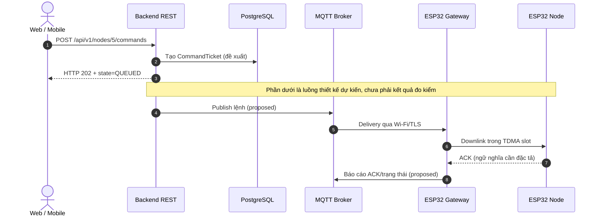
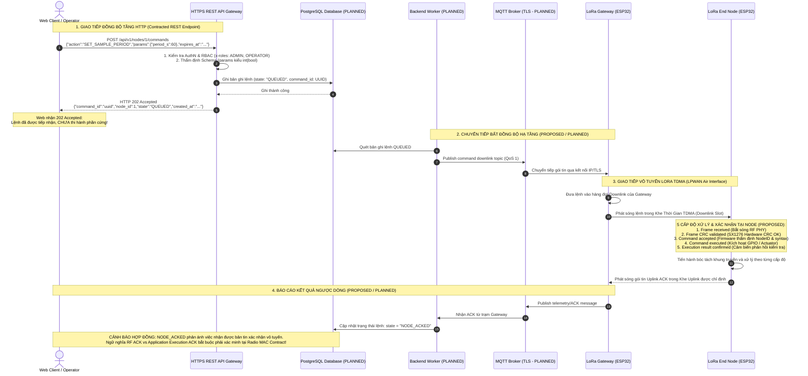
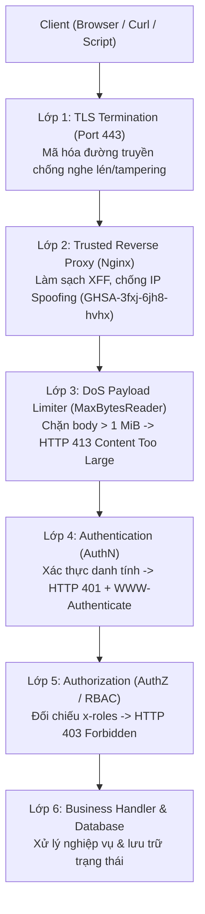

# BM04 — REST API over HTTPS & OpenAPI Contracts

**Giáo trình kiến thức giao thức và kiến trúc hệ thống IoT**  
**Bối cảnh:** LoRa P2P Hybrid TDMA — ESP32/SX1276 · Backend Go · PostgreSQL · MQTT · Web/Mobile  
**Thời lượng gợi ý:** 6 giờ (2 giờ nguyên lý, 2 giờ phân tích hợp đồng và luồng giao tiếp, 2 giờ bài tập).

## Mục tiêu học tập

Sau khi hoàn thành, người học có thể:

1. **WHAT:** Giải thích REST, HTTP, HTTPS, TLS và OpenAPI là gì; phân biệt giao thức với kiểu kiến trúc và tài liệu hợp đồng.
2. **WHY:** Lý giải vì sao dự án sử dụng REST/HTTPS giữa Web/Mobile và Backend, nhưng dùng Custom Binary MAC trên liên kết LoRa P2P.
3. **HOW:** Đọc HTTP request/response, hiểu ý nghĩa status code, truy vết một lệnh bất đồng bộ từ Client đến Node.
4. **LIMITATIONS:** Xác định ranh giới bảo đảm của HTTP 202, TLS, RBAC, idempotency, MQTT QoS và RF ACK; nhận diện tình huống thất bại.
5. **APPLICATION:** Đọc và phản biện OpenAPI Contract; đánh giá giải pháp do AI Coding Agent đề xuất mà không cần tự viết REST server.

> **Phạm vi:** Tài liệu dùng để học và phân tích thiết kế, không phải hướng dẫn triển khai production. Các ví dụ nội bộ của dự án tuân theo bản hợp đồng tham chiếu `contracts/api/openapi.yaml` (OpenAPI 3.0.3, `1.0.0-draft`, **PROPOSED — NOT IMPLEMENTED**). Những luồng Backend/MQTT/RF chưa có hợp đồng phê duyệt được ghi rõ là *minh họa thiết kế* hoặc *đề xuất*. Nội dung về tuân thủ RF của thiết bị thực tế vẫn `NOT_VERIFIED`.

## Lộ trình đọc

- **Mục 1 — Thuật ngữ:** Tra cứu nhanh 41 khái niệm.
- **Mục 2 — Kiến thức cốt lõi:** Hiểu cơ chế và vai trò của HTTP/REST/HTTPS/OpenAPI.
- **Mục 3 — Giới hạn và sai lầm thường gặp:** Kiểm soát bảo mật, độ tin cậy, giao thức và hệ thống.
- **Mục 4 — Workshops:** Giải phẫu thông điệp HTTP, kiểm tra OpenAPI và phân tích lệnh bất đồng bộ.
- **Mục 5 — Tự đánh giá:** 5 câu trắc nghiệm và 3 bài phân tích thiết kế, có đáp án.
- **Mục 6 — Checklist:** Xác định kiến thức cần nắm sau khóa học.
- **Tài liệu tham khảo:** RFC, OpenAPI và nguồn của dự án.

---

## 1. Thuật ngữ trọng tâm

| Thuật ngữ / Viết tắt gốc (EN) | English Full Name | Thuật ngữ Tiếng Việt chuẩn hóa | Giải thích bản chất kỹ thuật (VN, rõ nghĩa) |
| :--- | :--- | :--- | :--- |
| **REST** | Representational State Transfer | Chuyển giao trạng thái đại diện | Kiểu kiến trúc hệ thống phân tán với các ràng buộc như client-server, stateless, cacheable, uniform interface và layered system; thường triển khai qua HTTP. |
| **HTTP** | Hypertext Transfer Protocol | Giao thức truyền tải siêu văn bản | Giao thức truyền thông tầng ứng dụng chuẩn hóa bởi IETF (RFC 9110), hoạt động theo mô hình Yêu cầu - Phản hồi (Request-Response) trên nền kết nối tin cậy (TCP đối với HTTP/1.1 và HTTP/2; QUIC/UDP đối với HTTP/3). |
| **HTTPS** | Hypertext Transfer Protocol Secure | Giao thức truyền tải siêu văn bản bảo mật | Giao thức HTTP được truyền qua đường hầm mật mã TLS (mặc định cổng 443), cung cấp khả năng bảo mật dữ liệu, chống nghe lén, toàn vẹn thông điệp và xác thực máy chủ. |
| **Resource** | Web Resource / REST Resource | Tài nguyên thông tin | Thực thể dữ liệu hoặc khái niệm trừu tượng có thể định danh và thao tác thông qua API trong hệ thống IoT (ví dụ: Node, Gateway, Telemetry, Schedule, Alert). |
| **URI** | Uniform Resource Identifier | Định danh tài nguyên đồng nhất | Chuỗi ký tự định dạng chuẩn dùng để định danh duy nhất một tài nguyên trừu tượng hoặc vật lý (RFC 3986 / RFC 9110 §3.1). *Lưu ý: Quy ước dùng danh từ cho URI là hướng dẫn thiết kế kiến trúc REST (Design Guideline), không phải quy định bắt buộc MUST của RFC 9110.* |
| **URL** | Uniform Resource Locator | Bộ định vị tài nguyên đồng nhất | Một dạng cụ thể của URI, vừa định danh tài nguyên vừa chỉ rõ vị trí mạng và phương thức truy cập tài nguyên đó (ví dụ: `https://api.lora.local/api/v1/nodes/1`). *Phân biệt: Mọi URL đều là URI, nhưng URI có thể chỉ là tên định danh trừu tượng (URN) không mang địa chỉ mạng.* |
| **Endpoint** | API Endpoint | Điểm cuối giao tiếp API | Điểm tiếp nhận yêu cầu mạng kết hợp giữa một URI cụ thể và một phương thức HTTP mà máy chủ lắng nghe để thực thi một thao tác nghiệp vụ (ví dụ: `GET /api/v1/nodes`). |
| **HTTP Method** | HTTP Request Method | Phương thức yêu cầu HTTP | Từ khóa chỉ định thao tác mong muốn thực hiện trên tài nguyên (RFC 9110 §9), gồm `GET`, `POST`, `PUT`, `PATCH`, `DELETE`, `HEAD`, `OPTIONS`, `TRACE`. |
| **Safe Method** | Safe HTTP Method | Phương thức an toàn | Các phương thức HTTP có ngữ nghĩa chỉ đọc bản đại diện, không làm thay đổi trạng thái tài nguyên mục tiêu trên máy chủ (RFC 9110 §9.2.1: `GET`, `HEAD`, `OPTIONS`, `TRACE`). *Tác dụng phụ thứ yếu như ghi log và thống kê không nhất thiết làm mất ngữ nghĩa safe; client không yêu cầu chúng khi gửi request.* |
| **Idempotency** | HTTP Method Idempotence | Tính lũy đẳng | Tính chất của một phương thức HTTP mà khi thực thi thành công $N$ lần liên tiếp ($N \ge 1$) với cùng tải trọng sẽ để lại trạng thái hệ thống trên máy chủ giống hệt như thực thi một lần duy nhất (RFC 9110 §9.2.2: `GET`, `HEAD`, `PUT`, `DELETE`, `OPTIONS`, `TRACE`). *Phân biệt: Mọi phương thức Safe đều Idempotent; nhưng phương thức Idempotent (như PUT, DELETE) làm thay đổi trạng thái máy chủ.* |
| **GET** | HTTP GET Method | Phương thức truy vấn dữ liệu | Phương thức an toàn và bất biến (Safe & Idempotent, RFC 9110 §9.3.1), dùng để yêu cầu máy chủ truyền tải bản đại diện hiện tại của tài nguyên xác định. Không mang ngữ nghĩa làm thay đổi trạng thái hệ thống. |
| **POST** | HTTP POST Method | Phương thức gửi dữ liệu xử lý | Phương thức không an toàn và không bất biến (Non-safe & Non-idempotent, RFC 9110 §9.3.3), dùng để yêu cầu máy chủ xử lý tải trọng kèm theo (như tạo mới tài nguyên con, tiếp nhận vé lệnh điều khiển bất đồng bộ). |
| **PUT** | HTTP PUT Method | Phương thức thay thế toàn bộ bản đại diện | Phương thức bất biến nhưng không an toàn (Idempotent & Non-safe, RFC 9110 §9.3.4), dùng để tạo mới hoặc thay thế hoàn toàn trạng thái của tài nguyên đích bằng bản đại diện gửi lên. |
| **PATCH** | HTTP PATCH Method | Phương thức cập nhật một phần | Phương thức cập nhật một phần tài nguyên (RFC 5789), **không mặc định lũy đẳng**; phụ thuộc ngữ nghĩa của patch document và điều kiện áp dụng. |
| **DELETE** | HTTP DELETE Method | Phương thức xóa tài nguyên | Phương thức bất biến nhưng không an toàn (Idempotent & Non-safe, RFC 9110 §9.3.5), yêu cầu máy chủ xóa bỏ liên kết giữa tài nguyên mục tiêu và định danh URI của nó. |
| **Status Code** | HTTP Status Code | Mã trạng thái phản hồi HTTP | Mã số nguyên 3 chữ số do máy chủ trả về (RFC 9110 §15) cho biết kết quả xử lý yêu cầu, phân thành 5 nhóm: 1xx (Thông tin), 2xx (Thành công), 3xx (Chuyển hướng), 4xx (Lỗi Client), 5xx (Lỗi Server). |
| **202 Accepted** | HTTP 202 Accepted Status | Mã chấp nhận xử lý bất đồng bộ | Mã trạng thái (RFC 9110 §15.3.3) xác nhận máy chủ đã tiếp nhận yêu cầu vào luồng xử lý nhưng chưa hoàn tất. **Hoàn toàn KHÔNG đồng nghĩa** với việc lệnh đã được thực thi trên phần cứng hiện trường (Node/Gateway). |
| **401 Unauthorized** | HTTP 401 Unauthorized Status | Mã lỗi thiếu nhận thực danh tính | Mã lỗi Client (RFC 9110 §15.5.2) báo hiệu yêu cầu thiếu thông tin nhận thực hợp lệ. Máy chủ **bắt buộc phải gửi kèm header `WWW-Authenticate`** (RFC 6750) để hướng dẫn Client cách thức xác thực. |
| **403 Forbidden** | HTTP 403 Forbidden Status | Mã lỗi từ chối quyền truy cập | Mã lỗi Client (RFC 9110 §15.5.4) cho biết máy chủ đã hiểu danh tính của Client nhưng từ chối thực hiện vì Client không đủ quyền hạn (RBAC) hoặc vi phạm chính sách bảo vệ. |
| **404 Not Found** | HTTP 404 Not Found Status | Mã lỗi không tìm thấy tài nguyên | Mã lỗi Client (RFC 9110 §15.5.5) cho biết máy chủ không tìm thấy bản đại diện hiện tại cho tài nguyên mục tiêu theo URI yêu cầu. |
| **409 Conflict** | HTTP 409 Conflict Status | Mã lỗi xung đột trạng thái | Mã lỗi Client (RFC 9110 §15.5.10) cho biết yêu cầu không thể thực hiện do xung đột trực tiếp với trạng thái hiện tại của tài nguyên trên máy chủ (ví dụ: cố tạo lịch TDMA mới khi đang có lịch STAGED chờ kích hoạt). |
| **413 Content Too Large** | HTTP 413 Content Too Large Status | Mã lỗi tải trọng quá lớn | Mã lỗi Client (RFC 9110 §15.5.14) cho biết thân yêu cầu vượt quá giới hạn dung lượng tối đa mà máy chủ sẵn sàng hoặc có thể xử lý, dùng làm chốt chặn phòng chống tấn công DoS tràn bộ nhớ. |
| **422 Unprocessable Content** | HTTP 422 Unprocessable Content Status | Mã lỗi nội dung không thể xử lý | Mã lỗi Client (RFC 9110 §15.5.21) cho biết thân yêu cầu đúng cú pháp (JSON hợp lệ) nhưng chứa các chỉ thị vi phạm quy tắc logic nghiệp vụ hoặc vi phạm ràng buộc schema. |
| **Header** | HTTP Header Field | Trường tiêu đề HTTP | Cặp khóa - giá trị văn bản phân tách bằng dấu hai chấm (`Name: Value`) trong yêu cầu hoặc phản hồi HTTP (RFC 9110 §6), dùng để truyền siêu dữ liệu giao thức (như `Content-Type`, `Content-Length`, `Authorization`, `X-Request-ID`). |
| **JSON** | JavaScript Object Notation | Ký hiệu đối tượng JavaScript | Định dạng trao đổi dữ liệu dạng văn bản nhẹ, độc lập ngôn ngữ (IETF RFC 8259 / ECMA-404), sử dụng phổ biến làm định dạng tải trọng chính cho các RESTful API hiện đại. |
| **JSON Schema** | JSON Schema Specification | Đặc tả lược đồ dữ liệu JSON | Tiêu chuẩn từ vựng dùng để chú thích và thẩm định (validate) cấu trúc, kiểu dữ liệu, các trường bắt buộc và ràng buộc giá trị của tài liệu JSON. |
| **OpenAPI** | OpenAPI Specification (OAS) | Đặc tả giao diện lập trình mở | Chuẩn đặc tả độc lập ngôn ngữ (OpenAPI 3.0.3 / 3.1.2) dùng để mô tả hợp đồng giao diện máy-đọc-được cho RESTful APIs, bao gồm các endpoints, parameters, schemas, responses và cơ chế bảo mật. |
| **Specification Extension (`x-`)** | OpenAPI Specification Extension | Phần mở rộng đặc tả OpenAPI | Cơ chế của chuẩn OpenAPI (**OAS 3.0.3 §4.8**) cho phép khai báo thêm các trường tùy biến có tiền tố `x-` (như `x-roles`) nhằm mô tả các yêu cầu riêng của dự án mà không vi phạm tính tương thích cú pháp của parser. |
| **Pagination (Keyset/Cursor)** | Cursor-based Pagination / Keyset Pagination | Phân trang bằng con trỏ tập khóa | Kỹ thuật chia nhỏ tập dữ liệu dựa trên một con trỏ định danh duy nhất (Opaque String Cursor, ví dụ mã hóa Base64 là phương án triển khai tham chiếu). Mô hình độ phức tạp ước tính là **$O(\log N + K)$** khi có chỉ mục B-Tree phù hợp, tránh quét bỏ qua $O(N)$ của `OFFSET` nhưng không phải là $O(1)$ toàn diện cho mọi truy vấn. |
| **Request Validation** | HTTP Request Validation | Xác thực dữ liệu yêu cầu | Quá trình kiểm tra đầy đủ kiểu dữ liệu, kích thước tải trọng, định dạng và miền giá trị của tham số (Path, Query, Body) ngay tại ranh giới Handler trước khi đưa vào tầng nghiệp vụ. |
| **Authentication (AuthN)** | System Identity Authentication | Xác thực danh tính | Quá trình kiểm chứng xem người dùng hoặc thiết bị đang kết nối thực sự là ai (chứng minh danh tính thông qua Mật khẩu, Token, hoặc Chứng chỉ số). |
| **Authorization (AuthZ)** | Access Permission Authorization | Ủy quyền và phân quyền truy cập | Quá trình xác định xem thực thể (dù đã được nhận thực hay chưa) có quyền hạn thực hiện một thao tác cụ thể trên một tài nguyên xác định hay không. |
| **Bearer Token** | HTTP Bearer Token | Mã định danh người mang | Cơ chế xác thực trong đó bất kỳ ai nắm giữ chuỗi token bảo mật (trong header `Authorization: Bearer <token>`) đều được cấp quyền truy cập theo phạm vi của token đó (RFC 6750). Trong dự án, cơ chế này đang ở trạng thái đề xuất tạm thời (`PROVISIONAL`). |
| **RBAC** | Role-Based Access Control | Kiểm soát truy cập dựa trên vai trò | Mô hình phân quyền trong đó quyền hạn được gán cho các Vai trò (Roles: ví dụ `ADMIN`, `OPERATOR`, `VIEWER`), và người dùng được gán vào các vai trò tương ứng để kiểm tra quyền truy cập phía máy chủ. |
| **Middleware** | HTTP Handler Middleware Chain | Thành phần trung gian xử lý HTTP | Mẫu thiết kế phần mềm trong Go (`func(http.Handler) http.Handler`) bao bọc quanh Handler chính để thực thi các tác vụ xuyên suốt (như Logging, Panic Recovery, Auth, RBAC, Rate Limiting). |
| **TLS** | Transport Layer Security | Giao thức bảo mật tầng truyền vận | Giao thức mật mã hoạt động **ở giữa Tầng Giao vận (TCP) và Tầng Ứng dụng** (TLS 1.2 / TLS 1.3), cung cấp khả năng mã hóa dữ liệu, chống nghe lén, bảo vệ toàn vẹn và xác thực máy chủ qua chứng chỉ số X.509. TLS bảo vệ đường truyền nhưng **không thay thế** được phân quyền ứng dụng RBAC. |
| **X.509 Certificate** | X.509 Public Key Certificate | Chứng chỉ khóa công khai X.509 | Tệp tin số ràng buộc một khóa công khai với danh tính của máy chủ/tổ chức, được ký số bởi một Nhà cấp phát chứng chỉ (CA) đáng tin cậy. |
| **CORS** | Cross-Origin Resource Sharing | Chia sẻ tài nguyên giữa các nguồn khác nhau | Cơ chế bảo mật phía **trình duyệt Web** dựa trên các HTTP header cho phép hoặc chặn JavaScript đọc phản hồi cross-origin. **Không thay thế xác thực phía server và không ngăn chặn non-browser clients (curl, Postman, scripts) gửi request.** |
| **Rate Limiting** | HTTP Request Rate Limiting | Giới hạn tần suất yêu cầu | Cơ chế kiểm soát lưu lượng tại Backend, giới hạn số lượng yêu cầu tối đa mà một Client/IP được phép gửi trong một đơn vị thời gian (trả về mã `429 Too Many Requests` khi vượt trần). Cần thận trọng khi xác định IP qua proxy để tránh lỗ hổng giả mạo IP. |
| **Command Ticket** | Asynchronous Command Ticket | Phiếu theo dõi lệnh bất đồng bộ | Đối tượng phản hồi chứa `command_id` (UUID), `node_id` (1–254), `state` (enum: `QUEUED`, `DISPATCHED`, `NODE_ACKED`, `REJECTED`, `EXPIRED`, `UNKNOWN`) và `created_at` (date-time) trả về từ `POST /commands` trong hợp đồng đề xuất. |
| **Decimal String Representation** | 64-bit Integer Decimal String Encoding | Mã hóa chuỗi thập phân cho số nguyên 64-bit | Kỹ thuật truyền tải các số nguyên 64-bit vượt quá giới hạn an toàn của JavaScript ($> 2^{53}-1$) dưới dạng chuỗi ký tự văn bản (`"9007199254740995"`) trong JSON để tránh mất mát độ chính xác do làm tròn dấu phẩy động. |

---

## 2. Kiến thức cốt lõi: REST, HTTP, HTTPS và OpenAPI

### 2.1 Kiến trúc REST, Tài nguyên (Resource) và Thiết kế Định danh URI

#### 2.1.1 Nguyên lý kiến trúc REST và tính chất Phi trạng thái (Statelessness)
REST là kiểu kiến trúc hệ thống phân tán được Roy Fielding mô tả năm 2000. Những ràng buộc cốt lõi gồm:
1. **Mô hình Khách - Chủ (Client-Server Architecture):** Tách biệt rõ giữa giao diện người dùng (Web Dashboard, Mobile App) và tầng lưu trữ, xử lý nghiệp vụ trung tâm (Backend Go).
2. **Tính chất Phi trạng thái (Statelessness):** Mỗi yêu cầu HTTP gửi từ Client lên Server mang ngữ cảnh cần thiết để xử lý độc lập; máy chủ không phụ thuộc vào việc lưu **session state** của client giữa các request. Điều này không cấm Backend lưu **resource state** trong cơ sở dữ liệu.
3. **Khả năng Lưu đệm (Cacheability):** Phản hồi cần thể hiện quy tắc cache phù hợp thông qua các tiêu đề chuẩn (`Cache-Control`, `ETag`, `Last-Modified`) nhằm giảm thiểu tải trọng đường truyền.
4. **Giao diện Đồng nhất (Uniform Interface):** Tương tác giữa Client và Server được chuẩn hóa thông qua các tài nguyên định danh bằng URI, các thao tác chuẩn hóa bằng phương thức HTTP, và các thông điệp tự mô tả nội dung (Self-descriptive Messages).
5. **Kiến trúc Phân tầng (Layered System):** Client không thể biết và không cần biết nó đang kết nối trực tiếp đến máy chủ gốc (Origin Server) hay thông qua các trạm trung gian như Reverse Proxy (Nginx), bộ cân bằng tải (Load Balancer), tường lửa ứng dụng web (WAF) hoặc API Gateway.

#### 2.1.2 Tài nguyên (Resource) và Bản đại diện (Representation)
- **Tài nguyên (Resource):** Là bất kỳ khái niệm trừu tượng hoặc thực thể vật lý nào có thể định danh trong hệ thống IoT. Trong dự án LoRa P2P TDMA, các tài nguyên cốt lõi gồm:
  - Một trạm thu phát vô tuyến: `Gateway`
  - Một nút cảm biến đo xa ngoài hiện trường: `Node`
  - Chuỗi dữ liệu cảm biến đo xa theo thời gian: `Telemetry`
  - Một bản lịch phân bổ khe thời gian TDMA: `Schedule`
  - Một cảnh báo vượt ngưỡng an toàn: `Alert`
  - Một vé lệnh điều khiển phần cứng bất đồng bộ: `Command`
- **Bản đại diện (Representation):** Tài nguyên là thực thể trừu tượng trong cơ sở dữ liệu, còn dữ liệu mà Client và Server trao đổi qua mạng là bản đại diện của tài nguyên tại một thời điểm xác định. Trong hệ thống hiện đại, bản đại diện chủ yếu được tuần tự hóa dưới định dạng **JSON (JavaScript Object Notation)** theo kiểu nội dung `application/json; charset=utf-8`.

#### 2.1.3 Nguyên tắc thiết kế URI chuẩn hóa
URI (Uniform Resource Identifier) đóng vai trò là địa chỉ định danh duy nhất của tài nguyên trên mạng Internet (RFC 3986 / RFC 9110 §3.1). Quy ước thiết kế URI công nghiệp trong dự án tuân thủ các nguyên tắc sau:
1. **Sử dụng danh từ số nhiều cho tập hợp tài nguyên (Collection URIs):**
   - Tập hợp các trạm thu phát: `/api/v1/gateways`
   - Tập hợp các nút cảm biến: `/api/v1/nodes`
   - Tập hợp các cảnh báo: `/api/v1/alerts`
   *Lưu ý kỹ thuật:* Quy ước sử dụng danh từ cho URI là một nguyên tắc thiết kế kiến trúc REST (Design Guideline / Best Practice), không phải là mệnh lệnh bắt buộc MUST của chuẩn IETF RFC 9110. Tuy nhiên, việc tuân thủ quy ước này là bắt buộc trong dự án để đảm bảo tính nhất quán và dễ bảo trì.
2. **Quan hệ phân cấp Cha - Con (Hierarchical Sub-resources):** Thể hiện quan hệ sở hữu hoặc phụ thuộc trực tiếp giữa các tài nguyên:
   - Dữ liệu cảm biến thuộc về một Node cụ thể: `/api/v1/nodes/{node_id}/telemetry`
   - Bản lịch TDMA thuộc về một Gateway cụ thể: `/api/v1/gateways/{gw_id}/schedules/{schedule_id}`
3. **Xử lý các thao tác điều khiển nghiệp vụ phức tạp (Controller Endpoints):**
   - REST không bị giới hạn vào CRUD, dù nhiều API sử dụng các thao tác tương ứng. Tuy nhiên, trong các hệ thống kỹ thuật thực tế, nhiều hành động mang tính kích hoạt một quy trình tính toán phức tạp hoặc chuyển đổi trạng thái đặc thù.
   - Các URI như `/api/v1/gateways/{gw_id}/schedules/generate` hoặc `/api/v1/alerts/{alert_id}/acknowledge` trong hợp đồng dự án được gọi là **Action-style Sub-resources** hoặc **Controller Endpoints**. Đây là hướng dẫn thực hành tốt được chấp nhận rộng rãi trong ngành, không vi phạm các yêu cầu cốt lõi của giao thức HTTP (IETF RFC 9110 không cấm đoán cấu trúc đường dẫn URI).
4. **Phân vùng phiên bản trên URI (URI Path Versioning):** Tiền tố `/api/v1` được đặt ở đầu mọi đường dẫn nghiệp vụ. Khi có breaking change, việc dùng `/api/v2` là một phương án versioning; khả năng tương thích vẫn phụ thuộc chính sách vận hành và duy trì API cũ.

```mermaid
flowchart TD
    subgraph CLIENT["Tầng Trình Diễn (Clients)"]
        WEB["React Web Dashboard"]
        MOB["Flutter Mobile App (Tùy chọn tương lai)"]
    end

    subgraph PROXY["Tầng Biên / Reverse Proxy (Production Gateway)"]
        REV_PROXY["Reverse Proxy (Nginx / Cloudflare)<br/>- Chấm dứt TLS 1.3 tại cổng 443<br/>- Gán header X-Forwarded-For chuẩn xác<br/>- Xóa / Ghi đè header XFF từ client không tin cậy"]
    end

    subgraph BACKEND["Backend Go Modular Monolith (Cổng 8080 Cục bộ - PROPOSED DESIGN ARCHITECTURE)"]
        ROUTER["Router chi & Chuỗi Middleware An Toàn<br/>- RequestID Middleware<br/>- TrustedProxy RemoteIP (net.SplitHostPort, Chống Spoofing)<br/>- Structured Logger<br/>- Panic Recoverer<br/>- MaxBytesReader (1 MiB Lab Policy Assumption)<br/>- Lab Mock Auth & RBAC Enforcer"]
        
        subgraph MODULES["Các Handler Nghiệp Vụ Chuyên Biệt"]
            H_GW["Gateways Handler (/api/v1/gateways/...)"]
            H_NODE["Nodes Handler (/api/v1/nodes/...)"]
            H_SCHED["Schedule Planner Handler (/api/v1/gateways/{gw_id}/schedules/...)"]
            H_ALERT["Alerts Handler (/api/v1/alerts/...)"]
            H_CMD["Commands Handler (/api/v1/nodes/{node_id}/commands)"]
        end
        
        ROUTER --> H_GW
        ROUTER --> H_NODE
        ROUTER --> H_SCHED
        ROUTER --> H_ALERT
        ROUTER --> H_CMD
    end

    subgraph STORAGE["Tầng Lưu Trữ & Giao Vận (PLANNED)"]
        PG[("PostgreSQL Database<br/>(Minh họa sư phạm kiến trúc; pgx pool)")]
        MQTT["Mosquitto MQTT Broker<br/>(Hạ tầng giao vận Downlink)"]
    end

    WEB -->|HTTPS Request (Port 443)| REV_PROXY
    MOB -.->|HTTPS Request (Port 443)| REV_PROXY
    REV_PROXY -->|HTTP / Local Socket (Trusted Hop)| ROUTER
    H_GW --> PG
    H_NODE --> PG
    H_SCHED --> PG
    H_ALERT --> PG
    H_CMD --> PG
    H_CMD -->|Publish Downlink Command| MQTT
```

---

### 2.2 Các Phương thức HTTP, Mã Trạng thái và Bản chất Tính Lũy đẳng (Idempotency)

#### 2.2.1 Phân loại phương thức HTTP theo IETF RFC 9110 (Section 9)
Để thiết kế client retry an toàn, cần hiểu hai đặc tính ngữ nghĩa: **Tính an toàn (Safety)** và **Tính bất biến (Idempotency)**.

```text
+---------------------------------------------------------------------------------+
|                        PHÂN LOẠI PHƯƠNG THỨC HTTP (RFC 9110)                   |
+-------------------+--------------------+----------------------------------------+
| Thuộc tính        | Định nghĩa RFC     | Các phương thức cụ thể                 |
+-------------------+--------------------+----------------------------------------+
| Safe Methods      | Chỉ đọc, không làm | GET, HEAD, OPTIONS, TRACE              |
|                   | thay đổi tài nguyên|                                        |
+-------------------+--------------------+----------------------------------------+
| Idempotent        | Gọi N lần liên tiếp| GET, HEAD, OPTIONS, TRACE,             |
| Methods           | hiệu quả như 1 lần | PUT, DELETE                            |
+-------------------+--------------------+----------------------------------------+
| Non-idempotent    | Gọi lặp lại có thể | POST, PATCH (RFC 5789 không mặc định   |
| Methods           | gây tác dụng phụ mới| mang tính idempotent)                  |
+-------------------+--------------------+----------------------------------------+
```

- **Safe Methods (RFC 9110 §9.2.1):** Phương thức được định nghĩa là an toàn nếu ngữ nghĩa của nó thuần túy là chỉ đọc (Read-only), máy khách không mong muốn và máy chủ không được phép tạo ra bất kỳ thay đổi trạng thái tài nguyên nào trên máy chủ.
- **Idempotent Methods (RFC 9110 §9.2.2):** Phương thức được gọi là bất biến nếu tác động dự kiến của $N$ yêu cầu giống hệt nhau liên tiếp ($N > 1$) lên máy chủ hoàn toàn giống hệt như một yêu cầu duy nhất.
- **Cảnh báo về PATCH (RFC 5789):** Phương thức `PATCH` dùng để cập nhật một phần tài nguyên. Khác với `PUT` (thay thế toàn bộ tài nguyên nên luôn bất biến), `PATCH` **không mặc định lũy đẳng**. Nếu một yêu cầu PATCH mang chỉ thị tương đối (ví dụ: `{"op": "increment", "value": 1}`), việc gửi lại yêu cầu khi gặp lỗi mạng sẽ làm sai lệch giá trị tích lũy.

#### 2.2.2 Giải phẫu chi tiết 11 thao tác trong hợp đồng baseline của dự án
Tệp hợp đồng `contracts/api/openapi.yaml` (OpenAPI 3.0.3, version `1.0.0-draft`, trạng thái: `PROPOSED, NOT IMPLEMENTED`) định nghĩa chính xác 11 operations nghiệp vụ phục vụ hệ sinh thái LoRa TDMA:

| STT | Phương thức & Đường dẫn | Phân loại ngữ nghĩa | Thao tác nghiệp vụ & DTO Schema | Yêu cầu RBAC (`x-roles`) |
| :---: | :--- | :--- | :--- | :--- |
| 1 | `GET /healthz` | Safe, Idempotent | Kiểm tra liveness tiến trình Backend (trả về schema `Health`). Không kiểm tra độ sẵn sàng của RF Gateway. | Không yêu cầu (Public) |
| 2 | `POST /api/v1/auth/login` | Non-safe, Non-idempotent | Tiếp nhận `LoginRequest` (username/password), trả về `TokenResponse` (Trạng thái: PROVISIONAL D13). | Không yêu cầu (Public) |
| 3 | `GET /api/v1/gateways/{gw_id}/status` | Safe, Idempotent | Tra cứu trạng thái hiện tại của Gateway (trả về `GatewayStatus`). | `ADMIN`, `OPERATOR`, `VIEWER` |
| 4 | `GET /api/v1/nodes` | Safe, Idempotent | Tra cứu danh sách phân trang các Node cảm biến trong mạng (trả về `NodePage`). | `ADMIN`, `OPERATOR`, `VIEWER` |
| 5 | `GET /api/v1/nodes/{node_id}/telemetry` | Safe, Idempotent | Tra cứu lịch sử chuỗi thời gian dữ liệu cảm biến của Node theo cursor (trả về `TelemetryPage`). | `ADMIN`, `OPERATOR`, `VIEWER` |
| 6 | `GET /api/v1/alerts` | Safe, Idempotent | Tra cứu danh sách phân trang các cảnh báo hệ thống (trả về `AlertPage`). | `ADMIN`, `OPERATOR`, `VIEWER` |
| 7 | `POST /api/v1/alerts/{alert_id}/acknowledge` | Non-safe, Controller | Xác nhận xử lý cảnh báo, chuyển trạng thái cảnh báo sang `ACKNOWLEDGED` (trả về `Alert`). | `ADMIN`, `OPERATOR` |
| 8 | `POST /api/v1/gateways/{gw_id}/schedules/generate` | Non-safe, Asynchronous | Yêu cầu tính toán phân bổ lịch khe thời gian TDMA mới (trả về `ScheduleSummary` với mã `202 Accepted`). | `ADMIN` |
| 9 | `GET /api/v1/gateways/{gw_id}/schedules/{schedule_id}` | Safe, Idempotent | Tra cứu chi tiết một bản lịch TDMA theo mã định danh (trả về `ScheduleSummary`). | `ADMIN`, `OPERATOR`, `VIEWER` |
| 10 | `POST /api/v1/nodes/{node_id}/commands` | Non-safe, Asynchronous | Đưa lệnh điều khiển thiết bị vào hàng đợi xử lý (trả về `CommandTicket` với mã `202 Accepted`; trả về mã `422 Unprocessable Content` khi dữ liệu payload vi phạm validation schema). | `ADMIN`, `OPERATOR` |
| 11 | `GET /api/v1/audit` | Safe, Idempotent | Tra cứu lịch sử nhật ký kiểm toán hành vi hệ thống của quản trị viên (trả về `AuditPage`). | `ADMIN` |

*Lưu ý đối chiếu Contract:*
- Đường dẫn kiểm tra liveness chuẩn xác là `GET /healthz`, **không phải `/api/v1/healthz`**.
- Biến đường dẫn đại diện cho trạm Gateway trong contract là `{gw_id}`, **không phải `{gateway_id}`**.
- Endpoint sinh lịch là `POST /api/v1/gateways/{gw_id}/schedules/generate`, trong contract **hoàn toàn không có endpoint `POST /api/v1/gateways/{gw_id}/schedules`**.

#### 2.2.3 Giải phẫu các nhóm mã trạng thái phản hồi HTTP (RFC 9110 §15)
- **Nhóm 2xx (Thành công):**
  - `200 OK` (RFC 9110 §15.3.1): Yêu cầu đã thành công và dữ liệu kết quả được trả về ngay trong thân thông điệp.
  - `202 Accepted` (RFC 9110 §15.3.3): Yêu cầu đã được tiếp nhận để xử lý, nhưng quá trình xử lý chưa hoàn tất. Việc xử lý có thể thành công, thất bại hoặc không hoàn tất; trạng thái cuối chưa được xác định tại thời điểm trả `202`.
- **Nhóm 4xx (Lỗi phía Client):**
  - `400 Bad Request` (RFC 9110 §15.5.1): Yêu cầu không thể xử lý do lỗi cú pháp HTTP hoặc định dạng dữ liệu cấp thấp (ví dụ: JSON bị vỡ ngoặc, sai cú pháp phân tích, đường dẫn sai quy cách).
  - `401 Unauthorized` (RFC 9110 §15.5.2): Yêu cầu thiếu thông tin nhận thực hợp lệ. **Tiêu chuẩn bắt buộc máy chủ phải gửi kèm trường tiêu đề `WWW-Authenticate`** (theo RFC 6750: `WWW-Authenticate: Bearer realm="lora-api"` khi thiếu credentials; `WWW-Authenticate: Bearer error="invalid_token"` khi credentials sai cú pháp hoặc hết hạn). *Lưu ý: RFC 6750 §3.1 quy định máy chủ SHOULD NOT gửi tham số error khi Client chưa gửi bất kỳ credentials nào.*
  - `403 Forbidden` (RFC 9110 §15.5.4): Máy chủ hiểu rõ danh tính của Client nhưng từ chối thực hiện vì Client không đủ quyền hạn (RBAC) hoặc bị chặn bởi chính sách bảo vệ. Client không nên gửi lại thông tin xác thực cũ.
  - `404 Not Found` (RFC 9110 §15.5.5): Không tìm thấy tài nguyên theo định danh URI (ví dụ: Node ID không tồn tại trong CSDL).
  - `409 Conflict` (RFC 9110 §15.5.10): Xung đột trạng thái tài nguyên trên máy chủ (ví dụ: cố tạo lịch TDMA mới trong khi đang có lịch STAGED chờ kích hoạt).
  - `413 Content Too Large` (RFC 9110 §15.5.14): Kích thước thân yêu cầu vượt quá giới hạn tối đa mà máy chủ cho phép (chốt chặn chống DoS).
  - `422 Unprocessable Content` (RFC 9110 §15.5.21): Tải trọng JSON hoàn toàn đúng cú pháp nhưng không thể xử lý do vi phạm ràng buộc ngữ nghĩa hoặc schema hợp đồng (ví dụ: `params.period_s` truyền kiểu chuỗi thay vì số nguyên; hoặc `node_id = 300` vượt quá giới hạn `maximum: 254`). Trong cách tiếp cận Contract-First, mã lỗi phải khớp với định nghĩa OpenAPI của từng endpoint cụ thể.
- **Nhóm 5xx (Lỗi phía Server):**
  - `500 Internal Server Error` (RFC 9110 §15.6.1): Lỗi nghiêm trọng phía máy chủ (panic handler, lỗi kết nối CSDL bất ngờ).
  - `502 Bad Gateway` & `503 Service Unavailable`: Lỗi kết nối tới dịch vụ phụ trợ hoặc hệ thống đang quá tải/bảo trì.

#### 2.2.4 HTTP `202 Accepted` và đường đi của lệnh IoT

`202 Accepted` (RFC 9110 §15.3.3) cho biết yêu cầu **đã được chấp nhận để xử lý**, nhưng việc xử lý **chưa hoàn tất**. HTTP không yêu cầu server phải dùng PostgreSQL, queue hay một broker cụ thể. Vì vậy, `202` **không chứng minh** Gateway đã nhận lệnh, Node đã giải mã lệnh hoặc actuator đã hoạt động.

Một luồng thiết kế phù hợp với hệ thống LoRa P2P Hybrid TDMA là:



Cần phân biệt năm mốc: **(1) frame được nhận đầy đủ, (2) CRC hợp lệ, (3) firmware chấp nhận lệnh, (4) firmware phát lệnh điều khiển, (5) cảm biến xác nhận kết quả vật lý**. Phát hiện preamble đơn thuần chưa có nghĩa đã nhận trọn frame; `RxDone` và CRC validation là các bước khác nhau. CRC phát hiện lỗi truyền, **không xác thực mật mã**.

Trạng thái `NODE_ACKED` có trong enum `CommandTicket`, nhưng hợp đồng hiện chưa định nghĩa ACK tương ứng mốc nào. Không được diễn giải `NODE_ACKED` là bằng chứng actuator đã hoạt động thành công nếu chưa có **application-level execution confirmation**.

**Khoảng trống hợp đồng:** bản OpenAPI tham chiếu chưa có `GET /api/v1/nodes/{node_id}/commands/{command_id}`; WebSocket contract cũng chưa có `COMMAND_STATE_CHANGED`. Đây là khả năng cần đề xuất mở rộng, không phải API đã sẵn có.

### 2.3 Xử lý Tải trọng JSON, Xác thực Dữ liệu (Validation), Xử lý Số nguyên 64-bit và Phân trang

#### 2.3.1 Kỹ thuật phân tích cú pháp JSON an toàn và Bắt lỗi Dữ liệu Rác
Trong các ngôn ngữ lập trình hệ thống như Go, việc phân tích cú pháp JSON đòi hỏi phải kiểm soát chặt chẽ các giới hạn bộ nhớ và quy tắc giải mã:
1. **Phòng chống DoS qua kích thước gói tin:** Bắt buộc phải giới hạn dung lượng dòng đọc (ví dụ: bọc bằng bộ giới hạn trần 1 MiB) trước khi chuyển vào bộ giải mã.
2. **Khóa các trường không xác định (`DisallowUnknownFields`):** Ngăn chặn việc Client gửi các thuộc tính lạ hoặc giả định ngoài hợp đồng.
3. **Bắt lỗi dữ liệu rác nối đuôi (Trailing Garbage):** Khi đọc luồng JSON (`json.Decoder`), một lỗi lập trình phổ biến là chỉ gọi hàm giải mã một lần. Nếu kẻ tấn công gửi chuỗi `{"action":"REBOOT"} trailing_garbage_bytes`, bộ giải mã đọc xong đối tượng đầu tiên và bỏ qua phần rác phía sau. Giải pháp an toàn là bắt buộc phải gọi hàm giải mã lần thứ hai và xác nhận kết quả trả về phải là ký hiệu kết thúc luồng (`io.EOF`).
4. **Bảo toàn số nguyên lớn (`UseNumber`):** Mặc định, các bộ giải mã JSON có thể ép kiểu các số nguyên không xác định về kiểu số thực dấu phẩy động 64-bit (`float64`), gây sai lệch giá trị đối với các số nguyên lớn. Cấu hình giải mã dạng chuỗi số nguyên an toàn (`json.Number`) giúp bảo toàn tính toàn vẹn của dữ liệu.

#### 2.3.2 Cấu trúc Schema Lỗi Chuẩn hóa (Standard Error Response Schema)
Khi một yêu cầu gặp lỗi (4xx hoặc 5xx), Backend bắt buộc phải trả về một cấu trúc lỗi đồng nhất theo đúng schema `#/components/schemas/Error` trong `contracts/api/openapi.yaml`:

```json
{
  "code": "VALIDATION_FAILED",
  "message": "Dữ liệu tải trọng không đáp ứng quy chuẩn schema hợp đồng",
  "request_id": "d8f3a1b2-4c5e-4f6a-8b9c-0d1e2f3a4b5c",
  "details": {
    "field": "params.period_s",
    "issue": "Giá trị phải là số nguyên, không chấp nhận chuỗi ký tự"
  }
}
```

- `code` (string, minLength: 1, maxLength: 64, required): Mã lỗi nghiệp vụ định danh viết hoa phân tách bằng dấu gạch dưới (ví dụ: `VALIDATION_FAILED`, `UNAUTHORIZED`, `FORBIDDEN`, `NODE_NOT_FOUND`, `SCHEDULE_CONFLICT`).
- `message` (string, minLength: 1, maxLength: 512, required): Mô tả ngắn gọn bằng ngôn ngữ con người về nguyên nhân sự cố.
- `request_id` (string, minLength: 1, maxLength: 128, required): Khóa truy vết định danh duy nhất của chu kỳ yêu cầu, tương ứng với tiêu đề phản hồi `X-Request-ID`. *Lưu ý schema:* Hợp đồng OpenAPI hiện tại quy định trường này là kiểu `string` (độ dài tối đa 128 ký tự), chưa áp đặt ràng buộc `format: uuid`. Việc sinh chuỗi UUID v4 là thực hành tốt được khuyến nghị ở tầng triển khai (Implementation Best Practice).
- `details` (object, optional, additionalProperties: true): Thông tin bổ sung hỗ trợ gỡ lỗi chi tiết cho lập trình viên Client (schema không khai báo `nullable: true`).

#### 2.3.3 Vấn đề mất mát độ chính xác số nguyên 64-bit trên JavaScript & Giải pháp Decimal String
Trong môi trường trình duyệt Web và Node.js (JavaScript), toàn bộ các biến kiểu số (`Number`) đều tuân thủ chuẩn IEEE 754 Double-Precision Floating-Point. Tiêu chuẩn này chỉ có thể biểu diễn chính xác tuyệt đối các số nguyên nằm trong khoảng an toàn:
$$\text{Number.MAX\_SAFE\_INTEGER} = 2^{53} - 1 = 9.007.199.254.740.991$$
Các số nguyên 64-bit có dấu trong cơ sở dữ liệu và Backend Go (`int64` / `uint64`) có giá trị tối đa lên tới $\approx 9.22 \times 10^{18}$ và $1.84 \times 10^{19}$. Các khóa chính dạng Snowflake ID hoặc dấu thời gian nanosecond (ví dụ: `reading_id = 1735689600123456789`) đều vượt xa ngưỡng an toàn trên.

- **Hệ quả thực tế:** Nếu Backend truyền số nguyên thô `{"reading_id": 1735689600123456789}`, hàm `JSON.parse()` của trình duyệt sẽ tự động làm tròn giá trị thành `1735689600123456800`. Khi người dùng bấm xem chi tiết, Client gửi ID đã bị làm tròn lên server và nhận về lỗi `404 Not Found`.
- **Giải pháp quy chuẩn trong hợp đồng dự án:** Toàn bộ các trường định danh số nguyên 64-bit (`reading_id`, `schedule_id`, `audit_id`) khi truyền qua REST API bắt buộc phải được mã hóa thành **chuỗi thập phân (Decimal String)**:
  ```json
  {
    "reading_id": "1735689600123456789"
  }
  ```

#### 2.3.4 Kỹ thuật Phân trang bằng Con trỏ (Keyset / Cursor-based Pagination)
Đối với chuỗi dữ liệu đo xa IoT và nhật ký kiểm toán có quy mô hàng triệu bản ghi, kỹ thuật phân trang truyền thống sử dụng `OFFSET / LIMIT` (ví dụ: `SELECT * FROM telemetry LIMIT 50 OFFSET 1000000`) bộc lộ nhược điểm nghiêm trọng:
1. **Hiệu năng suy giảm tuyến tính $O(N)$:** Cơ sở dữ liệu bắt buộc phải quét và bỏ qua 1.000.000 bản ghi đầu tiên trước khi lấy ra 50 bản ghi mong muốn.
2. **Hiện tượng trượt bản ghi (Page Drift):** Khi có dữ liệu mới liên tục được chèn vào đầu bảng, việc nhảy trang tiếp theo sẽ khiến người dùng nhìn thấy bản ghi bị lặp lại hoặc bỏ sót bản ghi.

- **Giải pháp Phân trang bằng Con trỏ (Keyset Pagination):**
  - Dự án sử dụng tham số `cursor` được đặc tả trong `openapi.yaml` là chuỗi văn bản mờ (`type: string, minLength: 1, maxLength: 512`). Việc mã hóa con trỏ bằng Base64 (từ khóa chính hoặc dấu thời gian bản ghi cuối cùng) là một phương án triển khai tham chiếu, không phải là một quy định cứng bắt buộc của hợp đồng.
  - Phản hồi trả về thuộc tính `next_cursor`. Nếu trang cuối cùng đã đạt, `next_cursor` nhận giá trị `null`.
  - Cơ sở dữ liệu thực hiện truy vấn tận dụng chỉ mục: `SELECT * FROM telemetry WHERE reading_id < $last_id ORDER BY reading_id DESC LIMIT 50`.
  - *Mô hình độ phức tạp:* Kỹ thuật này đạt độ phức tạp ước tính là **$O(\log N + K)$** khi có chỉ mục B-Tree phù hợp trên trường phân trang (với $N$ là tổng số bản ghi và $K$ là kích thước trang), khắc phục triệt để nhược điểm quét bỏ qua $O(N)$ của `OFFSET` nhưng **không phải là $O(1)$ toàn diện cho mọi truy vấn**.

---

### 2.4 Đặc tả Hợp đồng OpenAPI 3.0.3 / 3.1.2, Quản lý Phiên bản và Thực hành Contract-First

#### 2.4.1 Triết lý Thiết kế Hợp đồng Trước (Contract-First Design)
Trong quy trình kỹ nghệ phần mềm hiện đại, có hai trường phái:
- **Code-First:** Lập trình viên viết mã nguồn trước, sau đó dùng công cụ tự động sinh ra tài liệu API. Nhược điểm: Dễ làm rò rỉ cấu trúc cơ sở dữ liệu nội bộ ra ngoài, gây chậm trễ cho đội ngũ Frontend và kiểm thử do phải chờ Backend hoàn thành.
- **Contract-First (Chuẩn mực của dự án):** Hợp đồng API (`openapi.yaml`) được thiết kế, thẩm định và thống nhất trước giữa các bên liên quan. Hợp đồng này đóng vai trò là "nguồn chân lý duy nhất" (Single Source of Truth). Đội Frontend có thể dùng Mock Server để lập trình giao diện, đội QA viết kịch bản kiểm thử, và đội Backend xây dựng dịch vụ dựa trên ranh giới đã định hình.

#### 2.4.2 Giải phẫu cấu trúc tệp OpenAPI 3.0.3 trong repository dự án
Tệp `contracts/api/openapi.yaml` tuân thủ tiêu chuẩn OpenAPI 3.0.3, bao gồm các khối cấu trúc chuẩn mực:
- `openapi: "3.0.3"`: Khai báo phiên bản đặc tả.
- `info`: Chứa tiêu đề, phiên bản hợp đồng (`1.0.0-draft`) và mô tả nghiệp vụ.
- `paths`: Khai báo chi tiết 11 đường dẫn API, các tham số, phương thức HTTP và cấu trúc phản hồi.
- `components/schemas`: Khai báo toàn bộ các Data Transfer Objects (DTO): `NodePage`, `TelemetryPage`, `ScheduleSummary`, `CommandTicket`, `Error`.
- `components/responses`: Định nghĩa sẵn các khuôn mẫu phản hồi dùng chung: `Unauthorized` (401), `Forbidden` (403), `NotFound` (404), `Conflict` (409).
- `components/securitySchemes`: Khai báo cơ chế nhận thực `BearerAuth` (HTTP Bearer Token).

#### 2.4.3 Cơ chế mở rộng đặc tả `x-roles` (Specification Extension theo OAS 3.0.3 §4.8)
Do tiêu chuẩn OpenAPI 3.0.3 không có trường quy định sẵn cho việc phân quyền mức người dùng, dự án áp dụng cơ chế mở rộng đặc tả chính thức (**OAS 3.0.3 §4.8**) bằng cách định nghĩa trường tùy biến có tiền tố `x-`:
```yaml
x-roles:
  - "ADMIN"
  - "OPERATOR"
```
Cơ chế này cho phép các công cụ parser tiêu chuẩn bỏ qua trường mở rộng mà không báo lỗi cú pháp, trong khi các công cụ kiểm tra tự động (CI/CD) và mã nguồn Backend có thể đọc trường này để tự động thực thi chính sách phân quyền.

#### 2.4.4 So sánh đối chiếu OpenAPI 3.0.3 và OpenAPI 3.1.2
Học viên cần nắm vững sự khác biệt giữa hai phiên bản đặc tả để tránh các lỗi không tương thích:
- **OpenAPI 3.0.3:** Sử dụng một biến thể riêng của JSON Schema (phương ngữ Draft 00). Để khai báo một trường có thể nhận giá trị null, bắt buộc phải dùng thuộc tính `nullable: true` (ví dụ: `type: string, nullable: true`). Cấm sử dụng mảng kiểu `type: ["string", "null"]`.
- **OpenAPI 3.1.2:** Đối tượng Schema Object trong OpenAPI 3.1 được xây dựng dựa trên nền tảng của **JSON Schema Draft 2020-12** và sử dụng phương ngữ chuẩn của OpenAPI (OAS dialect) với các từ khóa và phần mở rộng ngữ nghĩa bổ sung (như `discriminator`, `xml`, `externalDocs`, `example`). Chuẩn 3.1 hỗ trợ cú pháp mảng kiểu dữ liệu cho trường có thể nhận null: `type: ["string", "null"]` (tham chiếu: `https://spec.openapis.org/oas/v3.1.2.html#schema-object`).
- *Quy chuẩn dự án:* Hợp đồng REST API hiện tại đang sử dụng chuẩn **OpenAPI 3.0.3**. Do đó, mọi định nghĩa schema trong REST bắt buộc phải dùng cú pháp `nullable: true`.

---

### 2.5 Nhận thực Danh tính (Authentication), Phân quyền (Authorization) và Kiểm soát Truy cập Dựa trên Vai trò (RBAC)

#### 2.5.1 Phân định rõ giữa Authentication (AuthN) và Authorization (AuthZ)
Hai khái niệm này thường xuyên bị nhầm lẫn trong phát triển phần mềm:
- **Authentication - AuthN (Xác thực danh tính):** Trả lời cho câu hỏi *"Bạn là ai?"*. Đây là quá trình kiểm chứng thông tin định danh của người dùng (Username/Password, Bearer Token, Chứng chỉ số). Nếu thất bại, máy chủ phản hồi mã `401 Unauthorized` kèm theo tiêu đề thách thức `WWW-Authenticate`.
- **Authorization - AuthZ (Ủy quyền & Phân quyền):** Trả lời cho câu hỏi *"Bạn có quyền thực hiện thao tác này trên tài nguyên này hay không?"*. Quá trình này diễn ra SAU KHI danh tính đã được xác thực thành công. Nếu người dùng không đủ quyền hạn, máy chủ phản hồi mã `403 Forbidden`. Không gửi kèm tiêu đề thách thức nhận thực.

#### 2.5.2 Hiện trạng kiến trúc dự án: Quyết định D13 và Cơ chế Token Tạm thời
Trong `contracts/OPEN_DECISIONS.md`, quyết định D13 về JWT/login, HTTP+WSS và RBAC đang ở trạng thái:
`PROVISIONAL, BLOCKED Security`
- **Khoảng trống kỹ thuật hiện tại:** Dự án chưa phê duyệt chính thức kiến trúc nhà cung cấp danh tính (IdP), thời hạn sống của token (Token TTL), thuật toán ký khóa bí mật (HMAC-SHA256 vs RSA/ECDSA), cơ chế làm mới token (Refresh Token Rotation) hay danh sách thu hồi token (Token Revocation List).
- **Quy tắc thực hành trong module:** Để phục vụ học tập và phân tích giao thức tại học phần, hệ thống sử dụng cơ chế token mô phỏng (Mock Bearer Tokens: `mock-token-admin`, `mock-token-operator`, `mock-token-viewer`). Học viên không tự ý cài đặt một hệ thống cấp phát JWT phức tạp vào mã nguồn khi chưa có ADR được phê duyệt.

#### 2.5.3 Ba cấp bậc vai trò trong Hệ thống LoRa TDMA
Dự án phân chia quyền hạn thành 3 vai trò rõ rệt:
1. `ADMIN` (Quản trị viên toàn quyền): Được phép thực thi toàn bộ 11 operations trong hệ thống, bao gồm cấu hình trạm Gateway, phát hành bản lịch khe thời gian TDMA (`POST /schedules/generate`), gửi lệnh điều khiển phần cứng và đọc nhật ký kiểm toán (`GET /audit`).
2. `OPERATOR` (Kỹ sư vận hành hiện trường): Được phép xem danh mục node, đọc dữ liệu đo xa, xác nhận cảnh báo hệ thống (`POST /alerts/{id}/acknowledge`) và gửi lệnh điều khiển thiết bị (`POST /api/v1/nodes/{node_id}/commands`). **Tuyệt đối không có quyền phát hành lịch TDMA hoặc đọc nhật ký kiểm toán**.
3. `VIEWER` (Khách giám sát / Độc giả): Chỉ có quyền đọc dữ liệu (Read-only) trên các tài nguyên công cộng và nghiệp vụ cơ bản (`GET /gateways/.../status`, `GET /nodes`, `GET /telemetry`, `GET /alerts`, `GET /schedules/...`). **Bị chặn toàn bộ các thao tác làm thay đổi trạng thái (trả về mã `403 Forbidden`)**.

#### 2.5.4 Kiến trúc Middleware RBAC trong Go
Trong mô hình Go HTTP Handler tiêu chuẩn, kiểm tra RBAC được triển khai dưới dạng một chuỗi Middleware lồng nhau:
1. Tầng `AuthMiddleware`: Trích xuất tiêu đề `Authorization: Bearer <token>`, giải mã và xác thực danh tính. Nếu hợp lệ, đưa thông tin danh tính (gồm User ID và Role) vào `context.Context` của yêu cầu HTTP (`r.WithContext(ctx)`). Nếu thiếu hoặc sai token, ngắt luồng và trả về mã `401 Unauthorized` kèm header `WWW-Authenticate`.
2. Tầng `RequireRoleMiddleware`: Trích xuất vai trò từ Context, đối chiếu với danh sách các vai trò được phép (`allowedRoles`) khai báo trong hợp đồng API. Nếu vai trò không khớp, ngắt luồng và trả về ngay mã `403 Forbidden`.

---

### 2.6 Cấu hình Đầu cuối HTTPS, Chuỗi Tin cậy TLS 1.2/1.3 và Phòng vệ Biên

#### 2.6.1 Bản chất của HTTPS và Vị trí của Giao thức TLS
HTTPS (HTTP Secure) là giao thức HTTP tiêu chuẩn được truyền dẫn bên trong một phiên mật mã bảo vệ bởi giao thức TLS (Transport Layer Security).

**Vị trí phân tầng kỹ thuật:**
Nhiều tài liệu kỹ thuật mô tả sơ sài gán ghép TLS là "Tầng 4 (Transport Layer)". Đây là nhận định không chính xác về mặt kiến trúc giao thức:
- TLS hoạt động **ở giữa Tầng Giao vận (Transport Layer) và Tầng Ứng dụng (Application Layer)**.
- TLS sử dụng dịch vụ truyền dòng byte tin cậy của TCP (hoặc UDP/QUIC trong HTTP/3), và cung cấp một kênh truyền được mã hóa, xác thực và bảo vệ toàn vẹn cho HTTP bên trên.
- Trong quá trình bắt tay TLS (TLS Handshake — tối ưu hóa 1-RTT trong TLS 1.3), Client và Server thỏa thuận phiên bản giao thức, cipher suite, máy chủ xuất trình Chứng chỉ số X.509 do CA uy tín ký để chứng minh danh tính tên miền, và hai bên thiết lập cặp khóa đối xứng phiên (Session Keys) dùng để mã hóa toàn bộ dữ liệu HTTP truyền qua.
- *Lưu ý về MTU và Framing:* Giao thức HTTP không có khái niệm MTU cố định bằng 1.500 bytes (1.500 bytes là MTU tiêu chuẩn của Ethernet ở Tầng 2/3). HTTP xác định kích thước dữ liệu thông qua tiêu đề `Content-Length` hoặc cơ chế phân mảnh `Transfer-Encoding: chunked`.

#### 2.6.2 TLS Bảo vệ Đường truyền KHÔNG Thay thế Phân quyền Ứng dụng (RBAC)
Một ảo tưởng nguy hiểm trong an ninh mạng là cho rằng khi toàn bộ kết nối đã được bảo vệ bằng HTTPS (Port 443 với chứng chỉ TLS xanh hợp lệ), hệ thống đã an toàn tuyệt đối trước mọi kẻ xâm nhập.

*Phân định ranh giới bảo mật:*
- **TLS mang lại đầy đủ giá trị bảo mật trên đường truyền vật lý (Data in Transit):** Ngăn chặn kẻ tấn công trung gian (Man-in-the-Middle) nghe lén gói tin hoặc sửa đổi dữ liệu trên đường truyền từ Client đến Server. Đây là điều kiện tiên quyết, bắt buộc của mọi hệ thống hiện đại.
- **TLS hoàn toàn vô hiệu trước lỗ hổng phân quyền ứng dụng:** Một kẻ tấn công hoặc một nhân viên nội bộ có tài khoản hợp lệ với vai trò `VIEWER` kết nối hoàn toàn hợp lệ qua HTTPS (TLS mã hóa hoàn hảo). Nếu Backend Go chỉ kiểm tra kết nối HTTPS mà không kiểm tra vai trò người dùng trong middleware ứng dụng, kẻ tấn công hoàn toàn có thể gửi lệnh `POST /api/v1/gateways/{gw_id}/schedules/generate` để gây xáo trộn toàn bộ mạng vô tuyến LoRa. An ninh toàn diện bắt buộc phải kết hợp cả bảo mật đường truyền (TLS) và phân quyền ứng dụng đầy đủ (RBAC).

#### 2.6.3 Cấu hình An toàn theo Khuyến nghị OWASP
1. **Chuyển hướng HTTPS (HTTPS Redirection):**
   - Trên môi trường sản xuất (Production), toàn bộ các yêu cầu HTTP tại cổng 80 bắt buộc phải được Reverse Proxy chuyển hướng tự động sang HTTPS cổng 443 bằng mã trạng thái `301 Moved Permanently`.
   - *Miễn trừ:* Môi trường phát triển cục bộ (`http://localhost:8080`) được phép sử dụng HTTP thô để giảm thiểu độ phức tạp cấu hình chứng chỉ loopback.
2. **Cảnh báo về HTTP Strict Transport Security (HSTS):**
   - Tiêu đề `Strict-Transport-Security: max-age=31536000; includeSubDomains; preload` hướng dẫn trình duyệt luôn luôn kết nối qua HTTPS.
   - *Cảnh báo nguy hiểm:* Việc kích hoạt cờ `preload` và `includeSubDomains` **không phải là cấu hình mặc định an toàn áp dụng tùy tiện**. Khi đã đưa tên miền vào danh sách HSTS Preload của các trình duyệt lớn (Google Chrome, Firefox), mọi tên miền con nội bộ (subdomains) đều bắt buộc phải có chứng chỉ HTTPS hợp lệ. Nếu một dịch vụ con nội bộ chưa kịp cấp chứng chỉ, toàn bộ người dùng sẽ bị chặn truy cập và quy trình xin rút tên miền khỏi danh sách Preload có thể mất từ 6 đến 12 tháng.
   - *Khuyến nghị:* Trong giai đoạn thử nghiệm, chỉ cấu hình `max-age` ngắn (ví dụ: vài ngày) và không bật cờ `preload`.
3. **Bản chất của Cơ chế CORS (Cross-Origin Resource Sharing):**
   - CORS là một cơ chế bảo mật do **trình duyệt Web (Browser Sandbox)** thực thi dựa trên các tiêu đề phản hồi (`Access-Control-Allow-Origin`).
   - CORS giúp ngăn chặn một trang web độc hại từ domain khác tự ý dùng mã JavaScript chạy ngầm để đọc trộm dữ liệu API từ hệ thống LoRa.
   - **Cảnh báo quan trọng:** CORS **hoàn toàn không bảo vệ máy chủ API trước các non-browser clients**. Một kẻ tấn công sử dụng công cụ dòng lệnh (`curl`), phần mềm kiểm thử (Postman), mã script Python hoặc ứng dụng di động độc hại hoàn toàn không bị ràng buộc bởi CORS và có thể gửi request trực tiếp đến Backend. Do đó, không bao giờ được coi CORS là một cơ chế xác thực hay bảo vệ máy chủ.
4. **Phòng chống lộ token qua URL:**
   - Tuyệt đối tuân thủ khuyến nghị của *OWASP REST Security Cheat Sheet*: Cấm truyền Bearer Token hoặc API Key qua URL Query Parameters (ví dụ `GET /api/v1/nodes?token=xyz`).
   - Token truyền qua Query String sẽ bị ghi bản rõ vào lịch sử duyệt web của trình duyệt, file nhật ký truy cập (Access Logs) của Reverse Proxy, và bị rò rỉ qua tiêu đề `Referer` khi chuyển hướng liên kết. Token bắt buộc phải được truyền trong tiêu đề HTTP `Authorization: Bearer <token>`.

---

### 2.7 Vai trò của Backend REST trong Go

Ứng dụng Go có thể dùng `net/http` hoặc router `chi` để nhận request và chuyển tới business handler. Điều cần hiểu ở module này là **chuỗi trách nhiệm**, không phải cú pháp triển khai từng middleware:

| Lớp xử lý | Câu hỏi mà lớp đó giải quyết | Giới hạn cần nhớ |
|---|---|---|
| Reverse proxy / TLS | Kênh truyền có được bảo vệ? Client IP thực sự là gì? | Chỉ tin `X-Forwarded-For` từ proxy đáng tin cậy |
| Request ID và logging | Làm sao liên kết request với error/log? | Không tự động bảo đảm trace xuyên mọi hệ thống |
| Giới hạn request và rate limit | Có ngăn body quá lớn, request quá nhiều? | Limit trong ví dụ lab không phải chính sách production |
| Authentication | Ai đang gửi request? | Token không tự cấp quyền đến mọi resource |
| Authorization (`x-roles`) | Người đó được làm thao tác này? | TLS không thay thế RBAC |
| Schema validation | Path/query/body có đúng contract? | JSON đúng cú pháp chưa chắc đúng nghiệp vụ |
| Business handler và persistence | Lệnh được tiếp nhận, lưu và chuyển đi như thế nào? | `202` không tự bảo đảm xử lý ở Node |

`MaxBytesReader` chỉ phát hiện body vượt giới hạn khi dữ liệu được **đọc**; `context.WithTimeout` mang tính hợp tác, không tự hủy công việc không kiểm tra context. `httptest` hữu ích cho nhóm triển khai nhưng **không phải phần thực hành bắt buộc** của học phần này.

---

## 3. Giới hạn kỹ thuật và sai lầm thường gặp

Các nguyên lý trên có ranh giới bảo đảm khác nhau. Bảng sau dùng để nhận diện nhanh lỗi thiết kế khi phân tích tình huống hoặc review output của AI Coding Agent.

| Ngộ nhận | Thực tế kỹ thuật | Hệ quả nếu bỏ qua |
|---|---|---|
| `202 Accepted` nghĩa là Node đã chạy lệnh | HTTP chỉ báo việc tiếp nhận để xử lý; trạng thái RF/actuator thuộc các tầng khác | Dashboard báo thành công dù Node offline |
| Mọi `401`, `403`, `409`, `422` có thể gộp thành `400` | Mỗi mã thể hiện điều kiện khác nhau; `401` cần `WWW-Authenticate` | Client không biết nên đăng nhập, sửa dữ liệu hay xử lý xung đột |
| PATCH luôn lũy đẳng như PUT | Kết quả phụ thuộc ngữ nghĩa patch, ví dụ tăng thêm 1 khác gán giá trị 1 | Retry làm cập nhật lặp |
| HTTPS đủ để bảo vệ mọi API | TLS bảo vệ kênh truyền, không thay thế AuthN/AuthZ/RBAC | Người dùng hợp lệ có thể vượt quyền |
| JSON nhỏ hay đúng cú pháp thì an toàn | Cần giới hạn body, kiểm tra schema, giá trị và rate limiting | DoS, sai dữ liệu hoặc quá tải |
| `X-Forwarded-For` luôn là IP thật | Header có thể bị giả mạo ngoài ranh giới trusted proxy | Bypass IP rate limit và audit sai |
| JavaScript `Number` giữ nguyên mọi `int64` | Vượt `2^53−1` có nguy cơ mất độ chính xác nguyên | Sai ID, tra cứu không tìm thấy dữ liệu |
| MQTT QoS 1 / RF ACK bảo đảm actuator chạy đúng một lần | QoS 1 có thể gửi trùng; ACK không mặc nhiên là execution confirmation | Lệnh lặp, thiết bị vận hành sai |

**Lưu ý khi thiết kế:** `PATCH` có thể lũy đẳng nếu phép cập nhật và điều kiện đồng bộ được thiết kế phù hợp; `X-Idempotency-Key` chỉ có tác dụng trong phạm vi cơ chế deduplication được triển khai. HSTS `preload` cần cân nhắc khả năng triển khai HTTPS đồng bộ trên tên miền con. CORS là chính sách do trình duyệt thực thi, không phải hàng rào xác thực API.

---

## 4. Workshops — Phân tích giao thức và hợp đồng

> **Cách học:** Quan sát thông điệp, đọc contract và lập luận về failure modes. Các bài tập không yêu cầu lập trình Go. Ví dụ HTTP và sequence diagrams là mô phỏng để học, không phải packet capture hay bằng chứng hệ thống đã hoạt động.

---

### 4.1 Workshop 1: Giải Phẫu HTTP Request/Response Tầng Dây (Wire-level Protocol Anatomy)

#### 4.1.1 Cấu Trúc Thông Điệp HTTP/1.1 Trên Đường Truyền Dây
Giao thức HTTP/1.1 (IETF RFC 9112) là giao thức dạng văn bản thuần túy (Text-based). Mọi thông điệp trao đổi giữa Client và Server đều tuân thủ cấu trúc 4 phần phân tách bởi ký tự xuống dòng tiêu chuẩn CRLF (`\r\n`):

```text
+-------------------------------------------------------+
| Start-line (Request-line hoặc Status-line)      \r\n |
+-------------------------------------------------------+
| Header Field 1: Value 1                         \r\n |
| Header Field 2: Value 2                         \r\n |
| ...                                             \r\n |
+-------------------------------------------------------+
| Dòng trắng phân cách (Blank line)               \r\n |
+-------------------------------------------------------+
| Message Body (Thân thông điệp: JSON, byte thô)        |
+-------------------------------------------------------+
```

#### 4.1.2 Phân Tích Kỹ Thuật Các Tiêu Đề (Headers) Cốt Lõi
1. **`Content-Type` vs `Accept`:**
   - `Content-Type: application/json; charset=utf-8`: Khai báo định dạng của dữ liệu đang nằm trong thân (Body) của thông điệp hiện tại.
   - `Accept: application/json`: Đàm phán nội dung (Content Negotiation theo RFC 9110 §12) do Client gửi lên để yêu cầu Server phản hồi theo định dạng mong muốn.
2. **`Content-Length` vs `Transfer-Encoding: chunked` & Quy Tắc Tính Byte UTF-8:**
   - `Content-Length`: Xác định chính xác kích thước thân thông điệp tính bằng **octet (bytes)**. Giúp phía nhận biết chính xác khi nào đọc xong gói tin trên luồng TCP giữ kết nối (Persistent Connection).
   - *Cảnh báo kỹ thuật quan trọng:* `Content-Length` biểu thị **số byte nhị phân** sau khi đã mã hóa (thường là UTF-8), **hoàn toàn KHÔNG phải số lượng ký tự chuỗi**. Trong tiếng Việt hoặc các ngôn ngữ dùng Unicode, mỗi ký tự có dấu (như `á`, `ê`, `ầ`, `ư`) tiêu tốn từ 2 đến 3 bytes UTF-8. Nếu lập trình viên dùng hàm đếm độ dài chuỗi (`len(str)` trong JS hoặc đếm chữ) để gán vào `Content-Length`, tiêu đề sẽ bị khai báo thiếu byte:
     - Nếu `Content-Length` nhỏ hơn kích thước thực tế: Phía nhận chỉ đọc một phần dữ liệu rồi dừng lại, gây lỗi cắt cụt JSON hoặc làm mất đồng bộ dòng dữ liệu trên socket (HTTP Request Smuggling / Socket Desynchronization).
     - Nếu `Content-Length` lớn hơn kích thước thực tế: Phía nhận sẽ bị treo chờ (block) các byte còn lại cho đến khi kết nối bị timeout.
   - Nếu thân dữ liệu được sinh động (streaming), server sử dụng `Transfer-Encoding: chunked` thay thế cho `Content-Length`.
3. **`WWW-Authenticate` (IETF RFC 6750 §3):**
   - Khi Client gửi request không có thông tin nhận thực tới tài nguyên được bảo vệ: Server phản hồi mã `401 Unauthorized` kèm tiêu đề thách thức: `WWW-Authenticate: Bearer realm="lora-api"`. *Theo RFC 6750 §3.1, máy chủ SHOULD NOT gửi kèm mã lỗi `error` khi Client chưa gửi bất kỳ credentials nào.*
   - Khi Client gửi token sai định dạng, không tồn tại hoặc đã hết hạn: Server phản hồi `401 Unauthorized` kèm tiêu đề: `WWW-Authenticate: Bearer error="invalid_token", error_description="..."`.
4. **`X-Request-ID` (Correlation ID):**
   - Định danh duy nhất (UUID v4) cho một chu kỳ yêu cầu/phản hồi. Được Reverse Proxy hoặc Backend sinh ra, ghi vào log và phản hồi lại cho Client để phục vụ đối soát và gỡ lỗi phân tán (Distributed Tracing).
5. **`X-Forwarded-For` vs `RemoteAddr` (Phòng chống IP Spoofing GHSA-3fxj-6jh8-hvhx):**
   - `RemoteAddr`: Địa chỉ IP tầng mạng (IP:Port) của nút mạng kết nối trực tiếp vào socket TCP của máy chủ Backend. Giá trị này do hệ điều hành cung cấp, không thể bị giả mạo ở tầng ứng dụng.
   - `X-Forwarded-For`: Tiêu đề do các proxy trung gian nối thêm vào (chuỗi `client, proxy1, proxy2`). Do kẻ tấn công có thể tự do gửi tiêu đề này, Backend **chỉ được tin cậy `X-Forwarded-For` khi `RemoteAddr` thuộc danh sách Reverse Proxy Đáng Tin Cậy (Trusted Proxies)**.
6. **Bảo vệ DoS Tầng Ứng Dụng (`MaxBytesReader` $\rightarrow$ `413 Content Too Large`):**
   - Để ngăn kẻ tấn công gửi gói tin JSON khổng lồ (vài trăm MB) làm cạn kiệt bộ nhớ máy chủ, tầng HTTP phải bọc bộ đọc body với giới hạn trần (ví dụ: 1 MiB theo giả định thiết kế lab). Nếu dung lượng vượt quá trần, server phải ngắt đọc và phản hồi ngay mã `413 Content Too Large` (RFC 9110 §15.5.14).

#### 4.1.3 Bản Ghi Thô Tầng Dây (Raw Wire Traces) Cho Các Tình Huống Giao Thức
*(Ghi chú kỹ thuật: Các kịch bản 1–7, phản hồi của kịch bản 8 và kịch bản 9 là các bản ghi thô có thân dữ liệu đầy đủ (`ILLUSTRATIVE TRACE`), trong đó giá trị `Content-Length` khớp chính xác 100% với số byte UTF-8 thực tế của phần body. Riêng yêu cầu của kịch bản 8 sử dụng ký hiệu rút gọn cho tải trọng lớn vượt 1 MiB).*

##### Kịch bản 1: Tra Cứu Danh Sách Node Thành Công (`200 OK`)
*HTTP Request Wire (ILLUSTRATIVE TRACE):*
```http
GET /api/v1/nodes?limit=2 HTTP/1.1
Host: lora.example.internal
Accept: application/json
Authorization: Bearer mock-token-operator
X-Request-ID: d8f3a1b2-4c5e-4f6a-8b9c-0d1e2f3a4b5c

```
*HTTP Response Wire (ILLUSTRATIVE TRACE — Body UTF-8: chính xác 222 bytes):*
```http
HTTP/1.1 200 OK
Content-Type: application/json; charset=utf-8
Content-Length: 222
X-Request-ID: d8f3a1b2-4c5e-4f6a-8b9c-0d1e2f3a4b5c
Date: Wed, 21 Oct 2026 15:30:00 GMT

{"items":[{"node_id":1,"gateway_id":"gw-01","assigned_slot_id":1,"last_seen_at":"2026-10-21T15:28:00Z","status":"ONLINE","name":"Soil Sensor 01","battery_mv":3300,"last_rssi_dbm":-85,"last_snr_db":8.5}],"next_cursor":null}
```

##### Kịch bản 2: Tiếp Nhận Lệnh Điều Khiển Bất Đồng Bộ (`202 Accepted`)
*HTTP Request Wire (ILLUSTRATIVE TRACE — Body UTF-8: chính xác 91 bytes):*
```http
POST /api/v1/nodes/1/commands HTTP/1.1
Host: lora.example.internal
Content-Type: application/json; charset=utf-8
Content-Length: 91
Authorization: Bearer mock-token-operator
X-Request-ID: 7a8b9c0d-1e2f-4a5b-8c9d-0e1f2a3b4c5d

{"action":"SET_SAMPLE_PERIOD","params":{"period_s":60},"expires_at":"2026-10-21T18:00:00Z"}
```
*HTTP Response Wire (ILLUSTRATIVE TRACE — Body UTF-8: chính xác 118 bytes):*
```http
HTTP/1.1 202 Accepted
Content-Type: application/json; charset=utf-8
Content-Length: 118
X-Request-ID: 7a8b9c0d-1e2f-4a5b-8c9d-0e1f2a3b4c5d
Date: Wed, 21 Oct 2026 15:30:05 GMT

{"command_id":"3fa85f64-5717-4562-b3fc-2c963f66afa6","node_id":1,"state":"QUEUED","created_at":"2026-10-21T15:30:05Z"}
```

##### Kịch bản 3: Thiếu Xác Thực Danh Tính (`401 Unauthorized`)
*HTTP Request Wire (ILLUSTRATIVE TRACE):*
```http
GET /api/v1/nodes HTTP/1.1
Host: lora.example.internal
Accept: application/json

```
*HTTP Response Wire (ILLUSTRATIVE TRACE — Body UTF-8: chính xác 136 bytes):*
```http
HTTP/1.1 401 Unauthorized
Content-Type: application/json; charset=utf-8
Content-Length: 136
WWW-Authenticate: Bearer realm="lora-api"
X-Request-ID: 550e8400-e29b-41d4-a716-446655440000
Date: Wed, 21 Oct 2026 15:30:10 GMT

{"code":"UNAUTHORIZED","message":"Yêu cầu cung cấp Authorization Bearer token","request_id":"550e8400-e29b-41d4-a716-446655440000"}
```

##### Kịch bản 4: Token Không Hợp Lệ Hoặc Hết Hạn (`401 Unauthorized`)
*HTTP Request Wire (ILLUSTRATIVE TRACE):*
```http
GET /api/v1/nodes HTTP/1.1
Host: lora.example.internal
Authorization: Bearer invalid-token-xyz

```
*HTTP Response Wire (ILLUSTRATIVE TRACE — Body UTF-8: chính xác 124 bytes):*
```http
HTTP/1.1 401 Unauthorized
Content-Type: application/json; charset=utf-8
Content-Length: 124
WWW-Authenticate: Bearer error="invalid_token", error_description="Token khong hop le hoac da het han"
X-Request-ID: 550e8400-e29b-41d4-a716-446655440001
Date: Wed, 21 Oct 2026 15:30:12 GMT

{"code":"INVALID_TOKEN","message":"Token xác thực không hợp lệ","request_id":"550e8400-e29b-41d4-a716-446655440001"}
```

##### Kịch bản 5: Không Đủ Quyền Hạn Thực Hiện Thao Tác (`403 Forbidden`)
*HTTP Request Wire (ILLUSTRATIVE TRACE — Body UTF-8: chính xác 25 bytes; VIEWER cố gọi sinh lịch TDMA):*
```http
POST /api/v1/gateways/gw-01/schedules/generate HTTP/1.1
Host: lora.example.internal
Content-Type: application/json
Content-Length: 25
Authorization: Bearer mock-token-viewer

{"profile_id":"P-10S-15"}
```
*HTTP Response Wire (ILLUSTRATIVE TRACE — Body UTF-8: chính xác 148 bytes):*
```http
HTTP/1.1 403 Forbidden
Content-Type: application/json; charset=utf-8
Content-Length: 148
X-Request-ID: 550e8400-e29b-41d4-a716-446655440002
Date: Wed, 21 Oct 2026 15:30:15 GMT

{"code":"FORBIDDEN","message":"Tài khoản không đủ quyền hạn thực hiện thao tác","request_id":"550e8400-e29b-41d4-a716-446655440002"}
```

##### Kịch bản 6: Tài Nguyên Không Tồn Tại (`404 Not Found`)
*HTTP Request Wire (ILLUSTRATIVE TRACE — Body UTF-8: chính xác 91 bytes; Node 250 không có trong CSDL):*
```http
POST /api/v1/nodes/250/commands HTTP/1.1
Host: lora.example.internal
Content-Type: application/json
Content-Length: 91
Authorization: Bearer mock-token-operator

{"action":"SET_SAMPLE_PERIOD","params":{"period_s":60},"expires_at":"2026-10-21T18:00:00Z"}
```
*HTTP Response Wire (ILLUSTRATIVE TRACE — Body UTF-8: chính xác 141 bytes):*
```http
HTTP/1.1 404 Not Found
Content-Type: application/json; charset=utf-8
Content-Length: 141
X-Request-ID: 550e8400-e29b-41d4-a716-446655440003
Date: Wed, 21 Oct 2026 15:30:18 GMT

{"code":"NODE_NOT_FOUND","message":"Không tìm thấy Node với mã định danh: 250","request_id":"550e8400-e29b-41d4-a716-446655440003"}
```

##### Kịch bản 7: Xung Đột Trạng Thái Nghiệp Vụ (`409 Conflict`)
*HTTP Request Wire (ILLUSTRATIVE TRACE — Body UTF-8: chính xác 25 bytes; Gateway gw-01 đã có lịch đang hoạt động):*
```http
POST /api/v1/gateways/gw-01/schedules/generate HTTP/1.1
Host: lora.example.internal
Content-Type: application/json
Content-Length: 25
Authorization: Bearer mock-token-admin

{"profile_id":"P-10S-15"}
```
*HTTP Response Wire (ILLUSTRATIVE TRACE — Body UTF-8: chính xác 163 bytes):*
```http
HTTP/1.1 409 Conflict
Content-Type: application/json; charset=utf-8
Content-Length: 163
X-Request-ID: 550e8400-e29b-41d4-a716-446655440004
Date: Wed, 21 Oct 2026 15:30:20 GMT

{"code":"SCHEDULE_CONFLICT","message":"Gateway gw-01 hiện đang có lịch ở trạng thái hoạt động","request_id":"550e8400-e29b-41d4-a716-446655440004"}
```

##### Kịch bản 8: Tải Trọng Quá Lớn Chống Tấn Công DoS (`413 Content Too Large`)
*HTTP Request Wire (ABBREVIATED ILLUSTRATION — NOT A COMPLETE WIRE TRACE — Tải trọng thực tế giả định trên đường truyền vật lý vượt 1 MiB):*
```http
POST /api/v1/nodes/1/commands HTTP/1.1
Host: lora.example.internal
Content-Type: application/json
Content-Length: 1050000
Authorization: Bearer mock-token-operator

{"action":"SET_SAMPLE_PERIOD","params":{"padding":"[...1.050.000 bytes payload...]"},"expires_at":"2026-10-21T18:00:00Z"}
```
*Giải thích:* Thân request trên chỉ là ký hiệu rút gọn, **không phải wire trace đầy đủ**. Một thông điệp thật có `Content-Length: 1050000` phải chứa đúng 1.050.000 byte body.
*HTTP Response Wire (ILLUSTRATIVE TRACE — Body UTF-8: chính xác 159 bytes):*
```http
HTTP/1.1 413 Content Too Large
Content-Type: application/json; charset=utf-8
Content-Length: 159
X-Request-ID: 550e8400-e29b-41d4-a716-446655440005
Date: Wed, 21 Oct 2026 15:30:22 GMT

{"code":"CONTENT_TOO_LARGE","message":"Tải trọng yêu cầu vượt quá giới hạn 1 MiB cho phép","request_id":"550e8400-e29b-41d4-a716-446655440005"}
```

##### Kịch bản 9: Vi Phạm Quy Chuẩn Thẩm Định Ngữ Nghĩa & Schema (`422 Unprocessable Content`)
*HTTP Request Wire (ILLUSTRATIVE TRACE — Body UTF-8: chính xác 96 bytes; Tham số `period_s` truyền string thay vì số nguyên):*
```http
POST /api/v1/nodes/1/commands HTTP/1.1
Host: lora.example.internal
Content-Type: application/json
Content-Length: 96
Authorization: Bearer mock-token-operator

{"action":"SET_SAMPLE_PERIOD","params":{"period_s":"sixty"},"expires_at":"2026-10-21T18:00:00Z"}
```
*HTTP Response Wire (ILLUSTRATIVE TRACE — Body UTF-8: chính xác 166 bytes; Khớp với response 422 của endpoint POST /commands trong OpenAPI):*
```http
HTTP/1.1 422 Unprocessable Content
Content-Type: application/json; charset=utf-8
Content-Length: 166
X-Request-ID: 550e8400-e29b-41d4-a716-446655440006
Date: Wed, 21 Oct 2026 15:30:25 GMT

{"code":"VALIDATION_FAILED","message":"Tham số 'period_s' phải là số nguyên, không chấp nhận string","request_id":"550e8400-e29b-41d4-a716-446655440006"}
```
*Phân tích bản chất kỹ thuật 400 vs 422 trong Contract-First:*
- `400 Bad Request` có thể được áp dụng chung cho các yêu cầu có cú pháp HTTP/JSON bị hỏng.
- `422 Unprocessable Content` (RFC 9110 §15.5.21) được sử dụng khi thân thông điệp là JSON đúng cú pháp hoàn chỉnh nhưng máy chủ không thể xử lý do vi phạm ràng buộc ngữ nghĩa hoặc kiểu dữ liệu schema (truyền chuỗi `"sixty"` vào trường kiểu số nguyên).
- Trong bài học Contract-First, mã trạng thái phản hồi bắt buộc phải khớp chính xác với khai báo trong hợp đồng baseline hiện hành (`contracts/api/openapi.yaml` định nghĩa `422: {$ref: '#/components/responses/Unprocessable'}` cho endpoint `POST /api/v1/nodes/{node_id}/commands`). Tiêu chuẩn RFC 9110 không bắt buộc mọi lỗi sai kiểu JSON phải trả 422, nhưng kỷ luật dự án yêu cầu phản hồi đúng mã đã ký kết trong hợp đồng.

#### 4.1.4 Khám Phá Bằng Lệnh `curl` Thực Tế
Khi có mock server hoặc server thử nghiệm, dùng `curl -v` để quan sát HTTP. **Các lệnh sau là ví dụ cú pháp, không phải bài test đã chạy hoặc endpoint đang phục vụ tại localhost:**
```bash
# 1. Quan sát toàn bộ tiêu đề request và response (cờ -v: verbose)
curl -v -H "Authorization: Bearer mock-token-operator" \
     -H "Accept: application/json" \
     http://localhost:8080/api/v1/nodes?limit=1

# 2. Quan sát phản hồi 401 khi thiếu hoàn toàn token (kiểm tra WWW-Authenticate)
curl -v http://localhost:8080/api/v1/nodes

# 3. Gửi lệnh POST với dữ liệu JSON và kiểm tra mã phản hồi 202
# (Lưu ý: "expires_at" trong ví dụ là mốc thời gian giả định; khi kiểm thử thực tế, hãy đặt mốc thời gian trong tương lai)
curl -v -X POST http://localhost:8080/api/v1/nodes/1/commands \
     -H "Authorization: Bearer mock-token-operator" \
     -H "Content-Type: application/json" \
     -d '{"action":"SET_SAMPLE_PERIOD","params":{"period_s":60},"expires_at":"2026-10-21T18:00:00Z"}'
```

---

### 4.2 Workshop 2: Đọc Hiểu & Thẩm Định Hợp Đồng REST API (OpenAPI 3.0.3 Contract Audit)

#### 4.2.1 Bắt đầu đọc `contracts/api/openapi.yaml`

Mở hợp đồng OpenAPI 3.0.3 của dự án (trạng thái *proposed*) và lần lượt xác định: `paths` → HTTP method → `parameters` → `requestBody` → `responses` → `$ref` → `x-roles`. Danh mục 11 operations đã được trình bày tại §2.2.2. Đối với mỗi route, hãy trả lời: Ai được gọi? Dữ liệu hợp lệ là gì? Kết quả được bảo đảm ở mức nào? Khi sai, API khai báo mã lỗi nào?

Không tự coi endpoint ngoài `paths` như một API đã có, dù đó là cách thiết kế phổ biến ở dự án khác.

#### 4.2.2 Specification Extensions: Phân Quyền Bằng Trường `x-roles`
Do OpenAPI 3.0.3 chuẩn không có trường sẵn để định nghĩa quyền hạn mức người dùng (RBAC), dự án sử dụng cơ chế mở rộng đặc tả chính thức (**OAS 3.0.3 Section 4.8 Specification Extensions**) bằng tiền tố `x-`:
```yaml
paths:
  "/api/v1/gateways/{gw_id}/schedules/generate":
    post:
      summary: "Kích hoạt tạo mới một bản lịch TDMA"
      x-roles:
        - "ADMIN"
      responses:
        "202":
          description: "Lịch đã được tạo và chuyển sang trạng thái đề xuất"
        "401":
          $ref: "#/components/responses/Unauthorized"
        "403":
          $ref: "#/components/responses/Forbidden"
```
*Nguyên tắc bảo vệ:* Bất kỳ mã nguồn nào triển khai endpoint này đều bắt buộc phải đối chiếu vai trò người dùng trong Token Context với danh sách `x-roles`. Nếu người dùng mang vai trò `OPERATOR` hoặc `VIEWER`, server **bắt buộc phải từ chối ngay lập tức với mã `403 Forbidden`**.

#### 4.2.3 Bốn Cạm Bẫy Hợp Đồng Điển Hình (Contract Traps & Auditing)

##### Bẫy Schema 1: Giả Định Sai Thuộc Tính Trong `NodeSummary`
Nhiều AI Coding Agent tự ý sinh thuộc tính `mode: "ACTIVE"` trong JSON trả về của Node. Khi đối chiếu với `#/components/schemas/NodeSummary`:
- Danh mục trường bắt buộc: `node_id` (integer), `gateway_id` (string), `assigned_slot_id` (integer, nullable), `last_seen_at` (date-time, nullable), `status` (enum: `ONLINE`, `OFFLINE`, `UNSYNCED`, `UNKNOWN`).
- Trường tùy chọn: `name`, `battery_mv`, `last_rssi_dbm`, `last_snr_db`.
- Schema `NodeSummary` không định nghĩa trường `mode`; trong bài kiểm tra này chỉ dùng các trường đã được mô tả trong hợp đồng.

##### Bẫy Schema 2: Ràng Buộc Bắt Buộc Của `ScheduleSummary`
Khi kiểm tra schema `#/components/schemas/ScheduleSummary` trong `contracts/api/openapi.yaml`, học viên cần đặc biệt lưu ý danh mục **chính xác 7 trường bắt buộc (`required`)**, quy tắc định dạng ID và enum trạng thái chuẩn xác:
1. `schedule_id` (string): Khóa định danh của bản lịch, **bắt buộc phải tuân thủ biểu thức chính quy (pattern): `^(0|[1-9][0-9]{0,19})$`** (chuỗi thập phân biểu diễn số nguyên 64-bit không âm). Các giá trị như `"sched-20261021-001"` chứa chữ cái hoặc dấu gạch nối là **không hợp lệ**.
2. `gateway_id` (string, pattern: `^[A-Za-z0-9_-]{1,32}$`): Khóa định danh của Gateway sở hữu lịch.
3. `version` (integer, minimum: 0, maximum: 4294967295): Số thứ tự phiên bản lịch.
4. `state` (string, enum): Trạng thái vòng đời của lịch. Danh mục enum chuẩn xác trong hợp đồng live gồm đúng 6 giá trị: **`PROPOSED`**, **`SENT`**, **`STAGED`**, **`ACTIVE`**, **`REJECTED`**, **`EXPIRED`**. Tuyệt đối không sử dụng các giá trị bịa đặt ngoài contract như `DRAFT`, `PENDING_DISPATCH`, `DISPATCHED`, `SUPERSEDED`.
5. `activate_at_superframe_seq` (integer, **nullable: true**): Số thứ tự siêu khung lịch bắt đầu có hiệu lực (cho phép nhận `null` khi lịch chưa lên lịch kích hoạt).
6. `created_at` (string, format: date-time): Dấu thời gian khởi tạo bản ghi.
7. `activated_at` (string, format: date-time, **nullable: true**): Dấu thời gian lịch thực sự được kích hoạt (nhận `null` khi chưa kích hoạt).

Trường tùy chọn duy nhất:
- `reject_reason` (string, maxLength: 2000, nullable: true, optional): Lý do từ chối nếu lịch bị chuyển sang trạng thái `REJECTED`.

*Cảnh báo cạm bẫy:* Các trường như `epoch_s`, `slot_count`, `active_nodes` **không được định nghĩa** trong schema `ScheduleSummary` của live contract! Bất kỳ đề xuất code hoặc mock data nào đưa các trường này vào `ScheduleSummary` đều vi phạm hợp đồng API. Đồng thời, hai trường `activate_at_superframe_seq` và `activated_at` là **bắt buộc phải có mặt nhưng được phép nhận giá trị `null`**.

Ví dụ phản hồi JSON tuân theo schema `ScheduleSummary` (tuân thủ regex pattern và enum contract):
```json
{
  "schedule_id": "1001",
  "gateway_id": "gw-01",
  "version": 1,
  "state": "ACTIVE",
  "activate_at_superframe_seq": 100,
  "created_at": "2026-10-21T15:00:00Z",
  "activated_at": "2026-10-21T15:05:00Z"
}
```

##### Bẫy Schema 3: Lỏng Lẻo Kiểu Dữ Liệu Trong `CommandRequest.params`
Trong schema OpenAPI, `params` được khai báo là `type: object`. Tuy nhiên, nghiệp vụ phần cứng LoRa P2P TDMA chỉ chấp nhận:
- Số lượng tham số: từ 1 đến 4 (`minProperties: 1`, `maxProperties: 4`).
- Kiểu dữ liệu của từng giá trị: **Chỉ chấp nhận số nguyên (integer) hoặc boolean (true/false)**.
- Nghiêm cấm nhận giá trị kiểu chuỗi (ví dụ: `"period_s": "sixty"`) hoặc số thực lẻ (`"period_s": 3.14`). Nếu nhận dữ liệu sai kiểu, server từ chối với mã `422 Unprocessable Content` (đúng theo khai báo phản hồi validation `#/components/responses/Unprocessable` của endpoint `POST /api/v1/nodes/{node_id}/commands` trong hợp đồng OpenAPI).

##### Bẫy Schema 4: Số Nguyên Lớn 64-bit và Decimal String
Trong JavaScript (trình duyệt Web Client), kiểu số `Number` tuân theo chuẩn IEEE 754 Double Precision, có giá trị nguyên an toàn tối đa là:
$$\text{Number.MAX\_SAFE\_INTEGER} = 2^{53} - 1 = 9.007.199.254.740.991$$
Các trường như `reading_id` (dấu thời gian nanosecond 64-bit $\approx 1.7 \times 10^{18}$) vượt xa ngưỡng này. Nếu server trả về dạng số thuần túy `{"reading_id": 1735689600123456789}`, trình duyệt sẽ tự động làm tròn thành `1735689600123456800`.
- **Giải pháp hợp đồng chuẩn mực:** Toàn bộ các định danh số nguyên 64-bit bắt buộc phải được mã hóa thành **chuỗi thập phân (Decimal String)** trong JSON: `{"reading_id": "1735689600123456789"}`.

#### 4.2.4 Phân Định Các Cấp Độ Kiểm Thử Hợp Đồng
Học viên cần phân biệt rõ ba cấp độ công cụ kiểm tra hợp đồng:
1. **Kiểm tra cú pháp JSON thô (`ci-contracts.yml`):** Sử dụng `python3 -m json.tool`. Chỉ bảo đảm tệp JSON không bị lỗi dấu phẩy hay đóng mở ngoặc nhọn. Không kiểm tra schema OpenAPI.
2. **Kiểm tra schema tĩnh (`contracts/tests/check_contracts.py`):** Dùng thư viện `openapi-spec-validator` đối chiếu với chuẩn OpenAPI 3.0.3, kiểm tra sự tồn tại của `x-roles` và các mã lỗi `401`, `403`. Chạy thành công chỉ chứng minh tài liệu hợp đồng đúng ngữ nghĩa, không chứng minh backend đã chạy.
3. **Mô phỏng máy chủ ảo (Stoplight Prism Mock Server):**
   ```bash
   npx @stoplight/prism-cli mock contracts/api/openapi.yaml -p 8080
   ```
   Prism phân tích `openapi.yaml` và tự động sinh HTTP server giả lập. Giúp đội ngũ Frontend kiểm thử giao diện ngay cả khi đội Backend chưa viết mã nguồn.

---

### 4.3 Workshop 3: Phân Tích Luồng Tuần Tự & Các Kịch Bản Thất Bại của Lệnh Bất Đồng Bộ LoRa (Async Flow & Failure Mode Analysis)

#### 4.3.1 Sơ Đồ Luồng Tuần Tự (Sequence Diagram) Hoàn Chỉnh
*Sơ đồ thiết kế minh họa (PROPOSED): API endpoint có trong hợp đồng tham chiếu; queue, DB worker, MQTT downlink và ACK semantics chưa được nghiệm thu triển khai.*



*Lưu ý về Xác thực Vô tuyến & Ngữ Nghĩa ACK:*
1. Khung truyền LoRa P2P trong kiến trúc MVP hiện tại sử dụng cơ chế kiểm tra tính toàn vẹn phần cứng **Hardware CRC** của chip thu phát Semtech SX1276. Cơ chế mã hóa khóa đối xứng và mã xác thực thông điệp mật mã (MIC / Nonce) là giải pháp mở rộng an ninh dự kiến (`PLANNED / SECURITY EXTENSION`), không được đồng nhất CRC phần cứng với xác thực mật mã.
2. Quá trình xác nhận tại Node được phân tách đầy đủ thành 5 cấp độ: (1) Frame received, (2) Frame CRC validated, (3) Command accepted, (4) Command executed, và (5) Execution result confirmed.
3. Hợp đồng `contracts/api/openapi.yaml` hiện tại chưa định nghĩa ngữ nghĩa kỹ thuật của `NODE_ACKED`. Kỹ sư không được khẳng định `NODE_ACKED` đồng nghĩa cơ cấu chấp hành đã thực thi thành công nếu hệ thống chưa trang bị cơ chế Application Execution Confirmation trong Radio MAC Contract.

#### 4.3.2 Đọc đúng trạng thái của một lệnh

- **HTTP 202:** Backend đã tiếp nhận yêu cầu để xử lý, chưa có kết quả cuối cùng.
- **`QUEUED` / `DISPATCHED`:** Trạng thái trong `CommandTicket`, không phải bằng chứng actuator đã chuyển trạng thái.
- **`NODE_ACKED`:** Có ACK ở tầng được hệ thống quy định, nhưng hợp đồng hiện tại chưa xác định đó là RF ACK hay execution ACK.
- **Độ trễ:** Phụ thuộc mạng IP, tải backend, broker, độ dài superframe TDMA, khe downlink/uplink, SF/BW và lịch ngủ của Node. Không có benchmark/SLA thực nghiệm trong tài liệu này.

Khi phân tích một tình huống, hãy luôn chỉ rõ **tầng phát ra xác nhận**, **thời điểm**, **điều kiện thành công** và **bằng chứng**.

#### 4.3.3 Phân Tích 4 Kịch Bản Thất Bại Điển Hình (Failure Scenarios Analysis)

##### Kịch bản Thất bại 1: Trạm Gateway Mất Kết Nối (Gateway Offline / Broker Disconnect)
- **Hiện tượng:** Client gửi lệnh thành công và nhận mã `202 Accepted`, nhưng lệnh mãi mãi không được thực thi ngoài hiện trường.
- **Nguyên nhân kỹ thuật:** Trạm Gateway ESP32 bị mất nguồn, mất kết nối Wi-Fi/4G hoặc mất kết nối tới Mosquitto MQTT Broker.
- **Hệ quả & Hướng xử lý:** Lệnh lưu trong CSDL Backend ở trạng thái `QUEUED`. Sau khi vượt quá mốc thời gian hết hạn `expires_at`, Backend Worker quét bản ghi và chuyển trạng thái lệnh sang `EXPIRED`.

##### Kịch bản Thất bại 2: Mất Gói Vô Tuyến / Va Chạm Sóng (RF Loss / Packet Collision)
- **Hiện tượng:** Gateway đã nhận được lệnh từ MQTT và đã phát sóng gói tin Downlink, nhưng Node không phản hồi và thiết bị không thay đổi trạng thái.
- **Nguyên nhân kỹ thuật:** Môi trường địa hình suy hao lớn, có vật cản kim loại hoặc nhiễu đồng kênh từ mạng vô tuyến khác khiến gói tin LoRa bị lỗi CRC tầng vật lý; hoặc bản tin RF ACK từ Node gửi ngược lên bị suy hao trên đường truyền.
- **Hệ quả & Hướng xử lý:**
  - Gateway không nhận được bản tin RF ACK từ Node.
  - Sau số lần thử lại tối đa (Max Retries) được cấu hình trong siêu khung TDMA, lệnh bị coi là thất bại ở tầng vô tuyến.
  - *Cảnh báo về Enum Trạng Thái:* Theo hợp đồng `contracts/api/openapi.yaml`, enum trạng thái của `CommandTicket.state` chỉ có đúng 6 giá trị: `QUEUED`, `DISPATCHED`, `NODE_ACKED`, `REJECTED`, `EXPIRED`, `UNKNOWN`. Trong hợp đồng hiện tại **không có trạng thái `FAILED_NO_ACK`**.
  - Sự cố mất ACK vô tuyến là một *nguyên nhân thất bại (Failure Cause)*; trong kiến trúc baseline hiện hành, lệnh sẽ tiếp tục chờ cho đến khi chạm mốc `expires_at` và chuyển sang `EXPIRED`, hoặc ghi nhận mã lỗi nội bộ. Việc bổ sung một trạng thái chuyên biệt như `FAILED_NO_ACK` vào enum đòi hỏi phải mở một đề xuất mở rộng hợp đồng (`PROPOSED_API_EXTENSION`) và xin phê duyệt ADR chính thức.
  - *Phân định ranh giới RF ACK và Application Execution ACK:*
    Cần phân biệt rõ: Nếu Node nhận sóng và vượt qua bước kiểm tra Hardware CRC (Frame CRC validated — Cấp độ 2), nhưng khi đưa vào thực thi phần cứng gặp sự cố cơ cấu chấp hành (ví dụ: cuộn hút rơ-le bị hỏng, van kẹt cơ học, mất nguồn động lực ngoại vi — không đạt Cấp độ 4/5), hoặc nếu firmware gửi bản tin RF ACK ngay ở tầng liên kết dữ liệu mà chưa có cơ chế kiểm tra phản hồi cảm biến tầng ứng dụng, thì Gateway vẫn có thể nhận được RF ACK và Backend vẫn cập nhật trạng thái `NODE_ACKED`. Điều này khẳng định: **Trạng thái `NODE_ACKED` trong hợp đồng hiện hành KHÔNG bảo đảm cơ cấu chấp hành ngoài hiện trường đã thực thi thành công**. Ngữ nghĩa chi tiết của ACK và cơ chế xác nhận thực thi (Execution Confirmation) bắt buộc phải được quy chuẩn hóa trong Radio MAC Contract.

##### Kịch bản 3 — Duty Cycle và ràng buộc phát sóng tại Việt Nam

**Hiện tượng:** Lệnh xếp hàng lâu dù Gateway và Node vẫn hoạt động. Nguyên nhân có thể là giới hạn thời gian phát, Time-on-Air lớn, thiếu khe TX hợp lệ hoặc giới hạn theo quy định tần số.

**Không lấy EU868 làm mặc định cho Việt Nam.** Dựa trên văn bản pháp lý được dẫn trong tài liệu gốc (VBHN 01/VBHN-BKHCN năm 2025, hợp nhất quy định liên quan Thông tư 08/2021/TT-BTTTT và sửa đổi tại Thông tư 01/2025/TT-BKHCN), hai trường hợp tham khảo được trình bày như sau:

| Phân nhóm được dẫn | Băng tần | Công suất / quy tắc thời gian được nêu |
|---|---|---|
| Phụ lục 19 — LPWAN | 920–923 MHz | ≤25 mW ERP; Gateway ≤10% duty cycle; End Device ≤1% |
| Phụ lục 3 — Thiết bị cự ly ngắn mục đích chung | 918,4–923 MHz | ≤25 mW ERP; LBT hoặc duty cycle ≤1% |

**ERP khác EIRP:** `EIRP(dBm) ≈ ERP(dBm) + 2,15 dB`; 25 mW ERP tương đương xấp xỉ 41 mW EIRP. Không suy trực tiếp từ `SX1276 PaConfig` sang công suất bức xạ mà bỏ qua anten và suy hao đường RF.

Các điều kiện trên phụ thuộc phân loại thiết bị và yêu cầu áp dụng đầy đủ của văn bản; không tự kết luận module SX1276 chạy LoRa P2P 915 MHz đã phù hợp pháp lý. **`RF_COMPLIANCE = NOT_VERIFIED`** cho hệ thống triển khai thực tế. Kết quả xử lý lệnh có thể bị trì hoãn hoặc hết hạn (`EXPIRED`) nếu không có cửa sổ phát hợp lệ. Đây là tình huống học tập, không phải kết quả đo kiểm.

##### Kịch bản 4 — Timeout, retry và thực thi lệnh trùng

**Tình huống:** Người vận hành bấm “mở van”; Client không nhận được HTTP response nên gửi lại request. Có thể lần đầu Backend đã xử lý thành công, còn response bị mất. Hai `POST` riêng biệt có thể tạo hai lệnh.

**Ranh giới chống trùng theo tầng:**

| Tầng | Cơ chế cần xem xét | Không được suy diễn |
|---|---|---|
| Client | Chống bấm lặp; duy trì request identity khi retry | Tắt nút bấm không ngăn được mọi retry mạng |
| Backend REST | Lưu/kiểm tra idempotency key để tránh tạo thêm ticket (**PROPOSED**) | Không tự bảo đảm chính xác một lần tại actuator |
| MQTT | QoS 1 có thể phát lại; dùng `command_id` ở payload làm định danh ứng dụng | MQTT Packet Identifier không phải application dedup key |
| Gateway | Lọc lệnh trùng trước khi đưa vào downlink queue | RF retransmission vẫn có thể xảy ra |
| Node | Theo dõi transaction/sequence đã xử lý và ACK lại khi cần (**PROPOSED_RADIO_PAYLOAD_EXTENSION**) | Chưa có radio frame layout và ACK semantics được đóng băng |

`command_id` là ví dụ về **stable application identity** từ Backend tới Gateway. Đề xuất mang UUID hay sequence number lên RF phải được xét thêm overhead, wrap-around, reboot/persistence và anti-replay. Exactly-once actuation cần thiết kế end-to-end và xác nhận kết quả thực thi, **không tự xuất hiện từ HTTP, MQTT QoS 1 hoặc CRC**.

#### 4.3.4 Nhận Diện Ranh Giới Kỹ Thuật: Tại Sao Không Dùng HTTP Trực Tiếp Xuống Node LoRa?
Nhiều kỹ sư mới thường đặt câu hỏi: *Tại sao không chạy thẳng máy chủ HTTP REST trên từng cảm biến Node LoRa?*
Bảng so sánh sau đây chỉ rõ giới hạn vật lý và ranh giới kiến trúc:

| Tiêu chí kỹ thuật | Giao thức HTTP/HTTPS (REST) | Mạng Vô Tuyến LoRa P2P TDMA |
| :--- | :--- | :--- |
| **Kích thước tải trọng tầng vật lý (PHY Payload)** | Thường đóng gói trên Ethernet/IP (MTU 1.500B) đến hàng chục KB TCP stream | Chip Semtech SX1276 trang bị bộ đệm FIFO vật lý 256 bytes (dùng chung TX/RX); PHY payload tối đa **255 bytes** theo cấu hình được xét |
| **Dung lượng tiêu đề giao thức (Overhead)** | Overhead thay đổi theo HTTP version, TLS record, TCP/QUIC, header và phiên kết nối | Custom Binary MAC có overhead tùy frame format; kích thước chưa đóng băng |
| **Băng thông kênh truyền** | Hàng chục Mbps đến Gbps | Băng thông thô chỉ từ **0.3 kbps đến 50 kbps** (ước tính lý thuyết phụ thuộc SF7–SF12, BW 125–500 kHz, Coding Rate) |
| **Mô hình kết nối** | Bắt tay 3 bước TCP + Bắt tay TLS (tốn kém nhiều lượt Round-Trip Time) | Truyền các frame nhị phân trong khe thời gian TDMA (độ dài khe phải thiết kế theo ToA) |
| **Năng lượng tiêu thụ** | Yêu cầu nguồn điện ổn định, dòng tiêu thụ cao | Có thể tối ưu pin bằng duty cycling / sleep, cần đo dòng thực tế |
| **Khả năng chia dữ liệu** | TCP cung cấp luồng byte tin cậy, phân đoạn và tái lắp ghép | Phân mảnh trên vô tuyến diện rộng gây tăng tổng Time-on-Air và tăng tỷ lệ lỗi gói |

*Lưu ý phân biệt chuẩn mực:*
- Giới hạn payload 51 đến 222 bytes là quy định của **LoRaWAN Regional Parameters** (phụ thuộc vào Data Rate và tiêu chuẩn vùng), **KHÔNG PHẢI là giới hạn phần cứng của chip SX1276 ở chế độ LoRa P2P**. Cần phân biệt rõ: Bộ đệm FIFO phần cứng của SX1276 có dung lượng 256 bytes; chiều dài tải trọng PHY tối đa là 255 bytes (đối chiếu `Module_01_PHY_LoRa.md`); từ đó trừ đi tiêu đề Custom MAC để ra dung lượng dữ liệu ứng dụng hữu ích.
- Kích thước tải trọng thực tế trong dự án bị giới hạn bởi: cấu hình PHY (Spreading Factor SF, Bandwidth BW, Coding Rate CR), thời gian chiếm dụng kênh (Time-on-Air), độ dài khe thời gian TDMA, và dung lượng pin của thiết bị. Khi tăng Spreading Factor để tăng cự ly truyền dẫn, Time-on-Air tăng theo cấp số nhân. Mức tiêu thụ dòng và tuổi thọ pin là các tham số phụ thuộc vào cấu hình PHY, chu kỳ phát và trạng thái phần cứng, cần đo kiểm thực nghiệm trên thiết bị thật chứ không suy diễn số liệu cố định.
- *Nhận định khoa học chuẩn xác:* Việc không sử dụng HTTP trực tiếp trên mạng vô tuyến LoRa P2P của MVP là do **overhead lớn so với payload, tốc độ truyền thấp, Time-on-Air, năng lượng, độ trễ và việc chưa có IP adaptation stack**. Không khẳng định việc truyền HTTP qua LoRa là bất khả thi về mặt toán học tuyệt đối (các nghiên cứu thực nghiệm học thuật về SCHC/IPv6 qua LoRaWAN đã từng được chứng minh), nhưng nó hoàn toàn không phù hợp với ràng buộc hiện tại của của hệ thống LoRa P2P TDMA MVP.

> [!IMPORTANT]
> **Kết luận kiến trúc:** Giao thức Trong kiến trúc MVP này, HTTP/HTTPS được dùng ở phía client–backend và các kết nối IP thích hợp (giữa Client/Dashboard và Backend Gateway qua IP/Ethernet/4G). Liên kết Gateway–Node được thiết kế dùng giao thức vô tuyến diện rộng công suất thấp chuyên biệt (LoRa P2P TDMA) với khung dữ liệu nhị phân tối giản.

---

## 5. Tự đánh giá — Tình huống và bài tập thiết kế

> **Hướng dẫn đánh giá:** Bộ bài kiểm tra gồm hai phần: Phần A gồm 5 câu hỏi trắc nghiệm tình huống chuyên sâu và Phần B gồm 3 bài tập thiết kế/gỡ lỗi thực chiến. Hãy làm phần câu hỏi trước khi xem đáp án. Mục tiêu là giải thích được lý do, không chỉ chọn phương án.

### 5.1 Phần A: 5 Câu Hỏi Trắc Nghiệm Tình Huống Kỹ Thuật (Scenario-based MCQs)

#### Câu hỏi MCQ-01
Kỹ sư vận hành Web Dashboard gửi một yêu cầu thay đổi chu kỳ gửi tin của Node 03 thông qua API `POST /api/v1/nodes/3/commands` và nhận được phản hồi `HTTP 202 Accepted` kèm theo một đối tượng `CommandTicket` có `state: "QUEUED"`. Ngay lập tức, kỹ sư viết mã Frontend liên tục gọi hàm thăm dò `GET /api/v1/nodes/3/commands/{command_id}` mỗi giây một lần để kiểm tra xem thiết bị đã thực hiện lệnh xong hay chưa, nhưng toàn bộ các yêu cầu thăm dò này đều nhận về mã lỗi `404 Not Found`.

**Nhận định kỹ thuật nào sau đây là CHÍNH XÁC NHẤT về nguyên nhân và hiện trạng hệ thống?**
- **A.** Phản hồi 202 Accepted bảo đảm rằng lệnh đã được lưu thành công vào cơ sở dữ liệu PostgreSQL và đã gửi thành công tới Node; lỗi 404 là do trạm Gateway LoRa đang bị mất sóng.
- **B.** Phản hồi 202 Accepted chỉ xác nhận máy chủ đã tiếp nhận yêu cầu để xử lý; trong hợp đồng baseline `contracts/api/openapi.yaml` hiện **CHƯA CÓ endpoint tra cứu trạng thái lệnh** và WebSocket cũng chưa có sự kiện tương ứng, nên việc Frontend tự ý gọi endpoint polling là vi phạm hợp đồng và nhận mã 404 là hoàn toàn chính xác.
- **C.** Backend Go bị lỗi tiến trình xử lý nên làm mất bản ghi lệnh trong cơ sở dữ liệu, khiến lệnh không thể chuyển từ `QUEUED` sang `NODE_ACKED`.
- **D.** Kỹ sư chưa truyền tiêu đề `Authorization: Bearer` nên máy chủ từ chối phục vụ yêu cầu thăm dò bằng mã 404 thay vì mã 401.

---

#### Câu hỏi MCQ-02
Một ứng dụng gửi yêu cầu HTTP tới một endpoint yêu cầu quyền quản trị trong hệ thống LoRa TDMA. Trong kịch bản 1, Client không đính kèm bất kỳ thông tin nhận thực nào trong tiêu đề yêu cầu và nhận về mã lỗi X. Trong kịch bản 2, Client gửi kèm một Bearer Token hợp lệ nhưng tài khoản chỉ mang vai trò `OPERATOR` cố gắng gọi thao tác tính toán lịch TDMA (`POST /api/v1/gateways/{gw_id}/schedules/generate`) và nhận về mã lỗi Y.

**Cặp mã lỗi (X, Y) và cấu hình tiêu đề `WWW-Authenticate` nào sau đây tuân thủ ĐÚNG tiêu chuẩn IETF RFC 9110 và RFC 6750?**
- **A.** X = `403 Forbidden` (không kèm tiêu đề); Y = `401 Unauthorized` (kèm `WWW-Authenticate: Bearer error="insufficient_scope"`).
- **B.** X = `401 Unauthorized` (kèm tiêu đề `WWW-Authenticate: Bearer realm="lora-api"`); Y = `403 Forbidden` (không bắt buộc gửi tiêu đề thách thức nhận thực vì danh tính đã được xác thực nhưng không đủ quyền hạn).
- **C.** X = `401 Unauthorized` (kèm tiêu đề `WWW-Authenticate: Bearer error="invalid_token"`); Y = `401 Unauthorized` (kèm tiêu đề `WWW-Authenticate: Bearer realm="lora-api"`).
- **D.** X = `422 Unprocessable Content`; Y = `403 Forbidden`.

---

#### Câu hỏi MCQ-03
Một kỹ sư quản trị gửi yêu cầu phát hành lịch TDMA mới cho trạm Gateway số 1 qua API `POST /api/v1/gateways/gw-01/schedules/generate`. Tải trọng JSON gửi lên hoàn toàn đúng cú pháp, các trường dữ liệu đáp ứng đầy đủ schema quy định và tài khoản có vai trò `ADMIN`. Tuy nhiên, logic nghiệp vụ trên máy chủ phát hiện Gateway `gw-01` hiện đang có một bản lịch TDMA ở trạng thái `STAGED` đang chờ được kích hoạt tại chu kỳ siêu khung kế tiếp, do đó không thể sinh thêm lịch mới vào lúc này.

**Mã trạng thái phản hồi HTTP nào sau đây là PHÙ HỢP NHẤT theo tiêu chuẩn RFC 9110?**
- **A.** `422 Unprocessable Content` vì tải trọng JSON chứa dữ liệu sai ngữ nghĩa logic.
- **B.** `400 Bad Request` vì máy chủ không thể hiểu được yêu cầu tính toán lịch của quản trị viên.
- **C.** `409 Conflict` vì yêu cầu không thể thực hiện do xung đột trực tiếp với trạng thái tài nguyên hiện tại trên máy chủ (đang có lịch STAGED chờ kích hoạt).
- **D.** `500 Internal Server Error` vì thuật toán phân bổ khe thời gian TDMA bị treo.

---

#### Câu hỏi MCQ-04
Hệ thống Backend Go được triển khai sau một cụm Reverse Proxy Nginx ở tầng biên. Kỹ sư phát hiện kẻ tấn công bên ngoài có thể vượt qua bộ lọc giới hạn tần suất (Rate Limiting) bằng cách tùy tiện đính kèm tiêu đề `X-Forwarded-For: 203.0.113.195` trong mỗi request gửi lên cổng 443.

**Nguyên nhân gốc rễ và giải pháp kỹ thuật triệt để cho lỗ hổng an ninh này (GHSA-3fxj-6jh8-hvhx) là gì?**
- **A.** Do Nginx chưa bật chứng chỉ TLS 1.3; giải pháp là nâng cấp toàn bộ chứng chỉ SSL sang ECDSA.
- **B.** Do Backend Go dùng router `chi` nhưng chưa khai báo quyền `ADMIN`; giải pháp là thêm vai trò vào header.
- **C.** Do middleware Backend tin cậy mù quáng header XFF do client tùy tiện gửi lên; giải pháp là Nginx phải làm sạch/ghi đè header XFF, và Backend chỉ đọc XFF khi kết nối trực tiếp (`r.RemoteAddr`) đến từ địa chỉ IP thuộc danh sách Trusted Proxies, sử dụng `net.SplitHostPort` an toàn.
- **D.** Do chuẩn HTTP/1.1 không hỗ trợ bảo mật IP; giải pháp là bắt buộc nâng cấp toàn bộ hệ thống lên HTTP/3.

---

#### Câu hỏi MCQ-05
Trình duyệt Web Dashboard hiển thị dữ liệu lịch sử đo xa nhận được từ API `GET /api/v1/nodes/1/telemetry`. Trong cơ sở dữ liệu PostgreSQL, trường khóa chính `reading_id` là một số nguyên 64-bit tự tăng ngẫu nhiên (Snowflake ID) có giá trị `1735689600123456789`. Tuy nhiên, khi kỹ sư Frontend in giá trị này ra console trình duyệt bằng `console.log(data.items[0].reading_id)`, giá trị hiển thị lại là `1735689600123456800`.

**Giải thích bản chất kỹ thuật nào sau đây là ĐÚNG và giải pháp hợp đồng tương ứng là gì?**
- **A.** Do hệ điều hành Linux của server bị lỗi phân rã bộ nhớ; giải pháp là khởi động lại tiến trình Go.
- **B.** Do kiểu `Number` trong JavaScript tuân theo chuẩn IEEE 754 Double Precision có giới hạn nguyên an toàn tối đa là $2^{53}-1 = 9.007.199.254.740.991$, nên các số nguyên 64-bit vượt quá ngưỡng này bị làm tròn bit; giải pháp hợp đồng quy định bắt buộc phải biểu diễn số nguyên 64-bit dưới dạng chuỗi thập phân (Decimal String) trong JSON.
- **C.** Do thuật toán nén gzip trên đường truyền HTTPS làm mất các byte cuối; giải pháp là tắt nén gzip trên Nginx.
- **D.** Do trường `reading_id` trong OpenAPI Schema bị khai báo nhầm thành `float32`.

---

### 5.2 Phần B: 3 Bài Tập Thiết Kế & Gỡ Lỗi Chuyên Sâu (Design & Debug Challenges)

#### Bài tập 1 (Thiết kế Kiến trúc): Phân Tích & Thiết Kế Kiến Trúc Phòng Vệ Đa Tầng (Multi-layer Security & Boundary Design)
- **Tình huống bài toán:** Một lập trình viên trong đội ngũ đề xuất:
  > *"Hệ thống Backend IoT của chúng ta đã được triển khai hoàn toàn trên HTTPS với chứng chỉ TLS 1.3 hợp lệ tại cổng 443, đồng thời Nginx đã bật cấu hình CORS giới hạn origin. Do đó, toàn bộ dữ liệu trên đường truyền đã an toàn tuyệt đối. Chúng ta không cần thiết phải gắn thêm các middleware kiểm tra IP, giới hạn kích thước gói tin hay kiểm tra phân quyền vai trò x-roles (RBAC) trên từng endpoint để mã nguồn gọn nhẹ và đạt hiệu năng tối đa."*
- **Yêu cầu thực hiện:**
  1. Đóng vai trò là Senior Protocol Engineer, hãy chỉ ra các ngộ nhận quan trọng trong nhận định trên. Phân tích ranh giới bảo vệ thực sự của TLS, CORS và giải thích tại sao TLS không thể thay thế cho RBAC.
  2. Vẽ một sơ đồ phân tầng phòng vệ đa tầng (Defense-in-Depth) từ tầng mạng Internet biên vào tới Handler xử lý nghiệp vụ của Backend Go. Lập bảng ma trận trách nhiệm cho từng lớp phòng vệ, chỉ rõ cơ chế kiểm tra và mã lỗi HTTP phản hồi khi bị vi phạm.
  3. Xây dựng cấu trúc vỏ bọc lỗi chuẩn (Standard Error Envelope) tuân thủ schema `#/components/schemas/Error` trong `openapi.yaml`. Phân tích tầm quan trọng của trường `request_id` đối với việc truy vết phân tán và xử lý sự cố.

---

#### Bài tập 2 (Thiết kế Hợp đồng & Xử lý Bất đồng bộ): Phân Tích Vòng Đời Lệnh Bất Đồng Bộ & Xử Lý Sự Cố Phần Cứng (Async Command Lifecycle & Hardware Failure Handling)
- **Tình huống bài toán:** Đội ngũ phát triển Web Dashboard phàn nàn về hai vấn đề thực tế:
  - *Vấn đề 1:* Khi gửi lệnh điều khiển van tưới qua `POST /api/v1/nodes/1/commands`, API trả về mã `202 Accepted` kèm `CommandTicket`. Tuy nhiên, ngoài hiện trường van không mở. Dashboard không có cách nào biết lệnh đang ở trạng thái nào vì hợp đồng `openapi.yaml` hiện tại không có API kiểm tra tiến trình lệnh và WebSocket cũng không có sự kiện tương ứng.
  - *Vấn đề 2:* Khi kết nối mạng di động của người dùng bị chập chờn (packet drop), Dashboard bị timeout sau 5 giây nên tự động gửi lại lệnh (Retry). Khi mạng ổn định, ngoài hiện trường van tưới bị kích hoạt hai lần liên tiếp gây tràn bồn chứa.
- **Yêu cầu thực hiện:**
  1. Phân tích bản chất ngữ nghĩa của mã `202 Accepted` theo RFC 9110 §15.3.3. Giải thích tại sao mã 202 không đồng nghĩa với việc lệnh đã được ghi bền vững vào cơ sở dữ liệu và hoàn toàn không bảo đảm phần cứng ngoài hiện trường đã thi hành xong lệnh.
  2. Phân tích 3 nguyên nhân phần cứng/hạ tầng khiến lệnh không được thực thi dù API trả 202 thành công:
     - (a) Trạm Gateway offline hoặc mất kết nối MQTT;
     - (b) Mất gói vô tuyến do suy hao hoặc va chạm sóng LoRa (phân tích rõ: enum hợp đồng hiện tại KHÔNG có `FAILED_NO_ACK`, lệnh chờ hết hạn sang `EXPIRED`);
     - (c) Gateway cạn kiệt giới hạn phát sóng (phân tích nguyên lý Duty Cycle, nêu rõ ví dụ 1% của ETSI EN 300 220 là minh họa có điều kiện cho châu Âu, còn việc phân loại và tuân thủ RF của **thiết bị triển khai thực tế** ở Việt Nam chưa được xác minh).
  3. Phân tích cơ chế chống trùng lặp:
     - Giải thích tại sao việc gửi header `X-Idempotency-Key` (trạng thái: `PROPOSED`) tại tầng REST chỉ chống tạo trùng vé lệnh ở Backend, nhưng **KHÔNG bảo đảm kích hoạt phần cứng chính xác một lần (Exactly-Once Actuation)** nếu xảy ra duplicate delivery ở MQTT, Gateway retransmit, hoặc Node mất bản tin RF ACK.
     - Đề xuất mô hình kiểm soát trùng lặp 5 tầng (Client, Backend REST, MQTT, Gateway Downlink, Node Firmware).
  4. Soạn thảo một bản Đề xuất Mở rộng Hợp đồng kỹ thuật chuẩn hóa (`PROPOSED_API_EXTENSION`) để trình người đánh giá kỹ thuật phê duyệt, bao gồm:
     - Đặc tả endpoint REST tra cứu trạng thái: `GET /api/v1/nodes/{node_id}/commands/{command_id}` (đầy đủ parameters, responses 200, 401, 403, 404).
     - Đặc tả sự kiện WebSocket: `COMMAND_STATE_CHANGED` trong `websocket.md`.
     - Phân tích đánh giá rủi ro tương thích ngược và quy trình mở Issue/ADR theo kỷ luật dự án.

---

#### Bài tập 3 (Đánh Giá Năng Lực AI Coding Agent): Thẩm Định & Nhận Diện Lỗi Giao Thức / Hợp Đồng Trong Đề Xuất Của AI
- **Tình huống bài toán:** Một AI Coding Agent được giao nhiệm vụ: *"Xây dựng API điều khiển thiết bị Node LoRa và xử lý số liệu đo xa"*. AI Agent này đã gửi một bản thiết kế đề xuất kèm đoạn mã Go mẫu như sau:

```text
=== ĐỀ XUẤT CỦA AI CODING AGENT ===
1. Thiết kế URL:
   - POST /api/v1/nodes/setRelayState?node_id=1&state=true (Bật tắt rơ-le)
   - GET /api/v1/getTelemetryDataByNode?id=1 (Lấy dữ liệu đo xa)

2. Quy ước mã lỗi:
   - Luôn luôn trả về HTTP 200 OK cho mọi yêu cầu để tránh làm gián đoạn ứng dụng Frontend.
   - Nếu có lỗi xảy ra (ví dụ Node không tồn tại), trả về body JSON:
     { "status": "error", "error_code": 404, "message": "Node 250 not found" }

3. Cấu trúc Handler Go:
   func HandleCommand(w http.ResponseWriter, r *http.Request) {
       var params map[string]interface{}
       json.NewDecoder(r.Body).Decode(&params) // Đọc trực tiếp không giới hạn dung lượng
       // Thực hiện gửi lệnh trực tiếp xuống Node qua mạng vô tuyến...
       w.Header().Set("Content-Type", "application/json")
       w.WriteHeader(http.StatusOK)
       w.Write([]byte(`{"status":"SUCCESS","reading_id":1735689600123456789}`))
   }

4. Nhận định Bảo mật & Kiến trúc của AI:
   "Vì hệ thống chạy trên cổng HTTPS (port 443) đã có chứng chỉ TLS mã hóa toàn bộ dữ liệu,
   nên không cần thiết phải gắn middleware kiểm tra phân quyền vai trò x-roles (RBAC)
   để giúp tối ưu tốc độ phản hồi API."
```

- **Yêu cầu thực hiện:**
  Đóng vai trò là Senior Protocol Engineer & người đánh giá kỹ thuật, hãy phân tích đề xuất của AI và chỉ ra **ít nhất 6 lỗi vi phạm nghiêm trọng** về chuẩn thiết kế giao thức HTTP, hợp đồng REST API, an toàn dữ liệu và an ninh mạng. Đối với mỗi lỗi vi phạm, hãy chỉ rõ:
  1. Tên lỗi và căn cứ kỹ thuật bị vi phạm (HTTP semantics, OpenAPI Contract, OWASP, IEEE 754).
  2. Hậu quả kỹ thuật thực tế đối với hệ thống LoRa TDMA và ứng dụng Web/Mobile.
  3. Giải pháp sửa đổi chuẩn mực để đưa hệ thống về đúng quy chuẩn kỹ thuật.

---

### 5.3 Phần C: Đáp Án & Hướng Dẫn Giải Chi Tiết Toàn Bộ Đề Thi (Answer Key & Grading Rubrics)

#### Đáp án Phần A: Trắc Nghiệm Tình Huống Kỹ Thuật

| Câu hỏi | Đáp án đúng | Giải thích bản chất kỹ thuật chuyên sâu |
| :---: | :---: | :--- |
| **MCQ-01** | **B** | **Chính xác.** Theo RFC 9110 §15.3.3, mã 202 chỉ xác nhận tiếp nhận yêu cầu, không bảo đảm phần cứng thực thi xong. Hợp đồng hiện hành `contracts/api/openapi.yaml` chỉ có đúng 11 operations và **hoàn toàn chưa có endpoint polling trạng thái lệnh**. Web Frontend tự ý gọi endpoint chưa có trong hợp đồng sẽ nhận mã 404 từ router. Đồng thời cần lưu ý: ngay cả khi sau này có endpoint trả về `NODE_ACKED`, trạng thái này chỉ phản ánh việc nhận được bản tin xác nhận tầng RF hoặc cần xác minh cụ thể trong Radio MAC Contract chứ không tự động bảo đảm cơ cấu chấp hành ngoài hiện trường đã thi hành xong nếu thiếu cơ chế xác nhận thực thi tầng ứng dụng (Application Execution Confirmation). Phương án A sai vì 202 không bảo đảm phần cứng; C và D suy diễn sai bản chất. |
| **MCQ-02** | **B** | **Chính xác.** Theo IETF RFC 6750 Section 3 & 3.1, khi Client thiếu hoàn toàn thông tin xác thực, máy chủ phản hồi `401 Unauthorized` kèm header `WWW-Authenticate: Bearer realm="lora-api"` và nên tránh thêm tham số `error` (SHOULD NOT). Khi người dùng đã nhận thực hợp lệ nhưng không đủ quyền hạn (RBAC), máy chủ phản hồi `403 Forbidden` và không gửi thách thức nhận thực (challenge). Phương án A đảo lộn mã lỗi; C gửi sai tham số error khi thiếu credentials. |
| **MCQ-03** | **C** | **Chính xác.** Theo RFC 9110 §15.5.10, mã `409 Conflict` được sử dụng khi yêu cầu không thể hoàn tất do xung đột với trạng thái hiện tại của tài nguyên trên máy chủ (Gateway đang lưu lịch STAGED chờ kích hoạt). Mã `422` chỉ dùng khi dữ liệu vi phạm cú pháp/schema nghiệp vụ của chính nó; ở đây payload hoàn toàn đúng schema nên không thể dùng 422. Phương án B và D sai cấp độ lỗi. |
| **MCQ-04** | **C** | **Chính xác.** Lỗ hổng GHSA-3fxj-6jh8-hvhx bắt nguồn từ việc tin cậy mù quáng header XFF do client gửi lên. Giải pháp chuẩn mực là Reverse Proxy phải làm sạch header này và Backend chỉ đọc XFF từ Trusted Proxies; nếu kết nối trực tiếp, phải phân tách `r.RemoteAddr` bằng `net.SplitHostPort`. Các phương án A, B, D là ngụy biện không liên quan. |
| **MCQ-05** | **B** | **Chính xác.** Chuẩn số thực IEEE 754 của JavaScript giới hạn số nguyên an toàn tối đa tại $\text{Number.MAX\_SAFE\_INTEGER} = 2^{53}-1 = 9.007.199.254.740.991$. Dấu thời gian nanosecond hay Snowflake ID 64-bit đều vượt qua ngưỡng này nên bị JavaScript làm tròn bit. Hợp đồng `contracts/api/README.md` bắt buộc giải pháp mã hóa các trường này thành chuỗi thập phân (Decimal String). |

---

#### Hướng dẫn & Lời giải Mẫu Chi tiết Phần B

##### Lời giải Bài tập 1: Kiến Trúc Phòng Vệ Đa Tầng (Multi-layer Defense-in-Depth)

1. **Vạch trần sự ngộ nhận kỹ thuật:**
   - Nhận định của lập trình viên là sai lầm quan trọng về an ninh hệ thống:
     - **TLS (HTTPS)** mang lại đầy đủ giá trị mã hóa bảo vệ đường truyền vật lý giữa Client và Server (ngăn chặn kẻ nghe lén trên đường cáp mạng). Tuy nhiên, một kẻ tấn công hoàn toàn có thể thiết lập kết nối HTTPS hợp lệ và gửi payload độc hại hoặc vượt quyền nếu Backend không kiểm tra.
     - **CORS** chỉ là cơ chế giới hạn thực thi **phía trình duyệt Web** (Browser-enforced policy). CORS hoàn toàn không bảo vệ API trước các công cụ như `curl`, Postman, Python script hay botnets.
     - Việc loại bỏ kiểm tra IP và RBAC sẽ biến hệ thống thành một cổng mở toang cho bất kỳ ai có kết nối mạng.

2. **Sơ đồ phân tầng & Bảng ma trận trách nhiệm:**



| Lớp phòng vệ | Cơ chế kỹ thuật | Trách nhiệm an ninh | Mã lỗi khi vi phạm |
| :--- | :--- | :--- | :---: |
| **1. TLS / HTTPS** | TLS 1.2/1.3, Cipher suites mạnh, HSTS ngắn hạn | Mã hóa bí mật đường truyền, chống tấn công Man-in-the-Middle (MitM) trên đường cáp. | Lỗi bắt tay mạng (SSL/TLS Handshake Error) |
| **2. Trusted Proxy IP** | Phân tách `RemoteAddr` (`net.SplitHostPort`), chỉ đọc XFF từ Trusted Proxies | Ngăn chặn kẻ tấn công giả mạo IP nguồn (IP Spoofing) để lọt qua bộ lọc Rate Limiting. | Bỏ qua XFF giả mạo, lấy IP thực tế |
| **3. Payload Limiter** | `http.MaxBytesReader` (giới hạn trần 1 MiB) | Chống tấn công làm cạn kiệt RAM (Memory Exhaustion DoS) từ các gói tin JSON khổng lồ. | `413 Content Too Large` (RFC 9110 §15.5.14) |
| **4. Authentication** | Bearer Token Validation, RFC 6750 challenge | Xác minh danh tính người gửi ("Bạn là ai?"). Bắt buộc gửi tiêu đề thách thức nhận thực. | `401 Unauthorized` kèm `WWW-Authenticate` |
| **5. Authorization** | RBAC Enforcer, đối chiếu `x-roles` (`ADMIN`, `OPERATOR`) | Kiểm tra thẩm quyền thao tác ("Bạn có được phép làm việc này không?"). | `403 Forbidden` |
| **6. CORS Policy** | Header `Access-Control-Allow-Origin` | Giới hạn việc các trang web độc hại khác lợi dụng phiên làm việc của trình duyệt người dùng. | Trình duyệt chặn truy cập (Browser Console Error) |

3. **Cấu trúc vỏ bọc lỗi chuẩn (Error Response Envelope):**
   Tuân thủ đầy đủ schema `#/components/schemas/Error` trong `contracts/api/openapi.yaml`:
   ```json
   {
     "code": "FORBIDDEN",
     "message": "Tài khoản không đủ quyền hạn thực hiện thao tác trên tài nguyên này",
     "request_id": "550e8400-e29b-41d4-a716-446655440002",
     "details": {
       "required_roles": ["ADMIN"],
       "current_role": "VIEWER"
     }
   }
   ```
   *Ý nghĩa của `request_id`:* Là khóa truy vết phân tán (Distributed Tracing ID). Khi người dùng báo cáo lỗi, đội vận hành có thể dùng chuỗi này tra cứu chính xác dòng log trong hàng triệu bản ghi server, giúp xác định nguyên nhân sự cố trong vài giây.

---

##### Lời giải Bài tập 2 — Vòng đời lệnh và đề xuất hợp đồng

**Vấn đề 1 — HTTP 202:** Server đã nhận yêu cầu để xử lý nhưng không cam kết Node thực thi. Khi Gateway offline, downlink mất gói hoặc chỉ có RF ACK, người vận hành chưa biết kết quả vật lý. Bản contract tham chiếu chưa định nghĩa endpoint polling hay WSS event báo trạng thái lệnh.

**Vấn đề 2 — Retry:** Timeout ở Client không đồng nghĩa lệnh thất bại ở Backend. Phải nhận diện lại cùng request (ví dụ idempotency key được server lưu), sau đó dùng application identity ổn định (`command_id`) tại MQTT/Gateway; việc đưa identity vào RF và chống trùng tại Node đang là đề xuất và cần định nghĩa bằng Radio MAC Contract.

**Đề xuất mở rộng hợp đồng (chưa phải API hiện hành):**

```yaml
"/api/v1/nodes/{node_id}/commands/{command_id}":
  get:
    summary: "Tra cứu trạng thái CommandTicket (PROPOSED)"
    x-roles: ["ADMIN", "OPERATOR", "VIEWER"]
    parameters:
      - $ref: "#/components/parameters/NodeId"
      - name: command_id
        in: path
        required: true
        schema: {type: string, format: uuid}
    responses:
      "200":
        description: "CommandTicket hiện tại"
        content:
          application/json:
            schema: {$ref: "#/components/schemas/CommandTicket"}
      "401": {$ref: "#/components/responses/Unauthorized"}
      "403": {$ref: "#/components/responses/Forbidden"}
      "404": {$ref: "#/components/responses/NotFound"}
```

Có thể cân nhắc bổ sung sự kiện WebSocket `COMMAND_STATE_CHANGED` (PROPOSED). Trước khi chấp thuận phải kiểm tra RBAC, trạng thái terminal, truy vết `command_id`, retry/dedup, tính tương thích client, và đặc biệt **ý nghĩa `NODE_ACKED`**. Endpoint và sự kiện mới chỉ được xem là đề xuất, không đưa vào hợp đồng hiện hành khi chưa có quyết định thiết kế.

**Rủi ro:** Bổ sung response/event có thể giúp client cũ tiếp tục hoạt động về mặt cú pháp, nhưng thay đổi kỳ vọng xử lý, phân quyền và trình tự sự kiện vẫn cần compatibility review; không khẳng định tương thích ngược hoàn toàn nếu chưa đánh giá.

##### Lời giải Bài tập 3: Thẩm Định Đề Xuất Của AI Coding Agent

Bảng phân tích và bóc tách 6 lỗi vi phạm nghiêm trọng trong đề xuất của AI:

| STT | Lỗi vi phạm của AI | Chuẩn mực kỹ thuật bị vi phạm | Hậu quả kỹ thuật thực tế | Giải pháp sửa đổi chuẩn mực |
| :---: | :--- | :--- | :--- | :--- |
| **1** | Đặt URI kiểu RPC dùng động từ (`/setRelayState`, `/getTelemetryDataByNode`) | **Quy ước URI của dự án** (không phải điều cấm của RFC 9110) | Phá vỡ tính phân cấp tài nguyên, làm tăng số lượng endpoint vô tội vạ, gây khó khăn cho việc quản lý phân quyền và caching. | Chuyển thành danh từ số nhiều và phân cấp cha-con: `POST /api/v1/nodes/{node_id}/commands` và `GET /api/v1/nodes/{node_id}/telemetry`. |
| **2** | Luôn trả về `200 OK` cho lỗi ("Soft 200"), bọc lỗi trong JSON body | **Ngữ nghĩa Mã Trạng Thái HTTP** (IETF RFC 9110 §15) | Làm tê liệt toàn bộ hạ tầng mạng trung gian (API Gateways, Load Balancers không bắt được lỗi), Frontend phải phân tích từng body để biết lỗi. | Bắt buộc phản hồi đúng mã trạng thái HTTP chuẩn: `404 Not Found`, `401 Unauthorized`, `403 Forbidden`, `400 Bad Request`. |
| **3** | Không giới hạn kích thước đọc thân yêu cầu (`io.ReadAll` / `Decode` trực tiếp) | **OWASP API Security Top 10** (Unrestricted Resource Consumption) | Kẻ tấn công chỉ cần gửi một body JSON dung lượng 200 MB là làm máy chủ tràn RAM và bị hệ điều hành tiêu diệt (OOM Kill). | Bọc body bằng `http.MaxBytesReader(w, r.Body, 1048576)` để giới hạn trần 1 MiB và trả về mã `413 Content Too Large`. |
| **4** | Nhận `map[string]interface{}` mà không thẩm định kiểu dữ liệu tham số `params` | **OpenAPI Contract Validation** & Tính toàn vẹn LoRa TDMA | Node nhận được chuỗi `"sixty"` thay vì số nguyên sẽ bị lỗi giải mã vi điều khiển (MCU crash) hoặc không thể thiết lập chu kỳ lấy mẫu. | Bật `decoder.UseNumber()`, kiểm tra đầy đủ từng phần tử trong `params`: chỉ chấp nhận kiểu `int` hoặc `bool`, từ chối string và float fraction. |
| **5** | Cho rằng "có HTTPS thì không cần kiểm tra phân quyền RBAC x-roles nữa" | **Nguyên tắc Phân Tầng Bảo Mật** (OWASP Broken Object Level Authorization) | Mọi người dùng có token đăng nhập (kể cả khách thăm quan VIEWER) đều có thể gửi lệnh điều khiển phần cứng hoặc xóa dữ liệu trạm Gateway. | Thiết lập Middleware RBAC bắt buộc: kiểm tra vai trò trong Token Context đối chiếu với mảng `x-roles` tại từng endpoint, trả về `403 Forbidden` nếu sai quyền. |
| **6** | Trả số nguyên 64-bit thô `1735689600123456789` cho `reading_id` | **Chuẩn Số Thực IEEE 754** (JavaScript Number.MAX_SAFE_INTEGER) | Trình duyệt Web của Dashboard tự động làm tròn thành `1735689600123456800`. Khi người dùng bấm xem chi tiết, API tìm không thấy ID này và báo lỗi 404. | Mã hóa toàn bộ các khóa chính số nguyên 64-bit thành chuỗi thập phân (Decimal String) trong JSON: `"reading_id": "1735689600123456789"`. |

---

## 6. Checklist năng lực sau học phần

Đánh dấu sau khi tự giải thích được vấn đề mà **không tra đáp án**. Chưa làm thì để trống; đây không phải kết quả kiểm thử hệ thống.

- [ ] **REST/HTTP:** Phân biệt REST với HTTP; giải thích stateless, resource, URI; nhận biết safe, idempotent, POST/PUT/PATCH.
- [ ] **HTTP semantics:** Phân biệt `200`, `202`, `400`, `401`, `403`, `404`, `409`, `413`, `422`; biết khi nào cần `WWW-Authenticate`.
- [ ] **HTTPS và bảo mật:** Giải thích TLS bảo vệ gì và không bảo vệ gì; phân biệt AuthN, AuthZ, RBAC, CORS và trusted proxy.
- [ ] **Dữ liệu:** Đọc JSON/OpenAPI schema; nhận biết `required` khác `nullable`, lỗi `int64` trong JavaScript, nguyên tắc cursor pagination.
- [ ] **Đọc contract:** Tìm được endpoint, HTTP method, `x-roles`, `responses`, DTO và `$ref` trong `openapi.yaml`; phân biệt endpoint đã khai báo với đề xuất mở rộng.
- [ ] **Luồng lệnh IoT:** Vẽ được Client → Backend → MQTT → Gateway → LoRa Node; giải thích vì sao `202` hoặc `NODE_ACKED` không tự chứng minh actuator thành công.
- [ ] **Giới hạn và failure modes:** Phân tích gateway offline, RF loss, duty cycle, timeout/retry, duplicate command; không nhầm CRC với xác thực mật mã.
- [ ] **Review AI Coding Agent:** Chỉ ra ít nhất sáu lỗi giao thức, API contract, dữ liệu hoặc bảo mật trong một thiết kế và giải thích hướng sửa.

**Tự kiểm tra cuối khóa:** Hãy giải thích trong 3–5 phút: *“Vì sao người dùng nhận HTTP 202 nhưng van vẫn chưa mở, và hệ thống cần bổ sung gì để kết luận van đã mở an toàn?”* Nếu diễn giải được toàn bộ các ranh giới HTTP → MQTT → RF → application ACK, bạn đã đạt trọng tâm BM04.

---

## Tài liệu tham khảo và ranh giới áp dụng

**Chuẩn và hướng dẫn:**

- [RFC 9110 — HTTP Semantics](https://www.rfc-editor.org/rfc/rfc9110.html): methods, status codes, safe/idempotent, `202`, `401`, `403`, `409`, `413`, `422`.
- [RFC 9112 — HTTP/1.1](https://www.rfc-editor.org/rfc/rfc9112.html): message framing và `Content-Length`.
- [RFC 5789 — PATCH Method](https://www.rfc-editor.org/rfc/rfc5789.html): partial updates.
- [RFC 6750 — Bearer Token Usage](https://www.rfc-editor.org/rfc/rfc6750.html): `WWW-Authenticate`.
- [OpenAPI Specification 3.0.3](https://spec.openapis.org/oas/v3.0.3.html) và [3.1.2](https://spec.openapis.org/oas/v3.1.2.html): schema và contract-first.
- [OWASP REST Security Cheat Sheet](https://cheatsheetseries.owasp.org/cheatsheets/REST_Security_Cheat_Sheet.html): các biện pháp bảo vệ API.
- [go-chi security advisory GHSA-3fxj-6jh8-hvhx](https://github.com/go-chi/chi/security/advisories/GHSA-3fxj-6jh8-hvhx): rủi ro tin cậy client IP qua header.
- *Semtech SX1276 Datasheet* và `Module_01_PHY_LoRa.md`: radio payload, FIFO, ToA, RF ACK/CRC ở hệ thống LoRa P2P.
- Văn bản pháp lý được dẫn trong tài liệu nguồn: Thông tư 08/2021/TT-BTTTT, Thông tư 01/2025/TT-BKHCN và VBHN 01/VBHN-BKHCN (2025). Khi triển khai thực tế phải kiểm tra **đúng văn bản còn hiệu lực, đúng phân loại thiết bị**.

**Tài liệu dự án để đối chiếu (repo `khanhpn308/LoRa-P2P-Hybrid-TDMA-MVP`):**

- `contracts/api/openapi.yaml`: hợp đồng REST tham chiếu **DRAFT / PROPOSED, NOT IMPLEMENTED**.
- `contracts/api/websocket.md`: danh mục sự kiện realtime tham chiếu.
- `contracts/OPEN_DECISIONS.md`: các quyết định còn mở, đặc biệt AuthN/AuthZ D13.
- `contracts/radio-mac/`: kiểm tra contract khung truyền, ACK semantics và cơ chế nhận diện lệnh khi có phiên bản được phê duyệt.
- `esp32_sx1762.md`: bối cảnh kiến trúc LoRa P2P Hybrid TDMA.

**Giới hạn của module:** Không học sâu WebSocket (BM05), thuật toán scheduler/TDMA (BM06), thực thi Go backend production hay kiểm định RF/HIL. Các bảng DB, topic MQTT điều khiển, ACK mapping, idempotency header và radio payload extension trong sơ đồ là **minh họa hoặc đề xuất**, không phải bằng chứng đã triển khai.
