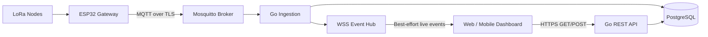
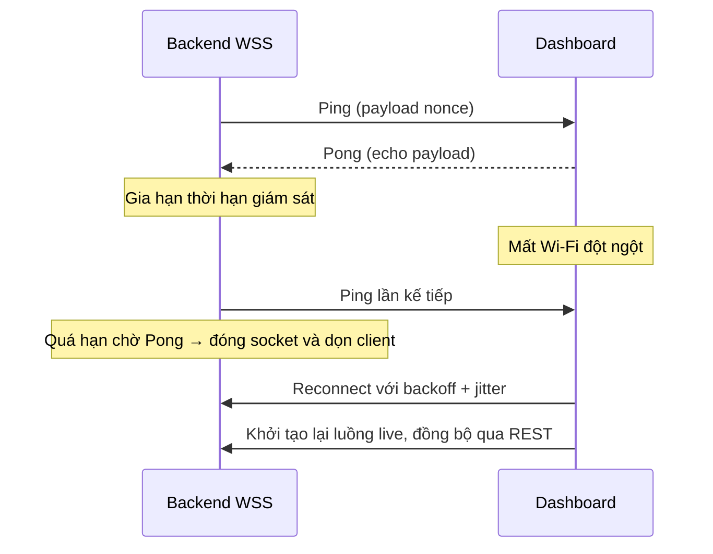
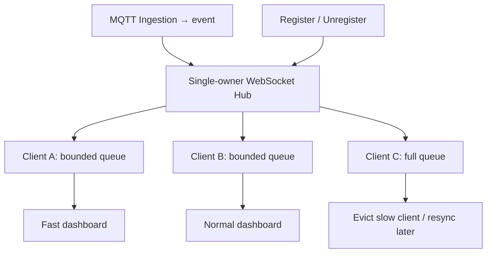
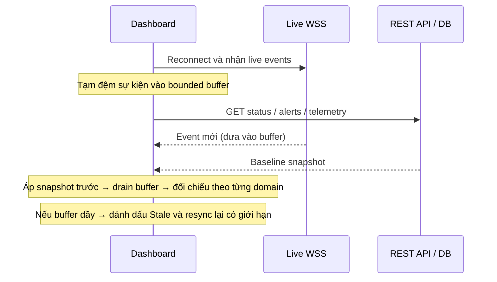

# BM05 — WebSocket Secure (WSS) & phân phối sự kiện thời gian thực

**Giáo trình Backend Engineering | Dự án LoRa P2P Hybrid TDMA**

**Thời lượng tham khảo:** 8–10 giờ · **Đối tượng:** Backend, IoT Systems, Web/Mobile Engineering

## Mục tiêu học tập

Hoàn thành module, người học có thể **giải thích WebSocket là gì, tại sao cần WSS, cơ chế giao tiếp hoạt động thế nào, giới hạn đến đâu và khi nào áp dụng trong dự án**. Trọng tâm là đánh giá thiết kế, phân tích failure modes và phản biện mã do AI tạo ra; **không yêu cầu tự lập trình WebSocket Server từ đầu**.

- **WHAT:** Phân biệt REST Polling, SSE và WebSocket; xác định vai trò của WSS trong tầng hiển thị.
- **WHY:** Giải thích nhu cầu server push, kết nối dài hạn, cập nhật trạng thái gần thời gian thực.
- **HOW:** Phân tích HTTP Upgrade, WebSocket frames, masking, Ping/Pong, fan-out và schema sự kiện.
- **LIMITATIONS:** Nhận biết giới hạn best-effort, mất kết nối, slow consumer, bảo mật và tính nhất quán dữ liệu.
- **APPLICATION:** Thiết kế đường đi MQTT → Go Backend → WSS Dashboard; dùng REST snapshot để tái đồng bộ khi reconnect.

**Kiến thức cần có:** Nội dung Go Concurrency (BM01), PostgreSQL (BM02), MQTT 5.0 (BM03), HTTP/REST/OpenAPI (BM04).

**Phạm vi hợp đồng:** Các tên endpoint, message type và schema được trích từ bộ hợp đồng **Draft** được mô tả trong tài liệu nguồn. Chúng là ví dụ học tập của dự án, **không đồng nghĩa đã triển khai hoặc được kiểm chứng trên hệ thống thật**. Các tham số như `cap=64`, timeout 8 giây, 100 sự kiện/giây là *giả định minh họa*, không phải SLA đã đo.

---

## 1. Bảng thuật ngữ trọng tâm

| Thuật ngữ (EN) | English Full Name | Nghĩa tiếng Việt | Bản chất và ứng dụng |
|---|---|---|---|
| **WebSocket** | The WebSocket Protocol | Giao thức truyền thông hai chiều thời gian thực | Giao thức mạng chuẩn hóa bởi IETF (RFC 6455), thiết lập kênh truyền thông song công toàn phần (full-duplex) qua một kết nối TCP duy nhất sau khi hoàn tất bắt tay nâng cấp từ HTTP. |
| **WSS** | WebSocket Secure | Giao thức WebSocket bảo mật qua TLS | WebSocket chạy trên nền tầng bảo mật TLS (mặc định cổng 443), mã hóa dữ liệu trên từng chặng truyền vận (hop-by-hop), ngăn chặn nghe lén và hỗ trợ đi qua các thiết bị trung gian (Proxy/Firewall). Lưu ý: Nếu có Reverse Proxy/Load Balancer chấm dứt TLS (TLS termination), kênh mã hóa đầu-cuối chỉ được bảo toàn khi mạng nội bộ cũng áp dụng TLS.* |
| **WS** | WebSocket (Unencrypted) | Giao thức WebSocket không mã hóa | WebSocket chạy trực tiếp trên TCP thô (mặc định cổng 80), không có mã hóa TLS; chỉ được phép sử dụng trong môi trường phát triển cục bộ (`localhost`) cô lập. |
| **Full-duplex** | Full-duplex Communication | Truyền thông song công toàn phần | Khả năng cho phép cả Client và Server truyền và nhận dữ liệu đồng thời trên cùng một kết nối vật lý/logic tại bất kỳ thời điểm nào mà không cần luân phiên chờ đợi. *Phân biệt với Half-duplex (như sóng LoRa) chỉ truyền hoặc nhận tại một thời điểm.* |
| **HTTP Upgrade** | HTTP Protocol Upgrade Mechanism | Cơ chế nâng cấp giao thức HTTP | Cơ chế chuẩn của HTTP/1.1 (RFC 9110 §7.8 và RFC 6455 §4) cho phép Client gửi yêu cầu chuyển đổi kết nối TCP hiện tại từ HTTP sang WebSocket thông qua các tiêu đề `Upgrade: websocket` và `Connection: Upgrade`. |
| **Opening Handshake** | WebSocket Opening Handshake | Bắt tay mở kết nối WebSocket | Pha giao tiếp ban đầu dựa trên HTTP: Client gửi yêu cầu GET kèm khóa thách thức `Sec-WebSocket-Key`, Server thẩm định và phản hồi HTTP `101 Switching Protocols` kèm mã băm `Sec-WebSocket-Accept`. |
| **Sec-WebSocket-Key** | WebSocket Client Challenge Key | Khóa thách thức ngẫu nhiên của Client | Chuỗi Base64 tạo từ 16 bytes ngẫu nhiên do Client sinh ra trong tiêu đề HTTP Upgrade, dùng để chống lại việc các proxy trung gian lưu đệm phản hồi HTTP cũ. |
| **Sec-WebSocket-Accept** | WebSocket Server Acceptance Hash | Mã băm chấp thuận của Server | Chuỗi Base64 tạo từ mã băm SHA-1 của chuỗi ký tự (`Sec-WebSocket-Key` nối trực tiếp với GUID cố định `258EAFA5-E914-47DA-95CA-C5AB0DC85B11`), dùng để chứng minh Server thực sự hiểu giao thức WebSocket RFC 6455. |
| **Origin** | HTTP Origin Header & Origin Validation | Tiêu đề nguồn gốc và kiểm tra nguồn gốc trình duyệt | Tiêu đề HTTP do trình duyệt tự động đính kèm cho biết nguồn gốc (Scheme + Host + Port) của trang web phát khởi kết nối. Server kiểm tra tiêu đề này với danh sách cho phép (Allowlist) để ngăn chặn tấn công chiếm quyền từ trình duyệt. Lưu ý: Origin không thay thế xác thực người dùng (Authentication) vì client phi trình duyệt có thể giả mạo tiêu đề này.* |
| **CSWSH** | Cross-Site WebSocket Hijacking | Tấn công chiếm quyền kết nối WebSocket chéo trang | Lỗ hổng bảo mật xảy ra khi trang web độc hại của kẻ tấn công lừa trình duyệt nạn nhân thiết lập kết nối WebSocket tới Server mục tiêu (dựa trên Cookie xác thực tự động gửi kèm), do Server không kiểm tra tiêu đề `Origin`. |
| **Frame** | WebSocket Protocol Frame | Khung truyền giao thức WebSocket | Đơn vị dữ liệu nhỏ nhất ở tầng giao thức WebSocket bao gồm phần đầu điều khiển (Header từ 2 đến 14 bytes) và phần tải trọng dữ liệu (Payload) theo quy định của RFC 6455 §5. |
| **Opcode** | Operation Code | Mã thao tác khung truyền | Trường 4-bit trong khung truyền WebSocket xác định kiểu nội dung hoặc chức năng điều khiển: `0x1` (Text), `0x2` (Binary), `0x8` (Close), `0x9` (Ping), `0xA` (Pong), `0x0` (Continuation). |
| **Data Frame** | WebSocket Data Frame | Khung truyền dữ liệu ứng dụng | Khung truyền mang tải trọng dữ liệu nghiệp vụ của ứng dụng, gồm kiểu văn bản UTF-8 (Opcode `0x1`) hoặc dữ liệu nhị phân thô (Opcode `0x2`). Có thể phân mảnh. Giới hạn biểu diễn độ dài tối đa là $2^{63}-1$ bytes theo RFC 6455 §5.2. |
| **Control Frame** | WebSocket Control Frame | Khung truyền điều khiển trạng thái | Khung truyền dùng để quản trị trạng thái kết nối (Opcode `0x8` Close, `0x9` Ping, `0xA` Pong); chiều dài dữ liệu không được vượt quá 125 bytes và tuyệt đối cấm phân mảnh (`FIN = 1`). |
| **Masking** | Client-to-Server Frame Masking | Cơ chế che giấu dữ liệu bằng mặt nạ | Thuật toán XOR tải trọng khung truyền với khóa ngẫu nhiên 4-byte (`Masking-key`). RFC 6455 §5.1 quy định bắt buộc khung từ Client lên Server phải có `MASK = 1` để chống Proxy Cache Poisoning (nếu vi phạm, Server MUST close kết nối); khung từ Server xuống Client bắt buộc `MASK = 0`. |
| **Fragmentation** | Message Fragmentation | Phân mảnh thông điệp khung truyền | Kỹ thuật chia một thông điệp lớn thành nhiều khung truyền liên tiếp: khung đầu có cờ `FIN = 0` và Opcode dữ liệu, các khung tiếp theo có `FIN = 0` và Opcode `0x0`, khung cuối có cờ `FIN = 1` và Opcode `0x0`. |
| **Ping Frame** | Heartbeat Ping Control Frame (Opcode 0x9) | Khung truyền kiểm tra duy trì kết nối | Khung điều khiển gửi từ một bên (thường là Server) để kiểm tra kênh TCP còn sống. Bên nhận bắt buộc phải phản hồi một khung Pong mang dữ liệu y hệt khung Ping (trừ khi đã nhận lệnh Close). |
| **Pong Frame** | Heartbeat Pong Control Frame (Opcode 0xA) | Khung truyền xác nhận duy trì kết nối | Khung điều khiển gửi phản hồi cho khung Ping hoặc gửi đơn phương (unsolicited) để báo hiệu client vẫn hoạt động. RFC 6455 khuyến nghị gửi Pong càng sớm càng tốt khi có thể. |
| **Close Frame** | Closing Handshake Frame (Opcode 0x8) | Khung truyền yêu cầu đóng kết nối | Khung điều khiển bắt đầu quá trình ngắt kết nối an toàn hai chiều, chứa mã trạng thái 2-byte (Close Status Code) và chuỗi lý do tùy chọn giải thích nguyên nhân ngắt kết nối. |
| **Close Status Code** | WebSocket Close Status Code | Mã trạng thái đóng kết nối RFC 6455 | Mã số nguyên 2-byte quy định tại RFC 6455 §7.4: `1000` (Bình thường), `1001` (Rời mạng), `1002` (Lỗi giao thức), `1008` (Vi phạm chính sách bảo mật/áp lực ngược), `1009` (Bản tin quá lớn), `1011` (Lỗi nội bộ máy chủ). |
| **Heartbeat / Keep-Alive** | Connection Liveness Check | Cơ chế nhịp tim giám sát sống còn | Cơ chế ứng dụng định kỳ trao đổi Ping/Pong nhằm phát hiện các kết nối TCP chết ngầm (TCP Half-Open). Chu kỳ gửi và thời gian timeout là thiết kế riêng của ứng dụng, không do RFC ấn định cứng. |
| **TCP Half-Open** | TCP Half-Open Connection | Kết nối TCP mở một nửa (chết ngầm) | Tình trạng một đầu kết nối bị đứt vật lý (mất sóng Wi-Fi/4G, rút cáp) mà không kịp gửi gói `FIN/RST`, khiến đầu còn lại vẫn giữ socket mở cho đến khi hết hạn timeout ứng dụng hoặc tầng socket. |
| **Reconnect & Backoff** | Exponential Backoff with Jitter | Tự động kết nối lại kèm giãn cách ngẫu nhiên | Thuật toán Client tự thiết lập lại kết nối sau khi đứt mạng: thời gian chờ tăng theo hàm mũ ($1\text{s}, 2\text{s}, 4\text{s}\dots$) cộng thêm độ lệch ngẫu nhiên (Jitter) nhằm ngăn chặn bão kết nối (Thundering Herd) đánh sập máy chủ. |
| **Backpressure** | Backpressure Flow Control | Cơ chế kiểm soát áp lực ngược | Kỹ thuật kiểm soát tốc độ khi phía sản xuất dữ liệu (Backend Hub) nhanh hơn khả năng tiêu thụ hoặc tốc độ mạng của Client; ngăn chặn việc cạn kiệt bộ nhớ RAM máy chủ. |
| **Slow Consumer** | Slow Consumer Problem | Sự cố bên tiêu thụ chậm | Tình trạng một Client xử lý chậm hoặc nghẽn băng thông khiến hàng đợi đệm gửi ra (`outbound channel`) tại máy chủ bị đầy; máy chủ cần chính sách cô lập/ngắt kết nối an toàn để bảo vệ hệ thống. |
| **WebSocket Hub** | Central WebSocket Hub Manager | Bộ điều phối kết nối WebSocket tập trung | Cấu trúc thành phần trong Go quản lý vòng đời toàn bộ Client kết nối, đăng ký (`register`), hủy đăng ký (`unregister`) an toàn đồng thời, và phát tán sự kiện (broadcast). |
| **Single-Owner Registry** | Single-Owner Client Registry Pattern | Mô hình một chủ sở hữu duy nhất danh bạ | Nguyên tắc thiết kế concurrency trong Go: duy nhất một Goroutine (vòng lặp Hub) được quyền đọc/ghi bản đồ `clients`, loại bỏ Data Race trên danh bạ và ngăn chặn tự khóa chết (Self-deadlock). |
| **Fan-out** | Broadcast Message Fan-out | Cơ chế phát tán bản tin hình quạt | Thao tác nhân bản và chuyển tiếp một sự kiện duy nhất từ nguồn (ví dụ: MQTT Ingestion Pipeline) tới các kết nối WebSocket Client đang lắng nghe. |
| **Outbound Queue** | Per-Client Outbound Channel | Hàng đợi đệm gửi ra từng Client | Kênh đệm Go (`chan []byte`) có dung lượng giới hạn cố định (bounded buffer) dành riêng cho từng kết nối Client để tách biệt tốc độ đọc/ghi giữa Hub và Socket mạng. |
| **Event Envelope** | Real-time Event Envelope Schema | Vỏ bọc bản tin sự kiện thời gian thực | Cấu trúc chuẩn hóa bao bọc mọi sự kiện gửi qua WSS theo hợp đồng dự án (`schema_version`, `event_id`, `type`, `emitted_at`, `payload`, `cursor`). |
| **Best-Effort Delivery** | Best-Effort Delivery Semantics | Ngữ nghĩa giao vận nỗ lực tối đa | Chính sách giao vận của luồng WSS trong dự án: máy chủ cố gắng đẩy dữ liệu nhanh nhất tới các client đang kết nối, nhưng **không** bảo đảm tin cậy tuyệt đối, không lưu đệm ngoại tuyến và không tự động phát lại khi client ngắt kết nối. |
| **Resynchronization (Re-sync)** | State Resynchronization via REST | Cơ chế tái đồng bộ trạng thái qua REST | Quy trình bắt buộc của Client sau khi tái kết nối WSS: đệm sự kiện mới vào bộ đệm giới hạn, gọi các API REST (`/status`, `/nodes`, `/alerts`, `/telemetry`) để kéo trạng thái cơ sở (baseline snapshot), sau đó đối chiếu theo thực thể miền và xử lý tiếp. |
| **Event Deduplication** | Client Event Deduplication | Cơ chế lọc trùng lặp sự kiện phía Client | Thao tác Client sử dụng trường `event_id` của vỏ bọc server để loại bỏ các bản tin bị gửi trùng khi mạng lặp lại trên luồng WSS. *Phân biệt: `event_id` vỏ bọc server là ID duy nhất do WSS cấp; `payload.event_id` là ID gốc từ MQTT Gateway dùng để đối chiếu với REST.* |
| **Single-Use Ticket** | Short-lived Single-Use WS Ticket | Vé bắt tay một lần thời hạn ngắn | Đề xuất kỹ thuật xác thực WebSocket an toàn cho trình duyệt: Client lấy vé ngẫu nhiên có độ entropy cao qua REST API đã xác thực (`POST /api/v1/auth/ws-ticket` [LAB_ONLY_PROPOSAL]), truyền qua URL query khi bắt tay; Server kiểm tra, hủy vé nguyên tử và nâng cấp kết nối. |
| **RBAC** | Role-Based Access Control | Kiểm soát truy cập dựa trên vai trò | Cơ chế phân quyền: Server thẩm định vai trò (Viewer, Operator, Admin) theo phạm vi Gateway/Tenant trước khi chấp thuận kết nối; cấm tuyệt đối gửi lệnh đột biến trạng thái qua WSS. |

---

## 2. Kiến thức kỹ thuật cốt lõi

### 2.1 Vì sao hệ thống cần WebSocket?

Dữ liệu từ Node LoRa P2P đi qua Gateway, MQTT Broker và Backend trước khi tới bảng điều khiển. **REST API** phù hợp với yêu cầu/trả lời và truy xuất trạng thái đã lưu; nhưng nếu dashboard cứ lặp `GET` để hỏi “có gì mới?”, nhiều request sẽ trở nên thừa khi dữ liệu ít thay đổi. WebSocket cho phép Backend chủ động gửi sự kiện qua một kết nối đã mở.

| Cơ chế | Cách truyền | Điểm mạnh | Giới hạn cần nhớ |
|---|---|---|---|
| REST Polling | Client định kỳ gửi `GET` | Dễ triển khai; dữ liệu trả về theo hợp đồng REST | Dư request khi ít sự kiện; độ trễ phụ thuộc chu kỳ polling |
| HTTP Long-Polling | Server giữ request đến khi có sự kiện/timeout | Giảm polling rỗng | Mỗi chu kỳ cần request/response mới; TCP/TLS có thể được tái sử dụng |
| SSE (`EventSource`) | HTTP stream, server → client | Đơn giản với luồng cập nhật một chiều; trình duyệt tự reconnect | Chỉ truyền sự kiện văn bản; `Last-Event-ID` không tự bảo đảm server replay |
| WebSocket / WSS | Kênh full-duplex qua kết nối lâu dài | Đẩy sự kiện với overhead khung nhỏ; hỗ trợ text và binary | Phải quản lý reconnect, heartbeat, backpressure, auth và đồng bộ trạng thái |

**Phân biệt giao thức với chính sách ứng dụng:** WebSocket theo RFC 6455 hỗ trợ trao đổi **hai chiều**, nhưng hệ thống này **chọn WSS làm kênh server → client cho sự kiện**. Lệnh tạo lịch, cấu hình Node hoặc xác nhận cảnh báo vẫn đi qua **HTTPS REST API**; không gửi mutation qua WSS theo hợp đồng dự án được dẫn trong tài liệu nguồn.



**Điểm cần hiểu:** MQTT QoS 1 giữa Gateway/Broker/Backend không biến WSS thành durable message queue. WSS dùng để cập nhật tức thời, còn REST/PostgreSQL cung cấp dữ liệu trạng thái để kiểm tra và phục hồi. Việc Backend thực sự commit dữ liệu, phát sự kiện và đồng bộ đúng thứ tự phụ thuộc thiết kế và kiểm thử tích hợp.

### 2.2 HTTP Upgrade, `ws://` và `wss://`

Với WebSocket qua **HTTP/1.1**, client gửi `GET` kèm tiêu đề yêu cầu nâng cấp. Nếu yêu cầu hợp lệ và thỏa chính sách ứng dụng, server trả `101 Switching Protocols`; sau đó hai bên trao đổi các **WebSocket frames** trên kết nối đã thiết lập.

**Ví dụ mở kết nối (minh họa theo endpoint Draft):**

```http
GET /api/v1/ws/realtime HTTP/1.1
Host: backend.loratdma.internal
Upgrade: websocket
Connection: Upgrade
Sec-WebSocket-Key: dGhlIHNhbXBsZSBub25jZQ==
Sec-WebSocket-Version: 13
Origin: https://dashboard.loratdma.internal
```

```http
HTTP/1.1 101 Switching Protocols
Upgrade: websocket
Connection: Upgrade
Sec-WebSocket-Accept: s3pPLMBiTxaQ9kYGzzhZRbK+xOo=
```

- `Upgrade` và `Connection` yêu cầu chuyển giao thức trên HTTP/1.1.
- `Sec-WebSocket-Key` là 16 byte ngẫu nhiên mã hóa Base64. Server nối **chuỗi Base64 chưa giải mã** với GUID cố định, tính SHA-1 và mã hóa Base64 để tạo `Sec-WebSocket-Accept`.
- `Sec-WebSocket-Accept = Base64(SHA1(ASCII(key + "258EAFA5-E914-47DA-95CA-C5AB0DC85B11")))`. Đây là cơ chế xác nhận handshake giao thức, **không phải xác thực danh tính người dùng**.
- Server phải kiểm tra Origin và xác thực theo chính sách của ứng dụng trước khi chấp thuận; mã 101 không xảy ra nếu máy chủ/ticket cần thiết chưa hợp lệ.

**RFC 8441:** Khi dùng WebSocket qua HTTP/2, việc thiết lập có thể sử dụng **Extended CONNECT** với `:protocol = websocket`, không dùng đúng trình tự HTTP/1.1 `Upgrade` nêu trên. Nội dung thực hành chủ yếu theo RFC 6455/HTTP 1.1.

**So sánh bảo mật:** `ws://` không có TLS; `wss://` bảo vệ dữ liệu trên kết nối TLS (thường cổng 443). Nếu TLS được kết thúc tại reverse proxy, lưu lượng từ proxy tới Backend phải được bảo vệ bằng mạng nội bộ tin cậy hoặc mã hóa tiếp. Reverse proxy phải hỗ trợ nâng cấp và xử lý header chuyển tiếp đúng trust boundary.

### 2.3 Giải phẫu khung truyền RFC 6455

WebSocket có **Fixed Header nhỏ (2–14 bytes)**, theo sau là payload. Một WebSocket *message* có thể gồm một hoặc nhiều *frames*; không nên nhầm ranh giới frame với ranh giới thông điệp ứng dụng.

```text
Byte 0: FIN | RSV1–3 | Opcode(4 bits)
Byte 1: MASK | PayloadLength(7 bits)
Nếu len == 126: +2 byte extended length
Nếu len == 127: +8 byte extended length (bit cao nhất phải bằng 0)
Nếu MASK == 1: +4 byte masking key
Cuối cùng: Payload bytes
```

| Trường | Ý nghĩa và giới hạn |
|---|---|
| `FIN` | `1` khi kết thúc message; `0` nếu còn fragment tiếp theo |
| `RSV1–3` | Thường phải bằng `0` nếu không đàm phán extension |
| `Opcode` | `0x0` Continuation; `0x1` Text; `0x2` Binary; `0x8` Close; `0x9` Ping; `0xA` Pong |
| `MASK` | **Client → Server phải có mask**; **Server → Client không có mask** theo RFC 6455 |
| Payload length | 0–125 trực tiếp; 126/127 dùng extended length. Giới hạn biểu diễn tối đa là `2^63−1` bytes, **không phải giới hạn cho phép của ứng dụng** |
| Masking key | 4 byte do client sinh; payload được XOR theo chu kỳ 4 byte |

**Control frames:** `Close`, `Ping`, `Pong` có payload không quá **125 byte**, không được fragment (`FIN=1`) và có thể xen giữa các data fragments.

**Masking không phải mã hóa:** Máy chủ phải đóng kết nối nếu nhận frame không mask từ Client; có thể gửi Close `1002` trước khi đóng. Không dùng masking thay TLS. Trên server cần quy định `max message size` phù hợp tài nguyên, không chấp nhận payload cực lớn chỉ vì encoding hỗ trợ.

### 2.4 Vòng đời: Ping/Pong, Close và reconnect

Một kết nối TCP có thể trông như vẫn mở khi một đầu mất điện hoặc mất mạng mà không phát được FIN/RST (**TCP half-open**). Ở tầng ứng dụng, WebSocket Ping (`0x9`) và Pong (`0xA`) giúp giám sát liveness. Bên nhận Ping phải phản hồi Pong tương ứng trừ khi đã nhận Close.



Giả sử scheduler hoạt động bình thường, có thể **ước lượng** `T_detect ≤ pingPeriod + pongWait + Δ_scheduler`. Đây là mô hình ứng dụng có điều kiện, không phải SLA do RFC 6455 cam kết. Khi kết nối lỗi, client nên reconnect bằng **exponential backoff + jitter** để tránh nhiều client đồng loạt tạo bão kết nối.

**Close handshake:** Hai điểm cuối trao đổi frame `Close (opcode 0x8)` trước khi đóng socket khi còn thực hiện được. Các mã thường gặp: `1000` (bình thường), `1001` (going away), `1002` (protocol error), `1008` (policy violation), `1009` (message too big), `1011` (internal server error). Bên nhận Close nếu chưa gửi Close phải đáp lại; echo nguyên mã là thông lệ, không phải bắt buộc với mọi trường hợp.

### 2.5 Fan-out, Go WebSocket Hub và Backpressure

Backend có thể nhận một sự kiện từ MQTT rồi cần phát cho nhiều dashboard. Mẫu **Hub** lưu danh sách các client đang kết nối, nhận sự kiện từ Ingestion, chuyển vào **bounded outbound queue** riêng cho mỗi client rồi để writer của client tự gửi ra socket.



**Single-owner registry:** Chỉ goroutine quản lý Hub được quyền cập nhật danh bạ `clients`; các goroutine khác gửi sự kiện `register/unregister/broadcast` qua channel. Một lỗi AI thường mắc là từ **bên trong goroutine Hub** lại gửi vào `unregister` unbuffered mà chính Hub mới là bên đọc: Hub chờ chính mình → **self-deadlock**.

**Slow consumer:** Nếu server sinh 100 sự kiện/giây, client chỉ tiêu thụ 10 sự kiện/giây, queue `cap=64` ban đầu rỗng sẽ đầy sau khoảng `64/(100−10) ≈ 0,71 s` trong mô hình đơn giản. Đây chỉ là ví dụ toán học, không phải thông lượng đã đo của mạng LoRa. Không được dùng queue vô hạn hoặc lệnh gửi có thể chặn toàn bộ Hub. Khi một queue đầy, ứng dụng có thể loại client đó và yêu cầu client phục hồi bằng REST snapshot.

**Quản lý kênh:** Chỉ `sync.Once` để tránh `double-close` không loại bỏ lỗi `send on closed channel`. Phải xác định rõ owner của channel, dừng nguồn gửi và phối hợp vòng đời trước khi đóng. `Single-writer pump` là một mẫu thiết kế phổ biến, không phải bắt buộc của RFC; khả năng ghi đồng thời còn phụ thuộc vào thư viện WebSocket đang dùng.

### 2.6 Bảo mật WSS: Origin, Authentication và Authorization

**Ba lớp bảo vệ khác nhau:**

1. **TLS:** bảo vệ tính bí mật/toàn vẹn của lưu lượng trên từng kết nối; không cấp quyền đọc dữ liệu nghiệp vụ.
2. **Origin validation:** với browser, đối chiếu `Origin` với allowlist để giảm nguy cơ **Cross-Site WebSocket Hijacking (CSWSH)**, đặc biệt khi cookie tự gửi theo yêu cầu kết nối. Client phi trình duyệt có thể giả mạo Origin.
3. **Authentication + server-side RBAC:** xác định ai đang kết nối, được theo dõi Gateway/Tenant nào. Theo hợp đồng WSS Draft, người dùng `Viewer`, `Operator`, `Admin` chỉ nhận sự kiện thuộc phạm vi được phép xem; thao tác làm thay đổi trạng thái đi qua REST.

**Rủi ro:** Trình duyệt không cho JavaScript tùy ý đặt header `Authorization` khi gọi `new WebSocket(url)`. Đặt long-lived bearer token trong URL query có nguy cơ bị lộ qua log/proxy. Tài liệu nguồn ghi **D13 — OPEN_DECISION / BLOCKED_SECURITY**. Hai hướng xem xét là **HttpOnly, Secure, SameSite cookie** kết hợp Origin/CSRF protection hoặc **single-use ticket ngắn hạn** lấy qua REST rồi dùng khi mở WSS. Endpoint `POST /api/v1/auth/ws-ticket` **chỉ là LAB_ONLY_PROPOSAL**, không phải API production đã phê duyệt. Nếu dùng vé một lần, kiểm tra và tiêu thụ vé phải là **atomic operation**.

### 2.7 Hợp đồng sự kiện, thứ tự dữ liệu và tái đồng bộ

Tài liệu nguồn sử dụng **JSON Schema Draft 2020-12** và endpoint WSS dự thảo `wss://{backend_host}/api/v1/ws/realtime`. Event envelope minh họa gồm `schema_version`, `event_id`, `type`, `emitted_at`, `payload` và `cursor` tùy chọn:

```json
{
  "schema_version": "1.0-draft",
  "event_id": "srv:0001",
  "type": "TELEMETRY_UPDATE",
  "emitted_at": "2026-10-20T08:00:01Z",
  "cursor": "opaque:001",
  "payload": {
    "gateway_id": "gw01",
    "node_id": 1,
    "reading_id": "50",
    "event_id": "gw01:boot:42",
    "observed_at": "2026-10-20T08:00:00Z",
    "data": {"ch1_raw": 2575, "ch2_raw": 620, "ch3_raw": 50, "battery_mv": 3600}
  }
}
```

**Bốn loại sự kiện của hợp đồng Draft:**

| `type` | Nội dung và khóa nghiệp vụ cần phân biệt |
|---|---|
| `TELEMETRY_UPDATE` | Dữ liệu đo; `gateway_id`, `node_id`, `reading_id`, **`payload.event_id`** là ID gốc từ Gateway |
| `ALERT_TRIGGERED` | Cảnh báo; `alert_id`, `severity`, `triggered_at`; không mặc định chứa trạng thái ACK |
| `SCHEDULE_STATE_CHANGED` | Trạng thái lịch; `schedule_id`, `version`, `state`; **`STAGED` khác `ACTIVE`** |
| `GATEWAY_STATUS_CHANGED` | Cập nhật trạng thái Gateway; `mode`, `last_seen_at`; cần thẩm định freshness |

**Hai `event_id` khác phạm vi:** `event_id` ngoài envelope là ID sự kiện WSS do Backend tạo; `payload.event_id` là ID nguồn MQTT/Gateway phục vụ đối chiếu Telemetry với REST. `cursor` chỉ là opaque hint, **không tự bảo đảm replay**. Các khóa chính lớn (ví dụ `reading_id`) biểu diễn dưới dạng **decimal string** để tránh mất chính xác của JavaScript `Number` với số nguyên vượt `2^53−1`.

**Vì sao có Snapshot/WSS race?** Khi reconnect, các event live có thể tới trước khi REST snapshot tải xong. Nếu client áp dụng event mới rồi ghi đè bằng snapshot cũ, dashboard sẽ hiển thị sai. Luồng đề xuất:



- **Telemetry:** đối chiếu bằng `(gateway_id, payload.event_id)` với `(gateway_id, event_id)` của dữ liệu gốc trong REST (khi contract REST cung cấp khóa này).
- **Alert:** so khớp `alert_id`; giữ trạng thái đã ACK từ snapshot, không để một event `ALERT_TRIGGERED` không mang ACK state tự ghi đè.
- **Schedule:** so khớp `(gateway_id, schedule_id, version)` và chỉ hiển thị `ACTIVE` khi có cơ sở xác nhận; `STAGED` chỉ là lịch đã được chuẩn bị.
- **Overflow:** nếu inbound buffer tạm bị đầy trong khi lấy snapshot, bỏ buffer, hiển thị `Stale/Resyncing` và lặp quá trình có giới hạn; không giả vờ đã nhận đủ sự kiện.

**Giới hạn quan trọng:** TCP chỉ bảo toàn thứ tự byte trên **một kết nối**, không cung cấp thứ tự nhân quả toàn cục giữa nhiều Gateway, Worker và lần reconnect. Một giao thức sự kiện cần quy tắc so sánh version/timestamp/ID phù hợp từng loại thực thể; timestamp không luôn đáng tin nếu nguồn đồng hồ chưa được xác minh.

---

## 3. Cảnh báo kỹ thuật và failure modes

| Failure mode | Dấu hiệu hoặc nguyên nhân | Cách phân tích, phòng ngừa |
|---|---|---|
| **WSS không phải durable queue** | Client mất mạng sẽ bỏ lỡ các event live; RFC 6455 không có offline replay mặc định | PostgreSQL/REST là baseline; sau reconnect luôn tái đồng bộ |
| **CSWSH / sai phân quyền** | Chỉ bật TLS nhưng chấp nhận mọi `Origin`, hoặc dùng Origin thay authentication | Origin allowlist + authentication + server-side RBAC |
| **Hub data race / self-deadlock** | Nhiều goroutine sửa chung `map`; Hub tự gửi vào kênh unbuffered của mình | Single-owner; channel lifecycle rõ ràng; không đánh đồng test pass với hết race |
| **Lộ credential qua URL** | Long-lived bearer JWT nằm ở `?token=...` có thể vào access logs | Cookie bảo vệ phù hợp hoặc vé ngắn hạn dùng một lần (nếu được duyệt) |
| **Sai WebSocket masking** | Client gửi frame `MASK=0`, Server không từ chối | Server phải đóng kết nối; có thể gửi Close `1002`; masking không phải TLS |
| **Mất chính xác số nguyên lớn** | JSON biến ID 64-bit thành JavaScript `Number` | Dùng decimal string theo schema; không parse thành Number rồi làm tròn |
| **Dùng nhầm event ID** | Lấy `event_id` của WSS envelope để khử trùng dữ liệu gốc | Dùng `payload.event_id` kết hợp `gateway_id` khi đối chiếu Telemetry |
| **Chậm, nghẽn và rò rỉ** | Slow consumer; queue vô hạn; `defer cancel()` trong vòng lặp Ping chạy mãi | Bounded queue, cô lập client chậm, gọi `cancel()` sau mỗi thao tác Ping |

**Lưu ý triển khai:** Các giá trị timeout, kích thước buffer, ngưỡng ngắt client trong ví dụ chưa phải cấu hình đã được duyệt. Build/Unit Test PASS không thay cho Integration/Load/Security testing.

---

## 4. Workshops — Phân tích giao thức và đánh giá giải pháp

Các bài dưới đây là **walkthrough trên giấy/tài liệu**. Không yêu cầu cài môi trường, thao tác firewall máy thật hoặc viết server. Với mỗi tình huống, hãy trả lời: *dữ liệu đi đâu → trạng thái nào thay đổi → bảo đảm nào tồn tại → lỗi có thể xảy ra → điều kiện chấp nhận thiết kế*.

### Workshop 1 — HTTP Upgrade, Masking và an ninh bắt tay

**Bài A — Phân tích HTTP handshake.** Dựa vào cặp request/response ở §2.2, giải thích nhiệm vụ của `Sec-WebSocket-Key`, cách tính `Sec-WebSocket-Accept` và ý nghĩa `HTTP 101`. Nêu vì sao `Sec-WebSocket-Accept` không thay thế xác thực người dùng.

**Bài B — Ma trận xác thực:** Giả định server kiểm tra **Origin trước, ticket sau**; ticket là cơ chế chỉ *đề xuất*.

| Origin | Ticket | Phản hồi kỳ vọng trong ví dụ | Ý nghĩa |
|---|---|---|---|
| Hợp lệ | Hợp lệ, chưa dùng | `101 Switching Protocols` | Cho phép nâng cấp |
| Hợp lệ | Thiếu/hết hạn | `401 Unauthorized` | Chưa xác thực |
| Không được phép | Bất kỳ | `403 Forbidden` | Origin không được chấp nhận |

Khi thứ tự kiểm tra thay đổi, mã lỗi được trả về có thể thay đổi. **Không** xem bảng trên là response matrix bắt buộc của mọi server WebSocket.

**Bài C — Review mã AI:**

```go
// Pseudocode thiếu bảo vệ đồng thời: dùng để phân tích lỗi
func (tm *TicketManager) CheckTicket(ticket string) bool {
    exp, ok := tm.tickets[ticket] // shared map, không khóa
    if !ok || time.Now().After(exp) { return false }
    delete(tm.tickets, ticket)
    return true
}
```

Giải thích vì sao có **data race**, nguy cơ **double-redemption** nếu hai handshake cùng dùng một ticket và các điều kiện thiết kế để đảm bảo atomic check-and-consume. Không phải viết code hoàn chỉnh: đề xuất đặt read–validate–delete trong một critical section hoặc atomic transaction phù hợp phạm vi lưu trữ.

**Bài D — Quy tắc frame:** Nhận một frame Client→Server `MASK=0`; quyết định phải làm gì theo RFC 6455. Phân biệt hành vi bắt buộc **close** với việc *có thể* gửi mã `1002`.

### Workshop 2 — Hub, Backpressure và self-deadlock

**Bối cảnh:** Backend phát 100 events/s, Client A nhận nhanh, Client B chỉ đọc 10 events/s. Mỗi client có outbound buffer 64 phần tử ban đầu rỗng. Đây là các tham số minh họa.

1. Tính tốc độ tích lũy backlog của Client B: `100 − 10 = 90 events/s`.
2. Ước lượng thời gian đầy: `64 / 90 ≈ 0,71 s` khi mọi sự kiện đều hướng đến B và tốc độ không đổi.
3. Nêu tác động của việc dùng `client.send <- msg` chặn trong vòng lặp broadcast chung.
4. Đề xuất biện pháp cô lập slow client và điều kiện dừng writer/giải phóng socket.

**Review mã AI:**

```go
case msg := <-h.broadcast:
    for client := range h.clients {
        select {
        case client.send <- msg:
        default:
            h.unregisterClient(client) // helper gửi vào h.unregister unbuffered
        }
    }
```

Hãy chỉ rõ **ai đang đọc `h.unregister`**, vì sao goroutine Hub không thể vừa đợi gửi vừa là bên nhận duy nhất, và vì sao cách sửa phù hợp trong mô hình single-owner là cập nhật registry ngay ở Hub rồi điều phối shutdown an toàn.

**Thought experiment — kiểm thử tất định:** Nếu `cap=16`, giữ writer không dequeue, thông điệp thứ 17 buộc phải kích hoạt nhánh queue đầy. Đây là một **thiết kế ca thử**, không phải bằng chứng đã chạy test.

### Workshop 3 — Half-open, REST resync và kiểm định Event Schema

**Tình huống A — TCP half-open:** Dashboard mất sóng nhưng socket Backend chưa thấy FIN/RST. Dự đoán điều gì xảy ra nếu không có heartbeat; chỉ ra vai trò Ping/Pong và vì sao thời gian phát hiện phụ thuộc scheduler và timeout.

**Review mã AI — vòng lặp Ping:**

```go
for {
    select {
    case <-ctx.Done(): return
    case <-ticker.C:
        pingCtx, cancel := context.WithTimeout(ctx, 8*time.Second)
        defer cancel() // sai: defer chỉ chạy khi hàm kết thúc
        _ = conn.Ping(pingCtx)
    }
}
```

Nhận diện sự tích lũy deferred calls; mô tả cách xử lý theo nguyên tắc gọi `cancel()` sau mỗi lần Ping (không cần viết lại chương trình).

**Tình huống B — Snapshot/WSS race:** Trong 2 phút mất WSS, Backend vẫn ghi dữ liệu từ MQTT. Khi UI reconnect, REST snapshot đang tải thì các event WSS mới đã đến. Dùng sơ đồ §2.7 để đề xuất thứ tự: **đệm live → lấy snapshot → apply baseline → drain buffer → reconcile**. Nếu buffer đầy phải hiển thị `Stale/Resyncing`, không tự cho rằng dữ liệu đã đầy đủ.

**Tình huống C — Sáu trường hợp JSON Schema:** Các fixture dưới đây được tổng hợp từ bộ test minh họa có tên `contracts/api/examples/realtime-cases.json` trong tài liệu nguồn. Hãy chỉ ra quy tắc đã bị vi phạm nếu `valid=false`.

| Fixture ID | Hợp lệ theo tài liệu nguồn | Điểm kiểm tra |
|---|:---:|---|
| `WS-ALERT-VALID` | Có | `ALERT_TRIGGERED` có `alert_id`, `severity`, `triggered_at` |
| `WS-ALERT-MISSING-ID` | Không | `event_id` rỗng; vi phạm `minLength: 1` |
| `WS-ALERT-UNKNOWN-TYPE` | Không | `type: "BEEP"` nằm ngoài enum |
| `WS-SCHEDULE-VALID` | Có | `SCHEDULE_STATE_CHANGED`, `schedule_id: "9"`, `state: "STAGED"` |
| `WS-TELEMETRY-VALID` | Có | `reading_id: "50"` dạng chuỗi; dữ liệu raw integer |
| `WS-STATUS-VALID` | Có | `GATEWAY_STATUS_CHANGED`, `mode` và `last_seen_at` |

**Thảo luận:** JSON có cú pháp đúng chưa chắc phù hợp Schema. Một validator có thể phải đối chiếu `type` với ràng buộc `allOf / if / then`, `required`, `enum` và `additionalProperties: false`. Kiểm tra schema thực tế khi dùng cho implementation; không xem bảng tóm tắt là bản thay thế file JSON Schema.

---

## 5. Đánh giá cuối module và hướng dẫn giải

### 5.1 Năm câu trắc nghiệm tình huống

**Câu 1.** Server WSS xác thực bằng cookie, nhưng cho mọi `Origin` với wildcard. Rủi ro quan trọng nhất là gì?

- A. TLS không thể bắt tay.
- B. Trang độc hại có thể lợi dụng cookie người dùng mở WebSocket (CSWSH).
- C. WebSocket buộc dùng cổng 80.
- D. Chỉ mobile app chịu ảnh hưởng.

**Câu 2.** Trong Hub single-owner, khi outbound queue đầy, thao tác nào phù hợp nhất?

- A. Hub gửi vào chính `unregister` unbuffered mà nó là bên nhận duy nhất.
- B. Tạo queue vô hạn.
- C. Hub xóa client khỏi registry của mình và kích hoạt shutdown an toàn.
- D. Cho mọi client đợi client chậm.

**Câu 3.** Dashboard rớt mạng âm thầm, server còn giữ socket ESTABLISHED. Biện pháp cấp ứng dụng chủ động phát hiện là gì?

- A. TCP luôn phát hiện tức thì.
- B. Ping/Pong với thời hạn phản hồi do ứng dụng quản lý.
- C. HTTP 101 tự động lặp lại.
- D. Tắt heartbeat để tiết kiệm RAM.

**Câu 4.** Khi đối chiếu Telemetry WSS với dữ liệu gốc REST, chọn khóa nào theo thiết kế trong tài liệu?

- A. `event_id` của envelope WSS.
- B. `(gateway_id, payload.event_id)` từ sự kiện, đối chiếu ID gốc ở REST.
- C. Chỉ `battery_mv`.
- D. Thứ tự event đến trên socket.

**Câu 5.** Theo RFC 6455, nhận frame client → server mà `MASK=0` thì server phải làm gì?

- A. Tự mask giúp client rồi xử lý.
- B. Đóng kết nối; có thể gửi Close 1002 trước đó.
- C. Bắt buộc gửi 1002 và giữ socket mở.
- D. Bỏ qua frame rồi tiếp tục nhận.

### 5.2 Ba bài tập phân tích thiết kế

**Bài 1 — Hub bị treo khi client chậm.** Một AI tạo Hub với `unregister` unbuffered và gọi helper gửi vào channel đó trong nhánh `default` của chính vòng lặp Hub. Hãy mô tả chuỗi nguyên nhân dẫn đến self-deadlock, phân tích blast radius khi dùng blocking send, đề xuất nguyên tắc quản lý registry và channel closure an toàn.

**Bài 2 — Lựa chọn cơ chế xác thực WSS.** Nhóm phát triển cho rằng TLS cộng Origin allowlist là đủ, không cần xác thực người dùng. Hãy phản biện. So sánh phương án cookie (`HttpOnly`, `Secure`, `SameSite`) và single-use ticket; nêu các rủi ro token trong URL log và lý do cơ chế vé vẫn chỉ là đề xuất do D13 chưa chốt.

**Bài 3 — Đồng bộ trạng thái sau mất WSS.** Dashboard mất kết nối 2 phút nhưng Gateway vẫn gửi MQTT. Hãy vẽ luồng reconnect → REST snapshot → drain live buffer; trình bày quy tắc reconcile của Telemetry, Alert, Schedule; soạn **ít nhất bốn điều kiện nghiệm thu** để giao cho AI Coding Agent, gồm tình huống inbound buffer đầy và `STAGED != ACTIVE`.

### 5.3 Đáp án và luận giải

**Đáp án trắc nghiệm:** 1–B; 2–C; 3–B; 4–B; 5–B.

- **Câu 1:** TLS không ngăn trình duyệt gửi cookie tới một handshake mà trang độc hại khởi phát nếu chính sách cookie và Origin không đủ chặt. Origin validation khác authentication; RBAC cần kiểm tra phía server.
- **Câu 2:** Để Hub tự gửi vào unbuffered channel do chính nó nhận gây tự chờ vô hạn. Hub single-owner có thể trực tiếp xóa registry rồi báo dừng; queue vô hạn hay blocking send làm lan truyền tắc nghẽn.
- **Câu 3:** Ping/Pong application heartbeat phát hiện trường hợp socket chết ngầm dựa trên timeout; TCP keepalive hoặc I/O timeout cũng có thể hỗ trợ nhưng RFC 6455 không cam kết một thời gian cụ thể.
- **Câu 4:** Envelope ID là định danh của lần phát WSS; ID gốc MQTT nằm trong payload và phù hợp để đối chiếu bản tin Telemetry với REST.
- **Câu 5:** Quy tắc bắt buộc là **đóng** kết nối khi client gửi frame không mask. Gửi Close 1002 là hành vi có thể thực hiện, không phải điều kiện bắt buộc.

**Gợi ý lời giải bài 1:** Việc Hub là người đọc duy nhất trên `unregister` nhưng lại gửi vào kênh unbuffered đó sẽ khiến thao tác gửi không có bên nhận; vòng lặp broadcast dừng và các client khác không được phục vụ. Khắc phục bằng single-owner registry, non-blocking enqueue, bounded queue; khi queue đầy thì evict client và phối hợp dừng writer. Không chỉ thêm `sync.Once` vì `send on closed channel` vẫn có thể xảy ra.

**Gợi ý lời giải bài 2:** TLS bảo vệ lưu lượng trên đường truyền, Origin giới hạn website có thể thực hiện handshake trong trình duyệt, còn authentication xác nhận danh tính. Phương án cookie tận dụng hỗ trợ sẵn của browser nhưng cần kiểm soát CSWSH/CSRF; phương án ticket chỉ dùng một lần giảm thời gian lộ credential nhưng cần endpoint phát vé và atomic redemption. Không gắn JWT dài hạn trên query. Chính sách D13 chưa được chốt nên không xem một phương án là production approved.

**Gợi ý lời giải bài 3:** Bắt đầu nhận sự kiện live vào bounded buffer trước/simultaneous với REST; nạp snapshot, rồi reconcile ID/version từ queue. Telemetry dùng `(gateway_id, payload.event_id)`; Alert dùng `alert_id`, không ghi đè ACK state khi event không mang trạng thái đó; Schedule chỉ chuyển sang `ACTIVE` theo xác nhận phù hợp. Bộ AC minh họa: (AC1) bộ đệm có giới hạn và chỉ số overflow; (AC2) luôn lấy snapshot sau reconnect; (AC3) đối chiếu theo domain/ID thay vì arrival order; (AC4) khi overflow hiển thị `Stale` và resync với retry có giới hạn; (AC5) không hiển thị `STAGED` thành `ACTIVE`. Kịch bản thử quan trọng: trì hoãn REST, đẩy event nhiều hơn cap và quan sát cơ chế làm mới trạng thái thay vì âm thầm bỏ sót.

---

## 6. Checklist tự đánh giá năng lực

Đánh dấu khi **tự giải thích được bằng lời, sơ đồ hoặc tình huống**. Không có tiêu chí nào mặc định đã đạt trước khi người học thực hiện đánh giá.

- [ ] **01 — Mục đích giao thức:** Phân biệt REST, SSE, WebSocket; giải thích vì sao WSS dùng để push nhưng REST/DB vẫn là nguồn trạng thái đáng tin cậy.
- [ ] **02 — Framing:** Giải thích FIN, RSV, Opcode, Masking, payload length, fragmentation và giới hạn control frame 125 byte.
- [ ] **03 — Handshake:** Đọc được HTTP 101, `Sec-WebSocket-Key`, `Sec-WebSocket-Accept`; phân biệt RFC 6455 với RFC 8441.
- [ ] **04 — Security:** Phân biệt TLS, Origin, authentication, RBAC và nhận diện CSWSH.
- [ ] **05 — Credential:** Nêu rủi ro bearer token trên URL, giải thích single-use ticket và tính chất `PROPOSED` của D13.
- [ ] **06 — Concurrency:** Phân tích được self-deadlock khi Hub tự gửi vào unbuffered channel; giải thích single-owner registry.
- [ ] **07 — Backpressure:** Tính thời gian đầy queue đơn giản; giải thích vì sao cô lập slow client.
- [ ] **08 — Liveness:** Giải thích Ping/Pong, TCP half-open, timeout có điều kiện và rủi ro `defer cancel()` trong vòng lặp vô hạn.
- [ ] **09 — Reconnect:** Mô tả exponential backoff với jitter và giới hạn của best-effort stream.
- [ ] **10 — Resync:** Vẽ được quy trình live buffer + REST snapshot + domain reconciliation; xử lý overflow.
- [ ] **11 — Contract:** Nhận biết Event Envelope, bốn event types, sáu fixtures và các quy tắc JSON Schema.
- [ ] **12 — Kiến trúc dự án:** Phân định Gateway/MQTT/Backend/WSS/REST; không gửi mutation commands qua WSS.

---

## Nguồn đọc và tài liệu tham chiếu

**Nguồn chuẩn/guidance:**

- [RFC 6455 — The WebSocket Protocol](https://www.rfc-editor.org/rfc/rfc6455): handshake, framing, masking, control frames, close.
- [RFC 8441 — WebSockets over HTTP/2](https://www.rfc-editor.org/rfc/rfc8441): Extended CONNECT.
- [OWASP WebSocket Security Cheat Sheet](https://cheatsheetseries.owasp.org/cheatsheets/WebSocket_Security_Cheat_Sheet.html): Origin, authentication, authorization và kiểm soát rủi ro.

**Hợp đồng dự án được tài liệu nguồn dẫn (trạng thái Draft, cần kiểm tra phiên bản hiện hành trước khi triển khai):**

- `contracts/api/websocket.md` — Endpoint, RBAC, best-effort và reconnect.
- `contracts/api/schemas/realtime-event.schema.json` — Event Envelope và điều kiện theo `type`.
- `contracts/api/examples/realtime-cases.json` — Sáu fixture luyện phân tích.
- `contracts/api/openapi.yaml` — REST snapshot và dữ liệu trạng thái.
- `contracts/OPEN_DECISIONS.md` — D13 về authentication/token lifecycle.

**Nguyên tắc kết thúc bài:** Hiểu đúng giao thức và giới hạn của từng tầng trước khi đánh giá AI-generated implementation. Một thiết kế WSS tốt giúp dashboard cập nhật nhanh, nhưng không tự biến dữ liệu live thành bản ghi bền vững hay cam kết delivery sau mất mạng.

