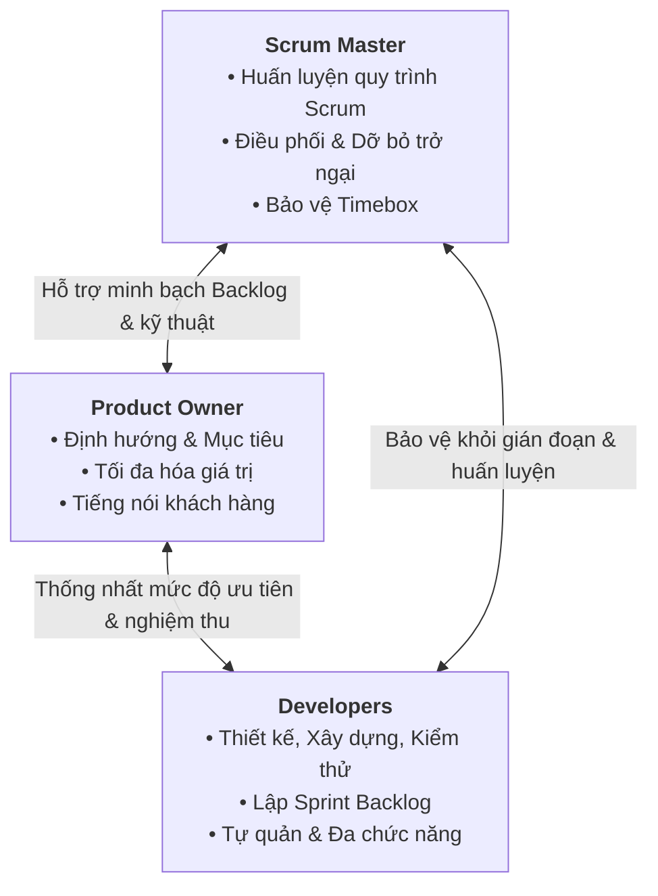

# Thấu hiểu các vai trò trong Scrum Team — Understanding Scrum Team roles

> **Mã bài học:** M02-L11  
> **Loại học liệu gốc:** READING  
> **Nguồn:** Agile_Project_Management / M02  

---

## 1. Mục tiêu bài học (Learning Objectives)

Sau khi hoàn thành bài học này, người học sẽ có khả năng:
- **Phân định rõ ràng trách nhiệm cốt lõi** của ba vai trò cấu thành một Scrum Team: *Scrum Master*, *Product Owner* (Chủ sở hữu sản phẩm), và *Development Team / Developers* (Đội ngũ phát triển).
- **Phân biệt ranh giới công việc** giữa các vai trò trong Scrum (*Scrum Master*, *Product Owner*) với vai trò Quản lý dự án truyền thống (*Project Manager*).
- **Giải thích được các đặc tính vận hành nền tảng** của nhóm Scrum: Tính tự quản (*Self-management*), tính liên chức năng/đa chức năng (*Cross-functionality*), và cơ chế phối hợp hướng đến việc tạo ra giá trị (*Value delivery*).
- **Nhận diện các phẩm chất và kỹ năng thiết yếu** (*Necessary traits*) cần có ở từng vị trí để xây dựng một đội ngũ Agile cộng tác hiệu quả.

---

## 2. Kiến thức nền tảng & Bối cảnh (Context & Prerequisites)

Trong khung làm việc Scrum (*Scrum Framework*), cấu trúc quản trị không vận hành theo hệ thống phân cấp thứ bậc (Command-and-Control) truyền thống. Thay vào đó, Scrum tổ chức công việc xung quanh một nhóm nhỏ, tự quản và đa chức năng gọi là **Scrum Team**.

Để dự án đi đến đích thành công, mỗi thành viên phải nắm vững vị trí, giới hạn quyền hạn và phương thức phối hợp nhịp nhàng giữa ba vai trò nền tảng. Bài học này làm rõ sự chuyển dịch từ mô hình điều hành dự án dựa trên người quản lý duy nhất (*Project Manager*) sang mô hình chia sẻ trách nhiệm chuyên biệt hóa trong Scrum.

---

## 3. Nội dung lý thuyết trọng tâm (Systematic Theory)

### 3.1. Scrum Master — Người bảo trợ phương pháp luận và huấn luyện viên nhóm

Theo Hướng dẫn Scrum (*The Scrum Guide*):
> *"Scrum Master chịu trách nhiệm giải trình về việc thiết lập Scrum đúng như định nghĩa trong Scrum Guide. Họ thực hiện điều này bằng cách giúp mọi người thấu hiểu lý thuyết và thực hành Scrum, ở cả phạm vi nội bộ Scrum Team lẫn toàn bộ Tổ chức. Scrum Master chịu trách nhiệm giải trình về tính hiệu quả của Scrum Team bằng cách tạo điều kiện cho Scrum Team cải tiến các thực hành của mình trong khuôn khổ Scrum."*

```
   ┌────────────────────────────────────────────────────────┐
   │                     SCRUM MASTER                       │
   │  • Thiết lập & duy trì hiểu biết về Scrum              │
   │  • Chịu trách nhiệm về tính hiệu quả của Scrum Team    │
   │  • Đảm bảo tuân thủ Timebox & tổ chức sự kiện          │
   │  • Loại bỏ trở ngại (Impediments)                      │
   │  • Huấn luyện tự quản & đa chức năng                   │
   └────────────────────────────────────────────────────────┘
```

#### Trách nhiệm cụ thể của Scrum Master:
- **Huấn luyện tinh thần tự quản và đa chức năng:** Hướng dẫn các thành viên tự chủ điều phối công việc (*self-management*) và phát triển năng lực phối hợp đa bộ môn (*cross-functionality*).
- **Định hướng tạo giá trị chuẩn mực:** Giúp Scrum Team tập trung tạo ra các phần tăng trưởng (*Increments*) có giá trị cao, đáp ứng đầy đủ Định nghĩa hoàn thành (**Definition of Done** — bộ tiêu chí thống nhất bắt buộc phải hoàn tất trước khi một dự án hay user story được coi là hoàn thành).
- **Thúc đẩy việc loại bỏ trở ngại (*Impediments*):** Chủ động dỡ bỏ hoặc thúc đẩy việc giải quyết các rào cản, khó khăn gây gián đoạn tiến trình của nhóm.
- **Duy trì nhịp độ và văn hóa sự kiện:** Đảm bảo tất cả các sự kiện Scrum (như *Daily Scrum*) được diễn ra với tinh thần tích cực, năng suất và tuân thủ nghiêm ngặt khung thời gian định sẵn (**Timebox** — khái niệm Scrum chỉ khoảng thời gian tối đa ước tính cho một sự kiện). Tương tự như trọng tài/huấn luyện viên kiểm soát đồng hồ thi đấu, Scrum Master giữ cho các buổi họp không bị kéo dài lê thê.

---

### 3.2. So sánh: Scrum Master vs. Project Manager truyền thống

Hai vai trò này thường bị nhầm lẫn do đòi hỏi một số kỹ năng mềm tương đồng. Tuy nhiên, bản chất công việc có sự khác biệt căn bản:

| Tiêu chí | Scrum Master | Quản lý dự án truyền thống (*Project Manager*) |
| :--- | :--- | :--- |
| **Trọng tâm quản lý** | Quản lý quy trình, phương pháp luận Scrum và tính hiệu quả của nhóm; loại bỏ rào cản. | Quản lý kế hoạch tổng thể, tiến độ chi tiết, ngân sách, nhân sự và rủi ro. |
| **Quản lý phạm vi & Ưu tiên** | **Không** can thiệp vào việc thay đổi phạm vi (*scope changes*) hay sắp xếp độ ưu tiên của sản phẩm. | Trực tiếp phê duyệt thay đổi phạm vi (*Change Management*) và kiểm soát phạm vi dự án. |
| **Công cụ & Tạo tác (*Artifacts*)** | Sử dụng các tạo tác Scrum (*Product Backlog*, *Sprint Backlog*, *Increment*). | Duy trì các tài liệu truyền thống như biểu đồ đường găng, sơ đồ Gantt (*Gantt charts*). |
| **Phong cách lãnh đạo** | Lãnh đạo phục vụ (*Servant Leader*), đóng vai trò huấn luyện viên (*Coach*). | Chỉ đạo, phân công nhiệm vụ và giám sát thực thi (*Directive/Command*). |

---

### 3.3. Product Owner — Tiếng nói khách hàng và Tối đa hóa giá trị sản phẩm

Theo Hướng dẫn Scrum (*The Scrum Guide*):
> *"Product Owner chịu trách nhiệm tối đa hóa giá trị của sản phẩm từ kết quả làm việc của Scrum Team. Cách thức thực hiện điều này có thể rất khác nhau giữa các tổ chức, các Scrum Team và từng cá nhân."*

Product Owner tối đa hóa giá trị bằng việc đại diện và cất lên tiếng nói của khách hàng xuyên suốt vòng đời dự án. Một sản phẩm hoàn thiện kỹ thuật sẽ trở nên vô dụng nếu nó không đáp ứng kỳ vọng và giải quyết nhu cầu thực tế của người dùng.

#### Trách nhiệm cụ thể của Product Owner:
- **Xây dựng Mục tiêu sản phẩm (*Product Goal*):** Thiết lập và truyền đạt một cách tường minh mục tiêu dài hạn của sản phẩm tới toàn đội ngũ.
- **Quản lý Product Backlog:** Khởi tạo và truyền đạt rõ ràng từng hạng mục trong **Product Backlog** (danh mục chứa toàn bộ tính năng, yêu cầu và hoạt động liên quan đến các hạng mục bàn giao nhằm đạt mục tiêu dự án).
- **Đảm bảo tính minh bạch:** Giữ cho *Product Backlog* luôn minh bạch, trực quan và được toàn thể thành viên thấu hiểu thấu đáo.

---

### 3.4. So sánh: Product Owner vs. Project Manager truyền thống

```
  TRUYỀN THỐNG (Project Manager):
  [Quản lý Phạm vi (Scope)] ─── kết hợp cùng ───> [Quản lý Tiến độ, Con người & Hiệu suất]

  TRONG SCRUM:
  [Product Owner]       ──> Quản lý Định nghĩa & Phạm vi Sản phẩm (Product Scope)
  [Developers / Team]   ──> Tự quản lý Tiến độ thực thi & Hiệu suất công việc nội bộ
```

- **Về quản lý phạm vi (*Scope Management*):**
  - Trong quản lý dự án truyền thống, kiểm soát phạm vi là trách nhiệm chính của Project Manager.
  - Trong Scrum, việc định nghĩa và quản lý phạm vi sản phẩm thuộc toàn quyền của Product Owner.
- **Về quản lý con người và hiệu suất (*Team Performance*):**
  - Product Owner **không** chịu trách nhiệm về hiệu suất nhân sự và **không** đóng vai trò là nhà quản lý nhân sự/quản lý cấp trên của các thành viên.
  - Project Manager truyền thống chịu trách nhiệm dẫn dắt đội ngũ, giao việc và giám sát tiến độ hoàn thành mục tiêu của từng nhân sự.
- **Điểm giao thoa (Tương đồng):**
  - Cả hai vai trò đều gánh vác trách nhiệm **Quản lý các bên liên quan (*Stakeholder Management*)**. Họ đều phải duy trì và thúc đẩy giao tiếp hiệu quả giữa nhóm thực thi và các bên liên quan bên ngoài.
- **Lưu ý thực tế doanh nghiệp:**
  - Tại nhiều tập đoàn công nghệ lớn (điển hình như Google), định nghĩa phạm vi sản phẩm hoặc giải pháp thường được giao cho một chức danh riêng biệt là **Product Manager** (Quản lý sản phẩm).
  - Khi gia nhập bất kỳ tổ chức mới nào, điều tối quan trọng là phải tìm hiểu cách doanh nghiệp đó phân định ranh giới giữa nghiên cứu người dùng, phát triển yêu cầu sản phẩm và phạm vi chức trách của Project Manager.

---

### 3.5. The Development Team (Developers) — Lực lượng thực thi sản phẩm

Theo Hướng dẫn Scrum (*The Scrum Guide*):
> *Developers là những người trong Scrum Team cam kết tạo ra bất kỳ khía cạnh nào của một Phần tăng trưởng có thể sử dụng được (**usable Increment**) trong mỗi Sprint.*

#### Trách nhiệm cụ thể của Developers:
1. **Lập kế hoạch Sprint:** Xây dựng kế hoạch thực hiện cho Sprint, cụ thể hóa thành **Sprint Backlog** (tập hợp các hạng mục từ *Product Backlog* được lựa chọn để hoàn thành trong Sprint sắp tới).
2. **Đảm bảo chất lượng:** Thấm nhuần và duy trì chất lượng bằng cách tuân thủ nghiêm ngặt Định nghĩa hoàn thành (*Definition of Done*).
3. **Thích ứng kế hoạch hàng ngày:** Điều chỉnh kế hoạch làm việc mỗi ngày trong sự kiện *Daily Scrum* để hướng đến Mục tiêu Sprint (*Sprint Goal*).
4. **Trách nhiệm tương hỗ:** Tự chịu trách nhiệm lẫn nhau với tư cách những người làm nghề chuyên nghiệp (*Holding each other accountable as professionals*).
5. **Thực thi kỹ thuật toàn diện:** Hiện thực hóa các hạng mục *Product Backlog* bằng cách thiết kế, xây dựng và kiểm thử theo từng phần tăng trưởng (*increments*).

#### Bản chất đa chức năng (*Cross-functional*):
Nhóm phát triển quy tụ các chuyên gia đến từ nhiều lĩnh vực chuyên môn khác nhau, sở hữu trọn vẹn mọi kỹ năng cần thiết để đưa sản phẩm từ ý tưởng đến trạng thái hoàn thiện mà không cần phụ thuộc vào nguồn lực bên ngoài.

---

### 3.6. Cơ chế phối hợp và Phẩm chất thiết yếu (Working Together & Necessary Traits)

Ba vai trò trong Scrum khớp nối với nhau thành một chỉnh thể thống nhất; mỗi vai trò đóng góp những phẩm chất, kỹ năng và trách nhiệm độc nhất để đưa dự án Scrum đến thành công.



#### Phẩm chất chung của mọi thành viên Scrum Team:
- Đam mê sự cộng tác liên tục và không ngừng cải tiến (*constant collaboration and improvement*).
- Trân trọng phản hồi (*feedback*), mang năng lượng tích cực và sự vui vẻ đến cho nhóm.
- Dũng cảm thừa nhận sai lầm và nhanh chóng học hỏi từ thất bại.

#### Phẩm chất riêng biệt theo vai trò:

| Vai trò | Phẩm chất thiết yếu |
| :--- | :--- |
| **Product Owner** | - Tự tin định hình phương hướng, yêu cầu và mục tiêu nhưng biết trao quyền để nhóm tự quyết định cách thức thực hiện.<br>- Lan tỏa tầm nhìn sản phẩm (*product vision*) và sắp xếp ưu tiên sắc bén nhằm tối đa hóa giá trị người dùng.<br>- Có kỹ năng tổ chức khoa học và năng lực giao tiếp xuất sắc. |
| **Scrum Master** | - Năng lực lãnh đạo mạnh mẽ theo phong cách lãnh đạo phục vụ.<br>- Kỹ năng điều phối (*facilitation*) và thương lượng/đàm phán khéo léo để giải quyết xung đột nội bộ.<br>- Quyết đoán trong việc loại bỏ phiền nhiễu và bảo vệ tiến trình làm việc của nhóm. |
| **Developers** | - Tập trung cao độ vào việc hoàn thành các hạng mục bàn giao và tạo ra sản phẩm hoàn hảo.<br>- Tinh thần tự tổ chức, sẵn sàng cộng tác chặt chẽ.<br>- Không ngại thỏa hiệp vì lợi ích cao nhất của sản phẩm chung (*greater good of the product*). |

---

## 4. Ví dụ thực tế & Tình huống minh họa (Practical Application)

### 4.1. Minh họa về tính Đa chức năng (Cross-functional) trong các lĩnh vực

Khái niệm "Đội ngũ phát triển" trong Scrum không giới hạn ở lĩnh vực lập trình máy tính:

- **Trong một nhóm phát triển phần mềm (Software Team):**
  - *Thành phần:* Chuyên viên lập trình giao diện Web (*Web Developer*), chuyên viên cơ sở dữ liệu (*Database Developer*), và chuyên viên trải nghiệm người dùng (*UX Specialist*).
  - *Vận hành:* Khi xây dựng một tính năng mới (ví dụ: Cổng thanh toán), UX Specialist thiết kế luồng tương tác, Web Developer dựng mã nguồn giao diện, Database Developer thiết kế bảng lưu trữ dữ liệu an toàn. Họ cùng nhau kiểm thử và chuyển giao trọn vẹn tính năng trong một Sprint.

- **Trong một nhóm tiếp thị số (Marketing Team):**
  - *Thành phần:* Người viết nội dung (*Writers*), biên tập viên (*Editors*), chuyên gia tối ưu hóa công cụ tìm kiếm (*SEO Specialists*), và chuyên viên phân tích nghiệp vụ (*Business Analysts*).
  - *Vận hành:* Để xuất bản một chiến dịch nội dung, SEO Specialist nghiên cứu từ khóa, Writer chấp bút, Editor chuẩn hóa câu từ và Business Analyst đo lường dữ liệu chuyển đổi.

### 4.2. Tình huống ranh giới vai trò tại môi trường doanh nghiệp lớn

- **Bối cảnh:** Tại các công ty như Google, cơ cấu quản lý thường tách biệt vai trò *Product Manager* (Quản lý sản phẩm) và *Project Manager* (Quản lý dự án).
- **Thực tế triển khai:** Product Manager chịu trách nhiệm nghiên cứu thị trường, khám phá khách hàng và định hình yêu cầu tính năng (tương tự phạm vi của Product Owner trong Scrum). Trong khi đó, Project Manager phối hợp điều phối nguồn lực, tiến độ liên phòng ban.
- **Bài học rút ra:** Khi tham gia vào một dự án Agile thực tế, người làm dự án không được áp đặt máy móc tên gọi chức danh. Phải chủ động tìm hiểu cách thức tổ chức đó phân định quyền hạn: Ai là người nắm giữ định nghĩa sản phẩm? Ai là người kiểm soát tiến trình?

---

## 5. Bảng thuật ngữ chuyên ngành Anh - Việt (Terminology Glossary)

| Thuật ngữ tiếng Anh | Thuật ngữ tiếng Việt | Giải thích ý nghĩa trong ngữ cảnh bài học |
| :--- | :--- | :--- |
| **Scrum Master** | Chuyên gia Scrum / Người điều phối Scrum | Thành viên chịu trách nhiệm đảm bảo Scrum được thấu hiểu, áp dụng đúng chuẩn và tối ưu hóa hiệu quả hoạt động của Scrum Team. |
| **Product Owner (PO)** | Chủ sở hữu sản phẩm | Người chịu trách nhiệm tối đa hóa giá trị sản phẩm, quản lý Product Backlog và đại diện cho tiếng nói khách hàng. |
| **Development Team / Developers** | Nhóm phát triển / Các nhà phát triển | Tập hợp những chuyên gia trực tiếp thực hiện công việc kỹ thuật để tạo ra phần tăng trưởng sử dụng được trong mỗi Sprint. |
| **Timebox** | Khung thời gian định mức | Khoảng thời gian giới hạn tối đa được ấn định trước cho một sự kiện hoặc hoạt động Scrum (ví dụ: cuộc họp Daily Scrum). |
| **Definition of Done (DoD)** | Định nghĩa hoàn thành | Bản thỏa thuận chung về các tiêu chí chất lượng bắt buộc phải đáp ứng trước khi một hạng mục hay công việc được coi là hoàn tất. |
| **Product Backlog** | Danh mục sản phẩm | Danh sách ưu tiên gồm tất cả các tính năng, yêu cầu, nghiệp vụ cần làm để hiện thực hóa mục tiêu sản phẩm. |
| **Sprint Backlog** | Danh mục công việc Sprint | Tập hợp các hạng mục Product Backlog được chọn cho Sprint hiện tại kèm theo kế hoạch bàn giao chi tiết của Developers. |
| **Increment** | Phần tăng trưởng | Phần sản phẩm hoàn thiện, có thể sử dụng được và đạt Định nghĩa hoàn thành, được tích lũy qua các Sprint. |
| **Product Goal** | Mục tiêu sản phẩm | Mục tiêu dài hạn mà sản phẩm hướng tới, đóng vai trò kim chỉ nam cho Product Backlog. |
| **Sprint Goal** | Mục tiêu Sprint | Mục tiêu ngắn hạn duy nhất được toàn đội cam kết đạt được trong thời gian diễn ra một Sprint. |
| **Impediment** | Trở ngại / Rào cản | Bất kỳ khó khăn, tắc nghẽn nào ngăn cản tiến trình hoặc làm giảm năng suất làm việc của Scrum Team. |
| **Cross-functional** | Đa chức năng / Liên chức năng | Đặc tính của nhóm sở hữu đầy đủ mọi kỹ năng nghiệp vụ chuyên biệt cần thiết để hoàn thành công việc độc lập. |
| **Self-management** | Tự quản | Cơ chế trong đó nội bộ nhóm tự quyết định ai sẽ làm việc gì, làm như thế nào và khi nào làm. |
| **Stakeholder Management** | Quản lý các bên liên quan | Quá trình giao tiếp, tương tác và điều phối kỳ vọng của những người có quyền lợi/ảnh hưởng đến dự án. |

---

## 6. Tóm tắt cốt lõi (Key Takeaways)

1. **Scrum Team là mô hình ba chân kiềng:** Không có cấp bậc phân cấp trên - dưới; thành công của dự án dựa trên sự bổ trợ lẫn nhau giữa *Scrum Master* (bảo vệ quy trình & dỡ bỏ rào cản), *Product Owner* (tối đa hóa giá trị sản phẩm) và *Developers* (thực thi xây dựng sản phẩm).
2. **Khác biệt cốt tử với Quản lý dự án truyền thống:**
   - *Scrum Master* không quản lý phạm vi hay vẽ Gantt chart mà đóng vai trò huấn luyện viên và người dỡ bỏ trở ngại.
   - *Product Owner* quản lý phạm vi sản phẩm và độ ưu tiên nhưng không quản lý con người hay điều hành công việc hàng ngày của nhóm.
3. **Đặc tính sống còn của Developers:** Phải là một đội ngũ **đa chức năng** (*cross-functional* — hội tụ đủ kỹ năng) và **tự quản** (*self-managing* — tự phân chia công việc), đồng lòng hướng đến *Sprint Goal* và tuân thủ tuyệt đối *Definition of Done*.
4. **Văn hóa phối hợp cởi mở:** Để Scrum vận hành hiệu quả, các thành viên cần có tinh thần cầu thị, yêu thích cộng tác, sẵn sàng thỏa hiệp vì sản phẩm và liên tục thích ứng thông qua phản hồi.

---

## 7. Bài tập & Câu hỏi tự luyện (Review Questions / Practice)

### Câu hỏi 1 (Tư duy phân tích vai trò)
Tại sao trong khung làm việc Scrum, việc để một người kiêm nhiệm cả hai vai trò *Product Owner* và *Scrum Master* thường bị xem là một "phản mẫu" (*anti-pattern*) nguy hiểm? Hãy phân tích sự mâu thuẫn về mặt trách nhiệm giải trình giữa hai vị trí này.

### Câu hỏi 2 (Tình huống so sánh với Quản lý truyền thống)
Một Quản lý dự án truyền thống chuyển sang làm việc trong môi trường Scrum thường có xu hướng yêu cầu nhóm Developers báo cáo công việc chi tiết hàng ngày và tự mình can thiệp phân chia từng đầu việc trong Sprint Backlog.
- Hành vi này vi phạm nguyên tắc cơ bản nào của Scrum?
- Trong tình huống này, Scrum Master cần làm gì để hỗ trợ tổ chức và đội ngũ điều chỉnh nhận thức?

### Câu hỏi 3 (Ứng dụng thực tế tính đa chức năng)
Hãy lấy một ví dụ về một dự án phi công nghệ (ví dụ: Tổ chức một sự kiện hội nghị khách hàng thường niên). Nếu áp dụng Scrum Team, bạn sẽ thành lập một đội ngũ Developers gồm những chuyên môn nào để đảm bảo tính đa chức năng (*cross-functionality*)?

---

## 8. Nguồn đối chiếu (Source Traceability)

| Phần giáo trình | Đề mục / Đoạn tài liệu gốc tương ứng | Vị trí / Thuật ngữ then chốt từ nguồn |
| :--- | :--- | :--- |
| **Mục 3.1 & 3.2** | `The Scrum Master` & `Scrum Master vs. project manager` | "accountable for establishing Scrum as defined in the Scrum Guide", "timebox", "Definition of Done", "removal of impediments", "no Gantt charts". |
| **Mục 3.3 & 3.4** | `The Product Owner` & `Product Owner vs. project manager` | "maximizing the value of the product", "voice of the customer", "Product Goal", "Product Backlog", "stakeholder management", "Google and product manager". |
| **Mục 3.5** | `The Development Team` | "creating any aspect of a usable Increment each Sprint", "Sprint Backlog", "cross-functional", "web developer, database developer, UX specialist". |
| **Mục 3.6** | `The roles working together` & `Necessary traits for each role` | "constant collaboration and improvement", "value feedback", "admit and learn from mistakes", "resolve conflict", "greater good of the product". |
| **Mục 4.1 & 4.2** | Ví dụ trong `The Development Team` & `Product Owner vs. project manager` | Minh họa đội phần mềm vs tiếp thị; dẫn chứng cơ cấu tổ chức phân tách tại Google. |