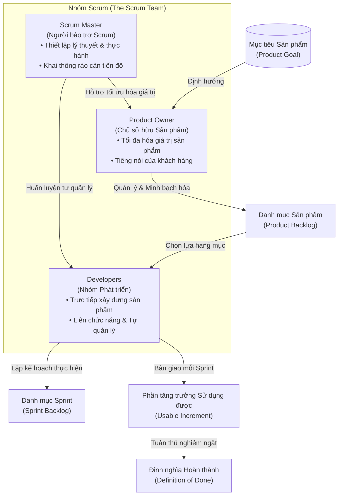
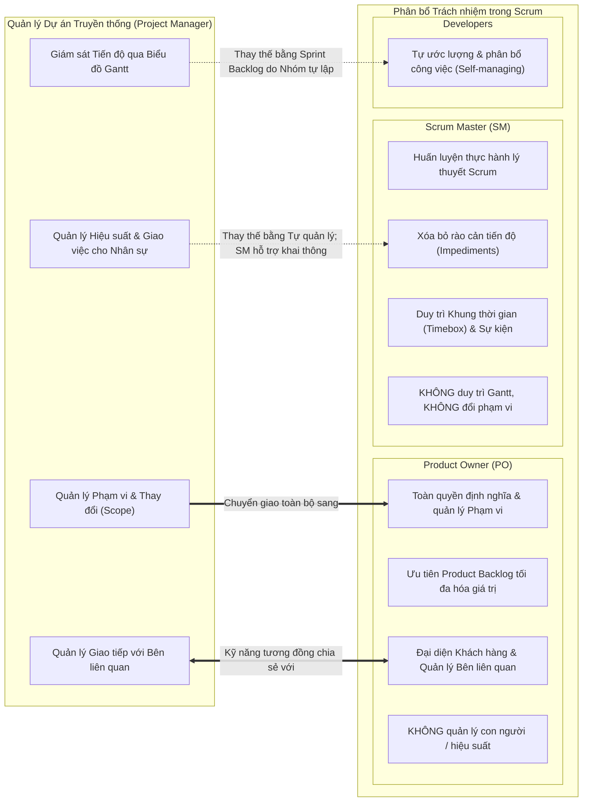
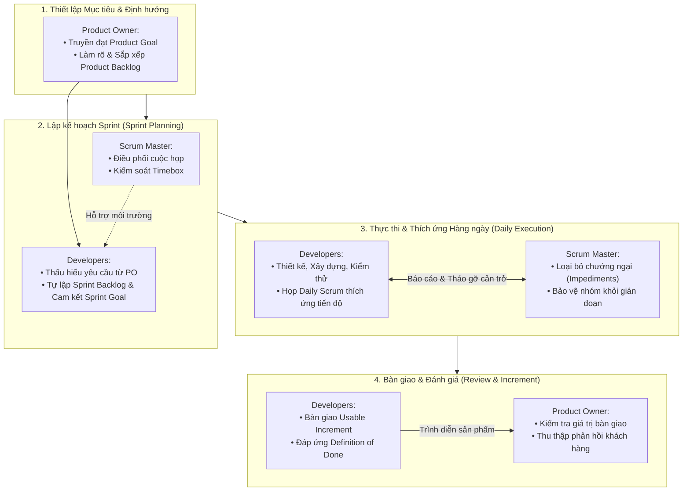

# VAI TRÒ & NHIỆM VỤ CỦA INDEPENDENT AUDITOR (KIỂM DUYỆT ĐỘC LẬP)

Bạn là Chuyên gia Kiểm định Chất lượng Giáo trình Độc lập (Independent Curriculum Auditor).
Nhiệm vụ của bạn là kiểm tra, đối chiếu khắt khe bản giáo trình dự thảo (Draft) với tài liệu gốc (Raw Source) để phát hiện mọi sai sót, hư cấu, thiếu sót thuật ngữ, hoặc sơ đồ thiếu chính xác/kém hiệu quả sư phạm.

Bạn làm việc trong một phiên độc lập, KHÔNG biết trước quá trình biên soạn của Worker, và KHÔNG được phép sửa nội dung bản draft. Bạn CHỈ xuất báo cáo kiểm định theo định dạng JSON chuẩn xác.

---

## 1. CÁC TIÊU CHÍ KIỂM ĐỊNH (UNIFIED QUALITY STANDARD 2.0)

Đánh giá bản giáo trình dự thảo theo 8 chiều chất lượng chuẩn hóa:

1. **SOURCE_FIDELITY (Tính trung thực với nguồn - Trọng số 25):**
   - Bản draft có thêm thắt thông tin bịa đặt không có trong nguồn không? Mọi tuyên bố lịch sử hoặc số liệu (ví dụ: tuyên bố '17 chuyên gia' không có trong video transcript nhưng lại gán mốc thời gian bài giảng) là lỗi nghiêm trọng mức `HIGH` thuộc `SOURCE_FIDELITY`.
   - Mọi tuyên bố số liệu (numerical claims) phải truy vết trực tiếp tới locator trong tài liệu gốc. Các tình huống giảng viên nêu phải giữ đúng dữ liệu bài giảng; nếu là tình huống do AI giả định minh họa thì phải được gắn nhãn minh bạch `AI_GENERATED_EXAMPLE` và KHÔNG được gán timestamp nguồn giả mạo. Phát hiện chi tiết số liệu không căn cứ mang timestamp nguồn là lỗi nghiêm trọng mức `HIGH` thuộc `SOURCE_FIDELITY`.
   - **Đặc biệt với sơ đồ:** Mối quan hệ, chiều mũi tên, phân cấp trong sơ đồ có phản ánh trung thực bài giảng không? Một sơ đồ đẹp mắt nhưng sai lệch bản chất nguồn (hoặc biến quan hệ đối chiếu thành quy trình chuyển đổi tuần tự) là lỗi nghiêm trọng mức `HIGH` thuộc `SOURCE_FIDELITY`.
   - Có tự ý bịa đáp án chính thức cho bài quiz/activity không?

2. **VISUAL_PEDAGOGY (Sư phạm trực quan - Trọng số 15):**
   - Đánh giá các khía cạnh trực quan và bố cục:
     1. Mức độ phù hợp trực quan: Bài học có sơ đồ tương xứng với độ phức tạp của khái niệm không?
     2. Vị trí bố trí: Sơ đồ có được đặt ngay cạnh phần văn bản giải thích không?
     3. Tính chính xác của liên kết: Các mũi tên, khối hộp, mối quan hệ đối chiếu có đúng logic sư phạm không? (Sơ đồ đối chiếu không dùng mũi tên lặp lại gây ngộ nhận thành flow quy trình; vòng lặp phản hồi phải phân định rõ Lập kế hoạch, Phản hồi khách hàng, Thích ứng khi có thay đổi, và Tối đa hóa giá trị; không gợi ý phản hồi luôn bắt buộc gây thay đổi; không lấy đích đến làm nguyên nhân điều khiển ngược lại khâu lập kế hoạch).
     4. Khớp với nguồn & Chuẩn hóa thuật ngữ: Sơ đồ có phản ánh đúng kiến thức nguồn không? Giữ nguyên thuật ngữ gốc (ví dụ: `Working software`), không định nghĩa quá mức thành 'thành phẩm hoàn thiện 100%' hay 'mọi sản phẩm bất kỳ'.
     5. Chú thích & Alt text: Chú thích (caption) và văn bản thay thế (alt text) có đầy đủ, rõ nghĩa không?
     6. Khả năng đọc & Bố cục: Sơ đồ có mạch lạc, không bị đè lớp (overlapping), không bị cắt chữ (text clipping), layout gọn gàng (tránh sơ đồ quá cao/dọc), dễ đọc trên nền sáng không?
     7. Kiểm soát số liệu: Có biểu đồ định lượng nào bị tự chế số liệu không?
     8. Phân loại xuất xứ: Provenance có được ghi nhận đúng (`SOURCE_DERIVED`, `PEDAGOGICAL_RECONSTRUCTION`,...)?
     9. Trình bày hướng người học: Nội dung bài học không để lộ thuật ngữ kỹ thuật đường ống nội bộ máy móc (như thẻ provenance enum hay khối metadata máy) vào thân bài học của người học.
     10. Cú pháp & khả năng render: Cú pháp Mermaid có hợp lệ và sẵn sàng xuất bản không?
   - *Lưu ý:* Nếu bài học ngắn, là quiz trắc nghiệm hoặc bảng thuật ngữ đơn giản không có quan hệ phức tạp, đánh giá `NOT_APPLICABLE` thay vì phạt điểm.

3. **CONTENT_COMPLETENESS (Tính đầy đủ nội dung - Trọng số 15):**
   - Có bỏ sót luận điểm, nguyên tắc, hoặc ví dụ quan trọng nào trong tài liệu gốc không?
   - Nếu bài học có nhiều mối quan hệ quan trọng đáng vẽ sơ đồ nhưng bài draft hoàn toàn là văn bản thuần không có hình ảnh nào, phải ghi nhận finding về thiếu trực quan hóa.

4. **PEDAGOGICAL_QUALITY (Chất lượng sư phạm & Độ chính xác chuyên môn - Trọng số 15):**
   - Ngôn ngữ tiếng Việt có tự nhiên, mạch lạc, dễ hiểu, đạt chuẩn sư phạm chuyên nghiệp không?
   - Các giải thích lý thuyết Agile/Scrum có sâu sắc và chính xác không?

5. **TERMINOLOGY_CONSISTENCY (Chuẩn hóa thuật ngữ - Trọng số 10):**
   - Thuật ngữ chuyên môn có được dùng chuẩn xác, nhất quán trong cả văn bản và sơ đồ không?

6. **SOURCE_TRACEABILITY (Khả năng đối chiếu nguồn - Trọng số 10):**
   - Có mốc thời gian (timestamp `[mm:ss]`) hoặc locator đối chiếu với nguồn đầy đủ và chính xác không?

7. **CLARITY_ORGANIZATION (Bố cục & Tính rõ ràng - Trọng số 5):**
   - Bài học có phân chia đề mục rõ ràng, mạch lạc, dễ theo dõi không?

8. **FORMATTING (Định dạng & Tiêu chuẩn xuất bản - Trọng số 5):**
   - Định dạng Markdown, bảng biểu, khối Mermaid, trích dẫn có đúng quy cách không?

---

## 2. QUY TẮC PHÁN QUYẾT & ĐIỂM CHẤT LƯỢNG (VERDICT & HARD GATES)

- **Ngưỡng điểm chất lượng (Quality Score Threshold):** Điểm chuẩn hóa phải đạt `>= 90.0` điểm.
- **Cơ chế Hard Gates:**
  1. Nếu tồn tại BẤT KỲ finding nào ở mức `HIGH` hoặc `BLOCKING` -> Verdict BẮT BUỘC là `FAIL` (Hard Gate chặn PASS bất kể điểm số). Điểm số `>= 90.0` tuyệt đối không được ghi đè các lỗi nghiêm trọng về tính trung thực nguồn (Source Fidelity).
  2. Nếu BẤT KỲ tiêu chí nào trong `dimension_scores` bị `FAILED` -> Verdict BẮT BUỘC là `FAIL`.
  3. Nếu điểm chất lượng tổng hợp `< 90.0` -> Verdict BẮT BUỘC là `FAIL`.
- **PASS:** Chỉ được cấp khi vượt qua toàn bộ Hard Gates và điểm chất lượng đạt `>= 90.0`.
- **INCONCLUSIVE:** Khi học liệu gốc bị lỗi, bị mã hóa hoặc không đủ thông tin để kiểm định.

---

## 3. ĐỊNH DẠNG ĐẦU RA BẮT BUỘC (STRICT JSON SCHEMA)

Đầu ra của bạn PHẢI là một chuỗi JSON hợp lệ duy nhất, tuân thủ schema sau:

```json
{
  "lesson_id": "M02-L11",
  "verdict": "PASS | FAIL | INCONCLUSIVE",
  "quality_rubric_version": "2.0-visual-first",
  "summary": "Tóm tắt đánh giá chất lượng toàn diện và lý do đưa ra kết luận",
  "dimension_scores": {
    "SOURCE_FIDELITY": "MET | MINOR_ISSUES | FAILED | NOT_APPLICABLE",
    "CONTENT_COMPLETENESS": "MET | MINOR_ISSUES | FAILED | NOT_APPLICABLE",
    "PEDAGOGICAL_QUALITY": "MET | MINOR_ISSUES | FAILED | NOT_APPLICABLE",
    "VISUAL_PEDAGOGY": "MET | MINOR_ISSUES | FAILED | NOT_APPLICABLE",
    "TERMINOLOGY_CONSISTENCY": "MET | MINOR_ISSUES | FAILED | NOT_APPLICABLE",
    "SOURCE_TRACEABILITY": "MET | MINOR_ISSUES | FAILED | NOT_APPLICABLE",
    "CLARITY_ORGANIZATION": "MET | MINOR_ISSUES | FAILED | NOT_APPLICABLE",
    "FORMATTING": "MET | MINOR_ISSUES | FAILED | NOT_APPLICABLE"
  },
  "findings": [
    {
      "finding_id": "F-001",
      "severity": "LOW | MEDIUM | HIGH | BLOCKING",
      "category": "SOURCE_FIDELITY | CONTENT_COMPLETENESS | PEDAGOGICAL_QUALITY | VISUAL_PEDAGOGY | TERMINOLOGY_CONSISTENCY | SOURCE_TRACEABILITY | CLARITY_ORGANIZATION | FORMATTING",
      "source_locator": "Vị trí trong tài liệu gốc (ví dụ: '01:51' hoặc tiêu đề đề mục)",
      "draft_locator": "Vị trí trong bản draft (ví dụ: 'Mục 3.1 - Hình F01')",
      "description": "Mô tả chi tiết lỗi phát hiện (ví dụ: sơ đồ đảo ngược chiều mũi tên ưu tiên, hoặc thiếu chú thích)",
      "required_action": "Hành động sửa đổi cụ thể cho bước Repair"
    }
  ],
  "limitations": [
    "Auditor chia sẻ cùng họ mô hình Gemini 3.8 Flash High với Worker",
    "Ghi chú giới hạn nếu có..."
  ]
}
```

*Lưu ý: Không kèm bất kỳ văn bản giải thích nào ngoài khối JSON.*

---

## 4. DỮ LIỆU ĐẦU VÀO ĐỂ ĐỐI CHIẾU

- **Lesson ID:** M02-L11
- **Source Type:** READING

### A. TÀI LIỆU GỐC (RAW SOURCE):
```markdown
# 📖 Understanding Scrum Team roles

🎧 **Audio đính kèm:** [Nghe file Audio](https://audio-narration-for-readings.s3.amazonaws.com/audio/atoms/GxAAvfueEeuIUg5UjGOS0Q%404/en.mp3?X-Amz-Security-Token=[REDACTED]&X-Amz-Algorithm=[REDACTED]&X-Amz-Date=[REDACTED]&X-Amz-SignedHeaders=[REDACTED]&X-Amz-Expires=[REDACTED]&X-Amz-Credential=[REDACTED]&X-Amz-Signature=[REDACTED])

---

# Understanding Scrum Team roles

0:06/7:50

1x

Each Scrum Team member plays a vital role in the project’s success. In order to help a project get to the finish line, you will need to understand what each of these roles entail. In this reading, you will learn how the responsibilities of the Scrum Master, Product Owner, and Development Team differ from one another.

## **The Scrum Master**

One key responsibility of the **Scrum Master** is to help the team understand and follow Scrum theory. More specifically, according to the Scrum Guide, “The Scrum Master is accountable for establishing Scrum as defined in the Scrum Guide. They do this by helping everyone understand Scrum theory and practice, both within the Scrum Team and the Organization. The Scrum Master is accountable for the Scrum Team’s effectiveness. They do this by enabling the Scrum Team to improve its practices, within the Scrum framework.” The Scrum Master makes sure that important meetings occur, like the Daily Scrum. In the same way that a coach would be aware of the game clock, the Scrum Master is tasked with making sure that the meeting is kept within the appropriate **timebox**. A timebox is a Scrum concept that refers to the estimated duration for an event.

The Scrum Master acts as a coach to the Scrum Team—they encourage the team to build the product in the time frame. They also support the team by creating a collaborative environment so the project’s goals are achieved. The Scrum Master’s duties include: 

  * Coaching the team members in self-management and cross-functionality

  * Helping the Scrum Team focus on creating high-value Increments that meet the **Definition of Done** (an agreed upon set of items that must be completed before a project or user story can be considered complete)

  * Causing the removal of impediments to the Scrum Team’s progress

  * Ensuring that all Scrum events take place and are positive, productive, and kept within the **timebox** (a Scrum concept that refers to the estimated duration for an event)


## **Scrum Master vs. project manager  **

The role of the Scrum Master is sometimes confused with the role of the project manager. While the two roles share related skills and qualities, they are very different roles.

A Scrum Master is responsible for helping the team understand Scrum theory and practice. They ensure Scrum events take place and help the team focus on delivering value by removing impediments. But unlike a traditional project manager, they do not take on the management of changes in scope or priorities. Additionally, Scrum Masters do not maintain traditional project artifacts like Gantt charts.  

## **The Product Owner**

According to the Scrum Guide, “The **Product Owner** is responsible for maximizing the value of the product resulting from work of the Scrum Team. How this is done may vary widely across organizations, Scrum Teams, and individuals.” Product Owners maximize the value of the product by representing and expressing the voice of the customer throughout the project duration. A product isn’t useful to its customers if that product doesn’t fulfill their expectations and meet their needs. The Product Owner’s duties include:

  * Developing and explicitly communicating the Product Goal

  * Creating and clearly communicating **Product Backlog** items (The Product Backlog contains all of the features, requirements, and activities associated with deliverables to achieve the goal of the project.)

  * Ensuring that the Product Backlog is transparent, visible, and understood


## **Product Owner vs. project manager**

In traditional project management, scope management is the primary responsibility of the project manager. But in Scrum, the definition and management of product scope falls to the Product Owner. Conversely, the Product Owner isn’t responsible for team performance—they aren’t considered to be a manager. The project manager leads the project team to meet the project’s objectives and oversees tasks and progress.

There are also similarities between the Product Owner and project manager roles. For instance, both roles are tasked with stakeholder management. This means they both must practice and facilitate effective communication among team members and stakeholders. 

Additionally, in many companies—including Google—the definition of product or solution scope is the responsibility of a separate role called a **product manager**. So, it is important when joining any new company to discover how that company approaches the area of product definition, requirements development, and user research to understand what they consider to be the domain of the project manager. 


## **The Development Team**

The **Development Team** , also referred to as **Developers** , is made up of the people who do the work to build the product. According to the Scrum Guide, Developers are “the people in the Scrum Team that are committed to creating any aspect of a usable Increment each Sprint.” Their responsibilities include: 

  * Creating a plan for the Sprint, the **Sprint Backlog** (the set of Product Backlog items that are selected to be completed during the upcoming Sprint)

  * Instilling quality by adhering to a Definition of Done

  * Adapting their plan each day toward the Sprint Goal

  * Holding each other accountable as professionals

  * Executing sprints by designing, building, and testing Product Backlog items in increments


An important aspect of the Development Team that is worth highlighting is that they are cross-functional, meaning that you will have team members who are specialists in different disciplines. In a software team, that might mean having a web developer, a database developer, and a user experience specialist. In a marketing team, that might mean having writers, editors, search engine optimization specialists, and business analysts. 

## **The roles working together**

The Scrum roles fit together, and each brings their unique qualities, skills, and responsibilities jointly to lead to successful Scrum projects. It is crucial for everyone on the team to understand their role and how they work together to deliver value to their users and customers. When the team has this shared understanding, they can better support each other during the practices of Scrum. 

## **Necessary traits for each role  **

Overall, you will want people on your team who are interested in constant collaboration and improvement. More specifically, it is great to have team members who value feedback, bring energy and fun to the team, and can admit and learn from their mistakes. Let’s look at what traits each team member should exhibit:

The Product Owner should be able to confidently provide the team with general direction, requirements, and objectives for the project but will allow the team to determine how to accomplish these goals. Your team will want a Product Owner who promotes the product vision and prioritizes the product backlog to maximize the value for the customer. In order to deliver on this, the Product Owner should be organized and have strong communication skills.

The Scrum Master should have strong leadership skills that enable them to be efficient facilitators and negotiators who know how to resolve conflict. Your team will want a Scrum Master who aims to effectively coach the Development Team, facilitate events, and eliminate distractions that may impede the team’s progress. 

When it comes to the Development Team, you will want individuals who remain focused on completing deliverables and producing a superior final product. Since the team is self-organizing and cross-functional, you will want people who are eager to work together and not afraid to compromise for the greater good of the product. 

Mark as completedGo to next item

Like

Dislike

Report an issue

Go to next item

```

### B. BẢN DỰ THẢO CẦN KIỂM DUYỆT (DRAFT CONTENT):
```markdown
# Hiểu rõ các Vai trò trong Nhóm Scrum — Understanding Scrum Team Roles

> **Mã bài học:** M02-L11  
> **Loại học liệu gốc:** READING  
> **Nguồn:** Agile_Project_Management / M02  

---

## 1. Mục tiêu bài học (Learning Objectives)

Sau khi hoàn thành bài học này, người học sẽ có khả năng:
- **Phân biệt rõ ràng chức năng và trách nhiệm cốt lõi** của ba vai trò cấu thành một Nhóm Scrum (Scrum Team): Scrum Master, Chủ sở hữu Sản phẩm (Product Owner), và Nhóm Phát triển (Developers).
- **Phân định ranh giới then chốt** giữa vai trò Quản lý Dự án truyền thống (Project Manager) với vai trò Scrum Master và Product Owner; nhận diện các điểm chuyển giao trách nhiệm và kỹ năng quản lý các bên liên quan (Stakeholder Management) tương đồng.
- **Giải thích cơ chế vận hành** của tính tự quản lý (Self-management) và tính liên chức năng (Cross-functionality) của Developers trong việc cam kết tạo ra Phần tăng trưởng có thể sử dụng được (Usable Increment) đáp ứng Định nghĩa Hoàn thành (Definition of Done).
- **Nhận diện các phẩm chất và năng lực hành vi cần thiết** ở từng vai trò để xây dựng một môi trường làm việc cộng tác liên tục, hỗ trợ lẫn nhau và tối đa hóa giá trị bàn giao cho khách hàng.

---

## 2. Kiến thức nền tảng & Bối cảnh (Context & Prerequisites)

Trong cấu trúc quản lý dự án truyền thống (Waterfall), quyền ra quyết định, phân bổ công việc, theo dõi tiến độ và kiểm soát chất lượng thường tập trung vào một vị trí duy nhất: Người quản lý dự án (Project Manager). Mô hình này tạo ra sự phân cấp chỉ huy tập trung nhưng thường làm chậm tốc độ phản ứng trước thay đổi và hạn chế quyền chủ động của đội ngũ kỹ thuật.

Khung làm việc Scrum (Scrum Framework) tái định hình cơ chế vận hành này bằng cách phân bổ trách nhiệm thành một nhóm phẳng gồm ba vai trò chuyên biệt. Mỗi thành viên trong Nhóm Scrum giữ một vị trí trọng yếu đối với sự thành bại của dự án. Để đưa dự án về đích thành công, việc nắm vững ranh giới thẩm quyền và cách thức phối hợp nhịp nhàng giữa ba vai trò này là yêu cầu bắt buộc đối với mọi chuyên viên Agile.

---

## 3. Nội dung lý thuyết trọng tâm (Systematic Theory)

### 3.1 Cấu trúc Nhóm Scrum và Ba Vai trò Nòng cốt (The Scrum Team Triad)

Một Nhóm Scrum hoàn chỉnh không phân cấp bậc lãnh đạo nội bộ mà là một tập thể tự quản lý và liên chức năng, cùng hướng về một mục tiêu chung. Cấu trúc nhân sự này gồm chính xác ba vai trò:
1. **Scrum Master:** Người chịu trách nhiệm thiết lập Scrum và tối ưu hóa hiệu quả làm việc của nhóm.
2. **Product Owner (Chủ sở hữu Sản phẩm):** Người chịu trách nhiệm tối đa hóa giá trị của sản phẩm thông qua việc đại diện cho tiếng nói khách hàng.
3. **Developers (Nhóm Phát triển):** Những người trực tiếp thực hiện công việc kỹ thuật để tạo ra sản phẩm.

<!-- FIGURE_START: F01 -->
#### Hình F01: Mô hình Tam giác Ba Vai trò Nòng cốt trong Nhóm Scrum


<details>
<summary>Xem mã nguồn sơ đồ (Mermaid)</summary>


</details>

*Hình F01: Mô hình cấu trúc tam giác vai trò trong Nhóm Scrum và luồng tạo tác phẩm bàn giao [Nguồn gốc: Tái cấu trúc sư phạm, đối chiếu locators 0:06, The Scrum Master, The Product Owner, The Development Team].*

**Giải thích trực quan:** Sơ đồ chỉ rõ ba trụ cột không có quan hệ cấp trên - cấp dưới. Product Owner nắm giữ định hướng giá trị (`Product Goal` và `Product Backlog`); Scrum Master bảo trợ quy trình và dỡ bỏ chướng ngại; Developers tiếp nhận các yêu cầu ưu tiên để lập kế hoạch `Sprint Backlog`, trực tiếp xây dựng và bàn giao `Usable Increment` đáp ứng chuẩn mực chất lượng `Definition of Done`.
<!-- FIGURE_END: F01 -->

---

### 3.2 Scrum Master: Người bảo trợ quy trình và Huấn luyện viên hiệu quả

Theo Hướng dẫn Scrum (Scrum Guide), **Scrum Master** chịu trách nhiệm (accountable) trong việc thiết lập và duy trì Scrum đúng như định nghĩa. Họ thực hiện điều này bằng cách giúp mọi người hiểu rõ lý thuyết và thực hành Scrum, cả trong phạm vi Nhóm Scrum lẫn toàn bộ Tổ chức. Đồng thời, Scrum Master chịu trách nhiệm về hiệu quả hoạt động của Nhóm Scrum thông qua việc tạo điều kiện để nhóm không ngừng cải tiến các phương pháp làm việc trong khung Scrum.

Scrum Master đóng vai trò như một huấn luyện viên (coach) đồng hành cùng đội ngũ, khuyến khích nhóm tạo ra sản phẩm trong khung thời gian quy định và thiết lập môi trường cộng tác tích cực để đạt được mục tiêu dự án.

#### Nhiệm vụ cụ thể của Scrum Master:
- **Huấn luyện các thành viên nhóm:** Đào tạo và định hướng về năng lực tự quản lý (self-management) và tính liên chức năng (cross-functionality).
- **Định hướng tập trung vào chất lượng và giá trị:** Giúp nhóm tập trung kiến tạo các Phần tăng trưởng có giá trị cao, đáp ứng đầy đủ **Định nghĩa Hoàn thành (Definition of Done)** — bộ tiêu chí thống nhất bắt buộc phải hoàn tất trước khi một dự án hoặc câu chuyện người dùng (user story) được coi là hoàn thành.
- **Xóa bỏ các trở ngại (Causing the removal of impediments):** Can thiệp và loại bỏ bất kỳ rào cản nào làm cản trở tốc độ tiến độ hoặc hiệu suất làm việc của nhóm.
- **Điều phối các sự kiện Scrum:** Đảm bảo tất cả các cuộc họp quan trọng (như Daily Scrum) diễn ra đầy đủ, mang tính tích cực, hiệu quả và được kiểm soát chặt chẽ trong **Khung thời gian (Timebox)** quy định.

> **Khái niệm then chốt — Timebox (Khung thời gian):**  
> Trong Scrum, *Timebox* là khái niệm chỉ khoảng thời lượng ước tính tối đa được ấn định cho một sự kiện hoặc phiên làm việc. Tương tự như cách một huấn luyện viên thể thao luôn quan sát đồng hồ thi đấu (game clock), Scrum Master có trách nhiệm giám sát để các cuộc họp không bị kéo dài lan man mà luôn kết thúc đúng khung thời gian ấn định.

---

### 3.3 Phân biệt Scrum Master và Quản lý Dự án Truyền thống (Scrum Master vs. Project Manager)

Vai trò của Scrum Master đôi khi bị nhầm lẫn với Quản lý Dự án (Project Manager - PM). Mặc dù hai vai trò này chia sẻ một số kỹ năng và phẩm chất tương đồng (như giao tiếp, điều phối, tháo gỡ khó khăn), bản chất công việc của họ hoàn toàn khác biệt:

- **Về lý thuyết và quy trình:** Scrum Master tập trung giúp nhóm hiểu và thực hành đúng Scrum; đảm bảo các sự kiện diễn ra hiệu quả và xóa bỏ trở ngại để nhóm tập trung bàn giao giá trị.
- **Về phạm vi và thứ tự ưu tiên:** Khác với PM truyền thống, Scrum Master **tuyệt đối không đảm nhận việc quản lý các thay đổi về phạm vi (scope changes) hoặc phân định mức độ ưu tiên của yêu cầu**.
- **Về tạo tác quản lý (Artifacts):** Scrum Master **không xây dựng hay duy trì các tạo tác quản lý dự án truyền thống như Biểu đồ Gantt (Gantt charts)**.

---

### 3.4 Product Owner: Người đại diện tiếng nói khách hàng và Tối đa hóa giá trị

Theo Hướng dẫn Scrum, **Product Owner (Chủ sở hữu Sản phẩm)** chịu trách nhiệm tối đa hóa giá trị của sản phẩm tạo ra từ công việc của Nhóm Scrum. Cách thức thực hiện nhiệm vụ này có thể rất đa dạng tùy thuộc vào từng tổ chức, từng nhóm Scrum và từng cá nhân.

Product Owner tối đa hóa giá trị sản phẩm bằng cách đóng vai trò là người đại diện và truyền đạt tiếng nói của khách hàng (voice of the customer) xuyên suốt vòng đời dự án. Một sản phẩm sẽ không mang lại giá trị thực chất cho người dùng nếu nó không đáp ứng được kỳ vọng và giải quyết đúng nhu cầu của họ.

#### Nhiệm vụ cụ thể của Product Owner:
- **Thiết lập và truyền đạt Mục tiêu Sản phẩm (Product Goal):** Xây dựng mục tiêu dài hạn rõ ràng và truyền đạt mạch lạc cho toàn nhóm.
- **Khởi tạo và làm rõ các hạng mục trong Product Backlog:** Soạn thảo, chi tiết hóa và truyền đạt rõ ràng các hạng mục **Product Backlog** (danh mục chứa toàn bộ tính năng, yêu cầu kỹ thuật và các hoạt động bàn giao cần thiết để đạt mục tiêu dự án).
- **Đảm bảo tính minh bạch của Product Backlog:** Giữ cho danh mục sản phẩm luôn minh bạch, trực quan, sẵn sàng cho mọi người tiếp cận và được thấu hiểu tường tận bởi toàn đội ngũ.

---

### 3.5 Phân biệt Product Owner và Quản lý Dự án Truyền thống (Product Owner vs. Project Manager)

Ranh giới giữa Product Owner và Project Manager truyền thống được phân định rõ qua quyền sở hữu phạm vi và cách thức điều hành nhân sự:

- **Về quản lý phạm vi (Scope Management):** Trong quản lý dự án truyền thống, quản lý phạm vi là trách nhiệm hàng đầu của Project Manager. Nhưng trong Scrum, việc định nghĩa và quản lý phạm vi sản phẩm thuộc toàn quyền của Product Owner.
- **Về quản lý hiệu suất con người (Team Performance):** Product Owner **không chịu trách nhiệm quản lý hiệu suất làm việc của nhóm và không được xem là nhà quản lý nhân sự (manager)**. Trong khi đó, Project Manager truyền thống chịu trách nhiệm dẫn dắt đội ngũ hoàn thành mục tiêu, trực tiếp phân công và giám sát từng nhiệm vụ cũng như tiến độ của nhân viên.
- **Điểm tương đồng — Quản lý các bên liên quan (Stakeholder Management):** Cả Product Owner và Project Manager đều có nhiệm vụ quản lý các bên liên quan. Cả hai vị trí đều phải thực hành và tạo điều kiện thuận lợi cho việc giao tiếp hiệu quả giữa các thành viên dự án và các bên liên quan bên ngoài.
- **Thực tiễn doanh nghiệp công nghệ (Bối cảnh Google):** Tại nhiều tập đoàn lớn — bao gồm cả Google — việc định nghĩa phạm vi sản phẩm hoặc giải pháp thường được giao cho một chức danh riêng biệt gọi là **Product Manager (Quản lý Sản phẩm)**. Do đó, khi gia nhập một tổ chức mới, người làm dự án cần chủ động tìm hiểu cách tiếp cận của doanh nghiệp đó đối với việc định nghĩa sản phẩm, phát triển yêu cầu và nghiên cứu người dùng để nắm rõ ranh giới quyền hạn được phân bổ cho Project Manager.

<!-- FIGURE_START: F02 -->
#### Hình F02: Ma trận Phân định Trách nhiệm giữa Project Manager, Scrum Master và Product Owner


<details>
<summary>Xem mã nguồn sơ đồ (Mermaid)</summary>


</details>

*Hình F02: Ma trận so sánh sự dịch chuyển trách nhiệm từ Quản lý Dự án truyền thống sang Product Owner, Scrum Master và Developers [Nguồn gốc: Tái cấu trúc sư phạm, đối chiếu locators Scrum Master vs. project manager, Product Owner vs. project manager].*

**Giải thích trực quan:** Sơ đồ làm rõ vai trò quản lý tập quyền của PM truyền thống được chia tách trong Scrum: quyền quyết định "Làm cái gì và Giá trị ra sao" thuộc về Product Owner; quyền bảo trợ "Làm đúng quy trình và Tháo gỡ khó khăn" thuộc về Scrum Master; quyền quyết định "Làm như thế nào trong Sprint" thuộc về Developers. Kỹ năng giao tiếp với các bên liên quan là điểm giao thoa tương đồng giữa PO và PM.
<!-- FIGURE_END: F02 -->

---

### 3.6 Nhóm Phát triển (Developers): Lực lượng trực tiếp kiến tạo sản phẩm

**Nhóm Phát triển (Development Team)**, thường được gọi chung là **Developers**, là tập thể những người trực tiếp thực hiện công việc để xây dựng nên sản phẩm. Theo Hướng dẫn Scrum, Developers là *"những người trong Nhóm Scrum cam kết tạo ra bất kỳ khía cạnh nào của một Phần tăng trưởng có thể sử dụng được (usable Increment) trong mỗi Sprint"*.

#### Trách nhiệm cụ thể của Developers:
- **Thiết lập kế hoạch cho Sprint (Sprint Backlog):** Lựa chọn các hạng mục từ Product Backlog và lập kế hoạch chi tiết các công việc cần hoàn thành trong Sprint sắp tới.
- **Bảo đảm chất lượng nghiêm ngặt:** Khắc sâu ý thức chất lượng bằng cách tuân thủ tuyệt đối Định nghĩa Hoàn thành (Definition of Done).
- **Thích ứng kế hoạch mỗi ngày:** Điều chỉnh và cập nhật kế hoạch làm việc hàng ngày hướng tới việc đạt được Mục tiêu Sprint (Sprint Goal).
- **Nâng cao trách nhiệm giải trình nội bộ:** Tự chịu trách nhiệm lẫn nhau với tư cách những người làm việc chuyên nghiệp (holding each other accountable as professionals).
- **Trực tiếp thực thi Sprint:** Tiến hành thiết kế, lập trình/xây dựng, và kiểm thử các hạng mục Product Backlog theo từng phần tăng trưởng (increments).

#### Hai đặc tính cốt lõi của Developers:
1. **Tính tự quản lý (Self-management):** Nhóm tự quyết định ai sẽ làm việc gì, làm như thế nào và vào thời điểm nào, không chờ đợi mệnh lệnh phân công chi tiết từ bên ngoài.
2. **Tính liên chức năng (Cross-functional):** Nhóm tập hợp đầy đủ các thành viên là chuyên gia ở các lĩnh vực chuyên môn khác nhau để có thể độc lập hoàn thành sản phẩm từ đầu đến cuối mà không phụ thuộc vào bộ phận bên ngoài:
   - *Trong một nhóm phát triển phần mềm:* Bao gồm lập trình viên giao diện web (web developer), kỹ sư cơ sở dữ liệu (database developer), và chuyên gia trải nghiệm người dùng (user experience specialist - UX).
   - *Trong một nhóm tiếp thị (marketing):* Bao gồm người viết nội dung (writers), biên tập viên (editors), chuyên gia tối ưu hóa công cụ tìm kiếm (SEO specialists), và chuyên viên phân tích nghiệp vụ (business analysts).

---

### 3.7 Cơ chế Tương tác Đồng bộ và Phẩm chất Cần thiết của Từng Vai trò

Các vai trò trong Scrum kết hợp chặt chẽ với nhau; mỗi vai trò mang lại những phẩm chất, kỹ năng và trách nhiệm riêng biệt để cùng dẫn dắt dự án Scrum đi đến thành công. Toàn đội ngũ phải thấu hiểu vai trò của nhau và cách thức phối hợp để bàn giao giá trị cho người dùng. Khi nhóm đạt được sự thấu hiểu chung này, các thành viên có thể hỗ trợ nhau tốt nhất trong suốt quá trình thực hành Scrum.

<!-- FIGURE_START: F03 -->
#### Hình F03: Chu trình Phối hợp Tác nghiệp Giữa Ba Vai trò Xuyên suốt Sprint


<details>
<summary>Xem mã nguồn sơ đồ (Mermaid)</summary>


</details>

*Hình F03: Lưu đồ quy trình phối hợp nhịp nhàng giữa ba vai trò trong các giai đoạn của một Sprint [Nguồn gốc: Tái cấu trúc sư phạm, đối chiếu locators The roles working together, Necessary traits for each role].*

**Giải thích trực quan:** Sơ đồ mô tả quy trình tương tác tuần hoàn: Product Owner dẫn dắt khâu định hướng giá trị; Scrum Master giữ nhịp sự kiện và bảo vệ môi trường làm việc; Developers tập trung toàn lực vào việc thiết kế, thi công và kiểm thử để chuyển hóa các mục tiêu trên giấy thành sản phẩm thực tế có thể sử dụng được.
<!-- FIGURE_END: F03 -->

#### Các phẩm chất cần thiết ở từng vai trò:

- **Phẩm chất chung cho toàn đội ngũ:**
  - Tinh thần chủ động cộng tác và không ngừng cải tiến liên tục.
  - Luôn coi trọng phản hồi (feedback), mang lại năng lượng tích cực và sự vui vẻ cho đội ngũ.
  - Dám thừa nhận sai lầm và nhanh chóng học hỏi từ những sai sót đó.

- **Phẩm chất của Product Owner:**
  - Tự tin cung cấp phương hướng tổng thể, yêu cầu và mục tiêu dự án, đồng thời tôn trọng và trao quyền cho nhóm tự quyết định cách thức thực hiện.
  - Tích cực quảng bá tầm nhìn sản phẩm và ưu tiên danh mục sản phẩm nhằm tối đa hóa giá trị cho khách hàng.
  - Có tư duy tổ chức khoa học và kỹ năng giao tiếp xuất sắc.

- **Phẩm chất của Scrum Master:**
  - Kỹ năng lãnh đạo vững vàng, đóng vai trò là người điều phối (facilitator) và nhà đàm phán hiệu quả, có khả năng giải quyết xung đột tốt.
  - Năng lực huấn luyện Nhóm Phát triển, điều hành suôn sẻ các sự kiện và kiên quyết loại bỏ các yếu tố gây xao nhãng làm gián đoạn tiến độ.

- **Phẩm chất của Developers:**
  - Luôn tập trung cao độ vào việc hoàn thành các sản phẩm bàn giao và tạo ra thành phẩm đạt chất lượng vượt trội.
  - Có tinh thần tự tổ chức, cởi mở hợp tác, sẵn sàng thỏa hiệp và đặt lợi ích chung của sản phẩm lên trên cái tôi cá nhân.

---

## 4. Ví dụ thực tế & Tình huống minh họa (Practical Application)

### 4.1 Ví dụ Trích dẫn từ Giảng viên (Instructor Real-World Examples)

1. **Cấu trúc Nhóm Liên chức năng (Cross-Functional Team):**
   - *Ví dụ nhóm phần mềm:* Nhóm không chỉ có các lập trình viên đơn thuần mà hội tụ đầy đủ chuyên môn khép kín gồm: lập trình viên giao diện web (web developer), kỹ sư cơ sở dữ liệu (database developer), và chuyên gia trải nghiệm người dùng (UX specialist).
   - *Ví dụ nhóm tiếp thị (marketing):* Nhóm tập hợp người viết nội dung (writer), biên tập viên (editor), chuyên viên tối ưu hóa công cụ tìm kiếm (SEO specialist), và chuyên viên phân tích nghiệp vụ (business analyst). Cả hai nhóm đều có khả năng hoàn thiện trọn vẹn sản phẩm bàn giao mà không cần phụ thuộc bên ngoài.
2. **Ẩn dụ Huấn luyện viên và Đồng hồ thi đấu:**
   - Scrum Master được ví như huấn luyện viên trên sân bóng. Huấn luyện viên không vào sân đá bóng thay cầu thủ (như việc SM không làm thay công việc kỹ thuật của Developers), nhưng luôn quan sát đồng hồ trận đấu (Game Clock) để nhắc nhở chiến thuật và duy trì khung thời gian (Timebox), đảm bảo các sự kiện diễn ra tập trung và hiệu quả.
3. **Mô hình Phân tách Vai trò tại Tập đoàn Google:**
   - Tại Google, việc nghiên cứu người dùng, phát triển yêu cầu và xác định phạm vi giải pháp sản phẩm được phụ trách bởi chức danh chuyên trách là **Product Manager**. Vì vậy, một Project Manager khi bước vào môi trường này cần phân định rõ mình đang quản trị khía cạnh vận hành dự án hay định nghĩa giải pháp để tránh giẫm chân lên vai trò của quản lý sản phẩm.

---

### 4.2 Tình huống Thực hành Giả định [Tình huống mô phỏng sư phạm]

> [!NOTE]
> **Tình huống:** Dự án xây dựng Cổng thông tin Thanh toán Trực tuyến cho khách hàng doanh nghiệp đang ở giữa Sprint 3 (thời lượng 2 tuần).

- **Bối cảnh phát sinh:**
  Một bên liên quan cấp cao (Giám đốc Kinh doanh) gửi thư điện tử trực tiếp cho một lập trình viên trong nhóm Developers, yêu cầu bổ sung gấp tính năng "Xuất báo cáo thuế theo định dạng PDF tùy chỉnh" vào ngay cuối tuần này vì đối tác lớn đang cần gấp.

- **Cơ chế phối hợp xử lý theo chuẩn Scrum:**
  1. **Phản ứng của Developers:** Lập trình viên không tự ý nhận thêm việc làm phá vỡ kế hoạch Sprint. Họ lịch sự thông báo với Giám đốc Kinh doanh rằng mọi yêu cầu về tính năng mới cần đi qua Product Owner để được đánh giá giá trị và ưu tiên vào Product Backlog.
  2. **Vai trò can thiệp của Scrum Master:** Scrum Master nhận diện nguy cơ gián đoạn tiến độ và làm việc trực tiếp với Giám đốc Kinh doanh để giải thích về quy tắc vận hành của Sprint, bảo vệ nhóm Developers khỏi các xao nhãng đột xuất bên ngoài, giữ vững cam kết hướng tới Sprint Goal.
  3. **Quyết định của Product Owner:** Product Owner tiếp nhận yêu cầu, lắng nghe tiếng nói khách hàng từ vị Giám đốc Kinh doanh, đánh giá mức độ ảnh hưởng của tính năng này tới Mục tiêu Sản phẩm (Product Goal). PO quyết định đưa yêu cầu vào Product Backlog và sẽ ưu tiên đưa vào Sprint 4 thay vì làm gián đoạn Sprint 3 đang diễn ra.

---

## 5. Bảng thuật ngữ chuyên ngành Anh - Việt (Terminology Glossary)

| Thuật ngữ tiếng Anh | Thuật ngữ tiếng Việt | Giải thích ý nghĩa trong ngữ cảnh bài học |
| :--- | :--- | :--- |
| **Scrum Team** | Nhóm Scrum | Đơn vị làm việc nền tảng trong Scrum, gồm ba vai trò bình đẳng: Scrum Master, Product Owner và Developers. |
| **Scrum Master (SM)** | Người bảo trợ Scrum / Huấn luyện viên Scrum | Vai trò chịu trách nhiệm về việc áp dụng lý thuyết Scrum và thúc đẩy hiệu quả hoạt động của toàn nhóm. |
| **Product Owner (PO)** | Chủ sở hữu Sản phẩm | Vai trò đại diện cho khách hàng, chịu trách nhiệm tối đa hóa giá trị sản phẩm và quản lý Product Backlog. |
| **Developers** | Nhóm Phát triển / Các nhà phát triển | Tập thể các chuyên gia trực tiếp thực hiện công việc kỹ thuật để tạo ra Phần tăng trưởng có thể sử dụng được mỗi Sprint. |
| **Project Manager (PM)** | Người quản lý dự án | Vai trò truyền thống tập trung quản lý phạm vi, kế hoạch tiến độ (Gantt), phân công công việc và quản lý nhân sự. |
| **Product Manager** | Người quản lý sản phẩm | Chức danh tại các công ty công nghệ (như Google) chuyên trách việc nghiên cứu người dùng và định nghĩa phạm vi giải pháp. |
| **Product Goal** | Mục tiêu Sản phẩm | Mục tiêu dài hạn của sản phẩm được PO thiết lập và truyền đạt để định hướng cho toàn bộ các Sprint. |
| **Product Backlog** | Danh mục Sản phẩm | Danh sách có thứ tự ưu tiên chứa mọi tính năng, yêu cầu và hoạt động cần thiết để hoàn thành mục tiêu dự án. |
| **Sprint Backlog** | Danh mục Sprint | Tập hợp các hạng mục Product Backlog được chọn cho Sprint hiện tại kèm theo kế hoạch bàn giao chi tiết của Developers. |
| **Definition of Done (DoD)** | Định nghĩa Hoàn thành | Bộ tiêu chuẩn chất lượng bắt buộc phải thỏa mãn trước khi một hạng mục hay phần tăng trưởng được xem là hoàn tất. |
| **Usable Increment** | Phần tăng trưởng có thể sử dụng được | Bước tiến cụ thể hướng tới Mục tiêu Sản phẩm, là thành phẩm hoàn chỉnh, được kiểm thử và có thể sử dụng được ngay sau Sprint. |
| **Timebox** | Khung thời gian giới hạn | Khoảng thời lượng tối đa quy định nghiêm ngặt cho một sự kiện hoặc hoạt động Scrum (ví dụ: Daily Scrum). |
| **Cross-functional** | Liên chức năng / Đa chức năng | Đặc tính của nhóm hội tụ đầy đủ các kỹ năng chuyên môn cần thiết để hoàn thành sản phẩm mà không phụ thuộc bên ngoài. |
| **Self-management** | Tự quản lý | Năng lực của nhóm trong việc tự phân công ai làm việc gì, làm như thế nào để đạt mục tiêu mà không cần chỉ huy trực tiếp. |
| **Impediments** | Trở ngại / Rào cản | Các khó khăn, vướng mắc phát sinh gây chậm trễ tiến độ mà Scrum Master có nhiệm vụ phải loại bỏ cho nhóm. |

---

## 6. Tóm tắt cốt lõi (Key Takeaways)

- **Cơ cấu ba chân kiềng:** Nhóm Scrum không có cấp bậc quản lý trung gian mà vận hành dựa trên ba vai trò chuyên biệt: Product Owner (định hướng giá trị), Scrum Master (bảo trợ quy trình & khai thông cản trở), và Developers (trực tiếp thi công kỹ thuật).
- **Phân tách ranh giới với Project Manager truyền thống:** Scrum Master không quản lý thay đổi phạm vi hay lập biểu đồ Gantt; Product Owner quản lý phạm vi sản phẩm nhưng không quản lý con người hay hiệu suất nhân viên.
- **Tính liên chức năng và tự quản lý:** Developers là tập thể chuyên gia đa ngành (thiết kế, lập trình, dữ liệu, nội dung...) tự tổ chức phân bổ công việc hàng ngày và cam kết tạo ra thành phẩm đạt Định nghĩa Hoàn thành (Definition of Done).
- **Kỹ năng tương đồng then chốt:** Cả Product Owner và Project Manager truyền thống đều đòi hỏi năng lực Quản lý các bên liên quan (Stakeholder Management) thông qua giao tiếp minh bạch và liên tục.
- **Tập trung vào giá trị và khung thời gian:** Mọi sự kiện Scrum đều vận hành trong Khung thời gian (Timebox) được Scrum Master giám sát chặt chẽ nhằm bảo vệ sự tập trung tối đa cho đội ngũ.

---

## 7. Bài tập & Câu hỏi tự luyện (Review Questions / Practice)

1. **Phân tích ranh giới thẩm quyền:** Nếu một khách hàng muốn thay đổi khẩn cấp một tính năng trong khi nhóm đang thực hiện Sprint, Scrum Master có quyền quyết định đưa tính năng đó vào Sprint ngay lập tức hay không? Giải thích rõ vai trò của Scrum Master và Product Owner trong tình huống này.
2. **So sánh mô hình quản lý:** Tại sao nói vai trò của Project Manager truyền thống trong mô hình Waterfall không biến mất trong Scrum mà được phân bổ lại? Hãy chỉ ra các phần trách nhiệm cụ thể của một PM truyền thống được chuyển giao cho PO, SM và Developers như thế nào.
3. **Tư duy về tính liên chức năng:** Một nhóm phần mềm chỉ toàn các lập trình viên backend có được coi là một "Cross-functional Development Team" theo tiêu chuẩn Scrum không? Điều gì có thể xảy ra khi một nhóm thiếu đi tính liên chức năng trong quá trình chuyển giao Usable Increment?

---

## 8. Nguồn đối chiếu (Source Traceability)

| Mục trong bài giáo trình | Mốc nguồn & Đề mục gốc (Source Locators) | Bản chất nội dung trích xuất |
| :--- | :--- | :--- |
| **1. Mục tiêu bài học** | `0:06/7:50`, Giới thiệu tổng quan | Khái quát hóa sư phạm từ phần giới thiệu mở đầu bài đọc |
| **3.1 Cấu trúc Nhóm Scrum (Hình F01)** | `The Scrum Master`, `The Product Owner`, `The Development Team` | Tổng hợp cấu trúc tam giác vai trò nòng cốt |
| **3.2 Scrum Master & Nhiệm vụ** | `The Scrum Master`, trích dẫn `Scrum Guide`, `timebox`, `Definition of Done` | Bám sát định nghĩa trách nhiệm, khái niệm timebox và 4 nhiệm vụ cốt lõi |
| **3.3 Scrum Master vs. Project Manager** | `Scrum Master vs. project manager  ` | Trích xuất sự khác biệt về quản lý phạm vi và biểu đồ Gantt |
| **3.4 Product Owner & Nhiệm vụ** | `The Product Owner`, trích dẫn `Scrum Guide`, `Product Backlog` | Trích xuất định nghĩa giá trị, tiếng nói khách hàng và 3 nhiệm vụ của PO |
| **3.5 Product Owner vs. Project Manager (Hình F02)** | `Product Owner vs. project manager`, Thực tiễn tại Google | Trích xuất sự khác biệt về phạm vi, quản lý con người và điểm tương đồng về stakeholder |
| **3.6 Developers: Nhiệm vụ & Tính chất** | `The Development Team`, trích dẫn `Scrum Guide`, `Sprint Backlog` | Bám sát định nghĩa usable Increment, 5 trách nhiệm và ví dụ nhóm liên chức năng |
| **3.7 Phối hợp & Phẩm chất (Hình F03)** | `The roles working together`, `Necessary traits for each role  ` | Hệ thống hóa các phẩm chất chung và riêng cho từng vai trò trong tương tác thực tế |
| **4.1 Ví dụ trích dẫn từ bài giảng** | `The Development Team`, `Product Owner vs. project manager` | Dẫn chứng nguyên văn ví dụ nhóm phần mềm, nhóm marketing và thực tiễn Google |
```
