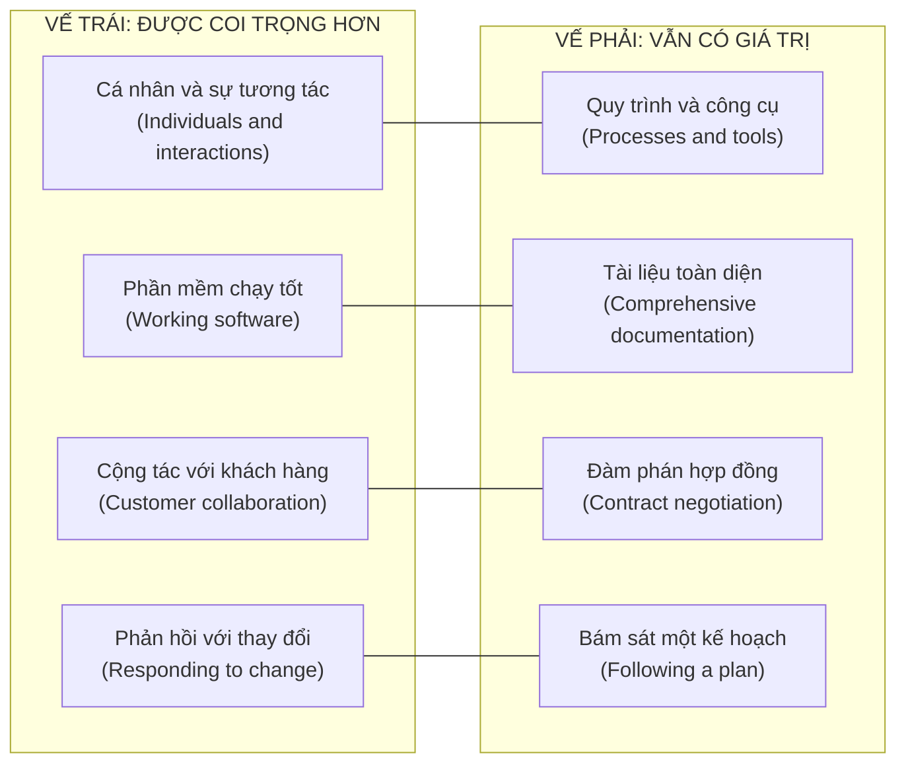
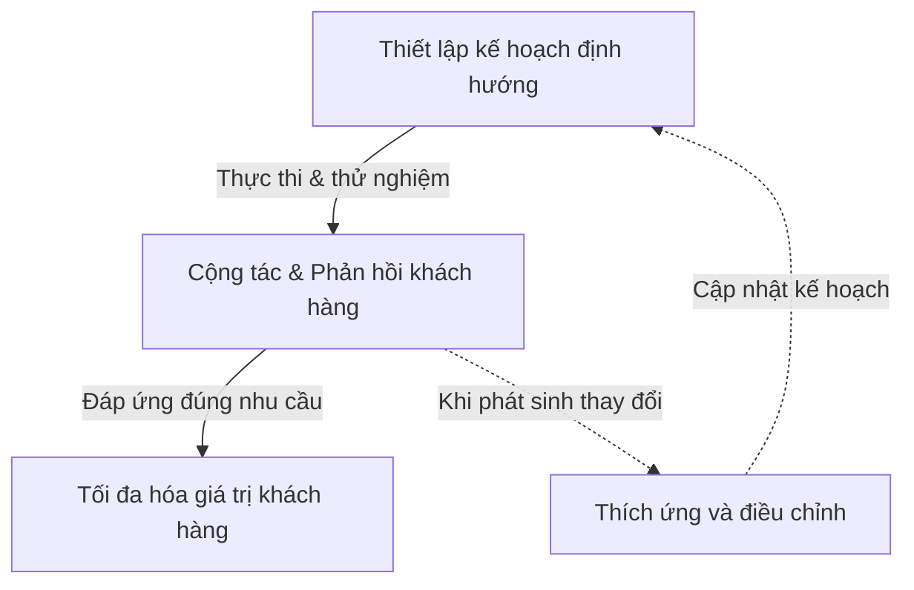

# Bốn giá trị cốt lõi của Tuyên ngôn Agile — The Four Values of the Agile Manifesto

> **Mã bài học:** M01-L07  
> **Loại học liệu gốc:** VIDEO_TRANSCRIPT  
> **Nguồn:** Agile_Project_Management / Module_01_The_fundamentals_of_Agile  

---

## 1. Mục tiêu bài học (Learning Objectives)
- Nắm vững bối cảnh lịch sử ra đời của Tuyên ngôn Agile (Agile Manifesto) năm 2001 [00:01].
- Phân tích sâu sắc 4 cặp giá trị cốt lõi và nguyên tắc định vị ưu tiên: coi trọng vế trái hơn vế phải, nhưng không phủ nhận giá trị của vế phải [00:52].
- Hiểu cách áp dụng giá trị "sản phẩm chạy tốt" sang các lĩnh vực ngoài phần mềm (tài liệu pháp lý, thiết kế bố cục văn phòng, thuyết trình bán hàng) [02:38].
- Nắm vững tư duy quản lý dự án linh hoạt: tìm kiếm điểm cân bằng lành mạnh giữa kỷ luật kế hoạch và năng lực đón nhận thay đổi để tối đa hóa giá trị khách hàng [04:37]–[05:42].

---

## 2. Kiến thức nền tảng & Bối cảnh (Context & Prerequisites)
- Vị trí bài học: Nằm ở Module 1 — Nền tảng của phương pháp Agile (The fundamentals of Agile).
- Bối cảnh: Năm 2001, các chuyên gia và nhà lãnh đạo tư tưởng hàng đầu trong ngành công nghệ phần mềm đã hội tụ để đúc kết trí tuệ tập thể từ kinh nghiệm thực tiễn sâu rộng của họ (Tuyên ngôn Agile), tìm ra phương thức phát triển sản phẩm tối ưu trong môi trường biến động nhanh chóng, tạo tiền đề cho 12 nguyên tắc Agile tiếp theo [00:01]–[01:51].

---

## 3. Nội dung lý thuyết trọng tâm (Systematic Theory)

### 3.1. Tuyên ngôn Agile và Bốn cặp giá trị đối ứng [00:52]

Tuyên ngôn Phát triển Phần mềm Linh hoạt khẳng định: Chúng tôi đang phát hiện ra những phương pháp tốt hơn để phát triển phần mềm bằng cách tự thực hiện và hỗ trợ người khác cùng làm. Qua trải nghiệm thực tiễn này, chúng tôi đã đi đến việc đề cao:

1. **Cá nhân và sự tương tác (Individuals and interactions)** *hơn là* **quy trình và công cụ (processes and tools)** [01:51].
2. **Phần mềm chạy tốt (Working software)** *hơn là* **tài liệu toàn diện (comprehensive documentation)** [02:38].
3. **Cộng tác với khách hàng (Customer collaboration)** *hơn là* **đàm phán hợp đồng (contract negotiation)** [03:42].
4. **Phản hồi với thay đổi (Responding to change)** *hơn là* **bám sát một kế hoạch (following a plan)** [04:37].

> **Lưu ý cốt lõi từ giảng viên [00:52]:** Mặc dù có giá trị ở các mục bên phải, chúng tôi coi trọng và ưu tiên các mục bên trái hơn.

<!-- FIGURE_START: F01 -->
#### Hình F01: Bốn cặp giá trị cốt lõi của Tuyên ngôn Agile (Agile Manifesto)

Xem mã nguồn sơ đồ (Mermaid)

*Hình F01: Bốn cặp giá trị cốt lõi của Tuyên ngôn Agile [00:52]–[01:51]. Trong khi các yếu tố bên phải vẫn có giá trị đối với dự án, các yếu tố bên trái được coi trọng hơn.*

**Giải thích trực quan:** Sơ đồ đối chiếu làm rõ 4 cặp giá trị của Tuyên ngôn Agile. Nguyên tắc định vị ưu tiên là coi trọng các yếu tố con người, sản phẩm chạy tốt, sự cộng tác và tính thích ứng hơn quy trình, văn bản, hợp đồng và kế hoạch cố định; đồng thời duy trì sự cân bằng thực tế mà không phủ nhận giá trị của vế phải.
<!-- FIGURE_END: F01 -->

> **Ghi chú sư phạm về thuật ngữ "Working software" [02:38]:**  
> Trong sơ đồ gốc, thuật ngữ nguyên bản của Tuyên ngôn là "Working software" (Phần mềm chạy tốt / có khả năng vận hành). Giảng viên giải thích rõ rằng nguyên tắc này hoàn toàn mở rộng và áp dụng tương đồng cho các loại hình dự án ngoài phần mềm: hãy thay thế "phần mềm chạy tốt" bằng bất kỳ sản phẩm bàn giao cốt lõi nào (deliverable) tạo ra giá trị trực tiếp cho khách hàng thay vì chỉ tập trung vào tài liệu quy trình.

---

### 3.2. Phân tích chi tiết từng giá trị thực tiễn

#### Giá trị 1: Cá nhân và sự tương tác hơn là quy trình và công cụ [01:51]
- Trọng tâm là con người giao tiếp trực tiếp với nhau thay vì sử dụng quá nhiều quy trình và công cụ máy móc để gò ép công việc diễn ra theo cách cứng nhắc.
- Quy trình và công cụ đóng vai trò hỗ trợ thúc đẩy quản lý dự án tốt và cải thiện sự hợp tác trong nhóm, không bao giờ được trở thành rào cản ngăn cách các thành viên phối hợp với nhau [02:38].

#### Giá trị 2: Phần mềm chạy tốt hơn là tài liệu toàn diện [02:38]
- Đội ngũ nên ưu tiên thời gian làm ra những thứ thực sự tạo ra giá trị và tránh tiêu tốn nhiều thời gian hơn mức cần thiết vào việc tranh luận, viết và duyệt tài liệu kéo dài.
- **Mở rộng ngoài ngành phần mềm:** Giá trị này áp dụng cho các dự án ngoài phần mềm. Sản phẩm bàn giao tạo ra giá trị có thể là một bản tóm tắt pháp lý, một thiết kế bố cục văn phòng, hay một bài thuyết trình bán hàng [02:38].
- Điều cốt lõi là bàn giao đúng sản phẩm khách hàng mong muốn thay vì tập trung tài liệu hóa quá trình thực hiện một cách rườm rà.

#### Giá trị 3: Cộng tác với khách hàng hơn là đàm phán hợp đồng [03:42]
- Sự hài lòng của khách hàng là ưu tiên cao nhất để xây dựng một sản phẩm chất lượng cao và có giá trị thực chất [03:42].
- Agile chủ trương sự tự do cộng tác với khách hàng sớm và thường xuyên (early and often). Nhờ đó, đội ngũ có thể phản ứng và thích ứng mau lẹ với nhu cầu thực tế của khách hàng, thay vì phải chờ đợi quá trình đàm phán hợp đồng hay thủ tục yêu cầu thay đổi tài liệu phức tạp [03:42]–[04:37].
- Hợp đồng vẫn luôn tồn tại trong quản lý dự án Agile, nhưng trọng tâm là xác định những điều thực sự cần thiết và để lại không gian linh hoạt cho sự cộng tác hướng tới khách hàng [04:37].

#### Giá trị 4: Phản hồi với thay đổi hơn là bám sát một kế hoạch [04:37]
- Thay đổi là điều không thể tránh khỏi trong các dự án có quy mô lớn, kéo dài và phức tạp [04:37].
- Việc chốt cứng một kế hoạch từ đầu dự án có thể giúp hoàn thành đúng hạn và đúng ngân sách trên giấy tờ, nhưng tiềm ẩn rủi ro lớn là không đáp ứng được nhu cầu thực tế của khách hàng hoặc không đem lại giá trị tối đa [04:37].
- Người quản lý dự án Agile vẫn lập kế hoạch cẩn thận và trân trọng kế hoạch, nhưng họ luôn sẵn sàng đón nhận và có năng lực thích ứng linh hoạt nếu kế hoạch cần điều chỉnh ở bất kỳ thời điểm nào [05:42].

<!-- FIGURE_START: F02 -->
#### Hình F02: Vòng lặp thích ứng và cân bằng kế hoạch trong Agile

Xem mã nguồn sơ đồ (Mermaid)

*Hình F02: Vòng lặp thích ứng và cân bằng kế hoạch trong Agile (Planning, Customer Collaboration & Feedback, Responding to Change, Customer Value) [04:37]–[05:42].*

**Giải thích trực quan:** Lưu đồ thể hiện cách đội ngũ Agile vận hành kế hoạch linh hoạt: Kế hoạch ban đầu đóng vai trò định hướng; qua quá trình cộng tác tiếp nhận phản hồi từ khách hàng và thử nghiệm sản phẩm sớm, nếu phát sinh thay đổi, nhóm sẽ thích ứng mượt mà để cập nhật lại kế hoạch nhằm đạt mục tiêu tối thượng là tối đa hóa giá trị khách hàng.
<!-- FIGURE_END: F02 -->

---

## 4. Ví dụ thực tế & Tình huống minh họa (Practical Application)

### 4.1. Ví dụ thực tế từ bài giảng của giảng viên (Instructor Source Examples)
- **Trao đổi trực tiếp thay vì email gián đoạn (Individuals and Interactions) [01:51]:** Giảng viên nêu ví dụ thực tế về việc gửi email đặt câu hỏi thường dẫn đến chuỗi thư trao đổi qua lại kéo dài do các câu hỏi phụ phát sinh; trong khi đó, một cuộc đối thoại trực tiếp ngắn có thể giúp hai bên nắm bắt cùng lượng thông tin đó trong thời gian ngắn hơn rất nhiều.
- **Giá trị bàn giao thực chất ngoài ngành phần mềm (Working Software / Deliverables) [02:38]:** Giá trị "sản phẩm chạy tốt" được chuyển dịch linh hoạt sang bất kỳ sản phẩm bàn giao nào mang lại giá trị thực tế cho dự án: soạn thảo một bản tóm tắt pháp lý, thiết kế bố cục văn phòng, hay chuẩn bị bài thuyết trình bán hàng. Mục tiêu là bàn giao sản phẩm khách hàng cần thay vì chỉ tập trung vào việc lập tài liệu quy trình.
- **Cộng tác sớm bằng bản mẫu thử nghiệm (Customer Collaboration) [04:37]:** Thay vì sa đà vào các thủ tục đàm phán hợp đồng hay quy trình yêu cầu thay đổi tài liệu phức tạp [03:42], đội ngũ chủ động tạo cơ hội cho khách hàng tham gia sớm và thường xuyên trong suốt quá trình triển khai dự án thông qua việc giới thiệu bản mẫu thử nghiệm ban đầu (early prototypes), đặt câu hỏi và mời khách hàng trực tiếp kiểm thử sản phẩm [04:37].

### 4.2. Tình huống giả định minh họa (Hypothetical Scenario)
> **Ghi chú sư phạm (Tình huống giả định):** Tình huống sau đây được xây dựng nhằm minh họa trực quan cách áp dụng nguyên tắc Agile trong bối cảnh cụ thể, không phải số liệu hay sự kiện có thật trong video bài giảng:
- Khi nhóm dự án gặp khó khăn trong việc thống nhất giao diện người dùng, thay vì tiếp tục chuỗi trao đổi văn bản kéo dài, đại diện khách hàng và nhóm phát triển tổ chức một buổi trao đổi trực tiếp ngắn để cùng thao tác trên bản mẫu tương tác, giải quyết ngay các điểm chưa thống nhất mà không cần chờ thủ tục điều chỉnh hợp đồng phức tạp.

---

## 5. Bảng thuật ngữ chuyên ngành Anh - Việt (Terminology Glossary)

| Thuật ngữ tiếng Anh | Thuật ngữ tiếng Việt | Giải thích ý nghĩa trong ngữ cảnh bài học |
| :--- | :--- | :--- |
| **Agile Manifesto** | Tuyên ngôn Agile | Văn bản nền tảng ra đời năm 2001 gồm 4 giá trị và 12 nguyên tắc phát triển linh hoạt [00:01]. |
| **Individuals and interactions** | Cá nhân và sự tương tác | Giá trị ưu tiên con người và sự trao đổi trực tiếp hơn quy trình, công cụ máy móc [01:51]. |
| **Working software** | Phần mềm chạy tốt | Phần mềm có khả năng vận hành tạo ra giá trị sử dụng thực tế (không đòi hỏi phải là sản phẩm hoàn tất 100%); trong các dự án ngoài phần mềm, tương đương sản phẩm bàn giao thực tế mang lại giá trị [02:38]. |
| **Comprehensive documentation** | Tài liệu toàn diện | Tài liệu mô tả quy trình chi tiết; cần thiết nhưng không nên chiếm thời gian hơn việc tạo giá trị [02:38]. |
| **Customer collaboration** | Cộng tác với khách hàng | Sự đồng hành chặt chẽ thường xuyên giữa đội ngũ dự án và khách hàng [03:42]. |
| **Contract negotiation** | Đàm phán hợp đồng | Thủ tục pháp lý và tài liệu thỏa thuận chính thức cần thiết nhưng không được cản trở cộng tác [03:42]. |
| **Responding to change** | Phản hồi với thay đổi | Khả năng điều chỉnh linh hoạt kế hoạch để đón nhận những biến động tất yếu của dự án [04:37]. |
| **Following a plan** | Bám sát một kế hoạch | Kỷ luật lập kế hoạch quan trọng nhưng không nên cứng nhắc khi nhu cầu khách hàng biến đổi [04:37]. |
| **Healthy balance** | Cân bằng lành mạnh | Trạng thái hài hòa giữa kỷ luật quy trình và sự linh hoạt sáng tạo phù hợp bối cảnh tổ chức [05:42]. |

---

## 6. Tóm tắt cốt lõi (Key Takeaways)
- Tuyên ngôn Agile gồm 4 cặp giá trị định hình tư duy quản trị dự án hiện đại.
- Nguyên tắc vế trái > vế phải: Vế phải vẫn có giá trị cần thiết, nhưng vế trái luôn được đặt lên hàng đầu.
- Giá trị của sản phẩm ("Working software / deliverable") áp dụng cho nhiều ngành nghề, không giới hạn trong công nghệ thông tin.
- Quản lý dự án thành công nhất là người biết tích hợp mượt mà các thay đổi vào kế hoạch hiện có.

---

## 7. Bài tập & Câu hỏi tự luyện (Review Questions)
1. Tại sao Tuyên ngôn Agile lại nhấn mạnh: "Mặc dù có giá trị ở các mục bên phải, chúng tôi coi trọng các mục bên trái hơn"? Điều này giúp dự án tránh được ngộ nhận tiêu cực nào?
2. Nếu dự án của bạn là tổ chức sự kiện hoặc biên soạn tài liệu pháp lý, giá trị "Working software over comprehensive documentation" sẽ được diễn giải và áp dụng thực tế như thế nào?
3. Trong dự án của bạn, việc kết hợp giữa việc lập kế hoạch ban đầu và năng lực thích ứng khi có phản hồi khách hàng (như mô tả trong Hình F02) mang lại lợi ích gì so với việc cố định kế hoạch từ đầu?

---

## 8. Nguồn đối chiếu (Source Traceability)

| Phần giáo trình | Hình vẽ trực quan | Mốc thời gian Video | Nội dung đối chiếu trong bài giảng gốc |
| :--- | :--- | :--- | :--- |
| Khởi đầu & Lịch sử | - | [00:01] | Bối cảnh ra đời Agile Manifesto năm 2001. |
| 4 Cặp giá trị đối ứng | **Hình F01** | [00:52]–[01:51] | Trích dẫn tuyên ngôn, nguyên tắc ưu tiên vế trái hơn vế phải. |
| Giá trị 1 (Con người) | - | [01:51] | Giao tiếp trực tiếp hiệu quả hơn chuỗi email dài. |
| Giá trị 2 (Sản phẩm) | - | [02:38] | Tập trung tạo giá trị; mở rộng ngoài phần mềm. |
| Giá trị 3 (Khách hàng) | - | [03:42], [04:37] | Sự hài lòng của khách hàng là ưu tiên cao nhất [03:42]; thử nghiệm mẫu sớm (prototypes) và kiểm thử thực tế [04:37]. |
| Giá trị 4 (Thay đổi) | **Hình F02** | [04:37]–[05:42] | Thay đổi là tất yếu [04:37]; vòng lặp thích ứng kế hoạch mượt mà để tích hợp thay đổi và tối đa hóa giá trị [05:42]. |
| Tổng kết & Cân bằng | - | [05:42]–[06:44] | Tinh chỉnh phong cách quản trị phù hợp tổ chức và ngành nghề. |
