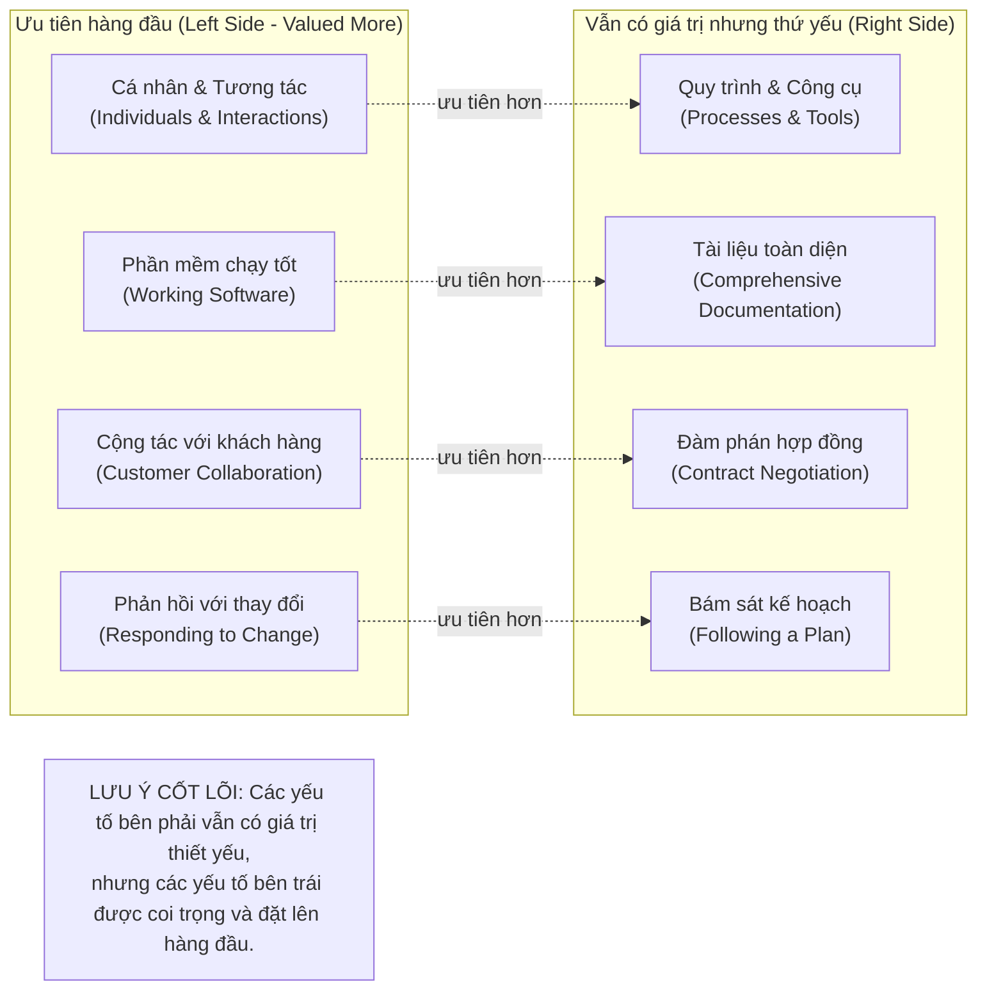

# HỆ THỐNG THIẾT KẾ TRỰC QUAN SƯ PHẠM (VISUAL DESIGN SYSTEM)
## Phiên bản: 2.0-visual-first

Tài liệu này chuẩn hóa quy chuẩn trực quan hóa cho toàn bộ giáo trình của Course Harness v1, đảm bảo tính nhất quán, khả năng tiếp cận và hiệu quả sư phạm cao nhất.

---

## 1. Nguyên tắc cốt lõi (Core Principles)

1. **Hiệu quả sư phạm trên hết (Pedagogy over Decoration):**
   - Chỉ tạo sơ đồ khi nó giải thích khái niệm tốt hơn một đoạn văn bản tương đương.
   - Tuyệt đối không tạo hình ảnh chỉ để đạt chỉ tiêu số lượng (no decorative quota).
   - Không thay thế phần giải thích cần thiết bằng hình vẽ không có chú thích.

2. **Dễ đọc trên nền sáng & In ấn đen trắng (Light Background & Grayscale Legibility):**
   - Tối ưu cho tài liệu đọc nền trắng/sáng (`#FFFFFF` hoặc `#F8FAFC`).
   - Độ tương phản chữ/nền cao (tối thiểu WCAG AA: contrast ratio >= 4.5:1).
   - Không dùng màu sắc làm phương tiện duy nhất để truyền tải thông tin (phải kết hợp hình khối, nhãn chữ, nét viền).

3. **Thuật ngữ song ngữ chuẩn xác (Bilingual Labels):**
   - Nhãn chính bằng tiếng Việt trong sáng, dễ hiểu.
   - Mở ngoặc giữ nguyên thuật ngữ tiếng Anh chuẩn quốc tế (ví dụ: `Cá nhân và tương tác (Individuals and interactions)`).

4. **Tránh quá tải nhận thức (Cognitive Load & Simplicity):**
   - Không nhồi nhét quá nhiều nút trong một sơ đồ (tối ưu: 4-10 nút mỗi hình).
   - Chiều mũi tên rõ ràng, mạch lạc, biểu diễn quan hệ nhân quả/trình tự trực tiếp.
   - Tránh hiệu ứng đổ bóng phức tạp, dải màu gradient rối mắt hoặc icon trang trí vô nghĩa.

---

## 2. Bảng màu tiêu chuẩn (Standard Palette)

| Vai trò | Mã màu HEX | Ứng dụng | Độ tương phản |
| :--- | :--- | :--- | :--- |
| **Nền tài liệu / Khối chính** | `#FFFFFF` | Nền chung và thẻ nội dung chính | Chuẩn |
| **Nền khối thứ cấp / Đối trọng** | `#F1F5F9` | Khối bối cảnh, quy trình hỗ trợ | Độ sáng cao |
| **Viền khối chính (Border)** | `#0F172A` / `#334155` | Đường viền nét đơn rõ ràng (1.5px - 2px) | Rõ nét |
| **Chữ chính (Primary Text)** | `#0F172A` | Tiêu đề và nhãn quan trọng | Đen đậm |
| **Chữ phụ (Secondary Text)** | `#475569` | Giải thích bổ trợ, mốc thời gian | Xám đậm |
| **Điểm nhấn ưu tiên (Primary Accent)** | `#1D4ED8` (Xanh dương đậm) | Nút được ưu tiên, luồng chính | Nhận diện cao |
| **Điểm nhấn đối chiếu (Contrast Accent)** | `#D97706` (Hổ phách đậm) | Cảnh báo hoặc lưu ý cân bằng | Tách biệt |
| **Đường liên kết (Link / Arrow)** | `#1E293B` | Mũi tên điều hướng luồng dữ liệu/quy trình | Dễ theo dõi |

---

## 3. Cấu trúc chuẩn của một Hình (Figure Anatomy)

Mỗi hình học tập xuất hiện trong giáo trình BẮT BUỘC có 5 thành phần:

1. **Mã định danh hình (Figure ID):** Định dạng `F01`, `F02` (hoặc `fig-m01-l07-01`), duy nhất trong bài học.
2. **Tiêu đề mô tả (Descriptive Title):** Nêu rõ nội dung sư phạm của hình.
3. **Mã nguồn đặc tả trực quan (Visual Specification):** Khối mã Mermaid chuẩn cú pháp hoặc đường dẫn SVG đã render.
4. **Chú thích sư phạm (Caption):** Diễn giải ngắn gọn ý nghĩa trọng tâm của hình.
5. **Dữ liệu xuất xứ & Truy vết (Provenance & Alt Text):**
   - **Mô tả trực quan (Alt text):** Cung cấp mô tả ngữ nghĩa cho người khiếm thị / text-only reader.
   - **Mục tiêu giáo dục:** Khái niệm hoặc mục tiêu bài học mà hình hỗ trợ.
   - **Phân loại xuất xứ (Provenance Class):**
     - `SOURCE_DERIVED`: Phản ánh trực tiếp sơ đồ/hình ảnh từ tài liệu nguồn.
     - `PEDAGOGICAL_RECONSTRUCTION`: Tái cấu trúc bằng sơ đồ các mối quan hệ do giảng viên giảng giải bằng lời.
     - `AI_GENERATED_ILLUSTRATION`: Ví dụ minh họa mới được biên soạn phục vụ mục đích sư phạm.
     - `EXTERNAL_VERIFIED_ASSET`: Hình ảnh từ tài nguyên ngoài đã được kiểm chứng.
   - **Source Locator:** Mốc thời gian (ví dụ: `[00:52]-[01:51]`) hoặc đề mục nguồn.

---

## 4. Định dạng Markdown mẫu (Standard Markdown Template)

```markdown
<!-- FIGURE_START: F01 -->
#### Hình F01: Bốn cặp giá trị cốt lõi của Tuyên ngôn Agile (Agile Manifesto)



*Hình F01: Bốn cặp giá trị cốt lõi của Tuyên ngôn Agile. Trong khi các yếu tố bên phải vẫn có giá trị thiết yếu đối với dự án, các yếu tố bên trái được đặt ưu tiên cao hơn.*

> **Mô tả trực quan (Alt text):** Sơ đồ đối chiếu hai cột thể hiện 4 cặp giá trị của Tuyên ngôn Agile với mũi tên ưu tiên từ cột trái sang cột phải kèm ghi chú lưu ý cân bằng.  
> **Mục tiêu giáo dục:** Giúp học viên nhận diện đúng bản chất ưu tiên tương đối của Agile thay vì ngộ nhận Agile loại bỏ hoàn toàn quy trình và tài liệu.  
> **Xuất xứ học liệu (Provenance):** `PEDAGOGICAL_RECONSTRUCTION` (Dựa trên mốc thời gian [00:52]–[01:51]).
<!-- FIGURE_END: F01 -->
```
