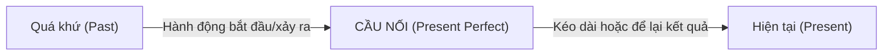
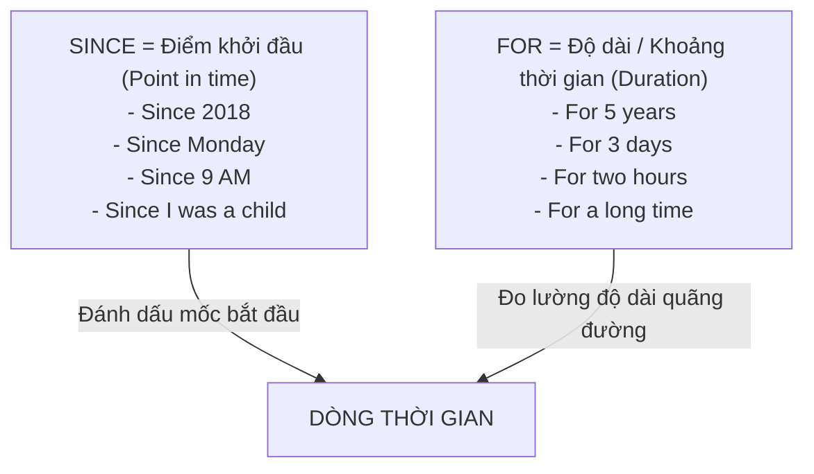

# 📘 GIÁO TRÌNH TOÀN DIỆN: THÌ HIỆN TẠI HOÀN THÀNH (PRESENT PERFECT TENSE)
### Khóa học: Perfect Tenses and Modals - University of California, Irvine (UCI)
*Tài liệu học tập chuyên sâu được biên soạn lại và chuẩn hóa cho Module 2*

---

## 🎯 MỤC TIÊU BÀI HỌC (LEARNING OBJECTIVES)
Sau khi hoàn thành Module này, bạn sẽ nắm vững:
1. **Bản chất ngữ pháp:** Hiểu rõ tại sao người bản xứ dùng thì Hiện tại hoàn thành và mối liên hệ giữa hành động trong quá khứ với thời điểm hiện tại.
2. **Cấu trúc ngữ pháp:** Sử dụng thành thạo thể khẳng định, phủ định, câu hỏi Yes/No và câu hỏi có từ để hỏi (Wh- questions).
3. **Quá khứ phân từ (Past Participles - V3):** Nắm vững quy tắc chia động từ có quy tắc (`-ed`) và thuộc lòng các động từ bất quy tắc thông dụng nhất.
4. **Giới từ thời gian:** Phân biệt chính xác cách dùng `Since` (mốc thời gian) và `For` (khoảng thời gian).
5. **Trạng từ chỉ tần suất & thời gian:** Sử dụng chuẩn xác các trạng từ `Ever`, `Never`, `Already`, `Yet`, `Before`, `Just`.
6. **So sánh phân biệt:** Phân biệt rõ ràng giữa thì **Hiện tại hoàn thành (Present Perfect)** và thì **Quá khứ đơn (Simple Past)**.

---

## 📑 MỤC LỤC
- [Chương 1: Bản chất và Ý nghĩa của Thì Hiện Tại Hoàn Thành](#chương-1-bản-chất-và-ý-nghĩa-của-thì-hiện-tại-hoàn-thành)
- [Chương 2: Công thức và Cấu trúc Câu Chuẩn](#chương-2-công-thức-và-cấu-trúc-câu-chuẩn)
- [Chương 3: Quá Khứ Phân Từ (Past Participles - V3)](#chương-3-quá-khứ-phân-từ-past-participles---v3)
- [Chương 4: Phân Biệt "Since" và "For"](#chương-4-phân-biệt-since-và-for)
- [Chương 5: Hiện Tại Hoàn Thành Chỉ Thời Điểm Không Xác Định](#chương-5-hiện-tại-hoàn-thành-chỉ-thời-điểm-không-xác-định)
- [Chương 6: Các Trạng Từ Đi Kèm (Ever, Never, Already, Yet, Just, Before)](#chương-6-các-trạng-từ-đi-kèm-ever-never-already-yet-just-before)
- [Chương 7: So Sánh Toàn Diện: Present Perfect vs. Simple Past](#chương-7-so-sánh-toàn-diện-present-perfect-vs-simple-past)
- [Chương 8: Danh Mục Video Bài Giảng Ngoại Tuyến (Offline Videos)](#chương-8-danh-mục-video-bài-giảng-ngoại-tuyến-offline-videos)

---

## CHƯƠNG 1: BẢN CHẤT VÀ Ý NGHĨA CỦA THÌ HIỆN TẠI HOÀN THÀNH

### 1.1. Bản chất cốt lõi: "Cây cầu nối giữa Quá khứ và Hiện tại"
Trong tiếng Việt, chúng ta chỉ có từ "đã" cho mọi hành động xảy ra trước thời điểm nói. Tuy nhiên trong tiếng Anh, người bản xứ phân biệt rất rạch ròi:
- Nếu một hành động đã xảy ra và **kết thúc hoàn toàn trong quá khứ**, không còn liên quan gì đến hiện tại ➔ Dùng **Quá khứ đơn (Simple Past)**.
- Nếu một hành động bắt đầu trong quá khứ nhưng **vẫn đang tiếp diễn**, hoặc **kết quả/ảnh hưởng của nó vẫn còn quan trọng ở hiện tại**, hoặc nói về **trải nghiệm tích lũy đến hiện tại** ➔ Bắt buộc dùng **Hiện tại hoàn thành (Present Perfect)**.

### 1.2. Ba trường hợp sử dụng chính:
1. **Hành động bắt đầu trong quá khứ và kéo dài đến hiện tại (thường đi với *Since* và *For*):**
   - *I have lived in Hanoi for five years.* (Tôi đã sống ở Hà Nội được 5 năm - và hiện tại tôi vẫn đang sống ở đây).
2. **Trải nghiệm cuộc đời tính đến thời điểm hiện tại (Life Experience):**
   - *She has visited five countries.* (Cô ấy đã đi qua 5 quốc gia - nhấn mạnh vào vốn trải nghiệm cô ấy tích lũy được).
3. **Hành động vừa mới xảy ra hoặc để lại kết quả/dấu vết ở hiện tại:**
   - *I have lost my key!* (Tôi đã đánh mất chìa khóa - hệ quả ở hiện tại là tôi không thể vào nhà).

---

## CHƯƠNG 2: CÔNG THỨC VÀ CẤU TRÚC CÂU CHUẨN

Công thức chung của thì Hiện tại hoàn thành luôn gồm 2 thành phần không thể tách rời:  
$$\mathbf{\text{Trợ động từ (Have / Has)} + \text{Quá khứ phân từ (Past Participle - V3/V-ed)}}$$

### 2.1. Bảng quy tắc chia Trợ động từ (Auxiliary Verb)

| Chủ ngữ (Subject) | Trợ động từ | Dạng viết tắt khẳng định | Dạng viết tắt phủ định |
| :--- | :---: | :---: | :---: |
| **I, You, We, They**, Danh từ số nhiều | **have** | `I've`, `You've`, `We've`, `They've` | `haven't` (`have not`) |
| **He, She, It**, Danh từ số ít, Tên riêng | **has** | `He's`, `She's`, `It's` | `hasn't` (`has not`) |

> [!WARNING]
> Cẩn thận nhầm lẫn giữa dạng viết tắt `'s` của `is` và `has`:
> - *He's a teacher.* = *He is a teacher.* (sau `'s` là danh từ/tính từ).
> - *He's visited Paris.* = *He has visited Paris.* (sau `'s` là phân từ V3).

---

### 2.2. Thể khẳng định (Affirmative Statements)
$$\mathbf{S + \text{have / has} + \text{V3 (Past Participle)} + \dots}$$
- *We **have studied** English for three months.* (Chúng tôi đã học tiếng Anh được 3 tháng).
- *John **has opened** a new coffee shop on Baker Street.* (John vừa mở một quán cà phê mới).

---

### 2.3. Thể phủ định (Negative Statements)
$$\mathbf{S + \text{have not / has not (haven't / hasn't)} + \text{V3 (Past Participle)} + \dots}$$
- *I **haven't finished** my homework yet.* (Tôi vẫn chưa hoàn thành bài tập về nhà).
- *She **hasn't seen** her doctor this week.* (Tuần này cô ấy chưa đi khám bác sĩ).

---

### 2.4. Thể nghi vấn: Câu hỏi Yes/No (Yes/No Questions)
$$\mathbf{\text{Have / Has} + S + \text{V3 (Past Participle)} + \dots?}$$

**Cách trả lời ngắn (Short Answers):**
- Khẳng định: `Yes, S + have / has.` *(Ví dụ: Yes, I have. / Yes, she has.)*
- Phủ định: `No, S + haven't / hasn't.` *(Ví dụ: No, I haven't. / No, she hasn't.)*

> [!CAUTION]
> Tuyệt đối **không** thêm trạng từ "ever" vào câu trả lời ngắn khẳng định:
> - Sai: *Yes, I ever have.* ❌
> - Đúng: *Yes, I have.* ✅

---

### 2.5. Thể nghi vấn: Câu hỏi có từ để hỏi (Information / Wh- Questions)
$$\mathbf{\text{Wh-word} + \text{have / has} + S + \text{V3 (Past Participle)} + \dots?}$$

- *Where **have you traveled** recently?* (Gần đây bạn đã đi du lịch những đâu?)
- *Why **has she decided** to study linguistics?* (Tại sao cô ấy lại quyết định học ngành ngôn ngữ học?)
- *How long **have they known** each other?* (Họ đã quen biết nhau được bao lâu rồi?)

---

## CHƯƠNG 3: QUÁ KHỨ PHÂN TỪ (PAST PARTICIPLES - V3)

Động từ trong thì Hiện tại hoàn thành bắt buộc phải ở dạng **Quá khứ phân từ (Past Participle)**.

### 3.1. Động từ có quy tắc (Regular Verbs - Thêm đuôi `-ed`)
- **Quy tắc chung:** Thêm `-ed` vào sau động từ nguyên mẫu:  
  *visit ➔ visited*, *open ➔ opened*, *work ➔ worked*, *learn ➔ learned*.
- **Tận cùng là `e`:** Chỉ thêm `-d`:  
  *live ➔ lived*, *decide ➔ decided*, *graduate ➔ graduated*.
- **Tận cùng là phụ âm + `y`:** Đổi `y` thành `i` rồi thêm `-ed`:  
  *study ➔ studied*, *cry ➔ cried*, *try ➔ tried*.
- **Động từ 1 âm tiết (nguyên âm kẹp giữa 2 phụ âm):** Gấp đôi phụ âm cuối trước khi thêm `-ed`:  
  *stop ➔ stopped*, *plan ➔ planned*.

#### 🔊 Quy tắc phát âm đuôi `-ed`:
1. **/ɪd/:** Khi động từ kết thúc bằng âm `/t/` hoặc `/d/`:  
   *wanted* `/ˈwɑːn.tɪd/`, *decided* `/dɪˈsaɪ.dɪd/`, *visited* `/ˈvɪz.ɪ.tɪd/`.
2. **/t/:** Khi động từ kết thúc bằng các âm vô thanh (`/p/, /k/, /f/, /s/, /ʃ/, /tʃ/`):  
   *cooked* `/kʊkt/`, *stopped* `/stɑːpt/`, *watched* `/wɑːtʃt/`.
3. **/d/:** Các trường hợp còn lại (âm hữu thanh và nguyên âm):  
   *played* `/pleɪd/`, *lived* `/lɪvd/`, *opened* `/ˈoʊ.pənd/`.

---

### 3.2. Động từ bất quy tắc cốt lõi (Irregular Verbs)
Học theo từng nhóm âm để ghi nhớ vĩnh viễn:

#### Nhóm 1: Cả 3 cột giống hệt nhau (V1 = V2 = V3)
| Động từ nguyên mẫu (V1) | Quá khứ đơn (V2) | Quá khứ phân từ (V3) | Ý nghĩa tiếng Việt |
| :--- | :--- | :--- | :--- |
| **cut** | cut | **cut** | cắt (không có "cutted") |
| **put** | put | **put** | đặt, để |
| **cost** | cost | **cost** | có giá là |
| **hit** | hit | **hit** | đánh, va chạm |
| **read** | read *(phát âm /red/)* | **read** *(phát âm /red/)* | đọc |

#### Nhóm 2: Cột 2 và Cột 3 giống nhau (V2 = V3)
| Động từ nguyên mẫu (V1) | Quá khứ đơn (V2) | Quá khứ phân từ (V3) | Ý nghĩa tiếng Việt |
| :--- | :--- | :--- | :--- |
| **meet** | met | **met** | gặp gỡ |
| **win** | won | **won** | chiến thắng |
| **have** | had | **had** | có, ăn, sở hữu |
| **find** | found | **found** | tìm thấy |
| **teach** | taught | **taught** | giảng dạy |
| **catch** | caught | **caught** | bắt được |
| **buy** | bought | **bought** | mua |

#### Nhóm 3: Cả 3 cột khác nhau (V1 ≠ V2 ≠ V3) - Tận cùng bằng `-en` hoặc biến âm
| Động từ nguyên mẫu (V1) | Quá khứ đơn (V2) | Quá khứ phân từ (V3) | Ý nghĩa tiếng Việt |
| :--- | :--- | :--- | :--- |
| **speak** | spoke | **spoken** | nói |
| **forget** | forgot | **forgotten** | quên |
| **fly** | flew | **flown** | bay |
| **run** | ran | **run** | chạy (chú ý: V3 quay lại giống V1) |
| **go** | went | **gone** / **been** | đi |
| **see** | saw | **seen** | nhìn thấy |
| **write** | wrote | **written** | viết |
| **eat** | ate | **eaten** | ăn |

> [!TIP]
> **Phân biệt `have gone to` và `have been to`:**
> - *He has **gone** to Paris:* Anh ấy đã đi Paris (hiện giờ vẫn đang ở Paris hoặc đang trên đường đi, chưa về).
> - *He has **been** to Paris:* Anh ấy đã từng đi Paris (đã đi và đã trở về rồi, thể hiện trải nghiệm).

---

## CHƯƠNG 4: PHÂN BIỆT "SINCE" VÀ "FOR"

Đây là trọng tâm ngữ pháp quan trọng nhất trong Module 2. Cả hai từ đều dùng để chỉ thời gian, nhưng bản chất khác biệt hoàn toàn:

### 4.1. "SINCE" (Kể từ khi...): Đi kèm MỐC THỜI GIAN CỤ THỂ
`Since` trả lời cho câu hỏi: *"Hành động bắt đầu vào thời điểm nào?"*
- Mốc năm/tháng/ngày: *since 2015, since January, since Tuesday*.
- Mốc giờ cụ thể: *since 8:00 AM, since noon, since midnight*.
- Sự kiện cụ thể trong đời: *since high school, since breakfast, since yesterday*.
- **Đi với một mệnh đề ở quá khứ đơn:**  
  $$\mathbf{\text{S + have/has + V3} \dots + \text{since} + \text{S + V2 (Simple Past)}}$$  
  *Ví dụ: I have known Mark **since we were in elementary school**.*

### 4.2. "FOR" (Trong khoảng...): Đi kèm ĐỘ DÀI THỜI GIAN
`For` trả lời cho câu hỏi: *"Hành động đã kéo dài được bao lâu?"*
- Có chứa con số chỉ số lượng thời gian: *for 10 minutes, for 3 hours, for 5 days, for 6 months, for 12 years*.
- Cụm từ chỉ khoảng thời gian chung chung: *for a long time, for several weeks, for centuries, for ages*.

### 4.3. Bảng so sánh đối chiếu nhanh:

| Trường hợp | Sử dụng **SINCE** | Sử dụng **FOR** |
| :--- | :--- | :--- |
| Năm | `since 2020` | `for 6 years` |
| Tháng | `since May` | `for 5 months` |
| Tuần | `since last week` | `for 2 weeks` |
| Ngày | `since yesterday` / `since Monday` | `for 3 days` |
| Giờ | `since 7:00 AM` | `for 4 hours` |

---

## CHƯƠNG 5: HIỆN TẠI HOÀN THÀNH CHỈ THỜI ĐIỂM KHÔNG XÁC ĐỊNH
*(Present Perfect without Since and For)*

Khi câu ở thì Hiện tại hoàn thành **không có** `since` hoặc `for`, nó nhấn mạnh rằng: **Thời điểm cụ thể trong quá khứ KHÔNG quan trọng**, điều quan trọng là **bản thân hành động đã diễn ra hay chưa**.

### Các trường hợp điển hình:
1. **Nói về trải nghiệm cuộc đời (Life Experience):**
   - *I have visited Canada.* (Tôi đã từng đến Canada - thời điểm nào không quan trọng, quan trọng là tôi có trải nghiệm đó).
2. **Hành động lặp lại nhiều lần:**
   - *She has taken this test three times.* (Cô ấy đã thi bài này 3 lần).
   - *We have eaten at that Italian restaurant several times.* (Chúng tôi đã ăn ở nhà hàng đó vài lần).
3. **Thành tựu, sự tiến bộ (Accomplishments):**
   - *Scientists have found new treatments for the disease.* (Các nhà khoa học đã tìm ra các phương pháp điều trị mới).

---

## CHƯƠNG 6: CÁC TRẠNG TỪ ĐI KÈM (EVER, NEVER, ALREADY, YET, JUST, BEFORE)

| Trạng từ | Ý nghĩa | Vị trí trong câu | Loại câu sử dụng | Ví dụ mẫu |
| :--- | :--- | :--- | :--- | :--- |
| **Ever** | đã từng, bao giờ | Trước V3 | **Câu hỏi** (?) | *Have you **ever** been to Disneyland?* |
| **Never** | chưa từng, không bao giờ | Trước V3 | **Câu khẳng định** mang nghĩa phủ định | *I have **never** eaten raw oysters.* |
| **Already** | đã... rồi (sớm hơn dự kiến) | Giữa have & V3, hoặc cuối câu, hoặc trước have | **Câu khẳng định** (+) | *They have **already** arrived.* *They **already** have arrived.* |
| **Yet** | chưa / đã... chưa? | **Cuối câu** | **Câu phủ định** (-) & **Câu hỏi** (?) | *She hasn't called me **yet**.* *Has he graduated **yet**?* |
| **Just** | vừa mới | Giữa have & V3 | **Câu khẳng định** (+) | *I have **just** received the results.* |
| **Before** | trước đây | **Cuối câu** | Cả (+), (-), (?) | *Have I met you **before**?* |

> [!IMPORTANT]
> **Ghi nhớ 3 điều cấm kỵ với trạng từ:**
> 1. `Yet` KHÔNG BAO GIỜ dùng trong câu khẳng định thông thường (*The shop has closed yet* ❌).
> 2. `Ever` KHÔNG dùng trong câu khẳng định để thay thế cho "đã từng" (*I have ever climbed a mountain* ❌ ➔ phải dùng *I have climbed a mountain*).
> 3. `Never` bản thân đã mang nghĩa phủ định, nên KHÔNG dùng thêm `not` (*I haven't never seen* ❌ ➔ *I have never seen* ✅).

---

## CHƯƠNG 7: SO SÁNH TOÀN DIỆN: PRESENT PERFECT VS. SIMPLE PAST

| Tiêu chí | Thì Hiện Tại Hoàn Thành (Present Perfect) | Thì Quá Khứ Đơn (Simple Past) |
| :--- | :--- | :--- |
| **Thời gian** | **Không xác định** (Indefinite) hoặc chưa kết thúc (Unfinished). | **Xác định rõ ràng** (Definite) và đã kết thúc hoàn toàn (Finished). |
| **Dấu hiệu nhận biết** | `since`, `for`, `ever`, `never`, `already`, `yet`, `so far`, `recently`, `in the past 3 years`. | `yesterday`, `last night`, `in 2010`, `ago`, `when I was young`, `at 5 PM`. |
| **Trọng tâm** | Nhấn mạnh vào **kết quả**, **trải nghiệm** hoặc **sự tiếp diễn** ở hiện tại. | Nhấn mạnh vào **thời điểm** hành động xảy ra trong quá khứ. |
| **Ví dụ đối chiếu 1** | *I **have lived** here for 10 years.* ➔ Hiện tại tôi **vẫn đang sống** ở đây. | *I **lived** there for 10 years.* ➔ Hiện tại tôi **không còn sống** ở đó nữa (đã chuyển đi). |
| **Ví dụ đối chiếu 2** | *I **have lost** my key.* ➔ Bây giờ tôi **vẫn chưa tìm thấy** (đang đứng ngoài cửa). | *I **lost** my key yesterday, but I found it this morning.* ➔ Việc mất chìa khóa đã được giải quyết xong. |
| **Ví dụ đối chiếu 3** | *Have you finished your dinner?* ➔ Hỏi để biết hiện tại bạn có đói bụng không. | *Did you eat dinner at 7 PM?* ➔ Hỏi về một thời điểm cụ thể đã qua. |

---

## CHƯƠNG 8: DANH MỤC VIDEO BÀI GIẢNG NGOẠI TUYẾN (OFFLINE VIDEOS)

Tất cả video của Module 2 đã được tải sẵn về máy tính của bạn tại thư mục:  
`coursera/output_course/Perfect_Tenses_Modals/Module_02_Present_Perfect_Tense/videos/`

Bạn có thể mở trực tiếp các file video này bằng bất kỳ trình phát video nào (VLC, Windows Media Player, QuickTime, Chrome):

1. 🎬 **Bài 01 - Giới thiệu Module 2:**  
   - File: [`videos/01_Module_Introduction.mp4`](file:///home/khanh/projects/tutor/coursera/output_course/Perfect_Tenses_Modals/Module_02_Present_Perfect_Tense/videos/01_Module_Introduction.mp4) (0.7 MB)
   - Tóm tắt: Giới thiệu mục tiêu của tuần học về thì hiện tại hoàn thành.
2. 🎬 **Bài 03 - Tổng quan thì Hiện tại hoàn thành:**  
   - File: [`videos/03_Present_Perfect_Overview_Lecture.mp4`](file:///home/khanh/projects/tutor/coursera/output_course/Perfect_Tenses_Modals/Module_02_Present_Perfect_Tense/videos/03_Present_Perfect_Overview_Lecture.mp4) (24.1 MB)
   - Tóm tắt: Hướng dẫn cấu trúc Have/Has + V3 và các trường hợp sử dụng cơ bản.
3. 🎬 **Bài 05 - Quá khứ phân từ (Past Participles):**  
   - File: [`videos/05_Past_Participles_Lecture.webm`](file:///home/khanh/projects/tutor/coursera/output_course/Perfect_Tenses_Modals/Module_02_Present_Perfect_Tense/videos/05_Past_Participles_Lecture.webm) (36.2 MB)
   - Tóm tắt: Cách biến đổi động từ có quy tắc và ghi nhớ động từ bất quy tắc.
4. 🎬 **Bài 09 - Hiện tại hoàn thành với Since và For:**  
   - File: [`videos/09_Present_Perfect_with_Since_and_For_Lecture.mp4`](file:///home/khanh/projects/tutor/coursera/output_course/Perfect_Tenses_Modals/Module_02_Present_Perfect_Tense/videos/09_Present_Perfect_with_Since_and_For_Lecture.mp4) (15.0 MB)
   - Tóm tắt: Kỹ thuật phân biệt mốc thời gian (Since) và khoảng thời gian (For).
5. 🎬 **Bài 11 - Hiện tại hoàn thành không dùng Since và For:**  
   - File: [`videos/11_Present_Perfect_without_Since_and_For_Lecture.mp4`](file:///home/khanh/projects/tutor/coursera/output_course/Perfect_Tenses_Modals/Module_02_Present_Perfect_Tense/videos/11_Present_Perfect_without_Since_and_For_Lecture.mp4) (19.7 MB)
   - Tóm tắt: Nói về kinh nghiệm sống, trải nghiệm và thời điểm không xác định.
6. 🎬 **Bài 14 - Câu hỏi với thì Hiện tại hoàn thành:**  
   - File: [`videos/14_Present_Perfect_Questions_Lecture.webm`](file:///home/khanh/projects/tutor/coursera/output_course/Perfect_Tenses_Modals/Module_02_Present_Perfect_Tense/videos/14_Present_Perfect_Questions_Lecture.webm) (20.9 MB)
   - Tóm tắt: Đảo ngữ câu hỏi Yes/No, câu trả lời ngắn và câu hỏi Wh-.
7. 🎬 **Bài 18 - Trạng từ đi kèm (Adverbs: Ever, Never, Already, Yet):**  
   - File: [`videos/18_Present_Perfect_Adverbs_Lecture.mp4`](file:///home/khanh/projects/tutor/coursera/output_course/Perfect_Tenses_Modals/Module_02_Present_Perfect_Tense/videos/18_Present_Perfect_Adverbs_Lecture.mp4) (11.9 MB)
   - Tóm tắt: Vị trí và cách dùng tinh tế của các trạng từ trong giao tiếp thực tế.

---
*Tài liệu được biên soạn phục vụ học tập và nghiên cứu ngữ pháp chuyên sâu.*
