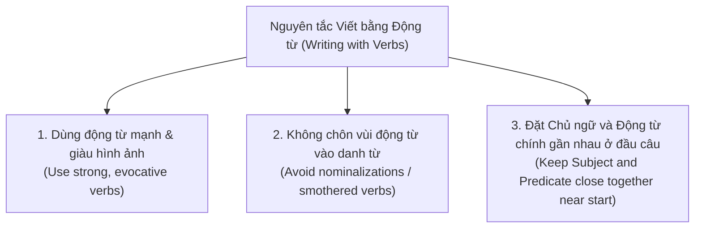

# GIÁO TRÌNH TOÀN DIỆN: WRITING IN THE SCIENCES
## MODULE 2: CÂU VĂN UY LỰC — ĐỘNG TỪ, THỂ CHỦ ĐỘNG & DÒNG CHẢY VĂN BẢN
*(Strong Sentences: Verbs, Voice, and Flow)*

---

**Thông tin khóa học & Học phần:**
- **Khóa học:** Writing in the Sciences (Viết khoa học chuẩn quốc tế)
- **Đơn vị phát hành:** Stanford Online — Đại học Stanford (Stanford University)
- **Giảng viên chủ nhiệm:** Dr. Kristin Sainani (Phó Giáo sư Dịch tễ học & Thống kê sinh học, Đại học Stanford)
- **Bản quyền biên soạn tài liệu tiếng Việt:** Dự án Tutor / Trợ lý Học thuật
- **Vị trí lưu trữ bài giảng & Video offline:** `coursera/output_course/writing_science/Module_02_Strong_Sentences_Verbs_Voice_and_Flow/`

---

## MỤC LỤC TỔNG QUAN

1. [Mục tiêu học tập & Chuẩn đầu ra](#1-mục-tiêu-học-tập--chuẩn-đầu-ra)
2. [Bảng thuật ngữ cốt lõi (Core Terminology Glossary)](#2-bảng-thuật-ngữ-cốt-lõi-core-terminology-glossary)
3. [Phân tích chi tiết từng bài học (Lectures 2.1 — 2.6 & Demo 2)](#3-phân-tích-chi-tiết-từng-bài-học)
   - [3.1. Bài 2.1: Thể chủ động — Động cơ phản lực của câu văn](#31-bài-21-thể-chủ-động--động-cơ-phản-lực-của-câu-văn)
   - [3.2. Bài 2.2: Dùng "We" và "I" trong bài báo khoa học — Có được phép không?](#32-bài-22-dùng-we-và-i-trong-bài-báo-khoa-học--có-được-phép-không)
   - [3.3. Bài 2.3: Xưởng thực hành chuyển thể chủ động](#33-bài-23-xưởng-thực-hành-chuyển-thể-chủ-động)
   - [3.4. Bài 2.4: Viết bằng động từ hành động (Write with Verbs)](#34-bài-24-viết-bằng-động-từ-hành-động-write-with-verbs)
   - [3.5. Bài 2.5: Phân tích các ca lâm sàng kinh điển (Practice Examples — Deep Dive)](#35-bài-25-phân-tích-các-ca-lâm-sàng-kinh-điển-practice-examples--deep-dive)
   - [3.6. Bài 2.6: Cẩm nang ngữ pháp trọng yếu trong viết khoa học](#36-bài-26-cẩm-nang-ngữ-pháp-trọng-yếu-trong-viết-khoa-học)
   - [3.7. Bài 2.8: Phân tích Demo Edit 2 (Optional) — Nghiên cứu "Robo-Cockroach" & Bài học đạo văn](#37-bài-28-phân-tích-demo-edit-2-optional--nghiên-cứu-robo-cockroach--bài-học-đạo-văn)
4. [Bộ đề ôn tập & Đáp án giải thích chi tiết (Unit 2 Homework)](#4-bộ-đề-ôn-tập--đáp-án-giải-thích-chi-tiết-unit-2-homework)
5. [Bảng quy chiếu: Chuyển đổi Danh từ hóa -> Động từ hành động mạnh](#5-bảng-quy-chiếu-chuyển-đổi-danh-từ-hóa---động-từ-hành-động-mạnh)
6. [Checklist kiểm soát sức mạnh câu văn (The Strong Sentences Checklist)](#6-checklist-kiểm-soát-sức-mạnh-câu-văn-the-strong-sentences-checklist)
7. [Danh mục Video bài giảng Module 2 đã lưu trữ Offline](#7-danh-mục-video-bài-giảng-module-2-đã-lưu-trữ-offline)

---

# 1. MỤC TIÊU HỌC TẬP & CHUẨN ĐẦU RA

Sau khi hoàn thành Module 2, học viên đạt được năng lực toàn diện:

1. **WHAT — Bản chất ngữ pháp & Tâm lý học tiếp nhận:** Nắm vững cấu trúc câu trực diện: **Chủ ngữ $\rightarrow$ Động từ $\rightarrow$ Tân ngữ (Subject - Verb - Object)**. Phân biệt rạch ròi cơ chế vận hành của thể chủ động (*active voice*) và thể bị động (*passive voice*). Hiểu tại sao động từ hành động là "động cơ đốt trong" tạo nên sự cuốn hút và mạch lạc cho bài báo khoa học.
2. **WHY — Đập tan những ảo tưởng học thuật sai lầm:**
   - Xóa bỏ định kiến cho rằng *"Thể bị động tạo ra tính khách quan khoa học"*.
   - Đập tan giáo điều cấm kỵ *"Không bao giờ được dùng 'We' hoặc 'I' trong văn bản học thuật"*.
   - Nhận diện tác hại của việc lạm dụng động từ to-be (*is, are, was, were*) và hiện tượng chôn vùi động từ chính (*buried verbs*) khiến độc giả kiệt sức.
3. **HOW — Kỹ thuật tái cấu trúc câu chuyên sâu:**
   - Kéo gần khoảng cách giữa Chủ ngữ (*Subject*) và Động từ chính (*Predicate*) ở đầu câu, ngăn chặn tình trạng chủ ngữ dài 30–40 từ làm đứt gãy sự tập trung.
   - Chuyển hóa các danh từ hóa trừu tượng (*nominalizations*) trở lại thành các động từ hành động uy lực (*provide an analysis of* $\rightarrow$ *analyze*).
   - Làm chủ các quy tắc ngữ pháp học thuật nhạy cảm: số nhiều của từ *data*, phân biệt cặp từ dễ lẫn *affect* vs *effect*, sử dụng chính xác *compared with* thay vì *compared to*, và quy tắc "săn phù thủy Which" (*that* vs *which*).
4. **WHEN & LIMITATIONS — Ranh giới ngoại lệ hợp lệ:** Biết rõ khi nào thể bị động **được phép và nên sử dụng** (ví dụ: trong phần Phương pháp nghiên cứu - *Methods section*, khi đối tượng bị tác động quan trọng hơn chủ thể thực hiện).
5. **APPLICATION — Khả năng biên tập đoạn văn nghiên cứu thực tế:** Có khả năng đọc một đoạn văn bản học thuật rối rắm, phát hiện ngay động từ chính bị giấu kín, tái định hình chủ ngữ hành động và viết lại một câu văn cô đọng, giàu năng lượng.
6. **ACADEMIC INTEGRITY — Nhận thức đạo đức nghiên cứu:** Hiểu sâu sắc về lằn ranh giữa việc trích dẫn, học hỏi văn phong và **hành vi đạo văn (plagiarism)**; làm chủ kỹ thuật diễn giải chân chính (*honest paraphrasing*).

---

# 2. BẢNG THUẬT NGỮ CỐT LÕI (CORE TERMINOLOGY GLOSSARY)

| Thuật ngữ gốc (EN) | Thuật ngữ Tiếng Việt chuẩn | Giải thích bản chất học thuật & Cơ chế tác động | Ví dụ minh họa đối chứng (Before & After) |
| :--- | :--- | :--- | :--- |
| **Active Voice** | Thể chủ động | Cấu trúc câu tự nhiên trong đó chủ thể thực hiện hành động đóng vai trò là chủ ngữ đứng đầu câu: `Subject + Verb + Object`. Câu văn trực diện, rõ người rõ việc, giàu năng lượng. | *The DSMB committee recommended halting the study.* (Thay vì bị động dài dòng). |
| **Passive Voice** | Thể bị động | Cấu trúc đảo ngược trong đó đối tượng chịu tác động được đưa lên làm chủ ngữ: `Object + was/were + Verb(past participle) + (by Subject)`. Câu văn thường dài hơn, giấu kín hoặc đẩy chủ thể hành động về cuối câu. | *A recommendation was made by the DSMB committee that...* $\rightarrow$ Nặng nề, đảo lộn trật tự logic. |
| **Buried / Smothered Verb** | Động từ bị chôn vùi / Danh từ hóa ngột ngạt | Hiện tượng động từ hành động cốt lõi bị "chôn sống" dưới dạng một danh từ trừu tượng cồng kềnh, khiến câu phải nương tựa vào một động từ to-be hoặc động từ rỗng yếu ớt. | *furnish an explanation of* $\rightarrow$ **explain** *make an evaluation of* $\rightarrow$ **evaluate** |
| **Subject-Predicate Distance** | Khoảng cách Chủ — Vị quá xa | Lỗi cấu trúc nghiêm trọng khi giữa Chủ ngữ và Động từ chính bị nhồi nhét hàng loạt mệnh đề quan hệ, cụm giới từ, khiến người đọc phải "nín thở" đọc 30–40 từ mới biết chuyện gì đang xảy ra. | *The results of variation of chromatographic conditions... furnished.* $\rightarrow$ Đưa động từ chính lên ngay đầu câu. |
| **"To-Be" Verb Overreliance** | Bệnh lạm dụng động từ To-Be | Thói quen viết câu chỉ dùng *is, are, was, were*, biến văn bản thành chuỗi định nghĩa tĩnh tại, triệt tiêu mọi cảm giác vận động và diễn tiến của khoa học. | *Sialic acids are... They are... Glycoconjugates is...* $\rightarrow$ Đưa động từ miêu tả tương tác hóa sinh vào. |
| **First-Person Pronouns** | Đại từ nhân xưng thứ nhất (*We, I*) | Các đại từ chỉ đích danh nhóm nghiên cứu hoặc tác giả. Được các tạp chí hàng đầu (*Nature, Science, PNAS*) khuyến khích nhằm tăng tính minh bạch, trực diện và loại bỏ câu bị động rườm rà. | *We hypothesized that...* (Thay vì: *It was hypothesized by the authors that...*). |
| **Objectivity Myth** | Huyền thoại tính khách quan giả tạo | Niềm tin sai lầm rằng việc giấu tên tác giả sau cấu trúc bị động vô nhân xưng (*"It was observed that..."*) sẽ làm thí nghiệm trở nên khách quan hơn. Thực tế, tính khách quan nằm ở phương pháp và dữ liệu, không nằm ở ngữ pháp bị động. | Giấu tên không làm thí nghiệm trung thực hơn, chỉ làm người đọc mệt mỏi hơn. |
| **Restrictive Clause** | Mệnh đề giới hạn (Dùng **That**) | Mệnh đề mang thông tin sống còn để xác định danh từ; nếu bỏ đi câu sẽ sai nghĩa hoặc mất đi đối tượng cần nói. **Không bao giờ dùng dấu phẩy**. | *The vial that contained her RNA was lost.* (Hàm ý có nhiều ống nghiệm, ống chứa RNA bị mất). |
| **Non-restrictive Clause** | Mệnh đề bổ sung (Dùng **Which**) | Mệnh đề chỉ cung cấp thông tin phụ trợ; nếu lược bỏ câu vẫn giữ nguyên danh tính đối tượng xác định. **Bắt buộc phải đặt giữa các dấu phẩy**. | *The vial, which contained her RNA, was lost.* (Chỉ có duy nhất một ống nghiệm, việc chứa RNA là chi tiết phụ). |
| **Compared with vs. Compared to** | So sánh tương đồng vs Ẩn dụ dị biệt | - *Compared with:* So sánh hai sự vật cùng loại để tìm sự khác biệt/tương đồng (dùng trong 99% văn cảnh khoa học). - *Compared to:* So sánh ẩn dụ hai vật hoàn toàn khác bản chất. | *Brain tumors are rare compared with lung cancers.* (Hai loại u). *Shall I compare thee to a summer's day?* (Người vs ngày hè). |
| **Affect vs. Effect** | Cặp từ Tác động (Động từ) & Kết quả (Danh từ) | - **Affect (v):** Gây ảnh hưởng, tác động lên (*The drug affected the cells*). - **Effect (n):** Kết quả, tác động (*The drug had an effect on cells*). *(Ngoại lệ: affect trong tâm thần học = biểu cảm cảm xúc; effect change = tạo ra thay đổi).* | *Terrorist plots affect the beauty industry.* (Dùng động từ *affect*, không dùng *effect*). |
| **Plagiarism vs. Honest Paraphrasing** | Đạo văn vs Diễn giải trung thực | - *Plagiarism:* Sao chép nguyên văn hoặc cấu trúc câu của người khác mà không trích dẫn. - *Paraphrasing:* Đọc hiểu thấu đáo, gấp tài liệu gốc lại và tự viết lại hoàn toàn bằng vốn từ và tư duy của mình. | Cảnh báo từ bài học của học viên: chép nguyên văn câu từ thông cáo báo chí vào bản thảo. |

---

# 3. PHÂN TÍCH CHI TIẾT TỪNG BÀI HỌC

## 3.1. Bài 2.1: Thể chủ động — Động cơ phản lực của câu văn
*(Lecture 2.1: Use the Active Voice)*

### A. Cấu trúc và Tâm lý học tiếp nhận
Tiếng Anh tự nhiên tuân theo trật tự: **Chủ ngữ (Actor) $\rightarrow$ Động từ (Action) $\rightarrow$ Tân ngữ (Target)**.
- Khi ta nói: *"She throws the ball"* hoặc *"The president made mistakes"*, não bộ người nghe tiếp nhận thông tin theo đúng dòng thời gian: Ai làm $\rightarrow$ Làm việc gì $\rightarrow$ Tác động lên ai.
- Khi chuyển sang thể bị động: *"The ball was thrown by her"* hoặc *"Mistakes were made by the president"*, câu văn bị đảo ngược: Đối tượng chịu trận xuất hiện trước, động từ bị kéo dài thêm trợ động từ (*was/were*), còn chủ thể gây ra hành động bị giấu kín hoặc vứt ở cuối câu sau giới từ *by*.

| Tiêu chí so sánh | Thể chủ động (Active Voice) | Thể bị động (Passive Voice) |
| :--- | :--- | :--- |
| **Độ dài câu** | Ngắn gọn, tiết kiệm 20% - 30% số từ | Lê thê, luôn cần trợ động từ và giới từ *by* |
| **Sự minh bạch** | Luôn nêu rõ ai chịu trách nhiệm cho hành động | Dễ xóa mờ trách nhiệm (ai làm? ai tìm ra?) |
| **Nhịp điệu** | Dứt khoát, mạnh mẽ, sống động | Nặng nề, tĩnh tại, gây buồn ngủ |
| **Mức độ tiêu hao nhận thức** | Não người đọc giải mã ngay lập tức | Não phải đảo ngược trật tự tư duy để hiểu |

### B. Ba trường hợp duy nhất thể bị động ĐƯỢC CHẤP NHẬN trong khoa học
Dr. Kristin Sainani nhấn mạnh rằng bà không bài trừ hoàn toàn thể bị động. Có 3 tình huống thể bị động phát huy tác dụng:

1. **Trong phần Phương pháp nghiên cứu (Methods section):**
   - Khi mô tả quy trình thí nghiệm, việc *hóa chất nào được thêm vào dung dịch*, hoặc *chuột được tiêm thuốc gì* là trung tâm của sự chú ý, không quan trọng kỹ thuật viên hay nghiên cứu sinh nào đã đổ hóa chất đó.
   - *Hợp lý:* *"Mice were injected with 0.5 mg of the compound daily."* (Không nhất thiết phải viết: *"We injected mice with..."* lặp đi lặp lại 20 lần trong phần Methods).
2. **Khi đối tượng chịu tác động quan trọng hơn chủ thể:**
   - Nếu bạn đang viết một bài báo về nạn nhân của một căn bệnh hiếm, đối tượng bệnh nhân cần được đặt ở vị trí trung tâm của câu.
   - *Ví dụ:* *"Patients with stage IV melanoma were enrolled in the trial."*
3. **Khi chủ thể thực hiện hoàn toàn không được biết đến:**
   - *Ví dụ:* *"The ancient cave paintings were preserved for thousands of years."*

> [!WARNING]
> Ngoài 3 trường hợp hẹp nêu trên, **90% câu văn trong phần Dẫn nhập (Introduction), Kết quả (Results), và Thảo luận (Discussion) nên và phải được viết ở thể chủ động!**

---

## 3.2. Bài 2.2: Dùng "We" và "I" trong bài báo khoa học — Có được phép không?
*(Lecture 2.2: Is It Really OK to Use "We" and "I"?)*

Rất nhiều sinh viên và nhà khoa học trẻ mang trong mình một nỗi sợ hãi cố hữu: *"Giáo sư của tôi bảo rằng tuyệt đối không được dùng 'We' hoặc 'I' trong bài báo khoa học vì sẽ làm mất đi tính khách quan"*.

Dr. Kristin Sainani khẳng định dứt khoát: **ĐÂY LÀ MỘT HUYỀN THOẠI HOÀN TOÀN SAI LẦM!**

### 1. Lập trường của các tạp chí khoa học hàng đầu thế giới
Hãy đọc hướng dẫn tác giả (*Instructions for Authors*) của các tập san khoa học quyền lực nhất hành tinh:
- **Tạp chí Nature:** *"Nature journals prefer authors to write in the active voice ('we performed the experiment...') rather than the passive voice. Experience has shown that writing in the active voice makes papers much easier and more enjoyable to read."*
- **Tạp chí Science:** Khuyến khích sử dụng ngôi thứ nhất để làm rõ ai là người thực hiện phân tích và chịu trách nhiệm cho các kết luận.
- **Tạp chí PNAS & Cell:** Khuyến nghị dùng đại từ nhân xưng chủ động để tránh các cấu trúc vòng vo vô nghĩa.

### 2. Minh chứng lịch sử: Bài báo đoạt giải Nobel của Watson & Crick (1953)
Bài báo 1 trang lịch sử trên tạp chí *Nature* công bố cấu trúc xoắn kép của DNA bắt đầu bằng câu văn kinh điển:
> *"**We** wish to suggest a structure for the salt of deoxyribose nucleic acid (D.N.A.). This structure has novel features which are of considerable biological interest."*

Nếu Watson và Crick bị trói buộc bởi định kiến cấm kỵ *We/I*, họ sẽ phải viết một câu kỳ quặc như: *"A structure for the salt of deoxyribose nucleic acid is wished to be suggested by the present investigators"*.

### 3. Sự lố bịch của các lối diễn đạt "né tránh" đại từ nhân xưng
Khi cố tình trốn tránh chữ *We* và *I*, người viết thường rơi vào hai cái bẫy tệ hại:
- **Bẫy 1 — Thể bị động cồng kềnh:** *"It was hypothesized that..."*, *"It has been demonstrated by the authors that..."*
- **Bẫy 2 — Nói về bản thân ở ngôi thứ ba (Nghe như một kẻ xa lạ):** *"The authors observed..."*, *"The present investigators believe that..."*. Lối viết này vừa gượng gạo, vừa làm người đọc hoang mang không biết "the authors" là nhóm tác giả bài báo hay nhóm tác giả của tài liệu tham khảo nào khác!

> [!TIP]
> **Ranh giới sử dụng chuẩn mực:**
> - **NÊN DÙNG:** *We measured, We hypothesized, We analyzed, We found, We conclude.* (Mô tả hành động khoa học khách quan của nhóm nghiên cứu).
> - **KHÔNG NÊN DÙNG:** *I feel, In my personal opinion, We believe passionately.* (Không dùng để đưa cảm xúc chủ quan, thiếu căn cứ dữ liệu vào bài báo).

---

## 3.3. Bài 2.3: Xưởng thực hành chuyển thể chủ động
*(Lecture 2.3: Active Voice Practice)*

Dưới đây là 5 bài tập thực hành trên lớp được Dr. Sainani phân tích và chữa mẫu:

### Bài tập 1:
- **Câu gốc (Bị động):** *"A recommendation was made by the DSMB committee that the study be halted."*
- **Phân tích:** Ai là chủ thể? $\rightarrow$ *The DSMB committee*. Hành động là gì? $\rightarrow$ *recommended*.
- **Bản sửa đổi (Chủ động):**  
  $\rightarrow$ **"The DSMB committee recommended that the study be halted."** *(Gọn gàng, loại bỏ hoàn toàn danh từ hóa "was made").*

### Bài tập 2:
- **Câu gốc (Bị động, ẩn chủ thể):** *"Major differences in the reaction times of the two study subjects were found."*
- **Phân tích:** Câu gốc bị động và giấu nhẹm chủ thể (*were found* bởi ai?). Ta có 2 cách sửa:
  - *Cách 1 (Thêm chủ thể We):* *"We observed major differences in the reaction times of the two study subjects."*
  - *Cách 2 (Trực diện hơn, đưa đối tượng làm chủ ngữ với động từ hành động):*  
    $\rightarrow$ **"The two study subjects differed in reaction times."** *(Cách này xuất sắc nhất vì loại bỏ luôn cả cụm dọn họng "We observed").*

### Bài tập 3:
- **Câu gốc (Hai lần bị động liên tiếp):** *"It was concluded by the editors that the data had been falsified by the authors."*
- **Phân tích:** Có 2 hành động bị động: `was concluded` (bởi ban biên tập) và `had been falsified` (bởi nhóm tác giả).
- **Bản sửa đổi (Chủ động kép hoàn hảo):**  
  $\rightarrow$ **"The editors concluded that the authors falsified their data."** *(Giảm 40% độ dài, đanh thép và trực diện).*

### Bài tập 4:
- **Câu gốc (Bị động):** *"The first visible-light snapshot of a planet circling another star has been taken by NASA's Hubble Space Telescope."*
- **Phân tích:** Chủ thể thực hiện là Kính viễn vọng Hubble.
- **Bản sửa đổi (Chủ động):**  
  $\rightarrow$ **"NASA's Hubble Space Telescope has taken the first visible-light snapshot of a planet circling another star."**

### Bài tập 5 (Thách thức nâng cao):
- **Câu gốc:** *"Therefore, the hypothesis that the overall kinetics of a double transtibial amputee athlete and an able-bodied sprinter at the same level of performance are not different, was rejected."*
- **Phân tích:** Động từ chính `was rejected` bị đẩy tít xuống tận cuối câu sau một chủ ngữ dài dằng dặc 25 từ! Ngoài ra cụm phủ định `are not different` rất gượng gạo.
- **Bản sửa đổi:**  
  $\rightarrow$ **"We rejected the hypothesis that the overall kinetics of a double transtibial amputee athlete and an able-bodied sprinter at the same level of performance are comparable."** *(Đưa ngay động từ "We rejected" lên đầu câu; đổi "not different" thành khẳng định "comparable").*

---

## 3.4. Bài 2.4: Viết bằng động từ hành động (Write with Verbs)
*(Lecture 2.4: Write with Verbs)*

Động từ là linh hồn, là động cơ thúc đẩy câu văn tiến lên. Để viết câu văn uy lực, cần tuân thủ **Ba nguyên tắc vàng**:

### Nguyên tắc 1: Sử dụng động từ mạnh thay vì động từ yếu
So sánh hai phiên bản miêu tả trong một tác phẩm văn học:
- *Phiên bản yếu (dùng động từ chung chung):* *"Loud music came from speakers embedded in the walls, and the entire arena moved as the hungry crowd got to its feet."* (Tạm ổn, nhưng nhạt nhòa).
- *Phiên bản gốc mạnh mẽ:* *"Loud music **exploded** from speakers embedded in the walls, and the entire arena **shook** as the hungry crowd **leaped** to its feet."*

Trong bài báo khoa học, dù ta hiếm khi được dùng các từ giật gân như *exploded* hay *leaped*, nhưng việc thay thế động từ to-be yếu ớt bằng các động từ chuyên môn chính xác (*exhibited, triggered, suppressed, accelerated, diminished*) sẽ làm bài báo trở nên thuyết phục và đầy sức sống.

### Nguyên tắc 2: Chống lại bệnh Danh từ hóa (Nominalization)
Đừng biến động từ hành động thành danh từ để rồi phải "chắp vá" bằng một động từ vô hồn:
- Đừng viết: *conduct an analysis of* $\rightarrow$ Hãy viết: **analyze**
- Đừng viết: *make an assumption that* $\rightarrow$ Hãy viết: **assume**
- Đừng viết: *give a demonstration of* $\rightarrow$ Hãy viết: **demonstrate**
- Đừng viết: *achieve an improvement in* $\rightarrow$ Hãy viết: **improve**

### Nguyên tắc 3: Đặt Chủ ngữ và Động từ chính sát cạnh nhau ở đầu câu
Tâm lý người đọc luôn khao khát nhanh chóng tìm thấy: **Ai làm gì?**  
Nếu bạn mở đầu câu bằng một chủ ngữ, sau đó chèn thêm 35 từ bổ nghĩa linh tinh rồi mới chịu quẳng ra động từ chính, người đọc sẽ bị hụt hơi, quên mất chủ ngữ ban đầu là gì và phải đọc lại câu từ đầu.
- **Quy tắc vàng:** **Chủ ngữ và Động từ chính phải gặp nhau trong vòng 5–10 từ đầu tiên của câu!**

---

## 3.5. Bài 2.5: Phân tích các ca lâm sàng kinh điển (Practice Examples — Deep Dive)
*(Lecture 2.5: Practice Examples)*

### Ca lâm sàng 1: Câu chuyện cuốn sách Thống kê dày 3 inch tại Stanford
Dr. Sainani kể lại kỷ niệm khi mới về giảng dạy tại Stanford: Sinh viên theo học môn Thống kê ở một khoa khác đều kêu trời vì cuốn giáo trình dày cộp khó đọc đến mức tuyệt vọng. Đây là đoạn trích ngay trong lời mở đầu của cuốn sách:

> **Đoạn trích gốc:**  
> *"The fear expressed by some teachers that students would not learn statistics well if they were permitted to use canned computer programs has not been realized in our experience. The monitoring of student achievement levels before and after the introduction of computers in our course revealed no appreciable change in student performance."*

**Chẩn đoán bệnh lý:**
1. Chủ ngữ của câu 1 là `The fear` nhưng mãi đến cuối câu mới thấy động từ `has not been realized`. Động từ `fear` bị danh từ hóa thành `The fear`.
2. Câu 1 dùng liên tiếp 2 mệnh đề phủ định nặng nề: `would not learn`, `has not been realized`.
3. Câu 2 có chủ ngữ dài lê thê: `The monitoring of...`, chôn vùi động từ `to monitor`.
4. Dùng từ rào đón đáng ngờ (*hedge word*): `no appreciable change` (Không có thay đổi đáng kể? Nghĩa là có thay đổi nhưng không đạt ý nghĩa thống kê? Tác giả đang giấu giếm điều gì đằng sau chữ "appreciable"?).

**Bản chữa trị của Dr. Sainani (Crisp & Clear):**
> *"Many teachers **feared** that the use of canned computer programs would prevent students from learning statistics. We **monitored** student achievement levels before and after the introduction of computers in our course and **found** no detriments in performance."*  
> *(Khôi phục hai động từ mạnh: `feared` và `monitored`, chủ ngữ và động từ xuất hiện ngay đầu câu, nhịp điệu sáng sủa tuyệt đối).*

---

### Ca lâm sàng 2: Đánh giá tiến độ thử nghiệm lâm sàng
> **Câu gốc:**  
> *"Review of each center's progress in recruitment is important to ensure that the cost involved in maintaining each center's participation is worthwhile."* (22 từ)

**Chẩn đoán:**
- Chủ ngữ dài và chôn vùi động từ: `Review of each center's progress in recruitment`.
- Động từ chính là động từ to-be yếu: `is`.
- Dùng tính từ rỗng tuếch, mơ hồ: `important`, `worthwhile` (Quan trọng thế nào? Đáng giá là đáng giá cái gì?).

**Bản chữa trị:**
> $\rightarrow$ *"We should review each center's recruitment progress to make sure its continued participation is cost effective."*  
> *(Biến câu thành mệnh lệnh hành động `We should review`, đổi `worthwhile` mơ hồ thành tiêu chí cụ thể `cost effective`).*

---

### Ca lâm sàng 3: Dịch tễ học mô tả về bệnh tự kỷ
> **Câu gốc:**  
> *"Important studies to examine the descriptive epidemiology of autism, including the prevalence and changes in the characteristics of the population over time, have begun."* (22 từ)

**Chẩn đoán:**
- Khoảng cách Chủ — Vị quá xa: Chủ ngữ `Important studies` đứng đầu câu, nhưng động từ chính `have begun` bị ném tít ở từ thứ 22 cuối câu!
- Từ tự khen vô bổ: `Important`.
- Trùng lặp hiển nhiên: `changes over time` (đã là thay đổi thì đương nhiên phải theo thời gian).
- Cụm từ rỗng: `of the population`.

**Bản chữa trị:**
> $\rightarrow$ *"Studies have begun to describe the epidemiology of autism, including recent changes in the disorder's prevalence and characteristics."*  
> *(Đưa ngay động từ `have begun` lên thứ 2 trong câu; rút gọn `examine the descriptive epidemiology` thành `describe the epidemiology`).*

---

## 3.6. Bài 2.6: Cẩm nang ngữ pháp trọng yếu trong viết khoa học
*(Lecture 2.6: A Few Critical Grammar Tips)*

Dù đây không phải là một khóa học ngữ pháp thuần túy, Dr. Sainani tổng hợp 5 vấn đề ngữ pháp nhạy cảm nhất mà các nhà khoa học thường xuyên mắc lỗi:

### 1. Từ "DATA" là DANH TỪ SỐ NHIỀU!
Trong tiếng Anh học thuật, *data* là dạng số nhiều bắt nguồn từ tiếng Latin (dạng số ít là *datum* — một điểm dữ liệu, nhưng trong khoa học hầu như ta không dùng từ này đơn lẻ).
- ❌ **Sai:** *The data is conclusive.* / *The data shows a clear trend.*
- ✅ **Đúng:** **The data are conclusive.** / **These data show a clear trend.** / **The data support our hypothesis.**

### 2. Phân biệt AFFECT vs. EFFECT
- **AFFECT (bắt đầu bằng A) $\rightarrow$ Action $\rightarrow$ Động từ (Verb):** Có nghĩa là tác động, ảnh hưởng đến.  
  *Ví dụ:* *"The extreme temperature affected cell viability."*
- **EFFECT (bắt đầu bằng E) $\rightarrow$ End result $\rightarrow$ Danh từ (Noun):** Có nghĩa là kết quả, hiệu ứng, tác động.  
  *Ví dụ:* *"The extreme temperature had an adverse effect on cell viability."*
- *Ngoại lệ thú vị:*
  - *Affect* làm danh từ: Trong tâm lý học/tâm thần học chỉ biểu cảm nét mặt hoặc trạng thái cảm xúc (*flat affect*).
  - *Effect* làm động từ: Mang nghĩa tạo ra, mang lại sự thay đổi (*effect a change*).

### 3. Phân biệt COMPARED WITH vs. COMPARED TO
- **Compared with (Dùng trong 99% bài báo khoa học):** Dùng khi đặt hai sự vật tương đồng cạnh nhau để so sánh sự khác biệt và giống nhau cụ thể.  
  *Ví dụ:* *"Brain tumors are relatively rare compared with common cancers such as lung and breast cancer."*
- **Compared to:** Dùng khi so sánh ẩn dụ giữa hai sự vật hoàn toàn khác biệt về bản chất.  
  *Ví dụ:* *"Shall I compare thee to a summer's day?"* (So sánh một người phụ nữ với một ngày hè).

### 4. Phân biệt THAT vs. WHICH (Chiến dịch "Săn phù thủy Which")
Strunk & White trong cuốn *The Elements of Style* khuyên các tác giả: *"Những người viết cẩn trọng hãy mở cuộc đi săn phù thủy Which, quét sạch những chữ Which giới hạn thừa thãi để nâng tầm tác phẩm"*.

| Đại từ | Loại mệnh đề quan hệ | Quy tắc dấu phẩy | Bản chất ý nghĩa |
| :---: | :--- | :---: | :--- |
| **THAT** | **Restrictive** (Mệnh đề giới hạn / Thiết yếu) | **KHÔNG** có dấu phẩy | Thông tin bắt buộc phải có để xác định đối tượng. Nếu xóa mệnh đề này, câu sẽ mất nghĩa hoặc người đọc không biết đang nói về đối tượng nào. |
| **WHICH** | **Non-restrictive** (Mệnh đề bổ sung / Không thiết yếu) | **BẮT BUỘC** kẹp giữa 2 dấu phẩy | Thông tin phụ họa, thêm vào cho phong phú. Nếu xóa bỏ mệnh đề này đi, đối tượng chính vẫn hoàn toàn rõ ràng. |

**Ví dụ đối chứng kinh điển:**
1. *"The bike **that** is broken is in the garage."*  
   $\rightarrow$ Ngụ ý trong nhà có **nhiều chiếc xe đạp**, và chiếc xe *bị hỏng* thì nằm trong gara (chiếc còn tốt nằm ở ngoài sân). Cụm *that is broken* là thông tin sống còn để định danh chiếc xe.
2. *"The bike, **which** is broken, is in the garage."*  
   $\rightarrow$ Ngụ ý trong nhà chỉ có **duy nhất một chiếc xe đạp**, và nó đang ở trong gara; chi tiết nó bị hỏng chỉ là thông tin kể thêm, xóa đi người đọc vẫn biết chiếc xe nào.

### 5. Sự hòa hợp Số ít — Số nhiều và vấn đề Bình đẳng giới
- ❌ *Mắc lỗi:* *"Each student worries about their grade."* (*Each student* là số ít, nhưng *their* lại là số nhiều).
- *Cách sửa luộm thuộm:* *"Each student worries about his or her grade."* (Dùng *his/her* nhiều lần sẽ làm câu văn rất nặng nề, rối rắm).
- ✅ **Giải pháp thông minh nhất:** **Chuyển toàn bộ câu sang số nhiều!**  
  $\rightarrow$ **"All students worry about their grades."** (Vừa đúng ngữ pháp 100%, vừa thanh thoát, vừa bình đẳng giới tự nhiên).

---

## 3.7. Bài 2.8: Phân tích Demo Edit 2 (Optional) — Nghiên cứu "Robo-Cockroach" & Bài học đạo văn
*(Lecture 2.8: Demo Edit 2 — Live Editing Session with Dr. Kristin Sainani)*

Đây là một bài giảng thực hành có giá trị giáo khoa đặc biệt vì nó biến một sự cố có thật trong lớp học thành **bài học cảnh tỉnh sâu sắc về đạo đức học thuật (Academic Integrity)**.

### 1. Bối cảnh bài viết của học viên
Một học viên nộp bài tiểu luận về công trình nghiên cứu biến gián thành robot sinh học cứu hộ: Các nhà khoa học gắn một vi mạch điều khiển lên lưng con gián và cấy điện cực vào râu (*antennas*) của nó để điều khiển hướng di chuyển từ xa vào các đống đổ nát sau động đất.

### 2. Sự cố Đạo văn (Plagiarism Discovery)
Khi Dr. Sainani đọc bản thảo, bà rất ấn tượng và liên tục khen ngợi: *"Tôi rất thích cách dùng từ trong câu này! Tác giả viết cực kỳ sống động và giàu hình ảnh"*.  
Tuy nhiên, sau khi video bài giảng được phát sóng, một vài sinh viên sắc sảo trong lớp đã phát hiện ra: **Những câu văn hay nhất đó đã bị học viên sao chép nguyên văn từ một thông cáo báo chí (*press release*) của trường đại học!**

Cụ thể, các câu bị "bê nguyên xi":
- *"Antennas serve as electronic reins, injecting small charges into the roach's neural tissue. The charges trick the roach into thinking that the antennas are in contact with a physical barrier, which effectively steers them in the opposite direction."*
- *"Uses an electronic interface to remotely steer cockroaches..."*
- *"Creates a mobile web of sensors..."*

### 3. Ba bài học lớn về Đạo đức nghiên cứu & Kỹ thuật viết
1. **Nhận diện bước nhảy phong cách (*Style Shift*):** Khi chấm bài hoặc bình duyệt bài báo, nếu thấy một tác giả đang viết với văn phong bình thường, vụng về bỗng nhiên xuất hiện 1–2 câu văn bóng bẩy, điêu luyện như nhà báo chuyên nghiệp của tờ *The New York Times*, đó là dấu hiệu đỏ cảnh báo khả năng cao có sự đạo văn.
2. **Đừng bao giờ "nhặt" câu chữ của người khác:** Việc sao chép nguyên vẹn câu văn của người khác mà không đặt trong ngoặc kép và không dẫn nguồn là hành vi đạo văn nghiêm trọng, có thể hủy hoại toàn bộ sự nghiệp khoa học của bạn.
3. **Kỹ thuật Diễn giải chân chính (Honest Paraphrasing):**
   - Đọc tài liệu tham khảo 2–3 lần cho đến khi nắm vững bản chất cốt lõi.
   - **GẤP HOẶC TẮT TÀI LIỆU GỐC ĐI.** Tuyệt đối không vừa nhìn bản gốc vừa gõ lại bằng cách thay vài từ đồng nghĩa.
   - Tự diễn đạt lại ý tưởng đó bằng ngôn từ, cấu trúc câu và góc nhìn của chính bạn.

---

# 4. BỘ ĐỀ ÔN TẬP & ĐÁP ÁN GIẢI THÍCH CHI TIẾT (UNIT 2 HOMEWORK)

Dưới đây là đáp án và phân tích sư phạm toàn diện cho 13 câu hỏi trong bài tập chấm điểm Unit 2 Homework:

### Câu 1:
**Đề bài:** Chuyển câu sau sang thể chủ động:  
*"The predicted sharp edges characteristic of a cosmic string were observed by several teams."*  
- **Đáp án chuẩn:**  
  `Several teams observed the predicted sharp edges characteristic of a cosmic string.`  
- **Phân tích:** Xác định chủ thể thực hiện hành động: `several teams`. Đưa lên đầu câu làm chủ ngữ đi kèm động từ chủ động `observed`.

### Câu 2:
**Đề bài:** Chuyển câu sau sang thể chủ động:  
*"The tables were reformatted by me."*  
- **Đáp án chuẩn:**  
  `I reformatted the tables.`  
- **Phân tích:** Câu gốc bị động ngớ ngẩn (6 từ) chuyển thành câu chủ động trực diện (4 từ). Sử dụng đại từ nhân xưng `I` đanh thép, tự nhiên.

### Câu 3:
**Đề bài:** Câu sau đây đang ở thể chủ động hay thể bị động?  
*"Overall, 191 chocolates out of a possible 258 (74%) were observed to have been eaten."*  
- **Đáp án chuẩn:** **Passive voice (Thể bị động)**  
- **Phân tích:** Câu dùng cấu trúc `were observed to have been eaten` (hai lần bị động lồng nhau), giấu nhẹm chủ thể ai đã quan sát và ai đã ăn những thanh sô-cô-la đó!

### Câu 4:
**Đề bài:** Viết lại cụm từ *"provide inspiration"* thành một động từ đơn duy nhất.  
- **Đáp án chuẩn:** **INSPIRE**  
- **Phân tích:** Triệt tiêu danh từ hóa (*inspiration*) và động từ rỗng (*provide*).

### Câu 5:
**Đề bài:** Viết lại cụm từ *“offer confirmation of”* thành một động từ đơn duy nhất.  
- **Đáp án chuẩn:** **CONFIRM**  
- **Phân tích:** Triệt tiêu danh từ hóa (*confirmation*) và động từ rỗng (*offer*).

### Câu 6:
**Đề bài:** Vấn đề chính đối với các động từ trong đoạn văn sau là gì?  
*"Sialic acids are a highly diverse group of nine-carbon amino sugars. They are a component of glycoconjugates (mainly glycoproteins and glycolipids). Glycoconjugates is the general classification for carbohydrates covalently linked with other chemical species such as proteins, peptides, lipids and saccharides."*  
- **Đáp án chuẩn:** **Lạm dụng động từ "to-be" (Overreliance on "to-be" verbs / boring, weak verbs).**  
- **Phân tích:** Cả 3 câu liên tiếp đều sử dụng động từ yếu ớt `are`, `are`, `is`. Không có một động từ hành động nào mô tả chức năng, liên kết hay vai trò sinh học của các phân tử.

### Câu 7:
**Đề bài:** Xác định động từ chính (*main verb / predicate*) trong câu sau (chỉ điền đúng 1 từ):  
*"The results of variation of the applied chromatographic conditions, such as the bulk solvent composition, the concentrations and ratio of the acid and base additives, the presence of water as mobile phase additive and the counter-ion concentration furnished a better understanding of the retention mechanism."*  
- **Đáp án chuẩn:** **FURNISHED**  
- **Phân tích:** Toàn bộ cụm từ từ đầu câu cho đến `counter-ion concentration` dài tới **37 từ** chỉ là Chủ ngữ! Động từ chính duy nhất của câu là **furnished** (nằm tít ở cuối câu).

### Câu 8:
**Đề bài:** Chỉnh sửa câu ở Câu 7 để rút ngắn khoảng cách giữa Chủ ngữ và Động từ chính (*reduce the distance between subject and predicate*):  
- **Đáp án chuẩn:**  
  `Varying the chromatographic conditions—including solvent composition, additive concentrations, and counter-ion concentration—improved our understanding of the retention mechanism.`  
  *(Hoặc: `We better understood the retention mechanism by varying chromatographic conditions, such as...`)*  
- **Phân tích:**  
  - Biến danh từ hóa `The results of variation of` thành động từ danh động từ `Varying...`.  
  - Dùng cặp dấu gạch ngang (Em-dash) để kẹp các ví dụ chi tiết, giúp động từ chính `improved` xuất hiện ngay sau chủ ngữ.  
  - Đổi động từ yếu `furnished a better understanding` thành `improved our understanding`.

### Câu 9:
**Đề bài:** Chuyển sang thể chủ động, đồng thời chỉnh sửa cho rõ ràng và súc tích:  
*"The animal numbers for each group are chosen to achieve an adequate sample size to be able to observe a signal for effect in the behavioral tests."* (26 từ)  
- **Đáp án chuẩn:**  
  `We chose group sizes to detect behavioral effects.` (8 từ!)  
  *(Hoặc: `We selected sample sizes to provide adequate power to detect behavioral effects.`)*  
- **Phân tích:**  
  - Bỏ bị động `are chosen` $\rightarrow$ `We chose`.  
  - `The animal numbers for each group` $\rightarrow$ `group sizes` hoặc `sample sizes`.  
  - `to achieve an adequate sample size to be able to observe a signal for effect` $\rightarrow$ rút gọn thành `to detect behavioral effects`. Giảm gần 70% số từ!

### Câu 10:
**Đề bài:** Chuyển sang thể chủ động, đồng thời chỉnh sửa cho rõ ràng và súc tích:  
*"The validity of self-report of raised nevi over the telephone was evaluated in comparison to dermatological examination among a sub-sample of 25 subjects from the total sample of 100."* (28 từ)  
- **Đáp án chuẩn:**  
  `In 25 of the 100 subjects, we compared self-reports of raised nevi over the telephone with dermatological examinations.`  
  *(Hoặc: `We validated telephone self-reports of raised nevi against dermatological exams in a subsample of 25 subjects.`)*  
- **Phân tích:**  
  - Khôi phục động từ chính `We compared` hoặc `We validated`.  
  - Sửa lỗi ngữ pháp: dùng `compared... with` thay vì `in comparison to`.  
  - Rút gọn cụm định lượng: `a sub-sample of 25 subjects from the total sample of 100` $\rightarrow$ `In 25 of the 100 subjects`.

### Câu 11:
**Đề bài:** Chỉnh sửa cho rõ ràng và súc tích:  
*"This suggests that a high priority of providers, managers of health care, and researchers should be the identification and evaluation of approaches to improving the cost-effectiveness of managing the most prevalent chronic disease conditions in the general population."* (39 từ)  
- **Đáp án chuẩn:**  
  `This suggests that health care providers, managers, and researchers should prioritize identifying and evaluating cost-effective ways to manage common chronic diseases.`  
- **Phân tích:**  
  - Chuyển `a high priority... should be` thành động từ hành động: `should prioritize`.  
  - Khôi phục động từ từ danh từ hóa: `the identification and evaluation of` $\rightarrow$ `identifying and evaluating`.  
  - `approaches to improving the cost-effectiveness of` $\rightarrow$ `cost-effective ways to...`.  
  - `the most prevalent chronic disease conditions in the general population` $\rightarrow$ `common chronic diseases`.

### Câu 12:
**Đề bài:** Chuyển toàn bộ các câu bị động trong đoạn văn sau sang thể chủ động, đồng thời gọt giũa cho súc tích:  
*"We classified injuries as initial or subsequent injuries. An initial injury was defined as the athlete’s first injury incident during the season. Subsequent injury was defined as any injury that occurred after the initial injury, including re-injury to the same body part or a subsequent new injury to a different body part. Total injuries included all injuries recorded, initial and subsequent."* (67 từ)  
- **Đáp án chuẩn:**  
  `We classified injuries as initial (the athlete’s first injury during the season) or subsequent (any injury occurring after the initial injury). Total injuries included both initial and subsequent injuries.` (31 từ!)  
- **Phân tích:**  
  - Thay vì tách làm 4 câu lặp đi lặp lại điệp khúc bị động nhàm chán `was defined as`, ta lồng định nghĩa vào dấu ngoặc đơn ngay sau danh từ.  
  - Loại bỏ các từ thừa lặp lại: `injury incident`, `to the same body part or a subsequent new injury to a different body part` (bởi *any injury* đã bao quát tất cả).  
  - Đoạn văn giảm hơn 50% độ dài mà rõ ràng, khúc chiết gấp bội.

### Câu 13:
**Đề bài:** Chỉnh sửa câu sau để khắc phục lỗi "động từ bị chôn vùi" (*buried verb*), đồng thời nâng cao độ sáng rõ và súc tích:  
*"The lower external joint moments at the knee and hip joints, the lower mechanical work at the knee joint during stance, the lower energy loss in the prosthetic ankle joint, and the lower total body mechanical work in each ground contact leads to the assumption that running with dedicated prostheses allows the double transtibial amputee sprinter to run at the same level of performance as able-bodied controls, albeit, at lower metabolic costs."* (70 từ)  
- **Đáp án chuẩn:**  
  `These lower mechanical demands and energy losses suggest that dedicated prostheses allow double-amputee sprinters to match the performance of able-bodied runners at lower metabolic cost.` (26 từ!)  
- **Phân tích:**  
  - Câu gốc là một thảm họa văn phong: Liệt kê liên tiếp 4 cụm danh từ dài ngoằng làm chủ ngữ, sau đó dùng động từ rào đón yếu ớt `leads to the assumption that`.  
  - Gom 4 cụm kỹ thuật dài dòng thành khái niệm tổng quát: `These lower mechanical demands and energy losses`.  
  - Thay `leads to the assumption that` bằng động từ dứt khoát `suggest that`.  
  - Thay `allows the double transtibial amputee sprinter to run at the same level of performance as able-bodied controls` bằng cụm chủ động sắc sảo: `allow double-amputee sprinters to match the performance of able-bodied runners`.  
  - Giảm từ 70 từ xuống còn 26 từ!

---

# 5. BẢNG QUY CHIẾU: CHUYỂN ĐỔI DANH TỪ HÓA -> ĐỘNG TỪ HÀNH ĐỘNG MẠNH

Dưới đây là cẩm nang chuyển đổi hơn 40 cụm danh từ hóa "chôn vùi động từ" phổ biến nhất trong bài báo quốc tế:

| Cụm từ danh từ hóa cồng kềnh (Nominalization) | Động từ hành động tinh gọn & uy lực |
| :--- | :--- |
| *make an examination of* | **examine** |
| *perform an analysis of* | **analyze** |
| *give an explanation for* | **explain** |
| *conduct an investigation into* | **investigate** |
| *provide a description of* | **describe** |
| *reach a conclusion that* | **conclude** |
| *make an evaluation of* | **evaluate** |
| *provide an illustration of* | **illustrate** |
| *offer confirmation of* | **confirm** |
| *provide inspiration for* | **inspire** |
| *make an assumption that* | **assume** |
| *cause the destruction of* | **destroy** |
| *exhibit a tendency to* | **tend to** |
| *achieve an improvement in* | **improve** |
| *bring about the stabilization of* | **stabilize** |
| *be of the opinion that* | **believe / think** |
| *give consideration to* | **consider** |
| *furnish an assessment of* | **assess** |
| *effect a reduction in* | **reduce** |
| *render an assistance to* | **assist / help** |
| *come to an agreement* | **agree** |
| *give an indication of* | **indicate / show** |
| *take into measurement* | **measure** |
| *have a requirement for* | **require / need** |
| *provide a summary of* | **summarize** |
| *draw a comparison between* | **compare** |
| *initiate the implementation of* | **implement / start** |
| *achieve the transformation of* | **transform** |
| *serve as a replacement for* | **replace** |
| *act as a catalyst for* | **catalyze** |
| *make a determination of* | **determine** |
| *offer an identification of* | **identify** |
| *perform a validation of* | **validate** |
| *lead to the formation of* | **form** |
| *cause the inhibition of* | **inhibit** |
| *result in the suppression of* | **suppress** |
| *undertake the simulation of* | **simulate** |
| *provide a demonstration of* | **demonstrate** |
| *put forward a suggestion that* | **suggest** |
| *give an approximation of* | **approximate** |

---

# 6. CHECKLIST KIỂM SOÁT SỨC MẠNH CÂU VĂN (THE STRONG SENTENCES CHECKLIST)

Trước khi chuyển bản thảo cho cộng sự hoặc tạp chí, hãy rà soát từng câu trong bài viết của bạn theo 8 tiêu chí kiểm tra:

- [ ] **1. Kiểm tra trật tự SVO:** Đa số các câu trong bài có tuân theo trật tự tự nhiên `Chủ ngữ + Động từ + Tân ngữ` không?
- [ ] **2. Kiểm soát thể bị động:** Thể bị động có bị lạm dụng ngoài phần *Methods* không? Có câu nào giấu nhẹm chủ thể nghiên cứu một cách vô lý không?
- [ ] **3. Tự tin dùng "We" và "I":** Các câu mô tả quyết định học thuật, giả thuyết và phân tích của nhóm nghiên cứu đã dùng *We* trực diện thay vì *The authors* hoặc *It was hypothesized* chưa?
- [ ] **4. Đo khoảng cách Chủ — Vị:** Chủ ngữ và Động từ chính có gặp nhau trong vòng 5–10 từ đầu tiên không? Có câu nào chủ ngữ dài hơn 20 từ không?
- [ ] **5. Khai quật động từ bị chôn vùi:** Đã quét sạch các đuôi *-tion, -ment, -ance* đi kèm với các động từ rỗng *make, perform, conduct, provide* chưa?
- [ ] **6. Khử động từ "To-Be" buồn ngủ:** Có đoạn văn nào gồm 3 câu liên tiếp đều dùng *is, are, was, were* không? Hãy thay bằng các động từ mô tả hành động thực tế.
- [ ] **7. Rà soát lỗi ngữ pháp nhạy cảm:**
  - Chữ *data* đã dùng với động từ số nhiều (*data show*, *data are*) chưa?
  - Đã dùng *affect* cho động từ và *effect* cho danh từ chưa?
  - Đã dùng *compared with* thay vì *compared to* trong so sánh khoa học chưa?
  - Đã phân biệt đúng *that* (không phẩy) và *which* (có phẩy) chưa?
- [ ] **8. Kiểm soát tính liêm chính học thuật (No Plagiarism):** Toàn bộ các định nghĩa và giải thích đã được viết lại bằng chính tư duy và ngôn từ của bạn (*honest paraphrasing*) chưa, hay có câu nào "nhấc nguyên xi" từ tài liệu tham khảo?

---

# 7. DANH MỤC VIDEO BÀI GIẢNG MODULE 2 ĐÃ LƯU TRỮ OFFLINE

Toàn bộ 7 video bài giảng của Module 2 đã được tải về nguyên vẹn, tuần tự với chất lượng cao (540p MP4) và lưu trữ cục bộ trong thư mục:  
📁 `coursera/output_course/writing_science/Module_02_Strong_Sentences_Verbs_Voice_and_Flow/videos/`

| Bài học | Tên Video File | Dung lượng | Thời lượng bài | Liên kết xem Offline (Local MP4) |
| :---: | :--- | :---: | :---: | :--- |
| **2.1** | `01_2.1_Use_the_active_voice.mp4` | 19.91 MB | 16 phút | [Xem Video 2.1 Cục bộ](file:///home/khanh/projects/tutor/coursera/output_course/writing_science/Module_02_Strong_Sentences_Verbs_Voice_and_Flow/videos/01_2.1_Use_the_active_voice.mp4) |
| **2.2** | `02_2.2_Is_it_really_OK_to_use_We_and_I.mp4` | 7.11 MB | 5 phút | [Xem Video 2.2 Cục bộ](file:///home/khanh/projects/tutor/coursera/output_course/writing_science/Module_02_Strong_Sentences_Verbs_Voice_and_Flow/videos/02_2.2_Is_it_really_OK_to_use_We_and_I.mp4) |
| **2.3** | `03_2.3_Active_voice_practice.mp4` | 6.96 MB | 5 phút | [Xem Video 2.3 Cục bộ](file:///home/khanh/projects/tutor/coursera/output_course/writing_science/Module_02_Strong_Sentences_Verbs_Voice_and_Flow/videos/03_2.3_Active_voice_practice.mp4) |
| **2.4** | `04_2.4_Write_with_verbs.mp4` | 10.93 MB | 8 phút | [Xem Video 2.4 Cục bộ](file:///home/khanh/projects/tutor/coursera/output_course/writing_science/Module_02_Strong_Sentences_Verbs_Voice_and_Flow/videos/04_2.4_Write_with_verbs.mp4) |
| **2.5** | `05_2.5_Practice_examples.mp4` | 26.46 MB | 20 phút | [Xem Video 2.5 Cục bộ](file:///home/khanh/projects/tutor/coursera/output_course/writing_science/Module_02_Strong_Sentences_Verbs_Voice_and_Flow/videos/05_2.5_Practice_examples.mp4) |
| **2.6** | `06_2.6_A_few_grammar_tips.mp4` | 12.34 MB | 10 phút | [Xem Video 2.6 Cục bộ](file:///home/khanh/projects/tutor/coursera/output_course/writing_science/Module_02_Strong_Sentences_Verbs_Voice_and_Flow/videos/06_2.6_A_few_grammar_tips.mp4) |
| **Demo 2** | `08_Demo_Edit_2_Optional.mp4` | 36.10 MB | 20 phút | [Xem Video Demo 2 Cục bộ](file:///home/khanh/projects/tutor/coursera/output_course/writing_science/Module_02_Strong_Sentences_Verbs_Voice_and_Flow/videos/08_Demo_Edit_2_Optional.mp4) |
| **TỔNG** | **7 Videos MP4 trọn vẹn** | **~120 MB** | **~84 phút** | Đã sẵn sàng học tập Offline |

---
*Tài liệu biên soạn phục vụ học tập và nghiên cứu học thuật nội bộ. Bản quyền bài giảng gốc thuộc về Đại học Stanford và Dr. Kristin Sainani.*
