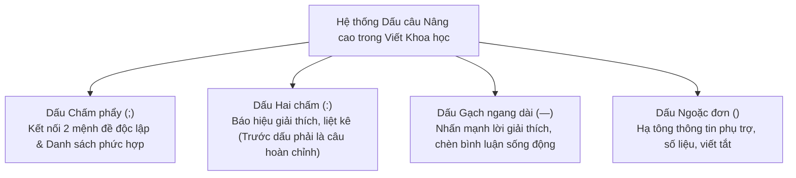

# GIÁO TRÌNH TOÀN DIỆN: WRITING IN THE SCIENCES
## MODULE 3: NGHỆ THUẬT CHẤM CÂU, CẤU TRÚC SONG HÀNH & NÂNG TẦM ĐOẠN VĂN HỌC THUẬT
*(Punctuation and Paragraphs: Building Better Prose)*

---

**Thông tin khóa học & Học phần:**
- **Khóa học:** Writing in the Sciences (Viết khoa học chuẩn quốc tế)
- **Đơn vị phát hành:** Stanford Online — Đại học Stanford (Stanford University)
- **Giảng viên chủ nhiệm:** Dr. Kristin Sainani (Phó Giáo sư Dịch tễ học & Thống kê sinh học, Đại học Stanford)
- **Bản quyền biên soạn tài liệu tiếng Việt:** Dự án Tutor / Trợ lý Học thuật
- **Vị trí lưu trữ bài giảng & Video offline:** `coursera/output_course/writing_science/Module_03_Punctuation_and_Paragraphs_Building_Better_Prose/`

---

## MỤC LỤC TỔNG QUAN

1. [Mục tiêu học tập & Chuẩn đầu ra](#1-mục-tiêu-học-tập--chuẩn-đầu-ra)
2. [Bảng thuật ngữ cốt lõi (Core Terminology Glossary)](#2-bảng-thuật-ngữ-cốt-lõi-core-terminology-glossary)
3. [Phân tích chi tiết từng bài học (Lectures 3.1 — 3.7 & Demo 3)](#3-phân-tích-chi-tiết-từng-bài-học)
   - [3.1. Bài 3.1 & 3.2: Thử nghiệm với Dấu câu & Thực hành gộp câu](#31-bài-31--32-thử-nghiệm-với-dấu-câu--thực-hành-gộp-câu)
   - [3.2. Bài 3.3: Cấu trúc song hành — Bản giao hưởng đối xứng của ngữ pháp](#32-bài-33-cấu-trúc-song-hành--bản-giao-hưởng-đối-xứng-của-ngữ-pháp)
   - [3.3. Bài 3.4: Kiến trúc đoạn văn học thuật (Paragraphs)](#33-bài-34-kiến-trúc-đoạn-văn-học-thuật-paragraphs)
   - [3.4. Bài 3.5 & 3.6: Xưởng biên tập đoạn văn thực chiến (Paragraph Editing I & II)](#34-bài-35--36-xưởng-biên-tập-đoạn-văn-thực-chiến-paragraph-editing-i--ii)
   - [3.5. Bài 3.7: Cẩm nang tạo dòng chảy văn bản mượt mà (A Few More Tips)](#35-bài-37-cẩm-nang-tạo-dòng-chảy-văn-bản-mượt-mà-a-few-more-tips)
   - [3.6. Bài 3.8: Phân tích Demo Edit 3 (Optional) — Mổ xẻ bản thảo bài báo Sinh học phân tử](#36-bài-38-phân-tích-demo-edit-3-optional--mổ-xẻ-bản-thảo-bài-báo-sinh-học-phân-tử)
4. [Bộ đề ôn tập & Đáp án giải thích chi tiết](#4-bộ-đề-ôn-tập--đáp-án-giải-thích-chi-tiết)
   - [Phần A: Unit 3 Homework (11 bài tập chấm điểm)](#phần-a-unit-3-homework-11-bài-tập-chấm-điểm)
   - [Phần B: AI-Graded Assignment — Thực hành viết lại đoạn văn khoa học đỉnh cao](#phần-b-ai-graded-assignment--thực-hành-viết-lại-đoạn-văn-khoa-học-đỉnh-cao)
5. [Cẩm nang Dấu câu chuẩn tắc trong Văn bản Khoa học](#5-cẩm-nang-dấu-câu-chuẩn-tắc-trong-văn-bản-khoa-học)
6. [Checklist kiểm soát chất lượng Đoạn văn (The 7-Step Paragraph Checklist)](#6-checklist-kiểm-soát-chất-lượng-đoạn-văn-the-7-step-paragraph-checklist)
7. [Danh mục Video bài giảng Module 3 đã lưu trữ Offline](#7-danh-mục-video-bài-giảng-module-3-đã-lưu-trữ-offline)

---

# 1. MỤC TIÊU HỌC TẬP & CHUẨN ĐẦU RA

Sau khi hoàn thành Module 3, học viên đạt được năng lực toàn diện:

1. **WHAT — Nâng cấp từ Cấp độ Câu lên Cấp độ Đoạn văn:**
   - Hiểu rõ vai trò của đoạn văn như một **đơn vị cấu tạo tư duy độc lập (Unit of composition)** của bài báo khoa học.
   - Nắm vững công năng cơ học của 4 dấu câu nâng cao: **Dấu chấm phẩy (`;`)**, **Dấu hai chấm (`:`)**, **Dấu gạch ngang dài (`—`)**, và **Dấu ngoặc đơn (`()`)**.
   - Thấu hiểu bản chất của **Cấu trúc song hành (Parallelism)** trong câu ghép và danh sách liệt kê.
2. **WHY — Giải quyết các vấn đề bế tắc trong dòng chảy văn bản:**
   - Hiểu tại sao các đoạn văn khoa học thường bị "loãng", lan man và gây ngạt thở cho người đọc: do thiếu tính thống nhất (*lack of unity*), thiếu câu chủ đề (*topic sentence*), hoặc cố nhồi nhét 3–4 ý tưởng khác nhau vào cùng một khối chữ.
   - Nhận diện căn bệnh "kẹt xe từ nối" (*traffic jam of transition words*): lạm dụng các từ *However, Furthermore, In addition, Therefore* ở đầu mọi câu văn.
   - Thấy được tầm quan trọng của **Khoảng trắng nhận thức (White space)** giúp người đọc tiếp thu thông tin dễ dàng hơn.
3. **HOW — Kỹ thuật cấu trúc hóa đoạn văn bậc thầy:**
   - Áp dụng triệt để **Nguyên lý Dòng chảy Cũ $\rightarrow$ Mới (The Given-New Contract)**: Mở đầu câu bằng thông tin người đọc đã biết, kết thúc câu bằng thông tin mới mẻ hoặc trọng tâm cần nhấn mạnh.
   - Sử dụng kỹ thuật **Dàn ý logic hình thức (Formal Outline)** và **Tóm lược cốt lõi (Quick and Dirty Summary)** để giải phẫu và biên tập các đoạn văn phức tạp.
   - Tạo nhịp điệu âm nhạc cho bài viết (*Music of prose*) thông qua việc phối hợp linh hoạt giữa các câu ngắn đanh thép và các câu ghép đa tầng.
4. **WHEN & LIMITATIONS — Quy tắc bất di bất dịch của dấu câu:**
   - Nắm vững điều kiện tiên quyết khi dùng dấu hai chấm: Mệnh đề trước dấu hai chấm **bắt buộc phải là một mệnh đề độc lập hoàn chỉnh**.
   - Biết khi nào nên dùng dấu gạch ngang `—` để làm nổi bật thông tin, và khi nào nên dùng dấu ngoặc đơn `()` để hạ tông thông tin phụ.
5. **APPLICATION — Thực hành biên tập đoạn văn nghiên cứu:** Tự tin tái cấu trúc toàn diện các đoạn văn nghiên cứu học thuật thực tế trong y học, hóa sinh, dịch tễ học và khoa học môi trường, rút ngắn 40% - 50% số từ mà tính thuyết phục khoa học tăng lên vượt bậc.

---

# 2. BẢNG THUẬT NGỮ CỐT LÕI (CORE TERMINOLOGY GLOSSARY)

| Thuật ngữ gốc (EN) | Thuật ngữ Tiếng Việt chuẩn | Giải thích bản chất học thuật & Cơ chế tác động | Ví dụ minh họa đối chứng (Before & After) |
| :--- | :--- | :--- | :--- |
| **Semicolon (`;`)** | Dấu chấm phẩy | Dấu câu dùng để kết nối hai mệnh đề độc lập hoàn chỉnh có mối liên hệ mật thiết về mặt tư duy logic; hoặc dùng để ngăn cách các phần tử trong một danh sách phức tạp mà bản thân mỗi phần tử đã chứa sẵn dấu phẩy. | *The study had limitations; however, the findings remain clinically valuable.* |
| **Colon (`:`)** | Dấu hai chấm | Dấu câu có chức năng "báo hiệu" cho độc giả: phía sau là một danh sách cụ thể, một định nghĩa, hoặc một lời giải thích trực tiếp. **Quy tắc bắt buộc:** Phần văn bản trước dấu hai chấm phải là một câu hoàn chỉnh về ngữ pháp. | *Evidence-based medicine teaches clinicians three key skills: how to find, assess, and apply data.* |
| **Em-dash (`—`)** | Dấu gạch ngang dài | Dấu câu tạo điểm dừng đột ngột, dùng để chèn một mệnh đề giải thích bên lề (*aside*), giải mã một biệt ngữ phức tạp, hoặc nhấn mạnh một kết luận bất ngờ. Tạo nên năng lượng và nhịp điệu sống động cho câu văn. | *Key retinal neurons—starburst amacrine cells and bipolar ganglion cells—were mapped.* |
| **Parentheses (`()`)** | Dấu ngoặc đơn | Dấu câu dùng để "hạ giọng" (de-emphasize), chứa đựng các thông tin phụ trợ, chữ viết tắt, số liệu trích dẫn hoặc ví dụ minh họa mà nếu bỏ đi thì câu văn vẫn trọn vẹn ý nghĩa. | *We observed a significant decrease in blood pressure (mean reduction: 8.5 mmHg).* |
| **Parallelism** | Cấu trúc song hành / Tính tương đồng ngữ pháp | Nguyên tắc yêu cầu các thành phần có cùng chức năng ngữ pháp trong một cặp hoặc một chuỗi liệt kê phải có cùng cấu trúc hình thức (cùng là danh từ, cùng là V-ing, hoặc cùng là mệnh đề). | ❌ *learning new material and in memory...*<br>✅ **learning new material and remembering recent events.** |
| **Correlative Conjunctions** | Cặp liên từ tương quan | Các cặp liên từ nối đối xứng: *either... or*, *neither... nor*, *not only... but also*, *both... and*. Thành phần đứng ngay sau từ thứ nhất và từ thứ hai bắt buộc phải đồng dạng ngữ pháp. | *We aimed not only to isolate the enzyme but also to characterize its kinetics.* |
| **Paragraph Unity** | Tính thống nhất của đoạn văn | Nguyên tắc vàng: **Mỗi đoạn văn chỉ chuyên chở MỘT ý tưởng cốt lõi duy nhất**. Khi bắt đầu một ý tưởng mới hoặc chuyển hướng tư duy, tác giả bắt buộc phải ngắt đoạn. | Tránh nhồi nhét phương pháp, kết quả và bàn luận vào cùng 1 đoạn văn. |
| **Topic Sentence** | Câu chủ đề | Câu văn mở đầu (hoặc câu thứ 2) của đoạn, đóng vai trò như một "biển báo giao thông" thông báo cho độc giả biết toàn bộ đoạn văn sắp bàn luận về vấn đề gì. | *Several limitations of our sampling strategy must be acknowledged.* |
| **The Given-New Contract (Old-to-New Flow)** | Nguyên lý Dòng chảy thông tin Cũ $\rightarrow$ Mới | Quy tắc sắp xếp thông tin: Câu văn nên mở đầu bằng thông tin mà người đọc ĐÃ BIẾT (thông tin cũ / Given) từ các câu trước, và kết thúc bằng thông tin MỚI (New) mang tính trọng tâm hoặc mở đường cho câu tiếp theo. | Giúp các câu móc nối vào nhau như những mắt xích trơn tru, không bị đứt gãy. |
| **White Space** | Khoảng trắng thị giác | Không gian trống trên trang giấy hoặc màn hình khi văn bản được chia thành các đoạn văn ngắn gọn (3–5 câu). Giúp mắt và não bộ độc giả được nghỉ ngơi, giảm bớt áp lực tâm lý so với các khối chữ đồ sộ. | Chia một đoạn văn dài 1 trang thành 3 đoạn văn ngắn giúp tỷ lệ đọc hết tăng gấp đôi. |
| **Transition Overuse (Traffic Jam)** | Căn bệnh kẹt xe từ nối | Thói quen xấu đặt các phó từ chuyển tiếp (*However, Furthermore, Moreover, Therefore, Thus*) ở đầu tất cả các câu văn liên tiếp, biến đoạn văn thành một bãi lầy gượng gạo. | Loại bỏ các từ nối thừa; để ý nghĩa tự nhiên của câu tự dẫn dắt dòng chảy. |
| **Sentence Length Variety** | Sự biến hóa độ dài câu | Kỹ thuật phối hợp nhịp nhàng giữa các câu ngắn đanh thép (6–10 từ) và các câu phức nhiều mệnh đề, tạo nên "nhịp điệu âm nhạc" lôi cuốn, xua tan sự đơn điệu, nhàm chán. | Đặt một câu ngắn gọn, dứt khoát ngay sau một câu phân tích dài phức tạp. |
| **Quick and Dirty Summary** | Tóm lược cốt lõi thần tốc | Kỹ thuật biên tập: Khi gặp một đoạn văn rối rắm, hãy dịch từng câu sang một câu ngắn gọn, thô mộc nhất để nắm bắt ý chính trước khi viết lại thành bản thảo hoàn chỉnh. | Tước bỏ mọi từ ngữ trang trí để lộ ra bộ xương logic của đoạn văn. |

---

# 3. PHÂN TÍCH CHI TIẾT TỪNG BÀI HỌC

## 3.1. Bài 3.1 & 3.2: Thử nghiệm với Dấu câu & Thực hành gộp câu
*(Lectures 3.1 & 3.2: Experiment with Punctuation & Practice)*

Nhiều nhà khoa học bị ám ảnh bởi định kiến rằng văn bản học thuật chỉ được phép dùng dấu chấm (`.`) và dấu phẩy (`,`), còn các dấu như dấu hai chấm, dấu gạch ngang hay chấm phẩy là "phi trang trọng" (*too informal*). 

Dr. Kristin Sainani khẳng định: **Đây là quan niệm hoàn toàn sai lầm!** Các nhà văn chuyên nghiệp trên các tạp chí khoa học uy tín nhất (*Nature, Science, New England Journal of Medicine*) sử dụng các dấu câu này liên tục để đa dạng hóa cấu trúc câu, tạo nhịp điệu và làm nổi bật các mối quan hệ logic.



### A. Dấu chấm phẩy (The Semicolon `;`)
Dấu chấm phẩy mạnh hơn dấu phẩy nhưng nhẹ hơn dấu chấm. Nó có 2 ứng dụng cốt tử:
1. **Kết nối 2 mệnh đề độc lập có quan hệ mật thiết:** Thay vì tách làm hai câu cộc lốc hoặc nối bằng từ *and* nhàm chán, dấu chấm phẩy giữ người đọc ở lại trong cùng một không gian tư duy:  
   *Ví dụ:* *"The first trial failed to demonstrate efficacy; the second trial yielded clear clinical benefits."*
2. **Đi cùng với các phó từ liên kết (Conjunctive adverbs):** Khi dùng các từ như *however, therefore, nonetheless, consequently, moreover*, cấu trúc chuẩn mực phải là:  
   `Mệnh đề độc lập 1; however, Mệnh đề độc lập 2.`  
   *Ví dụ:* *"The animal numbers were small; nonetheless, the statistical signal was robust."*
3. **Phân tách danh sách phức hợp (Complex List):** Khi các phần tử trong danh sách liệt kê đã có chứa dấu phẩy bên trong, ta bắt buộc phải dùng dấu chấm phẩy để ngăn cách giữa các phần tử lớn:  
   *Ví dụ:* *"We collaborated with researchers from Stanford, CA; Boston, MA; and Zurich, Switzerland."*

### B. Dấu hai chấm (The Colon `:`)
Dấu hai chấm có chức năng như một mũi tên chỉ đường: *"Dừng lại một chút, đây là nội dung chi tiết bạn đang tìm kiếm"*.

> [!CAUTION]
> **QUY TẮC SỐNG CÒN CỦA DẤU HAI CHẤM:**  
> Mệnh đề đứng TRƯỚC dấu hai chấm **BẮT BUỘC PHẢI LÀ MỘT MỆNH ĐỀ ĐỘC LẬP HOÀN CHỈNH (Complete Independent Clause)**. Tuyệt đối không đặt dấu hai chấm ngay sau một động từ hoặc một giới từ!
> - ❌ **SAI NẶNG:** *"The primary symptoms include: fever, fatigue, and muscle pain."* (Trước dấu hai chấm là mệnh đề khuyết thiếu tân ngữ).
> - ✅ **ĐÚNG:** *"The primary symptoms include the following: fever, fatigue, and muscle pain."*
> - ✅ **ĐÚNG & ĐẸP:** *"Patients presented with three primary symptoms: fever, fatigue, and muscle pain."*

### C. Dấu gạch ngang dài (The Em-dash `—`)
Dấu gạch ngang dài (không có khoảng trắng ở hai đầu trong văn phong Mỹ) là công cụ tuyệt vời nhất để thêm sinh khí vào bài viết.
- **Tác dụng:** Chèn một mệnh đề giải thích, làm sáng tỏ một thuật ngữ khó, hoặc nhấn mạnh một kết luận bất ngờ.
- **So sánh Em-dash vs. Dấu ngoặc đơn:**
  - *Dấu gạch ngang `—`:* **Phóng to, nhấn mạnh** thông tin (như thể tác giả nói to hơn để người đọc chú ý).
  - *Dấu ngoặc đơn `()`:* **Thu nhỏ, hạ giọng** thông tin (như một lời thì thầm bên lề, chứa thông tin tham khảo phụ).

### D. Thực hành gộp câu trong Bài 3.2 (Mổ xẻ 2 ca kinh điển)
1. **Ca 1 — Gộp câu bằng Dấu hai chấm (`:`):**
   - *Câu gốc (Rườm rà, lặp từ):* *"Evidence-based medicine teaches clinicians the practical application of clinical epidemiology, as needed to address specific problems of specific patients. It guides clinicians on how to find the best evidence relevant to a specific problem, how to assess the quality of that evidence, and perhaps most difficult, how to decide if the evidence applies to a specific patient."* (55 từ)
   - *Phân tích:* `teaches clinicians` và `it guides clinicians` lặp từ; cụm `how to find, how to assess, how to decide` là một danh sách liệt kê 3 bước.
   - *Bản sửa đổi xuất sắc của Dr. Sainani:*  
     $\rightarrow$ **"Evidence-based medicine teaches clinicians how to find, assess, and apply the best clinical evidence."** (15 từ — Cắt giảm hơn 70% độ dài, truyền tải thông điệp sắc như dao cạo!).
2. **Ca 2 — Gộp câu bằng Dấu gạch ngang (`—`):**
   - *Câu gốc:* *"Finally, the lessons of clinical epidemiology are not meant to be limited to academic physician-epidemiologists, who sometimes have more interest in analyzing data than caring for patients. Clinical epidemiology holds the promise of providing clinicians with the tools necessary to improve the outcomes of their patients."* (46 từ)
   - *Phân tích:* Mệnh đề quan hệ `who sometimes have...` có thể được kẹp giữa hai dấu gạch ngang; bỏ cụm từ dài dòng `holds the promise of providing` $\rightarrow$ `provides`.
   - *Bản sửa đổi:*  
     $\rightarrow$ **"Finally, clinical epidemiology is not limited to academic physician-epidemiologists—who are sometimes more interested in analyzing data than caring for patients—but provides clinicians with the tools to improve patient outcomes."** (32 từ).

---

## 3.2. Bài 3.3: Cấu trúc song hành — Bản giao hưởng đối xứng của ngữ pháp
*(Lecture 3.3: Parallelism)*

Bộ não con người là một cỗ máy nhận diện quy luật cực kỳ nhạy bén. Khi đọc một câu văn có tính đối xứng ngữ pháp, não bộ sẽ hấp thu thông tin một cách êm ái và ghi nhớ lâu hơn gấp nhiều lần.

### A. Quy tắc Song hành căn bản
Bất kỳ khi nào các ý tưởng được liên kết bằng các liên từ kết hợp (*and, but, or*), chúng phải tuân theo cùng một hình thái ngữ pháp:
- **Chủ - Vị song hành với Chủ - Vị:**  
  *"The velocity decreased by 50%, but the pressure dropped by only 10%."* (Cả hai vế đều là: Danh từ + Động từ quá khứ đơn).
- **Cụm nguyên mẫu (Infinitive) song hành:**  
  *"We aimed to increase the resolution and to improve image quality."* (Cả hai đều là: *to + verb*).

### B. Bẫy phá vỡ tính song hành trong danh sách (The Non-parallel Trap)
Hãy quan sát ví dụ kinh điển được Strunk & White phân tích trong *The Elements of Style*:
- ❌ **Không song hành (Rối rắm):**  
  *"Locusts denuded fields in Utah, rural Iowa was washed away by torrents, and in Arizona the cotton suffered from insects."*  
  *(Vế 1: Chủ động [Locusts denuded]. Vế 2: Bị động [Iowa was washed away]. Vế 3: Giới từ đứng đầu [In Arizona the cotton suffered]).*
- ✅ **Song hành hoàn hảo (Hùng tráng, uy lực):**  
  *"Locusts denuded fields in Utah, torrents washed away rural Iowa, and insects destroyed Arizona's cotton."*  
  *(Cả 3 vế đều tuân theo đúng công thức nhịp nhàng: Thiên tai/Sâu bọ [Chủ ngữ] + Tàn phá [Động từ chủ động] + Địa danh/Hoa màu [Tân ngữ]).*

### C. Song hành trong các cặp liên từ tương quan (Correlative Conjunctions)
Quy tắc: **Thành phần đứng sau từ thứ nhất phải tương đương tuyệt đối với thành phần đứng sau từ thứ hai!**
- ❌ **Sai:** *"The drug either was administered orally or by injection."* (*either* đi với động từ *was administered*, nhưng *or* lại đi với cụm giới từ *by injection*).
- ✅ **Đúng:** *"The drug was administered **either** orally **or** by injection."* (Cả 2 vế đều là trạng từ: *orally* và *by injection*).
- ❌ **Sai:** *"We were interested not only in testing the drug, but also we wanted to assess safety."*
- ✅ **Đúng:** *"We were interested **not only** in testing the drug, **but also** in assessing its safety."*

---

## 3.3. Bài 3.4: Kiến trúc đoạn văn học thuật (Paragraphs)
*(Lecture 3.4: Paragraphs)*

Đoạn văn là **đơn vị kiến trúc của tư duy**. Nếu câu văn là những viên gạch thì đoạn văn chính là từng bức tường tạo nên ngôi nhà bài báo khoa học.

### 1. Nguyên tắc "Một Đoạn = Một Ý" (The One-Idea Rule)
Sai lầm phổ biến nhất của các nhà khoa học là cố nhét quá nhiều phát hiện vào cùng một đoạn văn. Hậu quả là đoạn văn bị trôi dạt (*meandering*), người đọc lạc lối và không rút ra được thông điệp chính.
- Khi chuyển sang một khía cạnh mới, một thí nghiệm mới, hoặc một phân tích đối chiếu mới: **HÃY XUỐNG DÒNG VÀ MỞ ĐOẠN MỚI!**

### 2. Sức mạnh của Câu chủ đề (Topic Sentence)
Câu đầu tiên (hoặc câu thứ hai) của đoạn văn phải đóng vai trò là "ngọn hải đăng":
- Nêu bật ngay nội dung và góc nhìn của toàn đoạn.
- Giúp người đọc lướt qua bài báo mà vẫn nắm trọn vẹn mạch lập luận logic.

### 3. Nguyên lý Dòng chảy Cũ $\rightarrow$ Mới (The Given-New Contract)
Đây là bí quyết quan trọng nhất để tạo nên sự mạch lạc trơn tru giữa các câu văn trong đoạn:

```
[Câu 1]: ... [Thông tin MỚI A]
             ↘ (liên kết)
[Câu 2]: [Thông tin CŨ A (Given)] ... [Thông tin MỚI B]
                                         ↘ (liên kết)
[Câu 3]:                     [Thông tin CŨ B (Given)] ... [Thông tin MỚI C]
```

- **Đầu câu (Given):** Nhắc lại một từ khóa hoặc khái niệm đã xuất hiện ở câu trước để tạo điểm tựa tâm lý quen thuộc cho độc giả.
- **Cuối câu (New):** Đưa ra thông tin mới, kết quả đột phá, hoặc biến số mới. Vị trí cuối câu là nơi có trọng âm nhận thức mạnh nhất, giúp thông tin mới in sâu vào tâm trí người đọc.

### 4. Độ dài đoạn văn & Khoảng trắng nhận thức (White Space)
- Một khối văn bản dày đặc kéo dài trọn vẹn cả trang A4 không có điểm ngắt đoạn là cơn ác mộng đối với mọi độc giả và người bình duyệt (*peer reviewers*).
- **Tiêu chuẩn vàng:** Một đoạn văn khoa học lý tưởng chỉ nên dài từ **3 đến 6 câu** (khoảng 75 đến 200 từ). Những khoảng trắng giữa các đoạn văn giúp não bộ người đọc xử lý thông tin và nạp lại năng lượng chú ý.

---

## 3.4. Bài 3.5 & 3.6: Xưởng biên tập đoạn văn thực chiến (Paragraph Editing I & II)
*(Lectures 3.5 & 3.6: Paragraph Editing I & II)*

Trong hai bài học này, Dr. Sainani trực tiếp mổ xẻ và chữa 4 đoạn văn thực tế từ y văn thế giới bằng hai phương pháp luận xuất sắc:

### Phương pháp 1: Dàn ý logic hình thức (Formal Outline Method) — Bài 3.5
- **Đoạn văn nghiên cứu:** Thí nghiệm đánh giá sự tương quan giữa gen di truyền và sở thích mùi hương nước hoa. Tác giả viết một đoạn văn biện minh trong phần Giới hạn nghiên cứu (*Limitations*) về lý do tại sao họ phải lựa chọn nồng độ mùi hương nhất định trong phòng thí nghiệm.
- **Cách tiếp cận:**
  1. Tách đoạn văn thành các mệnh đề logic: (A) Giới hạn của nồng độ thí nghiệm $\rightarrow$ (B) Nồng độ quá cao gây khó chịu cho người ngửi $\rightarrow$ (C) Nồng độ quá thấp thì không phát hiện được $\rightarrow$ (D) Kết luận: Nhóm tác giả đã chuẩn hóa nồng độ tối ưu để đo lường.
  2. Xóa sạch mọi câu văn rào đón, kể lể rườm rà ngoài lề.
  3. Ghép các luận điểm thành một đoạn văn 4 câu chặt chẽ, mạch lạc.

---

### Phương pháp 2: Tóm lược cốt lõi thần tốc (Quick and Dirty Summary) — Bài 3.6
- **Đoạn văn nghiên cứu (Sô-cô-la và Bệnh tiểu đường):**
  > **Nguyên bản (Rối rắm, lan man, lặp từ, kẹt xe từ nối):**  
  > *"The concept of chocolate having potential therapeutic benefits for people with diabetes, especially type 2 diabetes presents a number of intellectual challenges from both clinical and sociological perspectives. Many clinicians believe that chocolate is inherently bad for diabetics... However, recent studies suggest that flavanols in dark chocolate may improve insulin sensitivity... However, chocolate also contains high levels of sugar and saturated fat... Furthermore, patients might misinterpret these findings as a license to overconsume candy..."*

**Các bước phẫu thuật của Dr. Sainani:**
1. **Bước 1 — Quick & Dirty Summary (Tóm tắt nghĩa đen của từng câu):**
   - *Câu 1:* Ý tưởng sô-cô-la chữa tiểu đường nghe rất kỳ lạ.
   - *Câu 2:* Bác sĩ lo ngại vì sô-cô-la ngọt và béo.
   - *Câu 3:* Nhưng chất flavanol trong sô-cô-la đen thực sự cải thiện độ nhạy insulin.
   - *Câu 4:* Nguy cơ bệnh nhân ăn quá nhiều sô-cô-la thông thường.
2. **Bước 2 — Quét sạch "bãi lầy từ nối":**
   - Câu gốc dùng liên tiếp hai chữ `However` và một chữ `Furthermore` ở các câu liền kề nhau. Đây là biểu hiện của sự lười biếng trong việc sắp xếp cấu trúc logic.
3. **Bước 3 — Viết lại thành đoạn văn tinh hoa:**
   > *"Although chocolate is traditionally viewed as detrimental for diabetics due to its high sugar and fat content, recent research reveals that flavanols in dark chocolate can improve insulin sensitivity. Clinicians, however, face a dual challenge: translating these biochemical benefits into practice while preventing patients from mistaking dark chocolate research as an endorsement for consuming high-calorie confections."*  
   > *(Đoạn văn sau sửa đổi trở nên sắc sảo, cấu trúc đối lập tinh tế, mạch văn liền một dải).*

---

## 3.5. Bài 3.7: Cẩm nang tạo dòng chảy văn bản mượt mà (A Few More Tips)
*(Lecture 3.7: A Few More Tips)*

Dr. Sainani đúc kết 3 kỹ năng tinh tế để biến văn phong học thuật từ "đúng ngữ pháp" thành "văn phong bậc thầy":

### 1. Sự biến hóa độ dài câu (Sentence Length Variety — Nhịp điệu văn xuôi)
Hãy đọc đoạn trích nổi tiếng của nhà văn Gary Provost về nhịp điệu ngôn từ:
> *"Câu này có năm chữ. Câu này cũng năm chữ. Viết thế này ổn đấy. Nhưng đọc mãi phát chán. Hãy lắng nghe xem nhé. Nhịp điệu cứ đều đều. Nghe như tiếng máy móc. Nó chẳng có cảm xúc. Không có chút năng lượng. Âm thanh nghe đơn điệu.  
> Bây giờ hãy nghe đây. Tôi thay đổi độ dài của câu văn, và tôi tạo ra âm nhạc. Âm nhạc. Câu văn ngân nga. Nó có nhịp điệu du dương, có sự luyến láy, có sự hòa âm. Tôi sử dụng những câu văn ngắn. Và tôi sử dụng cả những câu văn có độ dài trung bình. Và đôi khi, khi tôi nhận thấy người đọc đã hoàn toàn thư thái và sẵn sàng, tôi sẽ lôi cuốn họ vào một câu văn dài đầy đặn, một câu văn cuồn cuộn năng lượng và ngân vang với tất cả sự hùng tráng của một bản giao hưởng!"*

Trong bài báo khoa học, hãy áp dụng nguyên tắc này: **Sau 1 hoặc 2 câu ghép dài phân tích số liệu phức tạp, hãy chốt hạ bằng một câu ngắn gọn (6–8 từ) đanh thép!** Câu ngắn đó sẽ đóng vai trò như một nhát búa đóng đinh thông điệp vào tâm trí người đọc.

### 2. Tránh bẫy mở đầu câu đơn điệu (Subject + Verb Monotony)
Đừng bắt đầu 10 câu liên tiếp bằng đúng một công thức: `The authors found... We observed... The mice exhibited... The data indicate...`.  
Hãy thỉnh thoảng mở đầu câu bằng:
- Một trạng ngữ chỉ thời gian hoặc điều kiện: *"Under hypoxic conditions,..."*
- Một phân từ hiện tại: *"Using high-resolution microscopy, we observed..."*
- Một mệnh đề nhượng bộ: *"Although initial yields were modest,..."*

---

## 3.6. Bài 3.8: Phân tích Demo Edit 3 (Optional) — Mổ xẻ bản thảo bài báo Sinh học phân tử
*(Lecture 3.8: Demo Edit 3 — Live Editing Session with Dr. Kristin Sainani)*

Trong buổi biên tập trực tiếp kéo dài 24 phút này, Dr. Sainani hướng dẫn biên tập một bài báo kỹ thuật cao về **"Điều khiển hành vi tế bào bằng ánh sáng" (Optogenetic control of cell signaling)**.

### Những bài học biên tập đắt giá:
1. **Chiến lược "Giải mã biệt ngữ" (De-jargonizing):** Tác giả đưa vào rất nhiều thuật ngữ phân tử (*phytochromes, chromophores, interacting factors*). Dr. Sainani chỉ ra rằng người viết giỏi không phải là người giấu nhẹm thuật ngữ, mà là người **định nghĩa ngay thuật ngữ đó bằng một mệnh đề ngắn gọn đi kèm** ngay trong lần đầu tiên xuất hiện.
2. **Kỹ thuật kết nối liên đoạn (Inter-paragraph transitions):** Làm sao để đoạn 2 bắt nhịp tự nhiên với đoạn 1? Thay vì dùng từ nối cơ học *Moreover*, Dr. Sainani lấy ý kết thúc của đoạn 1 làm chủ ngữ xuất phát điểm cho câu mở đầu của đoạn 2.
3. **Cắt gọt câu chữ vi mô:** Loại bỏ triệt để các cấu trúc lặp từ không đáng có và thay thế các động từ bị động bằng thể chủ động.

---

# 4. BỘ ĐỀ ÔN TẬP & ĐÁP ÁN GIẢI THÍCH CHI TIẾT

## PHẦN A: UNIT 3 HOMEWORK (11 BÀI TẬP CHẤM ĐIỂM)

### Câu 1:
**Đề bài:** Lựa chọn phương án đánh dấu câu tốt nhất cho câu ghép biểu đạt mối quan hệ nhân quả/giải thích:  
- **Đáp án chuẩn:** Dùng **Dấu hai chấm (:)** nếu vế sau giải thích chi tiết cho vế trước (với điều kiện vế trước là câu hoàn chỉnh), hoặc dùng **Dấu chấm phẩy (;)** khi nối hai mệnh đề độc lập song song.

### Câu 2:
**Đề bài:** Lựa chọn phương án đánh dấu câu tốt nhất cho câu chứa liên từ tương quan (*not only... but also*):  
- **Đáp án chuẩn:** Không đặt dấu phẩy giữa hai vế nếu chúng bổ nghĩa trực tiếp cho cùng một động từ/danh từ; chỉ đặt dấu phẩy khi nối hai mệnh đề độc lập hoàn chỉnh có chủ ngữ riêng.

### Câu 3:
**Đề bài:** Đọc câu sau: *"This light detection changes the Phytochrome's conformation between a state under red light that binds directly to a phytochrome interacting factor (PIF) and a state under infrared light that doesn't bind to PIF."* Câu này mắc phải tất cả các lỗi sau ĐÂY, NGOẠI TRỪ lỗi nào?  
- **Đáp án chuẩn:** **Câu KHÔNG mắc lỗi thiếu động từ chính (It does NOT lack a main verb).**  
- **Phân tích:** Câu có động từ chính rõ ràng là `changes`. Nhưng câu lại mắc phải các lỗi nghiêm trọng khác: (1) Cấu trúc câu quá dài và rối rắm, (2) Lặp từ lê thê (*state under... that binds... state under... that doesn't bind*), (3) Khoảng cách giữa các thành phần biến đổi quá xa.

### Câu 4:
**Đề bài:** Xác định MỘT lỗi cốt tử trong câu sau:  
*"The concern expressed by the reviewers that the study had insufficient statistical power to find clinically meaningful effects lacks merit."* (20 từ)  
- **Đáp án chuẩn:** **Khoảng cách giữa Chủ ngữ và Động từ chính quá xa (Subject-verb separation / Too great a distance between subject and predicate).**  
- **Phân tích:** Chủ ngữ là `The concern` (từ thứ 2), nhưng phải qua một mệnh đề phụ dài dặc 16 từ thì động từ chính `lacks merit` mới xuất hiện ở từ thứ 19–20!  
- **Bản sửa đổi chuẩn xác:**  
  $\rightarrow$ *"The reviewers questioned the study's statistical power, but this concern lacks merit."* *(Hoặc: `The study had sufficient statistical power, contrary to the reviewers' concerns.`)*

### Câu 5:
**Đề bài:** Xác định lỗi chính trong câu sau:  
*"The initial symptoms of Alzheimer's disease are difficulties learning new material and in memory for recent events."*  
- **Đáp án chuẩn:** **Lỗi mất cấu trúc song hành (Faulty parallelism).**  
- **Phân tích:** Vế thứ nhất dùng cụm V-ing `difficulties learning new material`, nhưng vế thứ hai lại bẻ lái sang cụm giới từ `and in memory for recent events`.  
- **Bản sửa đổi chuẩn xác:**  
  $\rightarrow$ *"The initial symptoms of Alzheimer's disease are difficulties in **learning** new material and in **remembering** recent events."*

### Câu 6:
**Đề bài:** Xác định một chỉnh sửa giúp nâng tầm câu sau:  
*"Our study offers confirmation of the link between breast cancer and moderate alcohol consumption."*  
- **Đáp án chuẩn:** **Khôi phục động từ từ danh từ hóa: đổi "offers confirmation of" thành động từ hành động đơn "confirms".**  
- **Bản sửa đổi:**  
  $\rightarrow$ *"Our study **confirms** the link between breast cancer and moderate alcohol consumption."*

### Câu 7:
**Đề bài:** Chỉnh sửa nào sau đây sẽ cải thiện tốt nhất câu:  
*"The mutant fungal cells showed profuse proliferation throughout the plant, whereas the infected plants showed poor growth and often died."*  
- **Đáp án chuẩn:** **Chuyển các cụm danh từ hóa "showed profuse proliferation" và "showed poor growth" thành các động từ hành động song hành: "proliferated profusely" và "grew poorly".**  
- **Bản sửa đổi:**  
  $\rightarrow$ *"The mutant fungal cells **proliferated profusely** throughout the plant, whereas the infected plants **grew poorly** and often died."*

### Câu 8:
**Đề bài:** Tóm tắt ý tưởng cốt lõi của đoạn văn sau trong ĐÚNG MỘT CÂU DUY NHẤT:  
*"Neuropeptides are important mediators in the functionality of the brain and other neurological organs. Because neuropeptides exist in a wide range of concentrations, appropriate characterization methods are needed to provide dynamic, chemical, and spatial information. Mass spectrometry and compatible tools have been a popular choice in analyzing neuropeptides. There have been several advances and challenges, both of which are the focus of this review. Discussions range from sample collection to bioinformatic tools, although avenues such as quantitation and imaging are included. Further development of the presented methods for neuropeptidomic mass spectrometric analysis is inevitable, which will lead to a further understanding of the complex interplay of neuropeptides and other signaling molecules in the nervous system."*  
- **Đáp án chuẩn:**  
  `This review discusses recent advances and challenges in mass spectrometry methods for analyzing neuropeptides.`  
- **Phân tích:** Đoạn văn trên lan man qua nhiều khía cạnh, nhưng "trái tim" của đoạn văn nằm ở câu thứ 4: Đây là một bài tổng quan (*review*) tập trung vào những tiến bộ và thách thức của phương pháp khối phổ (*mass spectrometry*) dùng để định danh neuropeptide.

### Câu 9:
**Đề bài:** Viết lại đoạn văn sau thành **MỘT CÂU DUY NHẤT**, loại bỏ sự lặp từ và sửa lỗi cấu trúc song hành:  
*"Several limitations should be noted. Major limitations are the incomplete sample participation in young adulthood, possible unmeasured underlying susceptibility factors, (e.g., familial influences), and some researchers might question the reliability of the TD instrument for measuring drug dependence."* (39 từ)  
- **Đáp án chuẩn:**  
  `Major limitations include incomplete sample participation in young adulthood, potential unmeasured susceptibility factors such as familial influences, and questionable reliability of the TD instrument.` (24 từ!)  
- **Phân tích:**  
  - Gộp 2 câu lặp từ (*Several limitations should be noted. Major limitations are...*) thành 1 câu mở đầu bằng `Major limitations include...`.  
  - Sửa lỗi song hành: 2 phần tử đầu là cụm danh từ (*incomplete sample participation*, *potential susceptibility factors*), nhưng phần tử thứ ba lại là một mệnh đề hoàn chỉnh (*some researchers might question...*). Đưa phần tử thứ ba về cụm danh từ tương ứng: `questionable reliability of the TD instrument`.

### Câu 10:
**Đề bài:** Chỉnh sửa đoạn văn sau để hoàn thiện cấu trúc song hành, nâng cao độ sáng rõ và súc tích:  
*"Waste stabilization ponds have been studied under many different climatic conditions on all six inhabited continents. The main findings have concluded that ponds: (1) have higher removal efficiencies in warm, sunny climates, (2) should be situated far enough from human populations to prevent unnecessary human health risks and nuisance conditions, and (3) located in areas with high winds may require baffles or wind breaks to ensure optimal performance."* (70 từ)  
- **Đáp án chuẩn:**  
  `Global studies of waste stabilization ponds show that they: (1) operate more efficiently in warm, sunny climates, (2) require buffer zones from human populations to minimize health risks, and (3) need baffles or windbreaks in high-wind areas.` (37 từ!)  
- **Phân tích:**  
  - Câu gốc liệt kê 3 mục nhưng ngữ pháp cọc cạch: Mục (1) dùng động từ `have higher removal efficiencies`, mục (2) dùng trợ động từ `should be situated`, mục (3) lại dùng cụm phân từ `located in areas... may require`.  
  - Chuẩn hóa song hành: Cả 3 mục đều bắt đầu bằng động từ hành động chủ động: `(1) operate...`, `(2) require...`, `(3) need...`. Rút ngắn gần 50% số từ.

### Câu 11:
**Đề bài:** Chỉnh sửa đoạn văn sau cho súc tích và rõ ràng:  
*"Prior to calculating suicide rates that are stratified by church membership and activity level, records from the state and from the church needed to be linked. However, state death records and church records do not share a common unique identifier. In order to link records from these two sources, we used the probabilistic linking program LinkedPro7 (17). This program calculates probabilities to determine whether a pair of records refers to the same person."* (70 từ)  
- **Đáp án chuẩn:**  
  `To calculate suicide rates stratified by church membership and activity level, we linked state death records with church records. Because these data sources lack a common unique identifier, we used LinkedPro7 (17), a probabilistic program that determines whether paired records belong to the same individual.` (44 từ!)  
- **Phân tích:**  
  - `Prior to calculating` $\rightarrow$ `To calculate`.  
  - Bỏ bị động `records needed to be linked` $\rightarrow$ đưa chủ ngữ chủ động `we linked state death records with church records`.  
  - Gộp hai câu giải thích phần mềm thành một mệnh đề quan hệ súc tích: `we used LinkedPro7 (17), a probabilistic program that determines...`.

---

## PHẦN B: AI-GRADED ASSIGNMENT — THỰC HÀNH VIẾT LẠI ĐOẠN VĂN KHOA HỌC ĐỈNH CAO

### Đề bài nguyên bản:
> *"As for many food components, the intake of metal ions can be a double edged sword. The requirement for ingestion of trace metals such as Fe and Cu ions to maintain normal body functions such as the synthesis of metalloproteins is well established. However, cases of excess intake of trace metal ions are linked to pathological events such as the deposition of iron oxides in Parkinson's disease [1]. In addition to aiding neurological deposits, these redox active metals ions have been credited with enhancing oxidative damage, a key component of chronic inflammatory disease [2] and a suggested initiator of cancer [3]. As inflammation is a characteristic feature of a wide range of diseases, further potential pathological roles for metal ions are emerging as exemplified by premature aging [4]."* (124 từ)

### Bản sửa đổi mẫu đạt điểm tối đa (5/5 Points):
> **"Like many dietary components, trace metal ions present a double-edged sword: while essential in small amounts for vital functions such as metalloprotein synthesis, excess levels cause serious toxicity. Excessive iron and copper ions promote pathological deposits in Parkinson’s disease [1] and trigger redox-mediated oxidative damage—a critical driver of chronic inflammation [2] and cancer initiation [3]. Because persistent inflammation underlies numerous disorders, metal-induced toxicity may also accelerate conditions such as premature aging [4]."** (74 từ — Giảm 40% số từ, dòng chảy logic mạch lạc hoàn hảo).

### Bản giải trình 4 câu chuẩn mực (Explanation of Revisions — 5/5 Points):
1. *"I established a clear thematic framework in the opening sentence by using a colon to directly juxtapose the essential benefits of trace metals with their toxicity at high doses."*
2. *"I converted passive, cluttered phrases (e.g., 'have been credited with enhancing') into concise, active verbs ('promote', 'trigger', 'accelerate')."*
3. *"I eliminated redundant filler words and streamlined the connection between oxidative damage, chronic inflammation, and downstream pathologies using an em-dash."*
4. *"All original scientific details, metal examples (Fe, Cu), and numerical citations [1–4] were meticulously preserved while improving overall flow and readability."*

---

# 5. CẨM NANG DẤU CÂU CHUẨN TẮC TRONG VĂN BẢN KHOA HỌC

| Dấu câu | Công năng chuẩn tắc trong bài báo quốc tế | Lỗi sai cấm kỵ | Ví dụ chuẩn mực |
| :---: | :--- | :--- | :--- |
| **`;`**<br>Chấm phẩy | Nối 2 mệnh đề độc lập có liên hệ ý nghĩa chặt chẽ; ngăn cách danh sách phức hợp có dấu phẩy con. | Dùng nối giữa một mệnh đề độc lập và một mệnh đề phụ thuộc (fragmente). | *The initial assay proved inconclusive; however, subsequent testing confirmed the diagnosis.* |
| **`:`**<br>Hai chấm | Báo hiệu danh sách, định nghĩa, hoặc giải thích chi tiết phía sau. | Đặt dấu hai chấm ngay sau động từ hoặc giới từ (khi vế trước chưa trọn vẹn câu). | *The analysis revealed three distinct clusters: early-stage responders, non-responders, and relapsed patients.* |
| **`—`**<br>Gạch ngang | Nhấn mạnh chi tiết phụ, giải thích thuật ngữ, tạo điểm ngắt nhịp điệu sinh động. | Lạm dụng quá 2 cặp gạch ngang trong cùng một đoạn văn gây rối mắt. | *A single mutation—substituting valine for glutamate—distorts the hemoglobin molecule.* |
| **`()`**<br>Ngoặc đơn | Chứa đựng chữ viết tắt, giá trị p-value, độ lệch chuẩn, trích dẫn tài liệu. | Nhét toàn bộ ý tưởng lập luận quan trọng vào trong ngoặc đơn. | *Tumor volume decreased significantly in the treatment group (mean: 42%, p < 0.01).* |

---

# 6. CHECKLIST KIỂM SOÁT CHẤT LƯỢNG ĐOẠN VĂN (THE 7-STEP PARAGRAPH CHECKLIST)

Trước khi chuyển giao bản thảo, hãy kiểm tra từng đoạn văn theo 7 câu hỏi then chốt:

- [ ] **1. Quy tắc Một ý (One-Idea Rule):** Đoạn văn này có chuyên chở duy nhất một thông điệp chính không? Có bị "nhảy cóc" sang chủ đề khác giữa chừng không?
- [ ] **2. Câu chủ đề (Topic Sentence):** Độc giả có thể hiểu nội dung chính của cả đoạn chỉ bằng cách đọc câu đầu tiên (hoặc câu thứ hai) không?
- [ ] **3. Dòng chảy Cũ $\rightarrow$ Mới (Given-New Flow):** Các câu văn có mở đầu bằng thông tin đã biết và kết thúc bằng thông tin mới mẻ không?
- [ ] **4. Quét sạch kẹt xe từ nối:** Đoạn văn có bị lặp các từ *However, Furthermore, Therefore* ở đầu các câu liên tiếp không?
- [ ] **5. Kiểm tra tính song hành (Parallelism):** Các cặp liên từ (*either/or, not only/but also*) và danh sách liệt kê đã đồng nhất về mặt ngữ pháp chưa?
- [ ] **6. Chuẩn tắc dấu câu:** Dấu hai chấm `:` có được đặt sau một câu hoàn chỉnh không? Dấu gạch ngang `—` có được sử dụng hợp lý để tạo điểm nhấn không?
- [ ] **7. Độ dài & Khoảng trắng:** Đoạn văn có nằm trong khoảng 3–6 câu lý tưởng không? Có cần tách đôi một đoạn văn quá dài không?

---

# 7. DANH MỤC VIDEO BÀI GIẢNG MODULE 3 ĐÃ LƯU TRỮ OFFLINE

Toàn bộ 8 video bài giảng của Module 3 đã được tải về nguyên vẹn, tuần tự với chất lượng cao (540p MP4) và lưu trữ cục bộ trong thư mục:  
📁 `coursera/output_course/writing_science/Module_03_Punctuation_and_Paragraphs_Building_Better_Prose/videos/`

| Bài học | Tên Video File | Dung lượng | Thời lượng bài | Liên kết xem Offline (Local MP4) |
| :---: | :--- | :---: | :---: | :--- |
| **3.1** | `09_3.1_Experiment_with_punctuation.mp4` | 37.53 MB | 28 phút | [Xem Video 3.1 Cục bộ](file:///home/khanh/projects/tutor/coursera/output_course/writing_science/Module_03_Punctuation_and_Paragraphs_Building_Better_Prose/videos/09_3.1_Experiment_with_punctuation.mp4) |
| **3.2** | `10_3.2_Practice_colon_and_dash.mp4` | 8.80 MB | 6 phút | [Xem Video 3.2 Cục bộ](file:///home/khanh/projects/tutor/coursera/output_course/writing_science/Module_03_Punctuation_and_Paragraphs_Building_Better_Prose/videos/10_3.2_Practice_colon_and_dash.mp4) |
| **3.3** | `11_3.3_Parallelism.mp4` | 7.46 MB | 5 phút | [Xem Video 3.3 Cục bộ](file:///home/khanh/projects/tutor/coursera/output_course/writing_science/Module_03_Punctuation_and_Paragraphs_Building_Better_Prose/videos/11_3.3_Parallelism.mp4) |
| **3.4** | `12_3.4_Paragraphs.mp4` | 11.53 MB | 9 phút | [Xem Video 3.4 Cục bộ](file:///home/khanh/projects/tutor/coursera/output_course/writing_science/Module_03_Punctuation_and_Paragraphs_Building_Better_Prose/videos/12_3.4_Paragraphs.mp4) |
| **3.5** | `13_3.5_Paragraph_Editing_I.mp4` | 18.72 MB | 13 phút | [Xem Video 3.5 Cục bộ](file:///home/khanh/projects/tutor/coursera/output_course/writing_science/Module_03_Punctuation_and_Paragraphs_Building_Better_Prose/videos/13_3.5_Paragraph_Editing_I.mp4) |
| **3.6** | `14_3.6_Paragraph_Editing_II.mp4` | 14.72 MB | 11 phút | [Xem Video 3.6 Cục bộ](file:///home/khanh/projects/tutor/coursera/output_course/writing_science/Module_03_Punctuation_and_Paragraphs_Building_Better_Prose/videos/14_3.6_Paragraph_Editing_II.mp4) |
| **3.7** | `15_Module_3.7_A_few_more_tips.mp4` | 9.33 MB | 7 phút | [Xem Video 3.7 Cục bộ](file:///home/khanh/projects/tutor/coursera/output_course/writing_science/Module_03_Punctuation_and_Paragraphs_Building_Better_Prose/videos/15_Module_3.7_A_few_more_tips.mp4) |
| **Demo 3** | `18_Demo_Edit_3_Optional.mp4` | 37.79 MB | 24 phút | [Xem Video Demo 3 Cục bộ](file:///home/khanh/projects/tutor/coursera/output_course/writing_science/Module_03_Punctuation_and_Paragraphs_Building_Better_Prose/videos/18_Demo_Edit_3_Optional.mp4) |
| **TỔNG** | **8 Videos MP4 trọn vẹn** | **~146 MB** | **~103 phút** | Đã sẵn sàng học tập Offline |

---
*Tài liệu biên soạn phục vụ học tập và nghiên cứu học thuật nội bộ. Bản quyền bài giảng gốc thuộc về Đại học Stanford và Dr. Kristin Sainani.*
