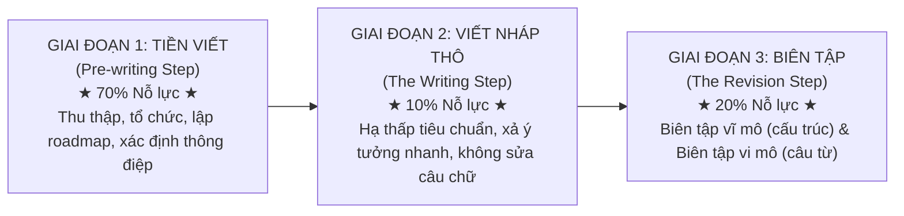
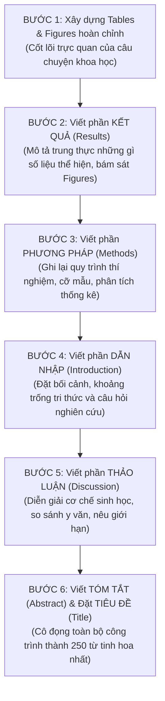

# GIÁO TRÌNH TOÀN DIỆN: WRITING IN THE SCIENCES
## MODULE 4: QUY TRÌNH VIẾT KHOA HỌC CHUYÊN NGHIỆP — NHÁP THÔ, TÁI CẤU TRÚC & TINH CHỈNH
*(The Writing Process: Draft, Revise, Refine)*

---

**Thông tin khóa học & Học phần:**
- **Khóa học:** Writing in the Sciences (Viết khoa học chuẩn quốc tế)
- **Đơn vị phát hành:** Stanford Online — Đại học Stanford (Stanford University)
- **Giảng viên chủ nhiệm:** Dr. Kristin Sainani (Phó Giáo sư Dịch tễ học & Thống kê sinh học, Đại học Stanford)
- **Bản quyền biên soạn tài liệu tiếng Việt:** Dự án Tutor / Trợ lý Học thuật
- **Vị trí lưu trữ bài giảng & Video offline:** `coursera/output_course/writing_science/Module_04_The_Writing_Process_Draft_Revise_Refine/`

---

## MỤC LỤC TỔNG QUAN

1. [Mục tiêu học tập & Chuẩn đầu ra](#1-mục-tiêu-học-tập--chuẩn-đầu-ra)
2. [Bảng thuật ngữ cốt lõi (Core Terminology Glossary)](#2-bảng-thuật-ngữ-cốt-lõi-core-terminology-glossary)
3. [Phân tích chi tiết từng bài học (Lectures 4.1 — 4.6 & Demo 4)](#3-phân-tích-chi-tiết-từng-bài-học)
   - [3.1. Bài 4.1: Xưởng thực hành đoạn văn nâng cao](#31-bài-41-xưởng-thực-hành-đoạn-văn-nâng-cao)
   - [3.2. Bài 4.2: Toàn cảnh quy trình viết khoa học — Mô hình 3 giai đoạn](#32-bài-42-toàn-cảnh-quy-trình-viết-khoa-học--mô-hình-3-giai-đoạn)
   - [3.3. Bài 4.3: Giai đoạn Tiền viết (The Pre-writing Step — 70% Nỗ lực)](#33-bài-43-giai-đoạn-tiền-viết-the-pre-writing-step--70-nỗ-lực)
   - [3.4. Bài 4.4: Giai đoạn Viết bản nháp đầu (The Writing Step — 10% Nỗ lực)](#34-bài-44-giai-đoạn-viết-bản-nháp-đầu-the-writing-step--10-nỗ-lực)
   - [3.5. Bài 4.5: Giai đoạn Biên tập & Sửa chữa (Revision — 20% Nỗ lực)](#35-bài-45-giai-đoạn-biên-tập--sửa-chữa-revision--20-nỗ-lực)
   - [3.6. Bài 4.6: Checklist kiểm định bản thảo trước khi gửi nộp](#36-bài-46-checklist-kiểm-định-bản-thảo-trước-khi-gửi-nộp)
   - [3.7. Bài 4.8: Phân tích Demo Edit 4 (Optional) — Mổ xẻ bản thảo Big Data Analytics](#37-bài-48-phân-tích-demo-edit-4-optional--mổ-xẻ-bản-thảo-big-data-analytics)
4. [Hướng dẫn thực hành Unit 4 & Khung tiêu chí bình duyệt đồng nghiệp (Peer Review Rubric)](#4-hướng-dẫn-thực-hành-unit-4--khung-tiêu-chí-bình-duyệt-đồng-nghiệp-peer-review-rubric)
5. [Quy trình viết phi tuần tự (Writing Out of Order: Step-by-Step Workflow)](#5-quy-trình-viết-phi-tuần-tự-writing-out-of-order-step-by-step-workflow)
6. [Bộ Checklist tổng thể 3 giai đoạn hoàn thiện bài báo quốc tế](#6-bộ-checklist-tổng-thể-3-giai-đoạn-hoàn-thiện-bài-báo-quốc-tế)
7. [Danh mục Video bài giảng Module 4 đã lưu trữ Offline](#7-danh-mục-video-bài-giảng-module-4-đã-lưu-trữ-offline)

---

# 1. MỤC TIÊU HỌC TẬP & CHUẨN ĐẦU RA

Sau khi hoàn thành Module 4, học viên đạt được năng lực toàn diện:

1. **WHAT — Bản chất quy trình tạo tác văn bản khoa học:**
   - Nắm vững **Mô hình viết 3 giai đoạn phân tách rõ rệt**: **Tiền viết (Pre-writing: 70%) $\rightarrow$ Viết bản nháp đầu (Writing: 10%) $\rightarrow$ Biên tập & Sửa chữa (Revision: 20%)**.
   - Hiểu rõ chiến lược **Viết phi tuần tự (Writing Out of Order)**: Viết Tables/Figures $\rightarrow$ Results $\rightarrow$ Methods $\rightarrow$ Introduction $\rightarrow$ Discussion $\rightarrow$ Abstract & Title.
2. **WHY — Nhận diện nguyên nhân gốc rễ của sự bế tắc trong viết lách (Writer's Block):**
   - Giải thích tại sao hầu hết các nhà nghiên cứu đều sợ viết và cảm thấy kiệt sức: do **gộp chung cả 3 bước làm một** (vừa viết vừa tìm tài liệu, vừa viết câu đầu đã vội chỉnh sửa câu chữ).
   - Đập tan căn bệnh cầu toàn độc hại (*Toxic perfectionism*) khiến tác giả không thể hoàn thành nổi một trang giấy trắng.
3. **HOW — Kỹ năng thực thi chuyên nghiệp:**
   - Tổ chức và tổng hợp toàn bộ tài liệu tham khảo "ngay trong tầm tay" (*at your fingertips*) trước khi gõ phím.
   - Xác định chính xác **Thông điệp cốt lõi mang về (Take-Home Message)** của công trình nghiên cứu.
   - Áp dụng các kỹ thuật biên tập nâng cao của Dr. Sainani: **Đọc to thành tiếng (Read Out Loud)**, **Quét động từ (The Verb Check)**, và **Tham vấn độc giả ngoài chuyên ngành (Outside Readers)**.
4. **WHEN & LIMITATIONS — Kiểm soát ranh giới logic & Bẫy kiểm định số liệu:**
   - Phát hiện và triệt tiêu các lỗi bất nhất số liệu (*numerical inconsistencies*) giữa phần Phương pháp, Kết quả, Bảng và Hình.
   - Loại bỏ triệt để lỗi "Trích dẫn vào hư không" (*references to nowhere*) gây hủy hoại uy tín học thuật của tác giả.
5. **APPLICATION & PEER REVIEW — Năng lực bình duyệt đồng nghiệp:** Nắm vững khung tiêu chí đánh giá bài báo chuẩn quốc tế, có khả năng phản biện, đóng góp ý kiến xây dựng và mổ xẻ bản thảo của đồng nghiệp một cách khách quan, chính xác.

---

# 2. BẢNG THUẬT NGỮ CỐT LÕI (CORE TERMINOLOGY GLOSSARY)

| Thuật ngữ gốc (EN) | Thuật ngữ Tiếng Việt chuẩn | Giải thích bản chất học thuật & Cơ chế tác động | Ví dụ minh họa & Khuyến nghị áp dụng |
| :--- | :--- | :--- | :--- |
| **Three-Phase Writing Model** | Mô hình viết 3 giai đoạn phân tách | Khung phương pháp luận phân bổ công sức khoa học: 70% chuẩn bị dữ liệu và cấu trúc $\rightarrow$ 10% xả nháp thô $\rightarrow$ 20% biên tập gọt giũa. Tách biệt hoàn toàn tư duy sáng tạo và tư duy phản biện. | Không bao giờ vừa viết vừa tra cứu tài liệu hay vừa viết vừa sửa lỗi ngữ pháp. |
| **Pre-writing Step** | Giai đoạn Tiền viết (70% Nỗ lực) | Quá trình thu thập, sàng lọc, tổng hợp dữ liệu, thiết kế bảng biểu, phác thảo dàn ý logic và xác định thông điệp chính trước khi viết câu hoàn chỉnh đầu tiên. | Gom tất cả số liệu, bài báo trích dẫn vào một thư mục có hệ thống trước khi mở Word. |
| **Take-Home Message** | Thông điệp cốt lõi mang về | Một câu tóm tắt duy nhất, cô đọng nhất mà tác giả muốn độc giả ghi nhớ sau khi đọc xong toàn bộ bài báo. Mọi đoạn văn trong bài đều phải phục vụ cho thông điệp này. | *"Hợp chất X ức chế chọn lọc thụ thể Y, giúp giảm 50% kích thước khối u trên chuột."* |
| **Writing Roadmap / Storyboard** | Bản đồ lộ trình bài viết | Dàn ý chi tiết phân tầng, trong đó mỗi đề mục và mỗi đoạn văn được gán một câu hỏi nghiên cứu hoặc một luận điểm cụ thể, chỉ rõ tài liệu tham khảo và số liệu cần dùng. | Lộ trình giúp người viết không bị lạc lối giữa rừng thông tin phức tạp. |
| **"Messy" First Draft** | Bản nháp đầu thô mộc | Bản nháp ban đầu được viết với tốc độ cao, hạ thấp tiêu chuẩn hoa mỹ, tập trung hoàn toàn vào việc ghi lại đầy đủ các luận điểm logic thành câu hoàn chỉnh theo đúng trật tự. | Tự nhủ: *"Bản nháp đầu không cần hay, bản nháp đầu chỉ cần tồn tại!"* |
| **Writer's Block** | Hội chứng bế tắc trang giấy trắng | Tình trạng tê liệt tâm lý khi ngồi trước màn hình trắng xóa mà không thể viết nổi một dòng, nguyên nhân chủ yếu do đặt kỳ vọng câu chữ phải hoàn hảo ngay từ lần gõ đầu tiên. | Vượt qua bằng cách đặt giới hạn thời gian (30 phút viết liên tục không dừng lại). |
| **Writing Out of Order** | Viết phi tuần tự | Quy trình đảo ngược trật tự viết truyền thống: Viết phần dễ và cụ thể trước (*Results, Methods*), viết phần tổng hợp và khái quát sau (*Introduction, Discussion, Abstract*). | Viết phần Abstract và đặt Title ở bước cuối cùng sau khi toàn bộ bài báo đã định hình. |
| **Macro-revision** | Biên tập cấu trúc Vĩ mô | Vòng sửa chữa đầu tiên tập trung vào "bộ khung xương" của bài báo: Luồng logic, sự liền mạch giữa các đoạn văn, tính thống nhất của thông điệp, việc sắp xếp lại các khối ý tưởng. | Di chuyển câu nêu tầm quan trọng từ kết bài lên ngay đoạn 2; tách hoặc gộp đoạn. |
| **Micro-revision** | Biên tập câu chữ Vi mô | Vòng sửa chữa thứ hai tập trung vào "làn da thớ thịt": Gọt tỉa rác từ vựng, chuyển câu bị động sang chủ động, khôi phục động từ mạnh, chuẩn hóa dấu câu và cấu trúc song hành. | Áp dụng các nguyên tắc từ Module 1, 2 và 3 vào từng dòng văn bản. |
| **Read Out Loud Technique** | Kỹ thuật đọc to thành tiếng | Phương pháp đọc lớn bản thảo bằng miệng để tai lắng nghe nhịp điệu. Não bộ con người xử lý âm thanh tốt hơn mắt đọc lướt, giúp phát hiện ngay các chỗ vấp, lặp từ hoặc câu văn quá dài gây hụt hơi. | Đọc thành tiếng hoặc ghi âm bài đọc vào điện thoại rồi bật nghe lại. |
| **The Verb Check** | Kỹ thuật quét động từ | Bài tập tự kiểm tra: Dùng bút gạch chân tất cả động từ chính trong 2 trang văn bản. Nếu thấy xuất hiện quá nhiều động từ to-be (*is, are, was*) hoặc thể bị động, lập tức thay bằng động từ hành động. | Đánh thức các câu văn ngái ngủ trở nên sống động và đanh thép. |
| **Numerical Inconsistency** | Lỗi bất nhất số liệu | Lỗi nghiêm trọng khi các con số ở các phần khác nhau trong bài báo mâu thuẫn lẫn nhau (ví dụ: Abstract ghi n = 150, nhưng Table 1 lại ghi n = 142). Khiến người bình duyệt nghi ngờ độ tin cậy của toàn bộ nghiên cứu. | Rà soát chéo từng con số giữa Text, Table, Figure và Abstract trước khi nộp. |
| **References to Nowhere** | Lỗi trích dẫn vào hư không | Lỗi học thuật khi dẫn một nguồn tài liệu tham khảo để chứng minh cho một luận điểm, nhưng trong bài báo gốc được trích dẫn hoàn toàn không có thông tin đó (do tác giả trích dẫn lại từ bài khác mà không tự đọc bài gốc). | Luôn tự tải và đọc bài báo gốc trước khi gắn số trích dẫn `[ref]`. |

---

# 3. PHÂN TÍCH CHI TIẾT TỪNG BÀI HỌC

## 3.1. Bài 4.1: Xưởng thực hành đoạn văn nâng cao
*(Lecture 4.1: More Paragraph Practice)*

Trước khi bước vào quy trình viết tổng thể, Dr. Sainani củng cố kỹ năng tổ chức đoạn văn thông qua các ca mổ xẻ thực tế từ y văn.

### Các bài học rút ra từ xưởng thực hành:
1. **Phát hiện "khe nứt" logic:** Khi hai câu văn đứng cạnh nhau nhưng không có mối liên hệ nhân quả hay thời gian rõ ràng, người đọc sẽ bị vấp. Cần bổ sung ngay một cụm từ nối hoặc tái cấu trúc vế đầu của câu sau theo nguyên lý Cũ $\rightarrow$ Mới.
2. **Cắt bỏ các chi tiết "ngoại lai":** Một đoạn văn đang bàn luận về cơ chế phân tử của thuốc thì không nên đột ngột chèn vào một câu nhận xét về chi phí sản xuất hay thị trường dược phẩm. Hãy kiên quyết di chuyển câu lạc đề đó sang một đoạn văn khác hoặc xóa bỏ hoàn toàn.

---

## 3.2. Bài 4.2: Toàn cảnh quy trình viết khoa học — Mô hình 3 giai đoạn
*(Lecture 4.2: Overview of the Writing Process)*

Quy trình viết khoa học chuyên nghiệp bắt đầu **sau khi bạn đã hoàn thành các thí nghiệm và có đầy đủ dữ liệu trong tay**.



### Sai lầm kinh điển: "Gộp chung cả 3 giai đoạn làm một"
Dr. Sainani chỉ ra rằng hầu hết các nhà nghiên cứu đều thất bại vì họ thực hiện 3 công việc này cùng một lúc:
- Ngồi xuống mở file Word trắng tinh $\rightarrow$ Cố gắng viết ngay một câu mở đầu thật bóng bẩy, hoàn hảo.
- Viết được nửa câu thì khựng lại vì nhớ ra thiếu một số liệu $\rightarrow$ Lại dừng viết để đi tìm tài liệu tham khảo.
- Đọc tài liệu tham khảo xong thì quên mất mạch văn $\rightarrow$ Viết tiếp được một câu thì lại ngồi soi từng lỗi chính tả, xóa đi viết lại 10 lần.
- **Hậu quả:** Sau 3 giờ đồng hồ chỉ viết được 2 câu, đầu óc căng thẳng, kiệt sức và rơi vào trạng thái sợ hãi viết lách (*procrastination*).

> [!IMPORTANT]
> **Quy tắc vàng phân tách năng lượng:** Hãy giữ cho 3 giai đoạn này hoàn toàn tách biệt trong tâm trí bạn. Khi đang ở giai đoạn nào, chỉ tập trung 100% năng lực vào giai đoạn đó!

---

## 3.3. Bài 4.3: Giai đoạn Tiền viết (The Pre-writing Step — 70% Nỗ lực)
*(Lecture 4.3: The Pre-writing Step)*

Đây là giai đoạn chiếm nhiều thời gian và công sức nhất nhưng lại thường bị xem nhẹ nhất.

### A. Câu chuyện thời Nghiên cứu sinh của Dr. Kristin Sainani
Dr. Sainani kể lại trải nghiệm chân thật thời bà làm nghiên cứu sinh tiến sĩ tại Stanford:
- Mỗi khi viết bài báo, văn phòng của bà như một "bãi chiến trường": Tài liệu rải đầy trên bàn, trên nóc máy in, trên nóc tủ tài liệu, dưới sàn nhà sau lưng ghế...
- Khi đang viết phần Bàn luận (*Discussion*), bà chợt nhớ ra: *"À, mình cần số liệu từ bài thử nghiệm lâm sàng của Smith et al. Bài đó ở đâu nhỉ? À, nó nằm trên nóc tủ tài liệu"*. Bà đứng dậy lấy bài báo, lật tìm con số, cất bài báo lại, gõ con số vào máy...
- **Bài học xương máu:** Quy trình này cực kỳ kém hiệu quả và làm tiêu hao năng lượng não bộ vào những việc vụn vặt thay vì tập trung vào tư duy lập luận.

### B. Ba trụ cột của Giai đoạn Tiền viết chuyên nghiệp
1. **Dữ liệu ngay trong tầm tay (*At your fingertips*):** Trước khi gõ chữ, hãy tạo một thư mục số hoặc một tập hồ sơ chứa toàn bộ các bài báo trích dẫn, các bảng số liệu, kết quả phân tích thống kê đã được đặt tên rõ ràng. Bạn không bao giờ phải dừng bút để "đi đào bới" tài liệu.
2. **Xác định Thông điệp Cốt lõi (Take-Home Message):**
   - Đặt câu hỏi: *"Bài báo này chứng minh điều gì mới mẻ cho nhân loại?"*
   - Viết thông điệp này ra giấy thành 1–2 câu văn đanh thép và dán ngay trước màn hình máy tính. Nó sẽ là kim chỉ nam giúp bạn quyết định đưa thông tin nào vào và gạt bỏ thông tin nào ra.
3. **Thiết kế Bản đồ Lộ trình (Writing Roadmap / Outline):**
   - Trong khoa học thực nghiệm: **Bảng biểu (Tables) và Hình vẽ (Figures) chính là khung cốt truyện của bài báo!** Hãy sắp xếp các Hình và Bảng theo một trật tự thời gian và logic thuyết phục.
   - Lập dàn ý phân đoạn: Ghi rõ đoạn 1 nói về gì, đoạn 2 chứng minh gì, đoạn 3 đối chiếu với ai.

---

## 3.4. Bài 4.4: Giai đoạn Viết bản nháp đầu (The Writing Step — 10% Nỗ lực)
*(Lecture 4.4: The Writing Step)*

Đây là giai đoạn mà hầu hết mọi người đều cảm thấy sợ hãi nhất: **Đối mặt với trang giấy trắng**.

### A. Bí quyết số 1: Đừng cầu toàn! (Don't Be a Perfectionist!)
- Rất nhiều nhà khoa học mắc bệnh cầu toàn: Họ muốn câu văn đầu tiên xuất hiện trên màn hình phải bóng bẩy như văn phong của Shakespeare hay xã luận của tạp chí *Nature*.
- **Chiến lược giải phóng tâm lý:** Hãy hạ thấp tiêu chuẩn của bạn xuống mức tối thiểu! Mục tiêu của bản nháp đầu chỉ là: **Ý tưởng được diễn đạt thành câu hoàn chỉnh, đúng trật tự logic, chấm hết!**
- Đừng quan tâm câu văn nghe có vụng về, cồng kềnh hay lặp từ hay không. Những thứ đó sẽ được xử lý cực kỳ dễ dàng ở giai đoạn Biên tập.

### B. Viết phi tuần tự (Writing Out of Order)
Đừng bao giờ bắt đầu viết bài báo từ trang đầu tiên (Title và Abstract)! Đó là cách viết sai lầm và khó khăn nhất.

```
Trật tự xuất hiện trong bài báo in:
[Title] → [Abstract] → [Introduction] → [Methods] → [Results] → [Discussion]

Trật tự viết thực tế của Chuyên gia:
Bước 1: Tables & Figures (Chuẩn bị số liệu trực quan)
Bước 2: Results (Mô tả khách quan những gì số liệu thể hiện)
Bước 3: Methods (Mô tả quy trình tạo ra số liệu đó)
Bước 4: Introduction (Đặt bối cảnh và câu hỏi nghiên cứu)
Bước 5: Discussion (Diễn giải ý nghĩa và giới hạn của kết quả)
Bước 6: Abstract & Title (Đúc kết toàn bộ công trình thành bản tóm tắt tinh hoa)
```

### C. Vượt qua Writer's Block
- Đặt đồng hồ bấm giờ (Pomodoro 30–45 phút).
- Tắt kết nối Internet, tắt thông báo email.
- Bám sát Bản đồ Lộ trình (Roadmap) và gõ liên tục không dừng lại để tra cứu hay sửa lỗi chính tả. Nếu thiếu một con số cụ thể, chỉ cần gõ ký hiệu `[XX.X%]` rồi viết tiếp!

---

## 3.5. Bài 4.5: Giai đoạn Biên tập & Sửa chữa (Revision — 20% Nỗ lực)
*(Lecture 4.5: Revision)*

> [!NOTE]
> *"Viết văn thực chất chính là sửa văn. Mọi sự thanh lịch, uy lực và tinh tế của ngôn từ đều ra đời trong giai đoạn biên tập này."* — Dr. Kristin Sainani.

Biên tập không phải là đọc lướt qua một lần để sửa lỗi chính tả. Biên tập là một quá trình phẫu thuật có phương pháp theo **Hai cấp độ**:

### Cấp độ 1: Tái cấu trúc Vĩ mô (Macro-revision)
- Đọc lại toàn bộ bản thảo để kiểm tra logic dòng chảy:
  + Mạch lập luận có trôi chảy tự nhiên không?
  + Các đoạn văn có tuân thủ nguyên tắc "Một đoạn = Một ý" không?
  + Câu nêu tầm quan trọng (*Significance*) có được đưa lên sớm ở phần đầu không, hay đang bị chôn vùi ở cuối bài?
- Dũng cảm cắt bỏ nguyên một đoạn văn dài nếu nó không đóng góp cho Thông điệp cốt lõi (*Take-Home Message*).

### Cấp độ 2: Tinh chỉnh Vi mô (Micro-revision)
Áp dụng toàn bộ kho vũ khí đã học từ Module 1, 2 và 3:
- Cắt sạch rác từ vựng, cụm từ chết (*dead-weight phrases*).
- Chuyển câu bị động sang chủ động, đưa chủ ngữ và động từ chính gặp nhau ở đầu câu.
- Khôi phục động từ mạnh từ các danh từ hóa (*smothered verbs*).
- Chuẩn hóa dấu câu (`;`, `:`, `—`) và cấu trúc song hành.

### Ba kỹ thuật biên tập kinh điển của Dr. Sainani:
1. **Đọc to thành tiếng (Read Out Loud):** Tai của bạn sẽ lập tức giật mình khi nghe thấy một câu văn dài lê thê 40 từ khiến bạn hụt hơi, hoặc một từ bị lặp lại 3 lần trong một đoạn.
2. **Kỹ thuật Quét động từ (The Verb Check):** Dùng bút dạ quang tô đậm mọi động từ chính trong bài. Nếu trang giấy ngập tràn màu vàng của các từ *is, are, was, were*, bạn biết mình phải làm gì: Hãy thay chúng bằng động từ hành động!
3. **Nhờ độc giả ngoài ngành đọc thử (Outside Readers):** Đưa bản thảo cho một người bạn không cùng chuyên môn hẹp đọc. Nếu họ hiểu được thông điệp chính và chỉ ra được những đoạn tối nghĩa, bài báo của bạn chắc chắn sẽ chinh phục được các biên tập viên khó tính nhất.

---

## 3.6. Bài 4.6: Checklist kiểm định bản thảo trước khi gửi nộp
*(Lecture 4.6: Checklist for the Final Draft)*

Trước khi bấm nút nộp bài cho tạp chí khoa học quốc tế, hãy rà soát kỹ lưỡng các bẫy kỹ thuật sau:

### 1. Kiểm tra tính nhất quán số liệu (Numerical Consistency)
Đây là lỗi mà Dr. Sainani bắt gặp thường xuyên nhất khi bình duyệt các bài báo khoa học:
- **Ca lâm sàng điển hình:** Trong phần Methods, tác giả viết: *"Bệnh nhân được theo dõi tối thiểu 2 năm (followed for a minimum of 2 years)"*. Nhưng sang phần Results, tác giả lại viết: *"Thời gian theo dõi trung bình là 1.5 năm (The average follow-up was 1.5 years)"*.
  $\rightarrow$ **Mâu thuẫn toán học ngớ ngẩn!** Thời gian trung bình không thể nào là 1.5 năm nếu thời gian tối thiểu của mọi bệnh nhân là 2 năm!
- **Kiểm tra chéo:** Đảm bảo mọi con số xuất hiện trong bài văn bản (*Text*) phải khớp từng chữ số thập phân với con số trong Bảng (*Tables*), Hình (*Figures*) và Tóm tắt (*Abstract*).

### 2. Quét sạch lỗi "Trích dẫn vào hư không" (References to Nowhere)
- Hiện tượng tác giả dẫn nguồn `[12]` để khẳng định: *"Thuốc A làm giảm 30% tỷ lệ tử vong"*. Nhưng khi người bình duyệt tải bài báo số 12 về đọc thì bài đó hoàn toàn không nghiên cứu về thuốc A, hoặc con số 30% là ở một bối cảnh khác!
- Nguyên nhân: Tác giả đọc một bài báo khác thấy họ trích dẫn nguồn số 12, liền "chép lại" nguồn trích dẫn mà không tự mình tải bài gốc về kiểm chứng.
- **Quy tắc đạo đức:** **Chỉ trích dẫn những gì bạn đã thực sự tự mình đọc và kiểm chứng!**

### 3. Kiểm tra tính nhất quán thuật ngữ (Terminology Consistency)
Đừng dùng luân phiên 3 từ khác nhau để chỉ cùng một đối tượng trong bài báo (ví dụ: lúc gọi là *subjects*, lúc gọi là *participants*, lúc lại gọi là *patients*). Hãy chọn một thuật ngữ chuẩn xác nhất và dùng nhất quán từ đầu đến cuối.

---

## 3.7. Bài 4.8: Phân tích Demo Edit 4 (Optional) — Mổ xẻ bản thảo Big Data Analytics
*(Lecture 4.8: Demo Edit 4 — Live Editing Session with Dr. Kristin Sainani)*

Trong buổi biên tập trực tiếp kéo dài 20 phút này, Dr. Sainani mổ xẻ bài luận của học viên viết về đề tài **"Phân tích dữ liệu lớn trong khoa học y sinh và kinh doanh" (Big Data Analytics)**.

### Những bài học biên tập đắt giá:
1. **Thay đổi cách mở bài (Crafting an Engaging Lead):** Bản gốc của học viên mở đầu cực kỳ nhàm chán: *"Bài báo này của tác giả X và Y xuất bản năm 2012 tổng quan về..."*. Dr. Sainani sửa lại bằng cách mở đầu trực diện bằng bối cảnh thực tế: Sự bùng nổ dữ liệu số trong kỷ nguyên công nghệ và bài toán cấp bách về việc khai thác thông tin có ý nghĩa.
2. **Tái cấu trúc các định nghĩa cồng kềnh:** Đổi các câu định nghĩa dài 4 dòng ngập ngụa danh từ hóa thành các mệnh đề động từ ngắn gọn, dễ tiếp thu.
3. **Kiểm tra nhịp điệu liên kết giữa các đoạn văn.**

---

# 4. HƯỚNG DẪN THỰC HÀNH UNIT 4 & KHUNG TIÊU CHÍ BÌNH DUYỆT ĐỒNG NGHIỆP (PEER REVIEW RUBRIC)

Trong Unit 4 Homework, học viên được giao nhiệm vụ chọn một bài tiểu luận trong số 8 bài Demo Essay để tự mình biên tập toàn diện, sau đó đối chiếu với video chữa bài của Dr. Sainani.

Dưới đây là **Khung tiêu chí đánh giá chuẩn mực 4 chiều (The 4-Dimensional Peer Review Rubric)** dùng để đánh giá bản thảo khoa học:

| Chiều kích đánh giá | Tiêu chí cụ thể | Mức Đạt chuẩn mực (Excellent) | Mức Cần cải thiện (Needs Work) |
| :--- | :--- | :--- | :--- |
| **1. Cấu trúc Vĩ mô (Macro Structure)** | - Tính rõ ràng của thông điệp chính<br>- Câu chủ đề từng đoạn<br>- Dòng chảy logic tổng thể | Nêu bật thông điệp chính ngay từ đầu; mỗi đoạn chở 1 ý; luồng tư duy chuyển tiếp êm ái. | Thông điệp bị giấu kín; các đoạn văn lan man, nhảy cóc ý tưởng; thiếu tính liên kết. |
| **2. Tinh gọn & Súc tích (Clarity & Brevity)** | - Cắt bỏ rác từ vựng<br>- Không có cụm từ chết<br>- Không lặp từ vô ích | Mọi từ ngữ đều làm việc; câu văn gọn gàng, đanh thép; loại bỏ 30–50% từ thừa. | Văn bản ngập tràn *due to the fact that, it has been shown that*, trạng từ rỗng *very, really*. |
| **3. Sức mạnh Động từ (Verb Dynamics)** | - Tỷ lệ thể chủ động<br>- Khử danh từ hóa<br>- Khoảng cách Chủ — Vị | Đa số câu ở thể chủ động; Chủ ngữ và Động từ chính gặp nhau trong 5–10 từ đầu; giàu động từ mạnh. | Lạm dụng bị động; chôn vùi động từ vào danh từ (*conduct an analysis of*); chủ ngữ dài 30 từ. |
| **4. Chuẩn xác Kỹ thuật (Technical Precision)** | - Nhất quán số liệu<br>- Dấu câu nâng cao<br>- Trích dẫn chuẩn xác | Số liệu khớp 100% giữa các phần; dùng đúng `;`, `:`, `—`; trích dẫn trung thực. | Mâu thuẫn số liệu giữa bảng và văn bản; lỗi dấu hai chấm sau động từ; trích dẫn cẩu thả. |

---

# 5. QUY TRÌNH VIẾT PHI TUẦN TỰ (WRITING OUT OF ORDER: STEP-BY-STEP WORKFLOW)

Quy trình 6 bước được các giáo sư đại học hàng đầu khuyên dùng để hoàn thành một bài báo nghiên cứu gốc (*Original Research Article*):



### Tại sao quy trình này lại vượt trội?
- **Khử bỏ tâm lý sợ hãi:** Bắt đầu bằng phần *Results* và *Methods* rất dễ vì bạn chỉ việc mô tả lại những gì chính tay bạn đã làm và nhìn thấy trong phòng thí nghiệm.
- **Tiết kiệm thời gian:** Khi đã viết xong Results và Methods, bạn đã có một bức tranh toàn cảnh cực kỳ rõ nét để viết phần Introduction và Discussion mà không sợ bị "lạc đề".

---

# 6. BỘ CHECKLIST TỔNG THỂ 3 GIAI ĐOẠN HOÀN THIỆN BÀI BÁO QUỐC TẾ

### Giai đoạn 1: Checklist Tiền viết (Pre-writing)
- [ ] Đã có đủ số liệu sạch và các bảng phân tích thống kê cuối cùng chưa?
- [ ] Đã hoàn thiện toàn bộ các Hình vẽ (Figures) và Bảng biểu (Tables) với độ phân giải cao chưa?
- [ ] Đã xác định được Thông điệp cốt lõi mang về (*Take-Home Message*) trong đúng 1 câu chưa?
- [ ] Đã lập Bản đồ lộ trình (*Writing Roadmap*) chi tiết cho từng đoạn văn chưa?
- [ ] Đã tập giải thích nghiên cứu thành lời nói (*talk it out*) với đồng nghiệp chưa?

### Giai đoạn 2: Checklist Viết bản nháp đầu (Drafting)
- [ ] Đã tạm thời dẹp bỏ bệnh cầu toàn sang một bên chưa?
- [ ] Có đang viết theo trật tự phi tuần tự (*Results $\rightarrow$ Methods $\rightarrow$ Intro $\rightarrow$ Discussion*) không?
- [ ] Có kiềm chế được việc dừng lại để sửa lỗi ngữ pháp hay tra cứu tài liệu giữa chừng không?
- [ ] Đã viết xong bản nháp thô từ đầu đến cuối trước khi bắt tay vào biên tập chưa?

### Giai đoạn 3: Checklist Biên tập & Hoàn thiện (Revision & Final Draft)
- [ ] **Biên tập vĩ mô:** Đã kiểm tra tính logic và sự liền mạch giữa các đoạn văn chưa?
- [ ] **Biên tập vi mô:** Đã quét sạch rác từ vựng, thể bị động thừa và danh từ hóa chưa?
- [ ] **Đọc to thành tiếng:** Đã đọc toàn bộ bài báo thành tiếng để lắng nghe nhịp điệu chưa?
- [ ] **Quét động từ (Verb check):** Đã kiểm tra và thay thế các động từ to-be yếu ớt chưa?
- [ ] **Nhất quán số liệu:** Đã đối chiếu từng con số giữa Text, Abstract, Tables và Figures chưa?
- [ ] **Trích dẫn trung thực:** Đã kiểm tra để đảm bảo không có "trích dẫn vào hư không" chưa?
- [ ] **Độc giả ngoài ngành:** Đã nhờ một người bạn ngoài chuyên ngành đọc thử và cho phản hồi chưa?

---

# 7. DANH MỤC VIDEO BÀI GIẢNG MODULE 4 ĐÃ LƯU TRỮ OFFLINE

Toàn bộ 7 video bài giảng của Module 4 đã được tải về nguyên vẹn, tuần tự với chất lượng cao (540p MP4) và lưu trữ cục bộ tại thư mục:  
📁 `coursera/output_course/writing_science/Module_04_The_Writing_Process_Draft_Revise_Refine/videos/`

| Bài học | Tên Video File | Dung lượng | Thời lượng bài | Liên kết xem Offline (Local MP4) |
| :---: | :--- | :---: | :---: | :--- |
| **4.1** | `19_4.1_More_paragraph_practice.mp4` | 23.79 MB | 19 phút | [Xem Video 4.1 Cục bộ](file:///home/khanh/projects/tutor/coursera/output_course/writing_science/Module_04_The_Writing_Process_Draft_Revise_Refine/videos/19_4.1_More_paragraph_practice.mp4) |
| **4.2** | `20_4.2_Overview_of_the_writing_process.mp4` | 8.91 MB | 7 phút | [Xem Video 4.2 Cục bộ](file:///home/khanh/projects/tutor/coursera/output_course/writing_science/Module_04_The_Writing_Process_Draft_Revise_Refine/videos/20_4.2_Overview_of_the_writing_process.mp4) |
| **4.3** | `21_4.3_The_pre-writing_step.mp4` | 13.99 MB | 11 phút | [Xem Video 4.3 Cục bộ](file:///home/khanh/projects/tutor/coursera/output_course/writing_science/Module_04_The_Writing_Process_Draft_Revise_Refine/videos/21_4.3_The_pre-writing_step.mp4) |
| **4.4** | `22_4.4_The_writing_step.mp4` | 10.55 MB | 8 phút | [Xem Video 4.4 Cục bộ](file:///home/khanh/projects/tutor/coursera/output_course/writing_science/Module_04_The_Writing_Process_Draft_Revise_Refine/videos/22_4.4_The_writing_step.mp4) |
| **4.5** | `23_4.5_Revision.mp4` | 6.65 MB | 6 phút | [Xem Video 4.5 Cục bộ](file:///home/khanh/projects/tutor/coursera/output_course/writing_science/Module_04_The_Writing_Process_Draft_Revise_Refine/videos/23_4.5_Revision.mp4) |
| **4.6** | `24_4.6_Checklist_for_the_final_draft.mp4` | 15.25 MB | 12 phút | [Xem Video 4.6 Cục bộ](file:///home/khanh/projects/tutor/coursera/output_course/writing_science/Module_04_The_Writing_Process_Draft_Revise_Refine/videos/24_4.6_Checklist_for_the_final_draft.mp4) |
| **Demo 4** | `26_Demo_Edit_4_Optional.mp4` | 31.13 MB | 20 phút | [Xem Video Demo 4 Cục bộ](file:///home/khanh/projects/tutor/coursera/output_course/writing_science/Module_04_The_Writing_Process_Draft_Revise_Refine/videos/26_Demo_Edit_4_Optional.mp4) |
| **TỔNG** | **7 Videos MP4 trọn vẹn** | **~111 MB** | **~83 phút** | Đã sẵn sàng học tập Offline |

---
*Tài liệu biên soạn phục vụ học tập và nghiên cứu học thuật nội bộ. Bản quyền bài giảng gốc thuộc về Đại học Stanford và Dr. Kristin Sainani.*
