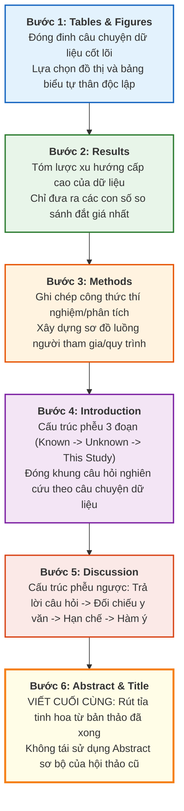

# GIÁO TRÌNH TOÀN DIỆN: WRITING IN THE SCIENCES
## MODULE 5: BẢN THẢO KHOA HỌC CHUẨN MỰC — TỪ KẾT QUẢ ĐẾN BẢN TÓM TẮT
*(The Scientific Manuscript: From Results to Abstract)*

---

**Thông tin khóa học & Học phần:**
- **Khóa học:** Writing in the Sciences (Viết khoa học chuẩn quốc tế)
- **Đơn vị phát hành:** Stanford Online — Đại học Stanford (Stanford University)
- **Giảng viên chủ nhiệm:** Dr. Kristin Sainani (Phó Giáo sư Dịch tễ học & Thống kê sinh học, Đại học Stanford)
- **Bản quyền biên soạn tài liệu tiếng Việt:** Dự án Tutor / Trợ lý Học thuật
- **Vị trí lưu trữ bài giảng & Video offline:** [`coursera/output_course/writing_science/Module_05_The_Scientific_Manuscript_From_Results_to_Abstract/`](file:///home/khanh/projects/tutor/coursera/output_course/writing_science/Module_05_The_Scientific_Manuscript_From_Results_to_Abstract/)

---

## MỤC LỤC TỔNG QUAN

1. [Mục tiêu học tập & Chuẩn đầu ra](#1-mục-tiêu-học-tập--chuẩn-đầu-ra)
2. [Bảng thuật ngữ cốt lõi (Core Terminology Glossary)](#2-bảng-thuật-ngữ-cốt-lõi-core-terminology-glossary)
3. [Quy trình kiến tạo bản thảo phi tuần tự (Non-linear Manuscript Assembly)](#3-quy-trình-kiến-tạo-bản-thảo-phi-tuần-tự-non-linear-manuscript-assembly)
4. [Phân tích chi tiết từng bài học (Lectures 5.1 — 5.8 & Demo 5)](#4-phân-tích-chi-tiết-từng-bài-học)
   - [4.1. Bài 5.1: Bảng biểu và Đồ thị (Tables and Figures) — Trụ cột câu chuyện khoa học](#41-bài-51-bảng-biểu-và-đồ-thị-tables-and-figures--trụ-cột-câu-chuyện-khoa-học)
   - [4.2. Bài 5.2: Phần Kết quả (Results) — Kể câu chuyện dữ liệu cấp cao](#42-bài-52-phần-kết-quả-results--kể-câu-chuyện-dữ-liệu-cấp-cao)
   - [4.3. Bài 5.3: Xưởng thực hành viết Kết quả (Practice Writing Results) — Chắt lọc số liệu](#43-bài-53-xưởng-thực-hành-viết-kết-quả-practice-writing-results--chắt-lọc-số-liệu)
   - [4.4. Bài 5.4: Phần Phương pháp (Methods) — Công thức tái lập và trực quan hóa quy trình](#44-bài-54-phần-phương-pháp-methods--công-thức-tái-lập-và-trực-quan-hóa-quy-trình)
   - [4.5. Bài 5.5: Phần Mở đầu (Introduction) — Mô hình phễu chuẩn mực từ rộng đến hẹp](#45-bài-55-phần-mở-đầu-introduction--mô-hình-phễu-chuẩn-mực-từ-rộng-đến-hẹp)
   - [4.6. Bài 5.6: Xưởng thực hành Mở đầu (Introduction Practice) — Phân tích Known / Unknown / This Study](#46-bài-56-xưởng-thực-hành-mở-đầu-introduction-practice--phân-tích-known--unknown--this-study)
   - [4.7. Bài 5.7: Phần Bàn luận (Discussion) — Cấu trúc phễu ngược từ phát hiện cốt lõi đến tầm nhìn vĩ mô](#47-bài-57-phần-bàn-luận-discussion--cấu-trúc-phễu-ngược-từ-phát-hiện-cốt-lõi-đến-tầm-nhìn-vĩ-mô)
   - [4.8. Bài 5.8: Phần Tóm tắt (Abstract) — Rút tỉa tinh hoa và quy tắc viết cuối cùng](#48-bài-58-phần-tóm-tắt-abstract--rút-tỉa-tinh-hoa-và-quy-tắc-viết-cuối-cùng)
   - [4.9. Bài Demo Edit 5 (Optional) — Mổ xẻ bản thảo nghiên cứu sinh học (Tanaka et al. - ROS Symbiosis)](#49-bài-demo-edit-5-optional--mổ-xẻ-bản-thảo-nghiên-cứu-sinh-học-tanaka-et-al---ros-symbiosis)
5. [Giải thích chi tiết & Đáp án chuẩn mực Unit 5 Homework](#5-giải-thích-chi-tiết--đáp-án-chuẩn-mực-unit-5-homework)
6. [Bộ Checklist chuẩn hóa từng phần bản thảo khoa học (IMRAD Quality Rubric)](#6-bộ-checklist-chuẩn-hóa-từng-phần-bản-thảo-khoa-học-imrad-quality-rubric)
7. [Danh mục Video bài giảng Module 5 đã lưu trữ Offline](#7-danh-mục-video-bài-giảng-module-5-đã-lưu-trữ-offline)

---

# 1. MỤC TIÊU HỌC TẬP & CHUẨN ĐẦU RA

Sau khi hoàn tất Module 5, học viên làm chủ trọn vẹn cấu trúc kinh điển **IMRAD (Introduction - Methods - Results - and - Discussion)** của một bài báo khoa học chuẩn quốc tế (ISI/Scopus):

1. **WHAT — Bản chất và cấu trúc của một bản thảo nghiên cứu gốc (Original Research Manuscript):**
   - Nắm vững định vị chức năng của từng phần trong bài báo: **Tables & Figures** (Linh hồn dữ liệu), **Results** (Dữ liệu nói gì), **Methods** (Công thức thực hiện để tái lập), **Introduction** (Tại sao nghiên cứu này cần thiết), **Discussion** (Ý nghĩa của phát hiện và giới hạn), **Abstract** (Bản đúc kết tinh gọn).
   - Thấu suốt nguyên lý **Viết phi tuần tự (Writing Out of Order)**: Tuyệt đối không bắt đầu từ Abstract hay Introduction, mà phải hoàn thiện hệ thống Bảng biểu/Đồ thị trước, sau đó phát triển lần lượt sang Results $\rightarrow$ Methods $\rightarrow$ Introduction $\rightarrow$ Discussion $\rightarrow$ Abstract.
2. **WHY — Nhận thức phản xạ của Ban biên tập, Người bình duyệt và Độc giả:**
   - Hiểu được thói quen duyệt bài của Reviewer/Editor: Khi nhận bản thảo, họ đọc lướt Abstract, lập tức nhảy ngay sang **Tables và Figures** để đánh giá trực tiếp dữ liệu thô trước khi đọc diễn giải văn bản của tác giả.
   - Thấy rõ tác hại của việc "đọc chép số liệu" (reading out the tables) vào phần Results, hoặc mở đầu phần Discussion bằng việc thanh minh hạn chế nghiên cứu.
3. **HOW — Kỹ năng thực thi viết và biên tập từng cấu phần:**
   - Thiết kế Bảng biểu chuẩn học thuật (chỉ 3 đường kẻ ngang, không viền lưới rườm rà, đơn vị đo lường chuẩn xác, số chữ số có nghĩa hợp lý).
   - Viết phần Results súc tích ở cấp độ xu hướng tổng quan, chỉ làm nổi bật 1-2 con số đắt giá nhất.
   - Ứng dụng cấu trúc **Hình phễu (Cone Model)** cho Introduction (Rộng $\rightarrow$ Hẹp) và **Hình phễu ngược (Inverted Cone)** cho Discussion (Hẹp $\rightarrow$ Rộng).
   - Soạn thảo Abstract hoàn chỉnh theo 6 thành phần cốt lõi và đảm bảo viết sau cùng để triệt tiêu nguy cơ mâu thuẫn số liệu.

---

# 2. BẢNG THUẬT NGỮ CỐT LÕI (CORE TERMINOLOGY GLOSSARY)

| Thuật ngữ tiếng Anh | Thuật ngữ tiếng Việt tương đương | Định nghĩa & Ý nghĩa học thuật chuyên sâu |
| :--- | :--- | :--- |
| **IMRAD Format** | Cấu trúc IMRAD | Khung cấu trúc chuẩn mực toàn cầu của bài báo khoa học thực nghiệm: *Introduction* (Mở đầu), *Methods* (Phương pháp), *Results* (Kết quả), *and Discussion* (Bàn luận). |
| **Self-contained** | Tự thân độc lập | Thuộc tính bắt buộc của Bảng biểu, Đồ thị và Abstract: Độc giả có thể đọc, hiểu trọn vẹn ý nghĩa và bối cảnh mà **không cần mở lại văn bản chính** để tra cứu. |
| **Three-horizontal-line Table** | Bảng chuẩn 3 đường kẻ | Quy chuẩn trình bày bảng của hầu hết tạp chí quốc tế: Chỉ gồm 3 đường kẻ ngang (trên tiêu đề cột, dưới tiêu đề cột, và dưới đáy dữ liệu); tuyệt đối không có đường kẻ dọc hay lưới caro. |
| **Significant Figures** | Chữ số có nghĩa | Số chữ số thập phân phản ánh đúng độ chính xác của thiết bị đo lường thực tế (ví dụ: tuổi, BMI chỉ nên ghi 1 chữ số thập phân, không copy nguyên bản 4-5 số thập phân từ phần mềm R/SPSS/Stata). |
| **Primary Evidence** | Bằng chứng gốc / Bằng chứng trực tiếp | Các hình ảnh thực tế chứng minh hiện tượng: Hình chụp gel điện di, ảnh vi phẫu, lát cắt mô bệnh học, hình kính hiển vi điện tử ("Seeing is believing"). |
| **Scatter Plot** | Biểu đồ phân tán | Đồ thị hiển thị toàn bộ từng điểm dữ liệu riêng lẻ ("airing your dirty laundry"), cho phép độc giả quan sát phân bố thực tế và mức độ biến thiên ngoài giá trị trung bình. |
| **Participant Flow Chart** | Sơ đồ luồng người tham gia | Biểu đồ luồng (chuẩn CONSORT) thể hiện chi tiết số lượng đối tượng từ lúc sàng lọc, thu nhận, phân bổ nhóm, theo dõi và số lượng hoàn tất phân tích cuối cùng. |
| **Funnel / Cone Model** | Mô hình hình phễu | Cấu trúc kinh điển của phần Mở đầu (Introduction): Đi từ rộng (What is known) $\rightarrow$ trung gian (What is unknown / Research gap) $\rightarrow$ hẹp (This study: Hypothesis / Specific Aims). |
| **Inverted Cone Model** | Mô hình phễu ngược | Cấu trúc kinh điển của phần Bàn luận (Discussion): Đi từ hẹp (Trả lời ngay câu hỏi nghiên cứu: "We found that...") $\rightarrow$ đối chiếu y văn & cơ chế $\rightarrow$ điểm mạnh & hạn chế $\rightarrow$ rộng (Hàm ý tương lai "So what?"). |
| **To Abstract (Verb)** | Rút tỉa / Trích xuất | Bản chất ngôn ngữ học của từ Abstract: Rút tỉa những mảnh ghép quan trọng nhất từ các phần đã hoàn chỉnh của bài báo để tạo thành bản tóm lược độc lập. |
| **Structured Abstract** | Bản tóm tắt có cấu trúc | Tóm tắt được phân chia rõ ràng theo các tiêu đề phụ: *Background*, *Methods*, *Results*, *Conclusions* (thường gặp trong các tạp chí y sinh học uy tín). |

---

# 3. QUY TRÌNH KIẾN TẠO BẢN THẢO PHI TUẦN TỰ (NON-LINEAR MANUSCRIPT ASSEMBLY)

Một trong những sai lầm phổ biến nhất khiến các nghiên cứu sinh và nhà khoa học rơi vào tình trạng bế tắc (*Writer's block*) là cố gắng viết bài báo theo thứ tự mà độc giả đọc: viết từ Abstract $\rightarrow$ Introduction $\rightarrow$ Methods $\rightarrow$ Results $\rightarrow$ Discussion.

TS. Kristin Sainani nhấn mạnh: **Quy trình viết chuyên nghiệp luôn là phi tuần tự!**



> [!IMPORTANT]
> **Lời khuyên vượt qua trì hoãn của TS. Sainani:**
> Viết lách là công việc khó khăn đối với tất cả mọi người, kể cả các giáo sư dạn dày kinh nghiệm. Để giải tỏa áp lực tâm lý, hãy chia nhỏ công việc và **đặt mục tiêu rất khiêm tốn mỗi ngày** (ví dụ: chỉ cần viết 400 từ mỗi ngày). Khi đạt được 400 từ, bạn cảm thấy thoải mái vì đã hoàn thành mục tiêu và có động lực viết tiếp. Nếu đặt mục tiêu viển vông như "hôm nay phải viết xong toàn bộ bản thảo", sự sợ hãi sẽ khiến bạn trì hoãn và không viết được chữ nào.

---

# 4. PHÂN TÍCH CHI TIẾT TỪNG BÀI HỌC

## 4.1. Bài 5.1: Bảng biểu và Đồ thị (Tables and Figures) — Trụ cột câu chuyện khoa học
*(Link bài học: [`27_5.1 Tables and Figures.md`](file:///home/khanh/projects/tutor/coursera/output_course/writing_science/Module_05_The_Scientific_Manuscript_From_Results_to_Abstract/27_5.1%20Tables%20and%20Figures.md) | Video: [`videos/27_5.1_Tables_and_Figures.mp4`](file:///home/khanh/projects/tutor/coursera/output_course/writing_science/Module_05_The_Scientific_Manuscript_From_Results_to_Abstract/videos/27_5.1_Tables_and_Figures.mp4))*

### 1. Triết lý nền tảng: Bảng và Hình là bản chất của công trình
Nhiều nhà khoa học mắc sai lầm nghiêm trọng khi coi việc làm bảng biểu là phụ, ném dữ liệu thô vào bảng một cách cẩu thả rồi dành hết tâm sức viết văn bản. Trên thực tế:
- **Tables and Figures là cốt lõi của công trình (*The crux of the manuscript*)**, văn bản xung quanh chỉ đóng vai trò như lời diễn giải hoặc quảng cáo cho dữ liệu đó (*"The data in your tables and figures is the scholarship, and the writing is just advertising for them"*).
- Reviewer và Editor thường đọc lướt Abstract rồi **nhảy ngay vào xem Bảng biểu và Hình ảnh**. Họ muốn tự mình nhìn thấy dữ liệu và đánh giá trước khi bị dẫn dắt bởi quan điểm chủ quan của tác giả trong phần Discussion.
- **Tính tự thân độc lập (Self-contained):** Bảng và Hình phải có chú giải đầy đủ để độc giả hiểu được mà không cần lật lại phần văn bản. Mọi từ viết tắt (acronyms), đơn vị đo, quy ước thống kê ($p$-values, test kiểm định) đều phải định nghĩa trong phần chú thích chân bảng (*footnotes*) hoặc chú thích hình (*legend*).

### 2. Khi nào dùng Bảng (Table) vs Khi nào dùng Hình (Figure)?
- **Nguyên tắc bất di bất dịch:** **KHÔNG BAO GIỜ lặp lại cùng một dữ liệu ở cả Bảng và Hình!**
- **Bảng (Table):** Sử dụng khi cần trình bày **giá trị chính xác** (từng chữ số thập phân, khoảng tin cậy 95%), hoặc khi có **quá nhiều biến số và nhiều nhóm** cần đối chiếu tổng thể (ví dụ: Bảng 1 mô tả đặc điểm nhân khẩu học lâm sàng - *Baseline characteristics*).
- **Hình ảnh / Đồ thị (Figure):** Sử dụng khi cần **tác động thị giác mạnh mẽ (Visual impact)**, thể hiện **xu hướng theo thời gian hoặc liều lượng (Trends/Patterns)**, trình bày **toàn bộ phổ phân bố của dữ liệu (Distribution)**, hoặc muốn làm nổi bật kết quả quan trọng nhất của bài báo.

### 3. Chuẩn mực trình bày Bảng học thuật chuyên nghiệp
- **Quy tắc 3 đường kẻ ngang (Three Horizontal Lines):** 
  - Một đường trên cùng (trên hàng tiêu đề cột).
  - Một đường dưới hàng tiêu đề cột (ngăn cách tiêu đề với dữ liệu).
  - Một đường đáy bảng (dưới dòng dữ liệu cuối cùng, trước phần footnote).
  - **Dấu hiệu cảnh báo đỏ (Red flag):** Việc để nguyên bảng có đầy đủ các đường viền lưới dọc ngang (grid lines) như xuất từ Excel/Word là dấu hiệu nhận diện của sự thiếu kinh nghiệm hoặc cẩu thả. Rất nhiều reviewer ngầm đánh giá thấp bài báo ngay khi nhìn thấy bảng có lưới caro!
- **Đều lề và thẳng hàng thập phân:** Căn chỉnh các cột số sao cho dấu phẩy thập phân thẳng hàng nhau.
- **Chữ số có nghĩa (Significant Figures):** Phần mềm thống kê có thể xuất ra 4-5 chữ số thập phân (ví dụ: tuổi trung bình 45.3827 tuổi). Đừng dại dột copy nguyên xi vào bảng! Hãy làm tròn đến số chữ số có ý nghĩa thực tế (thông thường chỉ lấy **1 chữ số thập phân** cho các biến số lâm sàng như tuổi, BMI, huyết áp).
- **Đơn vị đo lường bắt buộc:** Luôn ghi rõ đơn vị đo trong ngoặc đơn ở tiêu đề cột hoặc hàng (ví dụ: Tuổi *(năm)*, Tập luyện *(phút/ngày)*). Thiếu đơn vị đo sẽ khiến số liệu trở nên tối nghĩa.
- **Cắt bỏ các cột dư thừa:** Không thêm cột "Tổng thể" (*Overall*) nếu nó không phục vụ mục đích so sánh chính và người đọc có thể tự tính nhẩm. Thay vì lập hẳn một cột dài dằng dặc cho trị số $p$, hãy dùng dấu hoa thị hoặc ký tự superscript (*, **) và giải thích ở chân bảng.

### 4. Ba loại Figures cơ bản và lưu ý đồ họa
1. **Primary Evidence (Bằng chứng sơ cấp):** Ảnh chụp gel điện di, ảnh chụp huỳnh quang kính hiển vi, phim X-quang, mô bệnh học. Nguyên lý là *"Seeing is believing"* — mắt thấy thì tai mới tin.
2. **Graphs (Đồ thị hiển thị số liệu):**
   - *Line graph (Đồ thị đường):* Thể hiện xu hướng liên tục theo thời gian, độ tuổi hoặc liều lượng (*dose-response*).
   - *Bar graph (Đồ thị thanh):* So sánh các nhóm rời rạc tại một thời điểm hoặc một liều duy nhất. Khuyến nghị ghi rõ cỡ mẫu ($N$) trên từng thanh bar.
   - *Scatter plot (Biểu đồ phân tán):* Tuyệt vời nhất để xem toàn bộ dữ liệu thô ("airing dirty laundry"), phát hiện tính phi tuyến hoặc các điểm dị biệt (*outliers*).
   - *Cảnh báo thị giác:* Cực kỳ cẩn trọng khi vẽ đè các đường hồi quy thẳng hoặc cong lên scatter plot. Những đường kẻ này có thể tạo ảo giác quang học (*visual illusion*), đánh lừa mắt người đọc nhìn thấy một mối tương quan mạnh mẽ trong khi các điểm dữ liệu thực tế hoàn toàn phân tán ngẫu nhiên!
3. **Drawings and Diagrams (Sơ đồ và Bản vẽ):** Rất được khuyến khích nhưng thường bị bỏ quên. Thích hợp để mô tả:
   - Sơ đồ quy trình thí nghiệm / luồng thao tác.
   - Sơ đồ luồng đối tượng nghiên cứu (*Participant flow chart*).
   - Mô hình nguyên nhân - kết quả (*Causal directed acyclic graphs - DAGs*).
   - Hình vẽ hoạt họa (cartoons) mô phỏng những cấu trúc siêu vi không thể nhìn bằng mắt thường (kháng thể, cơ chế thụ thể tế bào, vi khuẩn).

---

## 4.2. Bài 5.2: Phần Kết quả (Results) — Kể câu chuyện dữ liệu cấp cao
*(Link bài học: [`28_5.2 Results.md`](file:///home/khanh/projects/tutor/coursera/output_course/writing_science/Module_05_The_Scientific_Manuscript_From_Results_to_Abstract/28_5.2%20Results.md) | Video: [`videos/28_5.2_Results.mp4`](file:///home/khanh/projects/tutor/coursera/output_course/writing_science/Module_05_The_Scientific_Manuscript_From_Results_to_Abstract/videos/28_5.2_Results.mp4))*

### 1. Chức năng cốt lõi: Tóm lược cấp cao, không "đọc chép" bảng biểu
Sai lầm phổ biến nhất của các tác giả khi viết phần Results là: Do phần này bắt nguồn trực tiếp từ Bảng và Hình, tác giả bị cám dỗ đọc chép lại từng dòng, từng số liệu từ bảng vào văn bản.
- **Hãy tin tưởng độc giả:** Độc giả hoàn toàn có khả năng tự nhìn bảng để đọc các con số cụ thể. Nhiệm vụ của bạn ở phần văn bản là cung cấp một **bản tóm lược cấp cao (High-level summary)**: Xu hướng bao trùm là gì? Nhóm nào vượt trội hơn? Có sự khác biệt có ý nghĩa thống kê hay không?
- **Không lãng phí câu văn để nói điều hiển nhiên:** Tránh viết những câu thụ động rỗng tuếch như: *"The descriptive characteristics of the patients are shown in Table 1."* Thay vào đó, hãy viết thẳng vào thông điệp dữ liệu và dẫn nguồn bảng trong ngoặc đơn: *"The patients were on average lean and predominantly female (Table 1)."*

### 2. Sự bổ trợ (Complement) giữa Văn bản và Bảng biểu
- Nếu Bảng đã trình bày giá trị trung bình của từng nhóm, văn bản trong Results có thể nêu **mức chênh lệch phần trăm** hoặc tỷ số giữa hai nhóm (ví dụ: *"Good witches exercised twice as long as bad witches"* thay vì lặp lại 60 phút và 30 phút).
- Chỉ lặp lại **1 hoặc 2 con số then chốt nhất** trong bài (chẳng hạn như mức giảm huyết áp chênh lệch giữa thuốc mới và giả dược kèm khoảng tin cậy 95%).
- Đừng bỏ qua các **kết quả âm tính (Negative results)**. Việc không tìm thấy sự khác biệt có ý nghĩa thống kê cũng là một phát hiện khoa học quan trọng.

### 3. Phân định ranh giới giữa Results, Methods và Discussion
- **Results vs Methods:** Phần Results là về **những gì bạn tìm thấy (What you found)**, không phải những gì bạn đã làm (What you did). Tuyệt đối không dùng phần Results để phân bua hay giải thích lý do tại sao lại chọn mô hình hồi quy này hay phương pháp thống kê kia. Toàn bộ phần biện minh phương pháp thuộc về phần Methods!
- **Results vs Discussion:** Results là **dữ liệu cho thấy điều gì (What your data show)**; Discussion là **dữ liệu đó có ý nghĩa gì (What your data mean)**. Hãy trình bày sự thật khách quan trong Results và giữ lại mọi sự diễn giải, cơ chế sinh học, suy đoán cho Discussion.

### 4. Quy tắc thì của động từ (Verb Tense) và Thể chủ động
- **Thì quá khứ (Past tense):** Dùng cho các hành động, thí nghiệm và phép đo đã hoàn thành trong quá khứ (*"We found that...", "Reaction time was faster...", "Smokers were more likely to..."*).
- **Thì hiện tại (Present tense):** Dùng cho các chân lý vĩnh cửu hoặc những khẳng định vẫn còn nguyên giá trị khi độc giả đang đọc bài báo (*"Figure 1 shows...", "Table 2 gives...", "The data suggest..."*).
- **Thể chủ động (Active voice):** Sử dụng thể chủ động để câu văn sinh động, gãy gọn. Tác giả không sợ bị lặp từ "We found" vì có thể linh hoạt sử dụng các chủ ngữ đa dạng: người tham gia nghiên cứu (*participants*), các chỉ số sinh hóa (*biomarkers*), mô hình dữ liệu (*models*).

---

## 4.3. Bài 5.3: Xưởng thực hành viết Kết quả (Practice Writing Results) — Chắt lọc số liệu
*(Link bài học: [`29_5.3 Practice writing results.md`](file:///home/khanh/projects/tutor/coursera/output_course/writing_science/Module_05_The_Scientific_Manuscript_From_Results_to_Abstract/29_5.3%20Practice%20writing%20results.md) | Video: [`videos/29_5.3_Practice_writing_results.mp4`](file:///home/khanh/projects/tutor/coursera/output_course/writing_science/Module_05_The_Scientific_Manuscript_From_Results_to_Abstract/videos/29_5.3_Practice_writing_results.mp4))*

Bài học phân tích trường hợp thực tế từ bản thảo nghiên cứu về hành vi chạy bộ của phụ nữ trong thai kỳ và sau sinh (Running during pregnancy).

### Bản thảo gốc (Before) — Rườm rà, liệt kê số liệu thô:
> *"The majority of runners ran during pregnancy (n=77/110, 70.0%). Of these, 75 (97.4%) ran during their first trimester, 57 (74.0%) during their second trimester, and 24 (31.2%) during their third trimester. The 77 women who ran during pregnancy reduced their mileage from 32.3 ± 15.6 miles/week pre-pregnancy to 20.3 ± 9.3 miles/week while pregnant. Furthermore, those who ran reduced their training intensity to 47.9 ± 21.0% of their non-pregnant intensity. A small number (n=3/77, 3.9%) reported sustaining a running injury while pregnant. In the postpartum period, 18 (23.4%) resumed running within 2 weeks, 32 (41.6%) within 4 weeks, 53 (68.8%) within 2 months, and 71 (92.2%) within 6 months."*

### Bản biên tập của TS. Kristin Sainani (After) — Sắc sảo, cô đọng:
> *"Seventy percent of runners ran during pregnancy (n=77), and almost one-third ran during their third trimester. On average, those who ran greatly curtailed their training—running 20.3 ± 9.3 miles per week and cutting their intensity to about half of their non-pregnant effort. Only three reported a running injury while pregnant. In the postpartum period, nearly a quarter waited two or fewer weeks to resume running, and most resumed within two months."*

### Bài học rút ra:
1. Gộp các mốc thời gian chi tiết thành điểm nhấn quan trọng nhất (như việc gần 1/3 vẫn chạy ở tam cá nguyệt thứ 3).
2. Dùng từ ngữ ước lượng trực quan thay cho số thập phân vụn vặt (*"cutting their intensity to about half"* thay vì *47.9 ± 21.0%*).
3. Đơn giản hóa số lượng tuyệt đối (*"Only three reported..."* thay vì *n=3/77, 3.9%*).

---

## 4.4. Bài 5.4: Phần Phương pháp (Methods) — Công thức tái lập và trực quan hóa quy trình
*(Link bài học: [`30_5.4 Methods.md`](file:///home/khanh/projects/tutor/coursera/output_course/writing_science/Module_05_The_Scientific_Manuscript_From_Results_to_Abstract/30_5.4%20Methods.md) | Video: [`videos/30_5.4_Methods.mp4`](file:///home/khanh/projects/tutor/coursera/output_course/writing_science/Module_05_The_Scientific_Manuscript_From_Results_to_Abstract/videos/30_5.4_Methods.mp4))*

### 1. Mục đích tối thượng: Khả năng tái lập nghiên cứu (Reproducibility)
Phần Methods chính là **công thức nấu ăn (Recipe)** của công trình nghiên cứu. Nó phải cung cấp đầy đủ chi tiết kỹ thuật để một nhà khoa học khác trong cùng lĩnh vực có thể lặp lại chính xác thí nghiệm đó.
- Cấu trúc "5W1H" theo Thomas Annesley (*Clinical Chemistry*): **Who** (ai thực hiện/lưu giữ hồ sơ), **What** (vật liệu, hóa chất, thiết bị, nồng độ, pH, nhiệt độ), **When** (thời điểm, khoảng thời gian theo dõi), **Where** (địa điểm, môi trường), **How** (giao thức thí nghiệm, xử lý dữ liệu), **Why** (cơ sở lựa chọn tiêu chí sàng lọc).
- **Phê duyệt y đức bắt buộc:** Nếu nghiên cứu có sự tham gia của con người hoặc động vật thí nghiệm, bắt buộc phải có câu tuyên bố chính thức về sự phê duyệt của Hội đồng Đạo đức Nghiên cứu Y sinh học (*Institutional Review Board - IRB / Ethics Committee*).

### 2. Các chiến lược giảm tải độ phức tạp cho người đọc
Phần Methods thường là phần khô khan và ít người đọc từ đầu đến cuối nhất. Độc giả thường chỉ "quét" (*skim*) để tìm thông tin họ cần. Vì vậy:
1. **Chia nhỏ bằng các tiêu đề phụ rõ ràng (Subheadings):** Ví dụ: *Participants and Recruitment*, *Surgical Procedure*, *Histological Staining*, *Statistical Analysis*.
2. **Viện dẫn phương pháp đã công bố:** Nếu sử dụng phương pháp chuẩn đã phổ biến trong y văn hoặc đã mô tả chi tiết ở bài báo trước, chỉ cần viết: *"as previously described [Reference]"*, tránh sao chép lại toàn bộ quy trình.
3. **Sử dụng Sơ đồ luồng (Flow diagrams) và Bảng biểu:** Bảng phân bổ liều và sơ đồ luồng người tham gia (*Participant Flow Chart*) giúp truyền tải quy trình phức tạp một cách trực quan, nhanh gọn gấp nhiều lần văn bản.

### 3. Ngoại lệ đặc biệt: Chấp nhận Thể bị động (Passive Voice) và Thuật ngữ (Jargon)
Module 2 đã dạy hạn chế thể bị động, nhưng **phần Methods là một ngoại lệ hợp lý**:
- Thể bị động giúp nhấn mạnh vào **đối tượng/thao tác được thực hiện** thay vì người thực hiện (*"Oral temperatures were measured..."* tập trung vào nhiệt độ, thay vì *"We measured oral temperatures"*).
- Tránh việc hàng chục câu liên tiếp đều bắt đầu bằng chủ ngữ *"We"*.
- Cho phép sử dụng thuật ngữ chuyên ngành chuyên sâu (*jargon*) vì đối tượng đọc phần này là các chuyên gia kỹ thuật muốn tìm hiểu chính xác vật liệu.

---

## 4.5. Bài 5.5: Phần Mở đầu (Introduction) — Mô hình phễu chuẩn mực từ rộng đến hẹp
*(Link bài học: [`31_5.5 Introduction.md`](file:///home/khanh/projects/tutor/coursera/output_course/writing_science/Module_05_The_Scientific_Manuscript_From_Results_to_Abstract/31_5.5%20Introduction.md) | Video: [`videos/31_5.5_Introduction.mp4`](file:///home/khanh/projects/tutor/coursera/output_course/writing_science/Module_05_The_Scientific_Manuscript_From_Results_to_Abstract/videos/31_5.5_Introduction.mp4))*

### 1. Sai lầm phổ biến và Độ dài chuẩn mực
Nhiều tác giả nghĩ rằng phần Mở đầu phải là một bài điểm báo (*literature review*) bao la, nhồi nhét tất cả những gì họ đã đọc trong nhiều tháng nghiên cứu. 
- **Sự thật:** Phần Introduction chuẩn mực chỉ dài **từ 2 đến 5 đoạn văn** (lý tưởng nhất là **3 đoạn văn ngắn gọn, sắc sảo**). Tuyệt đối không viết dài đến 10 đoạn!
- Toàn bộ phần Mở đầu chỉ xoay quanh **câu hỏi nghiên cứu hoặc giả thuyết cụ thể** của bài báo. Nếu bài viết về mối liên hệ giữa hút thuốc và ung thư vú, đừng bàn lan man về tác hại của thuốc lá nói chung hay dịch tễ học ung thư vú nói chung, mà chỉ tập trung đúng vào mối liên kết giữa hai yếu tố này.

### 2. Cấu trúc Mô hình Hình phễu (The Cone / Funnel Model)

```
        ▲ RỘNG
       / \      Đoạn 1: WHAT IS KNOWN (Bối cảnh đã biết)
      /   \     - Tóm tắt y văn ở cấp độ vĩ mô. Không đi sâu vào từng bài báo riêng lẻ.
     /-----\
    /       \   Đoạn 2: WHAT IS UNKNOWN (Khoảng trống tri thức - The Gap)
   /         \  - Nhược điểm, mâu thuẫn, hạn chế của các nghiên cứu trước.
  /-----------\
 /             \ Đoạn 3: THIS STUDY (Nghiên cứu này)
/_______________\- Tuyên bố mục tiêu/giả thuyết rõ ràng: "We hypothesized that..."
        ▼ HẸP    - 1-2 câu nêu phương pháp độc đáo chứng minh lấp đầy khoảng trống.
```

- **Đoạn 1 — What is known:** Giới thiệu bối cảnh chung, những gì giới khoa học đã đồng thuận. Tóm tắt y văn ở cấp cao (ví dụ: *"Trong số 9 nghiên cứu trước, 2 nghiên cứu phát hiện mối liên hệ và 7 nghiên cứu không tìm thấy"*).
- **Đoạn 2 — What is unknown:** Chỉ ra lỗ hổng tri thức (*Knowledge gap*). Các nghiên cứu trước bị hạn chế ở đâu? Cỡ mẫu nhỏ? Thiết kế hồi cứu? Đánh giá liều lượng sơ sài? Thiếu kiểm soát biến gây nhiễu?
- **Đoạn 3 — This study / Statement of Purpose:** Nêu đích danh mục tiêu nghiên cứu bằng cụm từ chỉ dấu rõ ràng: *"We aimed to...", "Our primary hypothesis was that...", "We asked whether..."*. Độc giả và Reviewer luôn quét tìm câu này để nắm mục đích của bài báo.
- **Quy tắc cấm kỵ:** **Không đưa kết quả (results) hay hàm ý kết luận (implications)** vào phần Mở đầu. Phần Mở đầu chỉ đặt ra câu hỏi, không trả lời câu hỏi!

---

## 4.6. Bài 5.6: Xưởng thực hành Mở đầu (Introduction Practice) — Phân tích Known / Unknown / This Study
*(Link bài học: [`32_5.6 Introduction practice.md`](file:///home/khanh/projects/tutor/coursera/output_course/writing_science/Module_05_The_Scientific_Manuscript_From_Results_to_Abstract/32_5.6%20Introduction%20practice.md) | Video: [`videos/32_5.6_Introduction_practice.mp4`](file:///home/khanh/projects/tutor/coursera/output_course/writing_science/Module_05_The_Scientific_Manuscript_From_Results_to_Abstract/videos/32_5.6_Introduction_practice.mp4))*

Bài học rèn luyện khả năng bóc tách cấu trúc 3 phần trong các bài báo thực tế:
1. **Bài báo về Talk Show y tế (BMJ Christmas):**
   - *Known:* Độ phổ biến của các chương trình talk show y tế trên truyền hình và mức độ tin tưởng của công chúng.
   - *Unknown:* Chưa từng có nghiên cứu nào đánh giá một cách có hệ thống về độ tin cậy và chứng cứ khoa học đằng sau các lời khuyên đó.
   - *This study:* Mục tiêu nghiên cứu nhằm xác định loại khuyến cáo và kiểm chứng bằng chứng y học thực chứng đằng sau chúng.
2. **Bài báo về Trích dẫn bản thân theo giới tính (Self-Citation Gender Gap):**
   - *Known:* Số lượt trích dẫn ảnh hưởng trực tiếp đến đề bạt học hàm trong trường đại học; nam giới nhìn chung có số trích dẫn cao hơn.
   - *Unknown:* Nghiên cứu trước chỉ khảo sát trong phạm vi hẹp một vài chuyên ngành với số bài báo hạn chế.
   - *This study:* Nghiên cứu này phân tích hơn 1,5 triệu lượt trích dẫn trên 24 ngành học lớn và theo dõi xu hướng thay đổi qua nhiều thập kỷ.

---

## 4.7. Bài 5.7: Phần Bàn luận (Discussion) — Cấu trúc phễu ngược từ phát hiện cốt lõi đến tầm nhìn vĩ mô
*(Link bài học: [`33_5.7 Discussion.md`](file:///home/khanh/projects/tutor/coursera/output_course/writing_science/Module_05_The_Scientific_Manuscript_From_Results_to_Abstract/33_5.7%20Discussion.md) | Video: [`videos/33_5.7_Discussion.mp4`](file:///home/khanh/projects/tutor/coursera/output_course/writing_science/Module_05_The_Scientific_Manuscript_From_Results_to_Abstract/videos/33_5.7_Discussion.mp4))*

### 1. Vị thế và Thách thức
Phần Bàn luận là nơi tác giả có **nhiều sự tự do nhất về phong cách viết**, nhưng cũng là **phần khó viết nhất**. Đây là nơi phô diễn kỹ năng kể chuyện, tư duy phản biện và tầm nhìn học thuật của tác giả.

### 2. Mô hình Hình phễu ngược (The Inverted Cone Model)
Nếu phần Mở đầu đi từ Rộng xuống Hẹp (kết thúc bằng câu hỏi nghiên cứu), thì phần Bàn luận phải **bắt đầu ngay từ điểm hẹp nhất: Trả lời trực tiếp câu hỏi đó**, rồi mới mở rộng dần ra thế giới bên ngoài.

```
        ▲ HẸP
       / \      Đoạn 1: CÂU TRẢ LỜI NGAY LẬP TỨC ("We found that...")
      /   \     - Trả lời trực diện câu hỏi/giả thuyết đặt ra ở cuối Introduction.
     /-----\
    /       \   Đoạn 2-3: BẰNG CHỨNG HỖ TRỢ, CƠ CHẾ & ĐỐI CHIẾU Y VĂN
   /         \  - Cơ chế sinh học/con đường giải thích hiện tượng.
  /-----------\ - Kết quả của bạn tương đồng hay mâu thuẫn với ai? Tại sao?
 /             \
/               \Đoạn 4: ĐIỂM MẠNH & HẠN CHẾ NGHIÊN CỨU (Strengths & Limitations)
/                 \- Dự đoán trước mọi chỉ trích của Reviewer và giải trình thuyết phục.
/-----------------\
/                   \Đoạn 5+: Ý NGHĨA VĨ MÔ & KẾT LUẬN CUỐI CÙNG ("So what?")
/_____________________\- Hàm ý lâm sàng, chính sách, hướng nghiên cứu tiếp theo.
        ▼ RỘNG
```

### 3. Những nguyên tắc sống còn khi viết Discussion
- **Mở đầu bằng kết quả chính, KHÔNG mở đầu bằng hạn chế:** 
  - *Sai lầm chết người:* Mở đầu Discussion bằng câu: *"This study has several limitations..."* Điều này làm suy giảm nghiêm trọng độ tin cậy của bài báo.
  - *Đúng chuẩn:* Mở đầu bằng phát hiện cốt lõi: *"We found that severely obese patients lost more weight on a carb-restricted diet than on a low-fat diet."*
- **Tuyệt đối không bay quá xa khỏi dữ liệu (Don't travel too far from data):**
  - Tránh suy diễn quá đà về những thứ bạn không hề thu thập số liệu. Chỉ kết luận dựa trên những gì dữ liệu chứng minh thực tế, không phải những gì bạn kỳ vọng tìm thấy.
- **Nghệ thuật viết phần Hạn chế (Limitations):**
  - Đừng viết các câu hạn chế chung chung, sáo rỗng áp dụng cho mọi nghiên cứu (ví dụ: *"Cần thêm nghiên cứu trong tương lai"*).
  - Tác giả giỏi là người **dự đoán trước mọi lỗ hổng mà Reviewer sẽ bắt bẻ** và chủ động phân tích nó ngay trong bài. Khi Reviewer thấy tác giả đã tự nhận thức được hạn chế và giải thích tại sao kết luận vẫn đáng tin cậy, họ sẽ vô cùng nể phục.
- **Khép lại với thông điệp cốt lõi ("So what?"):** Đoạn cuối cùng khẳng định lại thông điệp mang về (*take-home message*) và chỉ ra ý nghĩa thực tiễn cho cộng đồng y khoa/khoa học.

---

## 4.8. Bài 5.8: Phần Tóm tắt (Abstract) — Rút tỉa tinh hoa và quy tắc viết cuối cùng
*(Link bài học: [`34_5.8 Abstract.md`](file:///home/khanh/projects/tutor/coursera/output_course/writing_science/Module_05_The_Scientific_Manuscript_From_Results_to_Abstract/34_5.8%20Abstract.md) | Video: [`videos/34_5.8_Abstract.mp4`](file:///home/khanh/projects/tutor/coursera/output_course/writing_science/Module_05_The_Scientific_Manuscript_From_Results_to_Abstract/videos/34_5.8_Abstract.mp4))*

### 1. Bản chất và Vị trí của Abstract
- Từ *Abstract* xuất phát từ gốc Latin có nghĩa là **"trích xuất / rút tỉa ra" (To pull out)**.
- **QUY TẮC BẤT DI BẤT DỊCH: LUÔN VIẾT ABSTRACT CUỐI CÙNG!**
  - Bạn chỉ có thể trích xuất những mảnh ghép chuẩn xác khi toàn bộ công trình (Tables/Figures, Results, Methods, Intro, Discussion) đã hoàn thành trọn vẹn.
  - **Cảnh báo lỗi tái sử dụng bản tóm tắt cũ:** Nhiều nhà khoa học từng nộp một tóm tắt sơ bộ cho hội nghị khoa học trước đó. Nhiều tháng sau khi viết bài báo hoàn chỉnh, họ tiện tay dán nguyên abstract cũ vào bài. Kết quả là số liệu trong Abstract bị lệch pha hoàn toàn so với bảng số liệu mới trong bài! Lời khuyên của TS. Sainani: **Vứt bỏ bản tóm tắt cũ vào sọt rác và viết lại một bản mới toanh từ bài báo đã hoàn thiện.**

### 2. Sáu thành phần cốt lõi của một Abstract hoàn chỉnh
1. **Bối cảnh (Background):** 1 câu mở đầu nêu tầm quan trọng của vấn đề.
2. **Mục tiêu / Câu hỏi nghiên cứu (Aims / Research Question):** 1 câu phát biểu chính xác mục đích (*"We aimed to...", "We hypothesized that..."*).
3. **Phương pháp cô đọng (Methods):** Thiết kế nghiên cứu, đối tượng, địa điểm, chỉ số đo lường chính (tuyệt đối tối giản).
4. **Kết quả then chốt (Key Results):** 2-3 câu nêu các phát hiện quan trọng nhất kèm các con số so sánh đắt giá nhất.
5. **Kết luận chính (Conclusions):** Trả lời dứt khoát câu hỏi nghiên cứu.
6. **Hàm ý thực tiễn (Implications / Recommendations):** Câu kết luận trả lời câu hỏi *"Tại sao độc giả phải quan tâm?" (Why should anyone care?)*.

---

## 4.9. Bài Demo Edit 5 (Optional) — Mổ xẻ bản thảo nghiên cứu sinh học (Tanaka et al. - ROS Symbiosis)
*(Link bài học: [`36_Demo Edit 5 (Optional).md`](file:///home/khanh/projects/tutor/coursera/output_course/writing_science/Module_05_The_Scientific_Manuscript_From_Results_to_Abstract/36_Demo%20Edit%205%20(Optional).md) | Video: [`videos/36_Demo_Edit_5_Optional.mp4`](file:///home/khanh/projects/tutor/coursera/output_course/writing_science/Module_05_The_Scientific_Manuscript_From_Results_to_Abstract/videos/36_Demo_Edit_5_Optional.mp4))*

Bài giảng thị phạm biên tập một bài tiểu luận khoa học về công trình kinh điển của Tanaka và cộng sự (công bố trên tạp chí *Plant Cell* 2006) phát hiện vai trò mới của các phân tử oxy hóa hoạt tính (*Reactive Oxygen Species - ROS*) trong việc điều hòa cộng sinh giữa nấm và thực vật.

### Các kỹ thuật biên tập bậc thầy được TS. Sainani thị phạm:
1. **Lược bỏ chi tiết kỹ thuật không phục vụ chủ đề chính:** Bài viết bàn về ROS, không phải về giải phẫu nấm học. Vì vậy, các từ chuyên ngành rườm rà như *endophytically*, *mycelium*, *composed of cells called hyphae* được cắt gọn thành *"the fungus lives inside the grass"*.
2. **Khôi phục động từ từ danh từ hóa (De-nominalization):**
   - *"showed profuse and abundant proliferation"* $\rightarrow$ *"grew profusely"*
   - *"showed poor growth"* $\rightarrow$ *"grew poorly and often died"*
3. **Xóa bỏ các câu chuyển ý "cầm tay chỉ việc" thừa thãi:** Tác giả ban đầu hay viết các câu báo hiệu trước như: *"This set the stage for the next step. Finding the genetic changes that cause these aberrations..."* TS. Sainani đã xóa hẳn cả câu này vì khi mạch logic giữa các đoạn đã chặt chẽ, người đọc tự hiểu bước tiếp theo là gì mà không cần tác giả phải dắt tay.
4. **Sử dụng câu cực ngắn để tạo điểm nhấn nhịp điệu:** Chèn câu đơn giản 6 chữ: *"The researchers named the gene noxA."* để tạo sự lắng đọng trước khi bước vào cơ chế hóa sinh tiếp theo.
5. **Kỹ thuật kết cấu vòng tròn đồng quy (Bookending Metaphor):** Bài viết mở đầu bằng hình tượng ẩn dụ quân sự: *ROS là vũ khí trong cuộc chiến tranh sinh học giữa mầm bệnh và vật chủ*. Ở đoạn kết, TS. Sainani đề xuất khép lại bằng chính hình tượng đó: *Nghiên cứu của Tanaka chứng minh ROS không chỉ là vũ khí chiến tranh tàn phá, mà còn là sứ giả hòa bình và hợp tác cộng sinh (agents of peace and cooperation)*.

---

# 5. GIẢI THÍCH CHI TIẾT & ĐÁP ÁN CHUẨN MỰC UNIT 5 HOMEWORK
*(Link bài tập: [`35_Unit 5 Homework.md`](file:///home/khanh/projects/tutor/coursera/output_course/writing_science/Module_05_The_Scientific_Manuscript_From_Results_to_Abstract/35_Unit%205%20Homework.md))*

Dưới đây là lời giải chi tiết, phân tích bản chất khoa học và đáp án chuẩn mực cho toàn bộ 10 câu hỏi của Unit 5 Homework:

---

### Câu 1: Độ dài chuẩn của phần Mở đầu (Introduction)
- **Đề bài:** *True or False: The introduction section of a research manuscript should be about 10 paragraphs long.*
- **Đáp án chính xác:** **FALSE**
- **Phân tích sư phạm chuyên sâu:**
  - Phần Mở đầu chuẩn mực của bài báo khoa học chỉ nên dài từ **2 đến 5 đoạn văn** (phổ biến và lý tưởng nhất là **3 đoạn văn ngắn gọn**).
  - Độ dài 10 đoạn là quá dài, biến phần Mở đầu thành một bài tổng quan tài liệu dàn trải (*exhaustive literature review*), khiến người đọc mất kiên nhẫn và làm mờ nhạt mục tiêu nghiên cứu cụ thể.

---

### Câu 2: Trùng lặp dữ liệu giữa Bảng và Hình
- **Đề bài:** *True or False: Data presented in a figure should always be repeated in a table.*
- **Đáp án chính xác:** **FALSE**
- **Phân tích sư phạm chuyên sâu:**
  - Quy tắc vàng trong xuất bản khoa học quốc tế là: **Tuyệt đối không bao giờ lặp lại cùng một dữ liệu ở cả bảng và hình** (*"Don't repeat the same data in both a table and a figure"*).
  - Tác giả phải đưa ra quyết định dứt khoát: Nếu dữ liệu cần độ chính xác số học cao và nhiều biến số thì dùng **Bảng**; nếu dữ liệu cần làm nổi bật xu hướng trực quan hoặc phân bố thì dùng **Hình**. Trình bày cả hai là lãng phí tài nguyên tạp chí và gây phiền toái cho độc giả.

---

### Câu 3: Mở đầu phần Bàn luận (Discussion)
- **Đề bài:** *True or False: The discussion section should begin with a statement of the study's main strengths and limitations.*
- **Đáp án chính xác:** **FALSE**
- **Phân tích sư phạm chuyên sâu:**
  - Phần Bàn luận tuân theo mô hình **Hình phễu ngược (Inverted Cone)**: Điểm bắt đầu phải là điểm hẹp nhất — **trả lời trực tiếp câu hỏi hoặc giả thuyết nghiên cứu** đặt ra ở cuối phần Mở đầu (thường bằng cấu trúc: *"We found that..."* hoặc *"This study demonstrates that..."*).
  - Mục Điểm mạnh và Hạn chế (*Strengths and Limitations*) là phần bắt buộc nhưng luôn được đặt ở các đoạn thân bài phía sau (đoạn 3 hoặc 4), tuyệt đối không bao giờ mở đầu phần Bàn luận bằng việc liệt kê hạn chế vì nó làm suy giảm uy tín học thuật của bài báo ngay từ câu chữ đầu tiên.

---

### Câu 4: Thời điểm viết phần Tóm tắt (Abstract)
- **Đề bài:** *True or False: When writing research manuscripts, it is best to write the abstract last.*
- **Đáp án chính xác:** **TRUE**
- **Phân tích sư phạm chuyên sâu:**
  - *Abstract* có nghĩa là "rút tỉa ra" (*to pull out*). Bạn chỉ có thể rút tỉa tinh hoa khi toàn bộ bức tranh đã được hoàn thiện.
  - Viết Abstract sau cùng giúp đảm bảo tính nhất quán tuyệt đối về số liệu, thông điệp và kết luận so với phần thân bài báo. Tránh được cạm bẫy dùng lại bản tóm tắt hội thảo sơ bộ chứa dữ liệu chưa hoàn chỉnh.

---

### Câu 5: Bảng biểu và Sơ đồ trong phần Phương pháp (Methods)
- **Đề bài:** *True or False: Tables and diagrams are prohibited in the methods section.*
- **Đáp án chính xác:** **FALSE**
- **Phân tích sư phạm chuyên sâu:**
  - Bảng biểu và sơ đồ hoàn toàn **KHÔNG bị cấm**, mà ngược lại còn được khuyến khích mạnh mẽ trong phần Methods.
  - Ví dụ tiêu biểu: Sơ đồ luồng đối tượng nghiên cứu (*CONSORT Participant Flow Chart*), bảng phác đồ phân bổ liều thuốc phức tạp, hoặc sơ đồ quy trình thao tác phòng thí nghiệm (*workflow diagram*). Những hình ảnh này truyền tải thông tin hiệu quả và trực quan hơn nhiều so với văn xuôi thuần túy.

---

### Câu 6: Đối chiếu cuối Introduction và đầu Discussion (Nghiên cứu Tiêu thụ rượu & Sa sút trí tuệ)
- **Đề bài:** Cuối phần Mở đầu nêu:
  > *"We used data on alcohol consumption gathered prospectively over 30 years to investigate associations with brain structural and functional outcomes in 550 non-alcohol dependent participants. Our hypotheses were twofold: light drinking (<7 units weekly) is protective against adverse brain outcomes and cognitive decline and heavier drinking (above recommended guidelines) is associated with adverse brain and cognitive outcomes."*
  > *Hỏi câu nào nhiều khả năng xuất hiện ở đầu phần Bàn luận nhất?*
- **Đáp án & Phân tích:**
  - Cuối Introduction đặt ra 2 giả thuyết: (1) Uống nhẹ (<7 đơn vị/tuần) có tác dụng bảo vệ não bộ; (2) Uống nhiều gây hại não bộ.
  - Theo cấu trúc chuẩn, câu mở đầu Discussion phải **trả lời trực tiếp 2 giả thuyết này dựa trên phát hiện thực tế**:
  - **Câu chuẩn xác:** *"In this cohort of 550 individuals, we found that alcohol consumption, even at moderate levels, was associated with adverse brain outcomes including hippocampal atrophy, with no evidence of a protective effect of light drinking."*
  - Câu này trả lời dứt khoát: Giả thuyết 1 bị bác bỏ (uống nhẹ không hề có tác dụng bảo vệ), và giả thuyết 2 được xác nhận.

---

### Câu 7: Nhận diện câu văn thuộc phần Results (Nghiên cứu Kẹo Chocolate tại Bệnh viện - BMJ Christmas)
- **Đề bài:** Nghiên cứu để lén các hộp kẹo chocolate tại khoa phòng bệnh viện và quan sát hành vi tiêu thụ. Hãy chọn **HAI câu** nhiều khả năng thuộc phần Results nhất.
- **Đặc trưng nhận diện câu văn phần Results:**
  - Báo cáo số liệu quan sát thực nghiệm cụ thể và khách quan.
  - Sử dụng thì quá khứ (*Past tense*).
  - Không chứa đựng suy đoán nguyên nhân, cơ chế tâm lý hay đề xuất giải pháp.
- **Hai câu thuộc phần Results:**
  1. *"The median survival time of a chocolate was 51 minutes (95% confidence interval 39 to 63 minutes)."* (Báo cáo thông số thời gian bán rã thực tế của thanh kẹo kèm khoảng tin cậy 95%).
  2. *"Chocolates were taken significantly faster from Quality Street boxes than from Roses boxes (hazard ratio 1.54, 95% CI 1.05 to 2.25; p=0.03)."* (So sánh tốc độ tiêu thụ giữa hai thương hiệu kẹo với chỉ số HR và trị số p cụ thể).

---

### Câu 8: Xác định vị trí đoạn văn Meta-Analysis Cà phê và Ung thư Gan
- **Đề bài:** Đoạn văn sau xuất hiện ở phần nào của bài báo?
  > *"In our meta-analysis of 18 cohort studies, involving 2 272 642 participants and 2905 cases, and 8 case–control studies, involving 1825 cases and 4652 controls, increasing coffee consumption by two cups per day was associated with a 35% reduction in the risk of HCC (RR 0.65; 95% CI 0.59 to 0.72)."*
- **Đáp án chính xác:** **Discussion (Đoạn 1) hoặc Abstract (Results)**
- **Phân tích sư phạm chuyên sâu:**
  - Đây là mẫu câu kinh điển mở đầu phần **Discussion**: Tác giả bắt đầu bằng việc nhắc lại quy mô tổng thể của công trình (*recap the size of the study: 18 cohort studies, 2.2 triệu người*) và lập tức đưa ra câu trả lời cho câu hỏi nghiên cứu cốt lõi (*uống thêm 2 tách cà phê mỗi ngày giảm 35% nguy cơ ung thư biểu mô tế bào gan - HCC*).
  - Câu này cũng có thể nằm ở phần kết quả của một bản tóm tắt có cấu trúc (*Structured Abstract*). Khi làm bài thi trắc nghiệm đối chiếu 4 phần IMRAD, đây là câu mở màn hoàn hảo cho phần **Discussion**.

---

### Câu 9: Đối chiếu Mở đầu và Bàn luận (Thuốc chống trầm cảm ở phụ nữ mang thai)
- **Đề bài:** Cuối phần Mở đầu nêu:
  > *"Given the current debate, and the public health impact and clinical implications of prescribing and using antidepressants during pregnancy on the fetus, we aimed to study the association between first-trimester exposure to antidepressants and the risk of major congenital malformations in a cohort of depressed pregnant women."*
  > *Hỏi câu nào mở đầu phần Bàn luận phù hợp nhất?*
- **Đáp án & Phân tích:**
  - Mục tiêu nghiên cứu đặt ra ở Introduction: Đánh giá mối liên quan giữa việc sử dụng thuốc chống trầm cảm trong 3 tháng đầu thai kỳ với nguy cơ dị tật bẩm sinh lớn.
  - Đầu Discussion phải trả lời thẳng vào câu hỏi này: Có liên quan hay không?
  - **Câu mở đầu Discussion chuẩn mực:** *"In this large cohort of depressed pregnant women, we found no significant increase in the risk of major congenital malformations associated with first-trimester exposure to antidepressants."*

---

### Câu 10: Tự luận — Rút gọn và Tinh chỉnh đoạn văn Kết quả (Glucosamine vs Placebo)
- **Đề bài gốc (48 từ):**
  > *"Applying a mixed-effects regression model with adjustments for age and BMI yielded mean VAS scores at 24 weeks of 2.97 (95 % CI 2.38–3.56) and 2.88 (95 % CI 2.29–3.47) in the glucosamine and placebo groups, respectively (see Table 2). This indicated no significant difference between the two groups, with an estimated mean difference of 0.09 (95 % CI −0.75 to 0.94)."*

- **Phân tích nhược điểm của bản gốc:**
  1. *Lẫn lộn Methods vào Results:* Cụm từ *"Applying a mixed-effects regression model with adjustments for age and BMI yielded..."* là mô tả phương pháp thống kê, không được đưa vào phần Kết quả. Toàn bộ thông tin mô hình này phải nằm ở phần Methods!
  2. *Lặp lại số liệu chi tiết từ Bảng:* Trình bày chi tiết từng khoảng tin cậy của cả 2 nhóm trong khi Bảng 2 đã có đầy đủ.
  3. *Ngữ pháp rời rạc:* Tách thành 2 câu với đại từ mơ hồ *"This indicated..."*.

- **Bản sửa mẫu chuẩn mực (Model Answer) của TS. Kristin Sainani (21 từ — Giảm 56% độ dài):**
  > **"At 24 weeks, mean VAS pain scores did not differ significantly between the glucosamine and placebo groups (mean difference 0.09, 95% CI −0.75 to 0.94; Table 2)."**

- **Phân tích sự tiến bộ vượt bậc:**
  - Đi thẳng vào thông điệp dữ liệu cốt lõi: Điểm đau VAS không khác biệt có ý nghĩa thống kê giữa 2 nhóm.
  - Giữ lại đúng con số so sánh quan trọng nhất: Mức chênh lệch trung bình 0.09 kèm khoảng tin cậy 95%.
  - Dẫn nguồn Bảng 2 trong ngoặc đơn, tiết kiệm tối đa thời gian đọc của Reviewer.

---

# 6. BỘ CHECKLIST CHUẨN HÓA TỪNG PHẦN BẢN THẢO KHOA HỌC (IMRAD QUALITY RUBRIC)

Sử dụng bảng kiểm định này trước khi nộp bản thảo cho bất kỳ tạp chí quốc tế nào:

| Hạng mục bản thảo | Tiêu chuẩn chất lượng vàng | Cần kiểm tra & Tránh phạm phải | Đạt |
| :--- | :--- | :--- | :---: |
| **Tables & Figures** | - Có tính tự thân độc lập (*self-contained*).<br/>- Bảng chỉ có 3 đường kẻ ngang.<br/>- Đầy đủ đơn vị đo lường và chú thích viết tắt.<br/>- Số chữ số có nghĩa hợp lý (thường 1 số thập phân). | - Tuyệt đối không lặp lại cùng dữ liệu ở cả Bảng và Hình.<br/>- Không để bảng có viền lưới caro (grid lines).<br/>- Không vẽ đè đường kẻ gây ảo giác trên scatter plot. | [ ] |
| **Results** | - Tóm tắt xu hướng cấp cao của dữ liệu.<br/>- Chỉ chọn 1-2 con số so sánh đắt giá nhất.<br/>- Dùng thì quá khứ cho dữ liệu thí nghiệm, hiện tại cho Bảng/Hình.<br/>- Sử dụng thể chủ động linh hoạt. | - Không "đọc chép" lại từng hàng, từng số trong bảng.<br/>- Không viết câu thụ động vô nghĩa (*"Data are shown in Table 1"*).<br/>- Không biện minh phương pháp thống kê trong Results. | [ ] |
| **Methods** | - Đầy đủ chi tiết để người khác có thể tái lập nghiên cứu.<br/>- Chia nhỏ thành các tiểu mục (*subheadings*).<br/>- Trực quan hóa quy trình bằng sơ đồ luồng người tham gia.<br/>- Tuyên bố chấp thuận đạo đức nghiên cứu (*IRB*). | - Tránh mô tả lại chi tiết các phương pháp đã quá nổi tiếng (dùng *"as previously described [Ref]"*).<br/>- Không giấu giếm thông tin vật liệu, liều lượng, thiết bị. | [ ] |
| **Introduction** | - Cấu trúc phễu chuẩn 3 đoạn: Known $\rightarrow$ Unknown $\rightarrow$ This Study.<br/>- Nêu rõ câu hỏi/giả thuyết (*"We aimed to...", "We hypothesized that..."*).<br/>- Độ dài chuẩn từ 2 đến 5 đoạn văn ngắn gọn. | - Tuyệt đối không viết dài đến 10 đoạn văn.<br/>- Không biến thành bài điểm báo tổng quan rộng lớn.<br/>- Không đưa kết quả hay kết luận vào Introduction. | [ ] |
| **Discussion** | - Cấu trúc phễu ngược: Bắt đầu ngay bằng câu trả lời cho câu hỏi chính (*"We found that..."*).<br/>- Phân tích cơ chế và đối chiếu y văn khách quan.<br/>- Dự đoán trước chỉ trích và giải trình mục Hạn chế (*Limitations*).<br/>- Đoạn kết trả lời câu hỏi *"So what?"* và thông điệp mang về. | - Tuyệt đối không mở đầu bằng việc liệt kê hạn chế.<br/>- Không suy diễn quá xa ngoài phạm vi dữ liệu thu thập.<br/>- Không né tránh hoặc đưa các hạn chế sáo rỗng vô thưởng vô phạt. | [ ] |
| **Abstract** | - Viết CUỐI CÙNG sau khi bài báo đã hoàn tất toàn bộ.<br/>- Đầy đủ 6 thành phần (Bối cảnh, Mục tiêu, Phương pháp, Kết quả, Kết luận, Hàm ý).<br/>- Tuân thủ nghiêm ngặt giới hạn từ của tạp chí (thường 250 từ). | - Tuyệt đối không tái sử dụng bản tóm tắt hội thảo cũ.<br/>- Không để số liệu trong Abstract vênh với số liệu trong bài. | [ ] |

---

# 7. DANH MỤC VIDEO BÀI GIẢNG MODULE 5 ĐÃ LƯU TRỮ OFFLINE

Toàn bộ 9 video bài giảng MP4 của Module 5 đã được tải tuần tự an toàn về thư mục cục bộ của dự án. Học viên có thể nhấp trực tiếp vào liên kết bên dưới để xem offline trên trình phát media của máy tính:

| STT | Mã bài | Tên bài giảng chuyên đề | Dung lượng | Đường dẫn xem Video Offline (Cục bộ) |
| :---: | :---: | :--- | :---: | :--- |
| 1 | **5.1** | Tables and Figures (Bảng biểu và Đồ thị) | 45.1 MB | [`videos/27_5.1_Tables_and_Figures.mp4`](file:///home/khanh/projects/tutor/coursera/output_course/writing_science/Module_05_The_Scientific_Manuscript_From_Results_to_Abstract/videos/27_5.1_Tables_and_Figures.mp4) |
| 2 | **5.2** | Results (Phần Kết quả bài báo) | 15.9 MB | [`videos/28_5.2_Results.mp4`](file:///home/khanh/projects/tutor/coursera/output_course/writing_science/Module_05_The_Scientific_Manuscript_From_Results_to_Abstract/videos/28_5.2_Results.mp4) |
| 3 | **5.3** | Practice writing results (Thực hành viết Kết quả) | 8.8 MB | [`videos/29_5.3_Practice_writing_results.mp4`](file:///home/khanh/projects/tutor/coursera/output_course/writing_science/Module_05_The_Scientific_Manuscript_From_Results_to_Abstract/videos/29_5.3_Practice_writing_results.mp4) |
| 4 | **5.4** | Methods (Phần Phương pháp nghiên cứu) | 17.2 MB | [`videos/30_5.4_Methods.mp4`](file:///home/khanh/projects/tutor/coursera/output_course/writing_science/Module_05_The_Scientific_Manuscript_From_Results_to_Abstract/videos/30_5.4_Methods.mp4) |
| 5 | **5.5** | Introduction (Phần Mở đầu bài báo) | 20.8 MB | [`videos/31_5.5_Introduction.mp4`](file:///home/khanh/projects/tutor/coursera/output_course/writing_science/Module_05_The_Scientific_Manuscript_From_Results_to_Abstract/videos/31_5.5_Introduction.mp4) |
| 6 | **5.6** | Introduction practice (Thực hành Mở đầu) | 7.3 MB | [`videos/32_5.6_Introduction_practice.mp4`](file:///home/khanh/projects/tutor/coursera/output_course/writing_science/Module_05_The_Scientific_Manuscript_From_Results_to_Abstract/videos/32_5.6_Introduction_practice.mp4) |
| 7 | **5.7** | Discussion (Phần Bàn luận bài báo) | 28.1 MB | [`videos/33_5.7_Discussion.mp4`](file:///home/khanh/projects/tutor/coursera/output_course/writing_science/Module_05_The_Scientific_Manuscript_From_Results_to_Abstract/videos/33_5.7_Discussion.mp4) |
| 8 | **5.8** | Abstract (Phần Tóm tắt bản thảo) | 7.6 MB | [`videos/34_5.8_Abstract.mp4`](file:///home/khanh/projects/tutor/coursera/output_course/writing_science/Module_05_The_Scientific_Manuscript_From_Results_to_Abstract/videos/34_5.8_Abstract.mp4) |
| 9 | **Demo 5**| Demo Edit 5 (Optional — Biên tập ROS Symbiosis) | 39.3 MB | [`videos/36_Demo_Edit_5_Optional.mp4`](file:///home/khanh/projects/tutor/coursera/output_course/writing_science/Module_05_The_Scientific_Manuscript_From_Results_to_Abstract/videos/36_Demo_Edit_5_Optional.mp4) |
| **Tổng** | **9 Video** | **Học phần Bản thảo khoa học chuẩn IMRAD** | **~190.1 MB** | **Trọn bộ Offline đã kiểm định toàn vẹn** |
