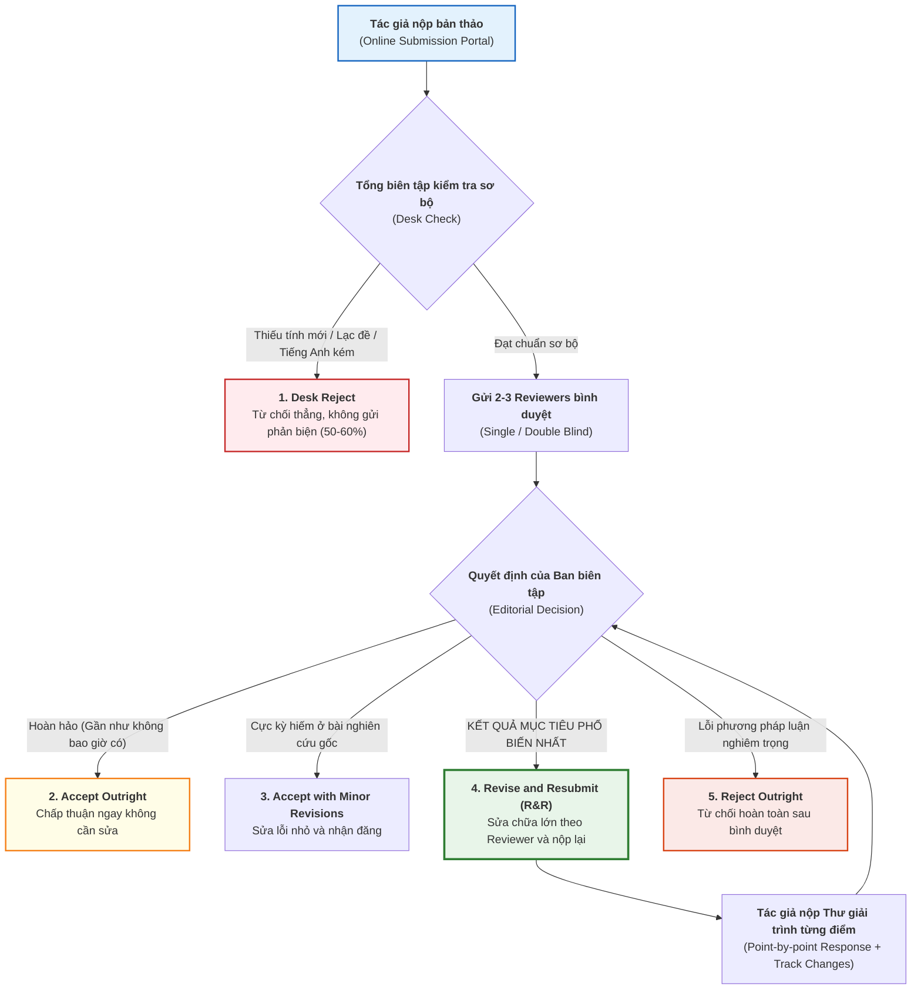

# GIÁO TRÌNH TOÀN DIỆN: WRITING IN THE SCIENCES
## MODULE 6: XUẤT BẢN CHÍNH TRỰC — ĐẠO ĐỨC KHOA HỌC, QUYỀN TÁC GIẢ & QUY TRÌNH BÌNH DUYỆT
*(Publishing with Integrity: Ethics, Authorship, and Submission)*

---

**Thông tin khóa học & Học phần:**
- **Khóa học:** Writing in the Sciences (Viết khoa học chuẩn quốc tế)
- **Đơn vị phát hành:** Stanford Online — Đại học Stanford (Stanford University)
- **Giảng viên chủ nhiệm:** Dr. Kristin Sainani (Phó Giáo sư Dịch tễ học & Thống kê sinh học, Đại học Stanford)
- **Khách mời chuyên gia:**
  - **GS. Bradley Efron:** Giáo sư Thống kê học Stanford, Viện sĩ Viện Hàn lâm Khoa học Quốc gia Hoa Kỳ, tác giả kỹ thuật Bootstrap, nguyên Tổng biên tập *The Annals of Applied Statistics*.
  - **TS. George Lundberg:** Cựu Tổng biên tập tạp chí *JAMA* (17 năm), tiên phong mô hình Open Access và bài báo y khoa có cấu trúc.
  - **TS. Gary Friedman:** Biên tập viên kỳ cựu của *American Journal of Epidemiology* (AJE) hơn 20 năm, nguyên Viện trưởng Nghiên cứu Kaiser Permanente.
- **Bản quyền biên soạn tài liệu tiếng Việt:** Dự án Tutor / Trợ lý Học thuật
- **Vị trí lưu trữ bài giảng & Video offline:** [`coursera/output_course/writing_science/Module_06_Publishing_with_Integrity_Ethics_Authorship_and_Submission/`](file:///home/khanh/projects/tutor/coursera/output_course/writing_science/Module_06_Publishing_with_Integrity_Ethics_Authorship_and_Submission/)

---

## MỤC LỤC TỔNG QUAN

1. [Mục tiêu học tập & Chuẩn đầu ra](#1-mục-tiêu-học-tập--chuẩn-đầu-ra)
2. [Bảng thuật ngữ cốt lõi (Core Terminology Glossary)](#2-bảng-thuật-ngữ-cốt-lõi-core-terminology-glossary)
3. [Quy trình nộp bài & 4 trạng thái phản hồi của Tạp chí](#3-quy-trình-nộp-bài--4-trạng-thái-phản-hồi-của-tạp-chí)
4. [Phân tích chi tiết từng bài học (Lectures 6.1 — 6.8 & Demo 6)](#4-phân-tích-chi-tiết-từng-bài-học)
   - [4.1. Bài 6.1: Đạo văn và Tự đạo văn (Plagiarism & Self-Plagiarism)](#41-bài-61-đạo-văn-và-tự-đạo-văn-plagiarism--self-plagiarism)
   - [4.2. Bài 6.2: Tiêu chuẩn quyền tác giả & Vấn nạn Ghost/Guest Authorship](#42-bài-62-tiêu-chuẩn-quyền-tác-giả--vấn-nạn-ghostguest-authorship)
   - [4.3. Bài 6.3: Quy trình nộp bài & Kỹ năng phản hồi Reviewer (Point-by-Point Response)](#43-bài-63-quy-trình-nộp-bài--kỹ-năng-phản-hồi-reviewer-point-by-point-response)
   - [4.4. Bài 6.4: Tọa đàm GS. Bradley Efron (Stanford) — Đơn giản hóa & Triết lý "Fewer and Better"](#44-bài-64-tọa-đàm-gs-bradley-efron-stanford--đơn-giản-hóa--triết-lý-fewer-and-better)
   - [4.5. Bài 6.5: Tọa đàm TS. George Lundberg (Cựu TBT JAMA) — Để nguội bài, Fit tạp chí & Tương lai Open Access](#45-bài-65-tọa-đàm-ts-george-lundberg-cựu-tbt-jama--để-nguội-bài-fit-tạp-chí--tương-lai-open-access)
   - [4.6. Bài 6.6: Tọa đàm TS. Gary Friedman (AJE) — Chống "cắt lát salami" & Giá trị của phát hiện âm tính](#46-bài-66-tọa-đàm-ts-gary-friedman-aje--chống-cắt-lát-salami--giá-trị-của-phát-hiện-âm-tính)
   - [4.7. Bài 6.7: Kỹ năng bình duyệt chuyên gia (Doing a Peer Review)](#47-bài-67-kỹ-năng-bình-duyệt-chuyên-gia-doing-a-peer-review)
   - [4.8. Bài 6.8: Nhận diện và phòng tránh Tạp chí săn mồi (Predatory Journals)](#48-bài-68-nhận-diện-và-phòng-tránh-tạp-chí-săn-mồi-predatory-journals)
   - [4.9. Bài Demo Edit 6 (Optional): Thị phạm biên tập bài luận chứng sợ nha khoa (Odontophobia)](#49-bài-demo-edit-6-optional-thị-phạm-biên-tập-bài-luận-chứng-sợ-nha-khoa-odontophobia)
5. [Giải thích chi tiết & Đáp án chuẩn mực Unit 6 Homework](#5-giải-thích-chi-tiết--đáp-án-chuẩn-mực-unit-6-homework)
6. [Hướng dẫn & Bài luận mẫu đạt điểm tuyệt đối (AI-Graded Essay: 10/10)](#6-hướng-dẫn--bài-luận-mẫu-đạt-điểm-tuyệt-đối-ai-graded-essay-1010)
7. [Bộ Checklist chuẩn mực đạo đức & Quy trình bình duyệt nộp bài](#7-bộ-checklist-chuẩn-mực-đạo-đức--quy-trình-bình-duyệt-nộp-bài)
8. [Danh mục Video bài giảng Module 6 đã lưu trữ Offline](#8-danh-mục-video-bài-giảng-module-6-đã-lưu-trữ-offline)

---

# 1. MỤC TIÊU HỌC TẬP & CHUẨN ĐẦU RA

Sau khi hoàn tất Module 6, học viên được trang bị năng lực xuất bản khoa học toàn diện và tư duy đạo đức học thuật chuẩn mực quốc tế:

1. **WHAT — Bản chất các chuẩn mực đạo đức và pháp lý trong xuất bản khoa học:**
   - Định nghĩa chính xác và phân biệt rõ các ranh giới: **Đạo văn thực chất (Plagiarism)**, **Đạo văn chắp vá (Patchwriting)**, **Tự đạo văn (Self-plagiarism)** và **Diễn giải hợp lệ (Acceptable Paraphrase)**.
   - Nắm vững 4 tiêu chuẩn vàng về **Quyền tác giả (Authorship)** của Ủy ban Quốc tế các Tổng biên tập Tạp chí Y học (ICMJE).
   - Nhận diện các hình thức gian lận cấu trúc nguy hại: **Tác giả ma (Ghost author)**, **Tác giả danh dự (Guest / Honorary author)**, **Cắt lát dữ liệu (Salami slicing)** và **Tạp chí săn mồi (Predatory open-access journals)**.
2. **WHY — Nhận thức sâu sắc hệ thống bình duyệt từ góc nhìn Ban biên tập (Behind the Scenes):**
   - Hiểu được động cơ và quy trình làm việc của Tổng biên tập (Editor-in-Chief), Biên tập viên phụ trách (Handling Editor) và Người bình duyệt (Peer Reviewers): Tại sao 50–60% bài báo bị từ chối ngay từ bàn biên tập (*Desk Reject*)?
   - Thấy rõ tại sao thư mời "Revise and Resubmit" (R&R) tuy có vẻ tiêu cực nhưng lại là **kết quả thành công nhất** mà một tác giả nộp bài lần đầu có thể kỳ vọng.
   - Thấu hiểu tâm lý phản xạ phòng thủ (*defensiveness*) của tác giả khi nhận chỉ trích và biết cách chuyển hóa nó thành cơ hội hoàn thiện công trình.
3. **HOW — Kỹ năng thực thi chuyên nghiệp trong quá trình bình duyệt:**
   - Soạn thảo thư giải trình phản hồi Reviewer theo nguyên tắc **từng điểm một (Point-by-point response letter)** với phong thái nhã nhặn, tôn trọng và minh bạch vị trí sửa đổi (Track Changes).
   - Đóng vai trò Người bình duyệt (Peer Reviewer) độc lập: Xây dựng bản nhận xét khách quan, tập trung vào công trình thay vì công kích cá nhân tác giả (*critique the work, not the author*).
   - Kiểm tra và sàng lọc tạp chí uy tín thông qua các chỉ số thật, né tránh các bẫy chỉ số Impact Factor giả mạo.

---

# 2. BẢNG THUẬT NGỮ CỐT LÕI (CORE TERMINOLOGY GLOSSARY)

| Thuật ngữ tiếng Anh | Thuật ngữ tiếng Việt tương đương | Định nghĩa & Ý nghĩa học thuật chuyên sâu |
| :--- | :--- | :--- |
| **Plagiarism** | Đạo văn | Hành vi chiếm đoạt ngôn từ, ý tưởng, cấu trúc hoặc phát hiện của người khác và công bố như thể đó là sản phẩm của chính mình mà không có trích dẫn hoặc dấu ngoặc kép phù hợp. |
| **Patchwriting** | Đạo văn chắp vá / Chỉnh sửa mỹ phẩm | Dạng đạo văn tinh vi bằng cách sao chép cấu trúc câu của bản gốc rồi chỉ thay đổi một vài từ đồng nghĩa đơn lẻ (*cosmetic synonym substitutions*); không thể hiện được sự hiểu biết độc lập. |
| **Self-Plagiarism** | Tự đạo văn | Việc tái sử dụng lại các đoạn văn, dữ liệu hoặc kết quả từ các công trình đã xuất bản trước đó của chính mình mà không trích dẫn hoặc vi phạm bản quyền (*copyright*) đã chuyển giao cho tạp chí cũ. |
| **Public Responsibility** | Trách nhiệm công khai | Rào cản cao nhất của Quyền tác giả: Tác giả đứng tên phải sẵn sàng chịu trách nhiệm công khai trước cộng đồng khoa học và pháp luật nếu bài báo xảy ra sai sót nghiêm trọng hoặc gian lận học thuật (*fraud*). |
| **Ghost Authorship** | Tác giả ma | Tình trạng một người trực tiếp viết bài báo (thường là cây bút chuyên nghiệp được công ty dược phẩm thuê) nhưng tên của họ bị giấu kín hoàn toàn khỏi danh sách tác giả. |
| **Guest / Honorary Authorship**| Tác giả khách mời / Danh dự | Việc đưa tên một giáo sư hoặc chuyên gia nổi tiếng vào danh sách tác giả dù họ chỉ tham gia tối thiểu hoặc không tham gia nghiên cứu, nhằm mượn danh tiếng đánh bóng độ tin cậy của bài báo. |
| **Salami Slicing** | Cắt lát xúc xích dữ liệu | Hành vi phi đạo đức khi tác giả chia nhỏ một công trình nghiên cứu lớn có thể xuất bản trọn vẹn thành nhiều bài báo nhỏ vụn nhằm tăng số lượng công bố (ví dụ tách riêng nam và nữ). |
| **Desk Reject** | Từ chối tại bàn biên tập | Tình trạng bản thảo bị Tổng biên tập từ chối ngay lập tức mà không được gửi đi bình duyệt đồng nghiệp (thường do không phù hợp phạm vi tạp chí, thiếu tính mới hoặc tiếng Anh quá kém). |
| **Revise and Resubmit (R&R)** | Yêu cầu sửa đổi và nộp lại | Kết quả phổ biến và tích cực nhất ở lần nộp đầu: Ban biên tập bày tỏ sự quan tâm và sẵn sàng xem xét chấp thuận nếu tác giả khắc phục thỏa đáng toàn bộ các chỉ trích của Reviewer. |
| **Predatory Journals** | Tạp chí săn mồi | Các tạp chí mở giả mạo, lợi dụng mô hình Open Access để thu phí xử lý bài viết (APC) từ tác giả nhưng không hề thực hiện quy trình bình duyệt nghiêm túc (*bogus peer review*). |
| **Cooling-off Period** | Giai đoạn để nguội bản thảo | Khoảng thời gian cất bản thảo vào ngăn kéo từ 1–3 ngày sau khi viết xong để tâm trí thoát khỏi sự say sưa chủ quan, trước khi quay lại rà soát với tư cách là một biên tập viên khó tính nhất. |

---

# 3. QUY TRÌNH NỘP BÀI & 4 TRẠNG THÁI PHẢN HỒI CỦA TẠP CHÍ

Hiểu rõ quy trình chuyển động của một bản thảo sau khi ấn nút "Submit" trên cổng trực tuyến giúp nhà khoa học chủ động tâm thế và tránh hoang mang:

> [!IMPORTANT]
> **Giải mã ngôn ngữ ngoại giao của bức thư R&R:**
> Thư gửi từ Ban biên tập thường mở đầu bằng giọng điệu có vẻ rất lạnh lùng: *"We regret to inform you that your manuscript is not acceptable for publication in its current form..."* Đừng vội nản lòng hay suy sụp! Hãy đọc tiếp đoạn văn tiếp theo: *"However, if you feel you can adequately address the comments of the reviewers, we invite you to revise and resubmit..."* Đây chính là **tín hiệu bật đèn xanh**. Tổng biên tập muốn xuất bản bài báo của bạn một khi các lỗ hổng đã được khắc phục!

---

# 4. PHÂN TÍCH CHI TIẾT TỪNG BÀI HỌC

## 4.1. Bài 6.1: Đạo văn và Tự đạo văn (Plagiarism & Self-Plagiarism)
*(Link bài học: [`37_6.1 Plagiarism.md`](file:///home/khanh/projects/tutor/coursera/output_course/writing_science/Module_06_Publishing_with_Integrity_Ethics_Authorship_and_Submission/37_6.1%20Plagiarism.md) | Video: [`videos/37_6.1_Plagiarism.mp4`](file:///home/khanh/projects/tutor/coursera/output_course/writing_science/Module_06_Publishing_with_Integrity_Ethics_Authorship_and_Submission/videos/37_6.1_Plagiarism.mp4))*

### 1. Bản chất của Đạo văn (Plagiarism)
Đạo văn là việc biến thành quả trí tuệ, câu từ hoặc ý tưởng của người khác thành của mình.
- **Quy tắc xác suất 7–10 từ (The 7–10 Word Rule):** Các cụm thành ngữ hoặc thuật ngữ thông dụng có thể dài 4–5 từ. Nhưng khi một chuỗi liên tiếp từ **7 đến 10 từ trùng khớp hoàn toàn** giữa hai tác giả độc lập, xác suất ngẫu nhiên theo lý thuyết thống kê là **gần bằng 0 (infinitesimally small)**. Điều đó chắc chắn là đạo văn!
- **Đạo văn chắp vá (Patchwriting):** Nhiều sinh viên lầm tưởng rằng chỉ cần lấy một câu văn trên mạng/Wikipedia, sau đó thay thế 1-2 từ bằng từ đồng nghĩa (ví dụ: thay *economical* thành *thrifty*, thay *life of adventure* thành *audacious lifestyle*) là đã thành văn bản của mình. TS. Sainani khẳng định: Đây chỉ là **chỉnh sửa mỹ phẩm (cosmetic changes)**, người viết hoàn toàn không hiểu sâu về đối tượng và bản chất vẫn là đạo văn trắng trợn.

### 2. Tự đạo văn (Self-Plagiarism) và Gian lận dữ liệu cũ
- Việc tái chế bài viết cũ của chính mình vào một bài báo mới là phi đạo đức vì:
  1. Vi phạm bản quyền: Bạn đã ký hợp đồng chuyển giao bản quyền (*Copyright Transfer*) cho nhà xuất bản của bài báo trước.
  2. Gian dối học thuật: Độc giả tưởng rằng có hai bằng chứng độc lập ủng hộ một giả thuyết, trong khi thực chất chỉ là một bộ dữ liệu được xào xáo lại.
- **Ngoại lệ duy nhất:** Phần **Methods** có thể cho phép sự tương đồng văn bản nhất định nếu bạn sử dụng cùng một quy trình thí nghiệm kỹ thuật tiêu chuẩn (ví dụ: nuôi cấy tế bào, giải trình tự gen), vì quy trình thao tác chỉ có bấy nhiêu cách diễn đạt. Tuy nhiên, toàn bộ Introduction, Results và Discussion phải được viết mới hoàn toàn.

### 3. Tỷ lệ đạo văn gây sốc trong thực tế
- Thử nghiệm hệ thống phần mềm *CrossCheck* (iThenticate) trên các tạp chí quốc tế ghi nhận **6% đến 23% bản thảo nộp vào bị từ chối ngay lập tức do đạo văn**.
- Nghiên cứu của Brigham and Women's Hospital (Bệnh viện thực hành danh tiếng của Đại học Harvard): Kiểm tra 5.000 bài luận cá nhân (*personal statements*) của các bác sĩ nộp đơn thi bác sĩ nội trú, phát hiện **5% (tức cứ 20 bác sĩ thì có 1 người) có hành vi đạo văn rõ ràng**!

---

## 4.2. Bài 6.2: Tiêu chuẩn quyền tác giả & Vấn nạn Ghost/Guest Authorship
*(Link bài học: [`38_6.2 Authorship.md`](file:///home/khanh/projects/tutor/coursera/output_course/writing_science/Module_06_Publishing_with_Integrity_Ethics_Authorship_and_Submission/38_6.2%20Authorship.md) | Video: [`videos/38_6.2_Authorship.mp4`](file:///home/khanh/projects/tutor/coursera/output_course/writing_science/Module_06_Publishing_with_Integrity_Ethics_Authorship_and_Submission/videos/38_6.2_Authorship.mp4))*

### 1. Trụ cột của Quyền tác giả: Trách nhiệm công khai (Public Responsibility)
- Đứng tên tác giả trên bài báo đồng nghĩa với việc bạn **chịu trách nhiệm công khai về nội dung của nó trước toàn xã hội**. Nếu công trình bị phát hiện có số liệu giả, ngụy tạo kết quả hoặc bị rút bài (*retraction*), uy tín và danh dự khoa học của bạn sẽ bị hủy hoại.
- Vì lý do đó, **không phải ai có đóng góp cũng được mời làm tác giả**:
  - Người chỉ góp ý thống kê sơ bộ, chỉnh sửa tiếng Anh, tài trợ kinh phí, cho mượn phòng thí nghiệm hoặc cung cấp hóa chất/bệnh phẩm **chỉ nên được đưa vào mục Lời cảm ơn (Acknowledgements)**.

### 2. Quy ước thứ tự tên tác giả (Authorship Order)
- **Tác giả đầu tiên (First Author):** Người thực hiện phần lớn công việc thực nghiệm, phân tích dữ liệu và trực tiếp viết bản nháp đầu tiên (thường là học viên cao học, nghiên cứu sinh, nhà nghiên cứu trẻ).
- **Tác giả cuối cùng (Senior / Corresponding Author):** Người đứng đầu phòng thí nghiệm (Principal Investigator - PI), người định hướng ý tưởng, xin kinh phí tài trợ và bảo trợ về mặt học thuật cho công trình.
- **Các tác giả ở giữa (Middle Authors):** Xếp theo mức độ đóng góp giảm dần; nếu đóng góp ngang nhau có thể xếp theo thứ tự bảng chữ cái.

### 3. Vấn nạn Tác giả ma (Ghost) & Tác giả danh dự (Guest/Honorary)
- **Ghost Authorship:** Công ty dược phẩm thuê người viết bài chuyên nghiệp (*medical writers*) biên soạn bản thảo có lợi cho thuốc của họ, nhưng tên của người viết không xuất hiện trên bài báo.
- **Guest Authorship:** Công ty dược sau khi hoàn thành bài báo sẽ "tặng" quyền tác giả (thường là vị trí thứ nhất hoặc thứ hai) cho một giáo sư đại học danh tiếng để mượn uy tín trường đại học đánh bóng sản phẩm.
- **Vụ bê bối thuốc Vioxx (Hãng Merck — Công bố trên JAMA 2008):** Tòa án phanh phui hàng loạt tài liệu nội bộ cho thấy Merck thuê công ty viết bài quảng bá và mời các bác sĩ danh tiếng đứng tên độc quyền. Khảo sát của BMJ 2011 trên các tạp chí y khoa hàng đầu cho thấy có tới **17.6% bài báo có tác giả danh dự và 7.6% có tác giả ma**!

---

## 4.3. Bài 6.3: Quy trình nộp bài & Kỹ năng phản hồi Reviewer (Point-by-Point Response)
*(Link bài học: [`39_6.3 The Submission Process.md`](file:///home/khanh/projects/tutor/coursera/output_course/writing_science/Module_06_Publishing_with_Integrity_Ethics_Authorship_and_Submission/39_6.3%20The%20Submission%20Process.md) | Video: [`videos/39_6.3_The_Submission_Process.mp4`](file:///home/khanh/projects/tutor/coursera/output_course/writing_science/Module_06_Publishing_with_Integrity_Ethics_Authorship_and_Submission/videos/39_6.3_The_Submission_Process.mp4))*

### 1. Vượt qua phản xạ tự vệ tâm lý (Defensiveness)
Khi nhận bản nhận xét từ Reviewer với hàng loạt lời chỉ trích gay gắt, phản xạ tự nhiên của con người là bực tức, tự ái và cho rằng reviewer ngu ngốc hoặc không hiểu chuyên môn.
- **Kỹ năng sống còn:** Phải tách bạch cái tôi cá nhân ra khỏi lời phê bình. Reviewer không công kích bạn, họ đang chỉ trích văn bản.
- **Quy luật Reviewer nhầm lẫn:** Ngay cả khi Reviewer phê bình sai một vấn đề khoa học, nguyên nhân sâu xa thường là do **cách hành văn của bạn chưa đủ rõ ràng khiến họ hiểu lầm**! Hãy coi mọi lời phê bình là chỉ dấu cho thấy bài viết cần được giải thích sáng tỏ hơn.

### 2. Kỹ thuật viết Thư giải trình chuẩn mực (Point-by-Point Response Letter)
1. **Lời mở đầu lịch thiệp:** Bày tỏ lòng biết ơn chân thành đối với công sức của Editor và các Reviewers (*"We thank the Editor and Reviewers for their constructive and insightful feedback. We feel the manuscript is substantially improved."*).
2. **Đánh số thứ tự từng ý kiến:** Copy nguyên văn từng ý kiến nhận xét của Reviewer và viết câu trả lời ngay bên dưới.
3. **Chỉ rõ vị trí sửa đổi:** Nêu cụ thể trang, dòng và trích dẫn đoạn văn mới đã bổ sung (*"We agree with Reviewer 1 that Section X was too brief. Accordingly, we have added a clarifying paragraph on Page 5, Lines 120–128."*).
4. **Tranh luận có văn hóa:** Nếu bạn không đồng ý với một yêu cầu sửa đổi, hãy giải trình bằng luận cứ khoa học và số liệu khách quan, tuyệt đối không dùng từ ngữ công kích.
5. **Nộp kèm bản Track Changes:** Luôn nộp kèm bản thảo hiển thị rõ các vết chỉnh sửa (gạch đỏ/chữ xanh) để Reviewer dễ dàng kiểm chứng.

### 3. Thống kê quan trọng: 60% chỉ trích thuộc về Kỹ năng Viết
Theo các khảo sát biên tập y khoa uy tín, **khoảng 60% những lời chê bai của Reviewer là về chất lượng viết văn, sự rườm rà và cách trình bày Bảng biểu/Đồ thị**, chỉ khoảng 40% thực sự liên quan đến khiếm khuyết phương pháp luận nghiên cứu!

---

## 4.4. Bài 6.4: Tọa đàm GS. Bradley Efron (Stanford) — Đơn giản hóa & Triết lý "Fewer and Better"
*(Link bài học: [`40_6.4 Interview with Dr. Bradley Efron.md`](file:///home/khanh/projects/tutor/coursera/output_course/writing_science/Module_06_Publishing_with_Integrity_Ethics_Authorship_and_Submission/40_6.4%20Interview%20with%20Dr.%20Bradley%20Efron.md) | Video: [`videos/40_6.4_Interview_with_Dr_Bradley_Efron.mp4`](file:///home/khanh/projects/tutor/coursera/output_course/writing_science/Module_06_Publishing_with_Integrity_Ethics_Authorship_and_Submission/videos/40_6.4_Interview_with_Dr_Bradley_Efron.mp4))*

GS. Bradley Efron (người khai sinh phương pháp Bootstrap lừng danh thế giới) chia sẻ những triết lý xuất bản sâu sắc:
1. **"Nếu muốn được đọc, hãy làm cho bài báo dễ chịu khi đọc" (*Make it pleasant to read*):** Viết khoa học giống như viết báo chí: Câu đầu tiên nói ngay câu chuyện, đoạn đầu giải thích rõ hơn, phần đầu cung cấp chi tiết.
2. **Đưa ví dụ truyền cảm hứng lên đầu trang (*Motivating Example up front*):** Đừng giấu ví dụ thực tế ở tận cùng bài báo sau hàng đống công thức toán và ký hiệu rối rắm. Hãy cho người đọc thấy ứng dụng thực tiễn ngay lập tức.
3. **Đừng sợ "Dumbing down" (Bình dị hóa bài viết):** Hầu hết mọi người (kể cả Reviewer) không am hiểu ngóc ngách hẹp của bạn bằng chính bạn. Hãy giải thích bằng ngôn ngữ đơn giản nhất có thể. Không ai bị ấn tượng bởi một mớ thuật ngữ phức tạp rỗng tuếch.
4. **Bài báo vĩ đại nhất của GS. Efron cũng từng bị từ chối!** Bài báo đột phá về kỹ thuật Bootstrap của ông từng bị các Reviewer từ chối thẳng thừng vì các ý tưởng mới mẻ thường đe dọa các quan điểm bảo thủ cũ. Sự kiên trì và tự tin vào khoa học chân chính là chìa khóa.
5. **Phương châm sống của Gauss: "Pauca sed matura" (Fewer and better - Ít nhưng chín muồi):** Đừng chạy theo số lượng bài báo vụn vặt. Một bài báo xuất sắc có ảnh hưởng thay đổi cả ngành quan trọng hơn hàng chục bài báo tầm thường.

---

## 4.5. Bài 6.5: Tọa đàm TS. George Lundberg (Cựu TBT JAMA) — Để nguội bài, Fit tạp chí & Tương lai Open Access
*(Link bài học: [`41_6.5 Interview with Dr. George Lundberg.md`](file:///home/khanh/projects/tutor/coursera/output_course/writing_science/Module_06_Publishing_with_Integrity_Ethics_Authorship_and_Submission/41_6.5%20Interview%20with%20Dr.%20George%20Lundberg.md) | Video: [`videos/41_6.5_Interview_with_Dr_George_Lundberg.mp4`](file:///home/khanh/projects/tutor/coursera/output_course/writing_science/Module_06_Publishing_with_Integrity_Ethics_Authorship_and_Submission/videos/41_6.5_Interview_with_Dr_George_Lundberg.mp4))*

Với 17 năm làm Tổng biên tập tạp chí hàng đầu thế giới *JAMA*, TS. George Lundberg truyền đạt những bài học đắt giá:
1. **Mục tiêu của Tạp chí:** Ban biên tập luôn tìm kiếm những bài báo làm cho tạp chí của họ "trông đẹp đẽ và uy tín" (*make the journal look good*).
2. **Quy tắc tuân thủ Hướng dẫn tác giả (*Instructions for Authors*):** Biên tập viên có thể "ngửi" thấy ngay tác giả nào không chịu đọc hướng dẫn. Nếu một tác giả không tuân thủ được những quy chuẩn định dạng cơ bản, liệu người đó có cẩn thận và chính xác trong nghiên cứu khoa học hay không?
3. **Kỹ thuật "Để bản thảo nguội trong ngăn kéo" (*Cooling-off Period*):** Khi viết xong, hãy cất bài báo đi 1–2 ngày. Sau đó mở ra đọc lại với tâm thế của **người biên tập tàn nhẫn nhất thế giới (*the meanest editor in the world*)**, và nhờ 1–2 đồng nghiệp thân thiết phản biện không khoan nhượng.
4. **Cảnh báo sai lầm ngốc nghếch nhất khi bị R&R:** Rất nhiều tác giả tự ái khi nhận thư R&R, liền rút bài và đem nguyên bản thảo chưa sửa nộp sang tạp chí khác. Tạp chí mới rất có thể sẽ gửi cho chính Reviewer cũ! Khi Reviewer phát hiện tác giả không thèm tiếp thu một lời góp ý nào, bài báo sẽ bị từ chối ngay lập tức.
5. **Kỷ nguyên Truy cập Mở (Open Access):** Nghiên cứu được tài trợ bởi ngân sách công thì công chúng có quyền tiếp cận miễn phí.

---

## 4.6. Bài 6.6: Tọa đàm TS. Gary Friedman (AJE) — Chống "cắt lát salami" & Giá trị của phát hiện âm tính
*(Link bài học: [`42_6.6 Interview with Dr. Gary Friedman.md`](file:///home/khanh/projects/tutor/coursera/output_course/writing_science/Module_06_Publishing_with_Integrity_Ethics_Authorship_and_Submission/42_6.6%20Interview%20with%20Dr.%20Gary%20Friedman.md) | Video: [`videos/42_6.6_Interview_with_Dr_Gary_Friedman.mp4`](file:///home/khanh/projects/tutor/coursera/output_course/writing_science/Module_06_Publishing_with_Integrity_Ethics_Authorship_and_Submission/videos/42_6.6_Interview_with_Dr_Gary_Friedman.mp4))*

TS. Gary Friedman (biên tập viên hơn 20 năm tại *American Journal of Epidemiology*) lưu ý:
1. **Lý do từ chối bài ngay lập tức (Desk Reject):** Thiếu tính mới (Novelty) — ví dụ viết bài báo thứ 30 chứng minh rượu gây tăng huyết áp; hoặc bài viết quá dài, lan man, tiếng Anh yếu kém.
2. **Vấn nạn "Cắt lát salami" (Salami Slicing):** Các tạp chí cực kỳ dị ứng với việc một nghiên cứu bị băm nhỏ thành nhiều bài báo ngắn. TS. Friedman kể lại bài học cá nhân khi ông chủ động rút một bài báo đã được nhận đăng ở tạp chí khác để gộp chung với đồng nghiệp nộp vào *New England Journal of Medicine (NEJM)* và thành công rực rỡ.
3. **Bài báo của nghiên cứu sinh "nghe như một luận án tốt nghiệp":** Sinh viên mới ra trường thường mắc lỗi cố gắng khoe kiến thức bằng cách giải thích lại những khái niệm ai cũng biết, liệt kê mọi ưu nhược điểm vặt vãnh. Hãy viết với phong thái của một nhà khoa học dạn dày kinh nghiệm, chỉ nêu những điểm hạn chế mang tính quyết định.
4. **Tôn vinh Kết quả âm tính (Negative Findings):** Phần lớn các giả thuyết trong dịch tễ học và y học không đem lại kết quả như mong đợi ban đầu. Kết quả âm tính có giá trị cảnh báo cực kỳ quan trọng cho giới khoa học và hoàn toàn xứng đáng được xuất bản (dưới dạng *Brief Report*).

---

## 4.7. Bài 6.7: Kỹ năng bình duyệt chuyên gia (Doing a Peer Review)
*(Link bài học: [`43_6.7 Doing a peer review.md`](file:///home/khanh/projects/tutor/coursera/output_course/writing_science/Module_06_Publishing_with_Integrity_Ethics_Authorship_and_Submission/43_6.7%20Doing%20a%20peer%20review.md) | Video: [`videos/43_6.7_Doing_a_peer_review.mp4`](file:///home/khanh/projects/tutor/coursera/output_course/writing_science/Module_06_Publishing_with_Integrity_Ethics_Authorship_and_Submission/videos/43_6.7_Doing_a_peer_review.mp4))*

### 1. Tại sao Ban biên tập thích mời Reviewer trẻ?
- Các nhà nghiên cứu trẻ (nghiên cứu sinh, sau tiến sĩ) nắm rất vững các kỹ thuật phòng lab và thuật toán mới nhất, làm việc với tinh thần trách nhiệm cao và cực kỳ kỹ lưỡng.
- Trái lại, các reviewer thâm niên thường bị "thoái hóa" chất lượng (*deterioration effect*) do bận rộn và đọc lướt quá nhanh.

### 2. Chuẩn mực văn phong bình duyệt (Review Tone)
- **Tập trung phê bình công trình, không công kích tác giả:** Thay vì viết *"Các tác giả hoàn toàn thiếu hiểu biết về thống kê khi đưa vào Bảng 5"*, hãy viết: *"Bảng 5 chứa thông tin chưa thực sự cần thiết, hệ số tương quan Pearson có thể không phù hợp trong bối cảnh này; tác giả nên cân nhắc sửa đổi hoặc lược bỏ Bảng 5"*.
- **Reviewer không phải là Biên tập viên sửa bản in (Reviewer $\neq$ Copy Editor):** Đừng lãng phí thời gian đi bắt từng lỗi chính tả nhỏ nhặt. Nhiệm vụ của Reviewer là đánh giá tính đúng đắn của phương pháp, tính logic của suy luận và mức độ tin cậy của dữ liệu.

### 3. Cấu trúc bản phản biện chuẩn
1. **Đoạn 1:** Tóm tắt phát hiện chính của bài báo, nêu rõ các điểm mạnh và đóng góp tích cực (luôn bắt đầu bằng lời khen ngợi chân thành).
2. **Đoạn 2:** Tóm lược 1–2 hạn chế hoặc mối quan ngại cốt lõi nhất.
3. **Danh mục nhận xét chi tiết (5–15 điểm đánh số):** Đi theo từng phần (Methods, Tables/Figures, Results, Discussion).
4. **Nhận xét bí mật cho Tổng biên tập (Confidential Comments to Editor):** Nêu khuyến nghị dứt khoát (Chấp thuận, Sửa chữa hay Từ chối) và các nghi vấn đạo đức nếu có.

---

## 4.8. Bài 6.8: Nhận diện và phòng tránh Tạp chí săn mồi (Predatory Journals)
*(Link bài học: [`44_6.8 Predatory journals.md`](file:///home/khanh/projects/tutor/coursera/output_course/writing_science/Module_06_Publishing_with_Integrity_Ethics_Authorship_and_Submission/44_6.8%20Predatory%20journals.md) | Video: [`videos/44_6.8_Predatory_journals.mp4`](file:///home/khanh/projects/tutor/coursera/output_course/writing_science/Module_06_Publishing_with_Integrity_Ethics_Authorship_and_Submission/videos/44_6.8_Predatory_journals.mp4))*

### 1. Bản chất của Tạp chí săn mồi (Predatory Open-Access)
Lợi dụng mô hình tác giả trả phí xuất bản (*Article Processing Charge - APC*) của các tạp chí truy cập mở chân chính (như *PLOS*, *BioMed Central*), các tổ chức trục lợi đã lập ra hàng ngàn tạp chí ma với mục đích duy nhất là thu tiền mà không hề bình duyệt.
- **Thử nghiệm của nhà báo John Bohannan (Công bố trên tạp chí Science 2013):** Ông tạo ra 255 bản thảo giả mạo với lỗi phương pháp luận chết người lộ liễu. Kết quả chấn động: **157/255 tạp chí đã nhận đăng bài báo rác này để thu tiền!** (Trong khi *PLOS ONE* đã từ chối chính xác).

### 2. Dấu hiệu nhận biết Tạp chí săn mồi
- Nhận được email spam mời nộp bài hoặc mời vào Ban biên tập với câu từ hoa mỹ, tâng bốc, chứa nhiều lỗi ngữ pháp và dấu chấm than (!).
- Thời gian bình duyệt siêu tốc (chấp thuận đăng bài chỉ sau 3–5 ngày).
- Không có địa chỉ tòa soạn thực tế hoặc thông tin liên lạc rõ ràng.
- Sử dụng các chỉ số Impact Factor bịa đặt: **UIF** (*Universal Impact Factor*), **GIF** (*Global Impact Factor*), **JIF** giả mạo nhằm gây nhầm lẫn với chỉ số *Journal Impact Factor* chính thống của Clarivate/Web of Science.
- **Công cụ kiểm chứng an toàn:** Tra cứu trên **DOAJ** (*Directory of Open Access Journals*), **OASPA** (*Open Access Scholarly Publishers Association*) hoặc danh mục uy tín Scopus / Web of Science (SCI/SCIE).

---

## 4.9. Bài Demo Edit 6 (Optional): Thị phạm biên tập bài luận chứng sợ nha khoa (Odontophobia)
*(Link bài học: [`46_Demo Edit 6 (Optional).md`](file:///home/khanh/projects/tutor/coursera/output_course/writing_science/Module_06_Publishing_with_Integrity_Ethics_Authorship_and_Submission/46_Demo%20Edit%206%20(Optional).md) | Video: [`videos/46_Demo_Edit_6_Optional.mp4`](file:///home/khanh/projects/tutor/coursera/output_course/writing_science/Module_06_Publishing_with_Integrity_Ethics_Authorship_and_Submission/videos/46_Demo_Edit_6_Optional.mp4))*

TS. Kristin Sainani thị phạm biên tập một bài tiểu luận khoa học đại chúng về nỗi ám ảnh phòng khám nha khoa (*Odontophobia*).
- **Vấn đề cốt lõi của bản thảo gốc:** Tác giả viết nhiều thông tin thú vị nhưng thiếu một tuyên bố trọng tâm (*Statement of Purpose*), khiến người đọc không rõ bài viết muốn gửi gắm điều gì.
- **Giải pháp biên tập:**
  1. Thêm một đoạn văn định hướng ngay sau phần mở đầu: Làm rõ bài viết hướng tới việc giới thiệu các giải pháp phi dược lý đơn giản, chi phí thấp cho nha sĩ.
  2. Tái cấu trúc logic: Gom các giải pháp kích thích giác quan (mùi bánh mì nướng, cà phê, âm nhạc, tranh vẽ) vào một đoạn; các can thiệp giao tiếp vào một đoạn; các liệu pháp internet trực tuyến vào một đoạn; và đưa các giải pháp dùng thuốc xuống đoạn sau cùng.
  3. Chuyển hóa danh từ y khoa nặng nề thành động từ sinh động (*tachycardia, hypertension, transpiration* $\rightarrow$ *hyperventilate, sweat, experience sudden changes in blood pressure*).

---

# 5. GIẢI THÍCH CHI TIẾT & ĐÁP ÁN CHUẨN MỰC UNIT 6 HOMEWORK
*(Link bài tập: [`45_Unit 6 Homework.md`](file:///home/khanh/projects/tutor/coursera/output_course/writing_science/Module_06_Publishing_with_Integrity_Ethics_Authorship_and_Submission/45_Unit%206%20Homework.md))*

Dưới đây là đáp án và phân tích chuyên sâu cho toàn bộ 5 câu hỏi của Unit 6 Homework:

---

### Câu 1: Nhận diện hành vi đạo văn đoạn văn "The Hallmarks of Cancer"
- **Đoạn văn gốc (Buddhini Samarasinghe - Scientific American):**
  > *"In 2000, Robert Weinberg and Douglas Hanahan published a review article in the journal Cell titled "The Hallmarks of Cancer." It was a seminal paper in every sense of the word; downloaded 20,000 times a year between 2004 and 2007, with over 15,000 citations in other research papers."*
- **Hành vi cấu thành Đạo văn:**
  - Sao chép nguyên văn cụm từ độc đáo mang tính cá nhân cao của tác giả (*"a seminal paper in every sense of the word"*) hoặc sao chép nguyên vẹn chuỗi số liệu kèm từ ngữ liên kết mà không đặt trong dấu ngoặc kép và không ghi nguồn.
  - Thay đổi một vài từ lẻ tẻ mang tính mỹ phẩm (như đổi *published a review article* thành *wrote an overview*, đổi *seminal* thành *groundbreaking*) nhưng giữ nguyên cấu trúc ngữ pháp và chuỗi ý tưởng.

---

### Câu 2: Diễn giải hợp lệ (Acceptable Paraphrase)
- **Đoạn văn gốc:**
  > *"Weinberg and Hanahan simplified this dauntingly complex disease to six underlying principles. The hugely complicated beast that is cancer, so diverse that even the same organ can have many different tumor types, was reduced to just six common traits that every single cancer shares, to facilitate that transformation from a normal cell to a cancer cell. It answers the 'how does cancer happen' question very elegantly, and we gain insight into all the different things that go wrong in a cancer cell."*
- **Tiêu chuẩn của Bản diễn giải hợp lệ (Acceptable Paraphrase):**
  - Người viết phải tiêu hóa trọn vẹn ý nghĩa, sau đó **gấp tài liệu lại và diễn đạt hoàn toàn bằng tư duy và vốn từ của chính mình**.
  - Bắt buộc phải có trích dẫn tác giả gốc.
  - **Mẫu diễn giải chuẩn mực:** *"According to Samarasinghe (2013), Weinberg and Hanahan's landmark review organized the bewildering biological complexity of cancer into six universal cellular capabilities, providing a cohesive framework for understanding malignant transformation."*

---

### Câu 3: Vụ việc đạo văn văn phong (Sabrina vs Moneypenny)
- **Bản gốc:** *“Sabrina was the brainy Angel. Yet another example of how every girl had to be one or the other: Pretty or smart. Guess which one I got. You’ll see where it’s gotten me.”*
- **Bản mới:** *“Moneypenny was the brainy female character. Yet another example of how every girl had to be one or the other: smart or pretty. I had long resigned myself to category one, and as long as it got me to Harvard, I was happy. Except, it hadn’t gotten me to Harvard. Clearly, it was time to switch to category two.”*
- **Đáp án chính xác:** **YES — ĐÂY CHẮC CHẮN LÀ ĐẠO VĂN (PLAGIARISM)**
- **Phân tích bản chất học thuật:**
  - Tác giả bản mới chỉ thay tên nhân vật (*Sabrina* $\rightarrow$ *Moneypenny*), đảo vị trí hai tính từ (*pretty or smart* $\rightarrow$ *smart or pretty*), nhưng đã bê nguyên xi câu văn xương sống: *"Yet another example of how every girl had to be one or the other..."*.
  - Cấu trúc nhịp điệu và ý tưởng đối lập được sao chép hoàn toàn. Đây chính là trường hợp đạo văn thực tế nổi tiếng của Kaavya Viswanathan khiến toàn bộ sách bị thu hồi và hủy bỏ hợp đồng xuất bản.

---

### Câu 4: Đạo văn chắp vá quy trình hóa đơn (Child-care Invoices)
- **Bản gốc:** *“Under the current program, child care providers send monthly invoices to GSA for each child, and the agency pays its portion of the bill when it verifies the information it receives from applicants and providers. Families have to pay all child care costs up front while waiting for GSA approval."*
- **Bản mới:** *“The program worked this way: Child-care providers send monthly invoices to the GSA for each child, and the agency pays its part of the cost once it verifies the information it receives from families and providers. Families have to pay all child-care costs up front while they wait for approval."*
- **Đáp án chính xác:** **YES — ĐÂY CHẮC CHẮN LÀ ĐẠO VĂN (PLAGIARISM)**
- **Phân tích bản chất học thuật:**
  - Đây là ví dụ kinh điển của kỹ thuật đạo văn "Patchwriting": Thay thế từ đồng nghĩa một cách máy móc (*portion of the bill* $\rightarrow$ *part of the cost*, *when* $\rightarrow$ *once*, *applicants* $\rightarrow$ *families*, *waiting for* $\rightarrow$ *they wait for*).
  - Hơn 85% từ ngữ và trật tự ngữ pháp hoàn toàn trùng khớp. Tác giả không hề có sự sáng tạo ngôn ngữ độc lập nào.

---

### Câu 5: Tiêu chuẩn trao quyền tác giả (Authorship Contribution)
- **Đề bài:** *True or False. Everyone who makes any contribution to a paper, no matter how minor, should be offered authorship.*
- **Đáp án chính xác:** **FALSE**
- **Phân tích bản chất học thuật:**
  - Theo tiêu chuẩn quốc tế của ICMJE, quyền tác giả chỉ dành cho những người có **đóng góp trí tuệ đáng kể** vào thiết kế, thu thập dữ liệu, phân tích hoặc soạn thảo bản thảo VÀ **sẵn sàng chịu trách nhiệm công khai trước công chúng về toàn bộ nội dung**.
  - Những đóng góp nhỏ (tài trợ kinh phí, cho mượn thiết bị, chỉnh sửa ngữ pháp đơn thuần, tư vấn thống kê cơ bản) phải được tri ân ở phần **Lời cảm ơn (Acknowledgements)**, tuyệt đối không được đưa vào danh sách tác giả.

---

# 6. HƯỚNG DẪN & BÀI LUẬN MẪU ĐẠT ĐIỂM TUYỆT ĐỐI (AI-GRADED ESSAY: 10/10)
*(Link bài tập: [`47_AI-Graded Essay Writing Clearly for a Broad Audience.md`](file:///home/khanh/projects/tutor/coursera/output_course/writing_science/Module_06_Publishing_with_Integrity_Ethics_Authorship_and_Submission/47_AI-Graded%20Essay%20Writing%20Clearly%20for%20a%20Broad%20Audience.md))*

Bài tập yêu cầu viết một bài luận khoa học đại chúng từ **500–600 từ** (Câu 1: 5 điểm) kèm theo một đoạn giải trình **75–100 từ** về các lựa chọn viết (Câu 2: 5 điểm).

Dưới đây là bài mẫu hoàn hảo (Option 1: Tóm lược công trình kinh điển về Optogenetics của Karl Deisseroth) giúp học viên tham khảo và đạt trọn vẹn **10/10 điểm**:

---

### Câu 1: Bài luận mẫu (540 từ) — Option 1: Lay summary of a scientific paper

**Option Selected: Option 1 — Lay summary of a scientific paper**

**Title: Controlling Brain Circuits with Flashes of Light: The Dawn of Optogenetics**

For centuries, understanding the human brain has been like trying to decipher the internal mechanics of a supercomputer while blindfolded. Neuroscientists knew that billions of neurons communicate via rapid electrical impulses, but they lacked tools to manipulate specific circuits without disrupting neighboring tissue. Traditional drugs flood the entire brain slowly, while implanted electrodes stimulate all cell types indiscriminately. In 2005, a groundbreaking study published in *Nature Neuroscience* by Edward Boyden, Karl Deisseroth, and their colleagues changed brain science forever by introducing a revolutionary technology: optogenetics.

The research team solved neuroscience's longstanding precision problem by borrowing a trick from single-celled pond algae. These microbes produce a light-sensitive protein called channelrhodopsin-2, which acts like an electrical gate on the cell membrane, opening in response to blue light. The researchers wondered: Could this light-activated switch be installed into mammalian brain cells to control their electrical firing on command?

To test this audacious concept, the team engineered a harmless virus to deliver the genetic code of channelrhodopsin-2 specifically into cultured rodent neurons. When the neurons produced the algal protein, the researchers delivered millisecond flashes of blue light through a microscope. The results were astounding. With temporal precision measured in milliseconds, pulses of blue light caused the engineered neurons to fire action potentials on demand. When the light was switched off, the electrical activity ceased immediately. The light-activated protein functioned reliably, without toxicity or immune rejection, enabling researchers to turn neural circuits on and off with the flick of a light switch.

This seminal paper demonstrated for the first time that light could reliably control precise neural circuits in living mammalian tissue. Boyden and Deisseroth bridged the gap between genetics and optical physics, transforming neurobiology from an observational field into an active, causal discipline. 

The implications of optogenetics are profound and far-reaching. Over the past two decades, this tool has allowed scientists worldwide to pinpoint the exact neural circuits responsible for memory formation, fear responses, depressive behaviors, addiction, and sleep cycles in animal models. By illuminating specific pathways, researchers have unmasked how Parkinson’s disease impairs motor control and how specific circuits malfunction in obsessive-compulsive disorder and chronic pain. 

While optogenetics is currently restricted to laboratory research due to the need for genetic modification, its discoveries have directly guided modern clinical treatments. For example, understanding how light stimulation relieves tremors in mice has directly inspired more targeted deep brain stimulation protocols for human patients with Parkinson’s disease. In 2021, clinical researchers even used a related optogenetic technique to partially restore vision in a blind patient suffering from retinitis pigmentosa.

The lesson of optogenetics underscores the vital importance of basic scientific curiosity. A peculiar protein found in common green scum turned out to hold the master key to decoding the human mind. By allowing scientists to illuminate the darkest corners of the brain, optogenetics continues to light the path toward novel therapies for devastating neurological and psychiatric disorders.

---

### Câu 2: Bản giải trình các lựa chọn viết (88 từ)

**Writing Choices Reflection:**
To engage a broad audience, I replaced technical jargon (e.g., depolarization, opsin kinetics) with intuitive metaphors, such as comparing the brain to a "supercomputer" and channelrhodopsin to a "light-activated switch." I structured the essay using the classic narrative arc: historical challenge, experimental solution, key findings, and real-world clinical implications. Sentences were trimmed of clutter and cast in the active voice to maintain momentum. Finally, I ensured academic integrity by properly attributing the breakthrough to Boyden, Deisseroth, and colleagues while accurately reflecting their published findings.

---

# 7. BỘ CHECKLIST CHUẨN MỰC ĐẠO ĐỨC & QUY TRÌNH BÌNH DUYỆT NỘP BÀI

Trước khi gửi bản thảo tới bất kỳ tạp chí quốc tế nào, tác giả liên hệ (*Corresponding Author*) phải kiểm tra từng mục sau:

| Hạng mục kiểm tra | Tiêu chuẩn chất lượng vàng | Cần kiểm tra & Tránh tuyệt đối | Đạt |
| :--- | :--- | :--- | :---: |
| **Đạo văn & Trích dẫn** | - Mọi ý tưởng mượn đều có trích dẫn nguồn. - Trích nguyên văn phải để trong dấu ngoặc kép ("..."). - Đã quét kiểm tra qua Turnitin / iThenticate ($<15\%$). | - Không "Patchwriting" (thay từ đồng nghĩa máy móc). - Không copy câu tóm tắt của bài khác mà không tự đọc bài gốc. - Không tái chế văn bản cũ (Tự đạo văn). | [ ] |
| **Quyền tác giả** | - Thỏa mãn 4 tiêu chuẩn ICMJE. - Từng tác giả sẵn sàng nhận trách nhiệm công khai. - Thỏa thuận thứ tự tác giả trước khi nộp bài. | - Không đưa Tác giả danh dự (Guest/Honorary). - Tuyệt đối không giấu tên người viết (Ghost author). - Đưa người hỗ trợ nhỏ vào Acknowledgements. | [ ] |
| **Quy chuẩn Tạp chí** | - Đọc kỹ bản *Instructions for Authors* của tạp chí. - Đúng giới hạn số từ, số hình/bảng và số tài liệu trích dẫn. - Bảng biểu chuẩn 3 đường kẻ ngang. | - Không nộp bài khi chưa kiểm tra định dạng. - Không nộp cùng lúc 1 bài cho 2 tạp chí (*Duplicate submission*). | [ ] |
| **Thẩm định Tạp chí** | - Tạp chí thuộc Scopus / Web of Science (SCI/SCIE). - Có tên trong danh mục DOAJ / OASPA. - Địa chỉ tòa soạn và hội đồng biên tập rõ ràng. | - Cảnh giác email spam mời nộp bài. - Tránh xa các chỉ số Impact Factor giả mạo (UIF, GIF, JIF giả). - Tránh các tạp chí cam kết nhận bài sau 3 ngày. | [ ] |
| **Phản hồi Reviewer** | - Thư giải trình từng điểm một (Point-by-point response). - Giọng điệu nhã nhặn, tôn trọng, không tự ái cá nhân. - Nộp kèm bản thảo Track Changes minh bạch. | - Không bỏ sót bất kỳ ý kiến nào của Reviewer. - Không tự ái rút bài đem nộp nguyên xi sang tạp chí khác. - Không ngụy tạo việc đã sửa trong khi chưa làm. | [ ] |

---

# 8. DANH MỤC VIDEO BÀI GIẢNG MODULE 6 ĐÃ LƯU TRỮ OFFLINE

Toàn bộ 9 video bài giảng MP4 của Module 6 đã được tải tuần tự an toàn về thư mục cục bộ của dự án. Học viên có thể nhấp trực tiếp vào liên kết bên dưới để xem offline trên trình phát media của máy tính:

| STT | Mã bài | Tên bài giảng chuyên đề | Dung lượng | Đường dẫn xem Video Offline (Cục bộ) |
| :---: | :---: | :--- | :---: | :--- |
| 1 | **6.1** | Plagiarism (Đạo văn & Tự đạo văn) | 23.7 MB | [`videos/37_6.1_Plagiarism.mp4`](file:///home/khanh/projects/tutor/coursera/output_course/writing_science/Module_06_Publishing_with_Integrity_Ethics_Authorship_and_Submission/videos/37_6.1_Plagiarism.mp4) |
| 2 | **6.2** | Authorship (Quyền tác giả & Trách nhiệm công khai) | 12.8 MB | [`videos/38_6.2_Authorship.mp4`](file:///home/khanh/projects/tutor/coursera/output_course/writing_science/Module_06_Publishing_with_Integrity_Ethics_Authorship_and_Submission/videos/38_6.2_Authorship.mp4) |
| 3 | **6.3** | The Submission Process (Quy trình nộp bài & R&R) | 14.2 MB | [`videos/39_6.3_The_Submission_Process.mp4`](file:///home/khanh/projects/tutor/coursera/output_course/writing_science/Module_06_Publishing_with_Integrity_Ethics_Authorship_and_Submission/videos/39_6.3_The_Submission_Process.mp4) |
| 4 | **6.4** | Interview with Dr. Bradley Efron (GS. Thống kê Stanford) | 30.1 MB | [`videos/40_6.4_Interview_with_Dr_Bradley_Efron.mp4`](file:///home/khanh/projects/tutor/coursera/output_course/writing_science/Module_06_Publishing_with_Integrity_Ethics_Authorship_and_Submission/videos/40_6.4_Interview_with_Dr_Bradley_Efron.mp4) |
| 5 | **6.5** | Interview with Dr. George Lundberg (Cựu TBT JAMA) | 47.4 MB | [`videos/41_6.5_Interview_with_Dr_George_Lundberg.mp4`](file:///home/khanh/projects/tutor/coursera/output_course/writing_science/Module_06_Publishing_with_Integrity_Ethics_Authorship_and_Submission/videos/41_6.5_Interview_with_Dr_George_Lundberg.mp4) |
| 6 | **6.6** | Interview with Dr. Gary Friedman (Biên tập viên AJE) | 41.5 MB | [`videos/42_6.6_Interview_with_Dr_Gary_Friedman.mp4`](file:///home/khanh/projects/tutor/coursera/output_course/writing_science/Module_06_Publishing_with_Integrity_Ethics_Authorship_and_Submission/videos/42_6.6_Interview_with_Dr_Gary_Friedman.mp4) |
| 7 | **6.7** | Doing a peer review (Kỹ năng bình duyệt chuyên gia) | 17.2 MB | [`videos/43_6.7_Doing_a_peer_review.mp4`](file:///home/khanh/projects/tutor/coursera/output_course/writing_science/Module_06_Publishing_with_Integrity_Ethics_Authorship_and_Submission/videos/43_6.7_Doing_a_peer_review.mp4) |
| 8 | **6.8** | Predatory journals (Phòng tránh Tạp chí săn mồi) | 11.1 MB | [`videos/44_6.8_Predatory_journals.mp4`](file:///home/khanh/projects/tutor/coursera/output_course/writing_science/Module_06_Publishing_with_Integrity_Ethics_Authorship_and_Submission/videos/44_6.8_Predatory_journals.mp4) |
| 9 | **Demo 6**| Demo Edit 6 (Optional — Biên tập Odontophobia) | 30.1 MB | [`videos/46_Demo_Edit_6_Optional.mp4`](file:///home/khanh/projects/tutor/coursera/output_course/writing_science/Module_06_Publishing_with_Integrity_Ethics_Authorship_and_Submission/videos/46_Demo_Edit_6_Optional.mp4) |
| **Tổng** | **9 Video** | **Học phần Đạo đức & Quy trình Xuất bản** | **~227.4 MB** | **Trọn bộ Offline đã kiểm định toàn vẹn** |
